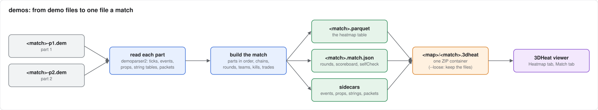

# CS2 demos and maps

**What is it?** Counter-Strike 2 can save a recording of a match, called a
*demo* (a `.dem` file). This tool turns a demo into files the 3DHeat viewer
can show in 3D: where everyone stood, died, threw and planted, round by
round. It can also turn a CS2 map into a 3D model to show them on.

**Why would I use it?** To review your own matches, to lay many matches of
one map over each other as one heatmap, and for match statistics such as
ADR (average damage a round) and KAST (the share of rounds a player killed,
assisted, survived or was traded) without a third-party site.

**Example:** `alpha-vs-bravo-m1.dem` in, `out/de_x/alpha-vs-bravo-m1.3dheat`
out - one file a match, which the viewer opens as it is.

In more detail: it turns Counter-Strike 2 demos into heatmap tables and match documents, and CS2 maps
into level geometry, for the [3DHeat viewer](https://github.com/Holdi601/3DHeat)
([documentation](https://holdi601.github.io/3DHeat/)) - or anything that reads
Parquet, JSON and glTF.

**Documentation: <https://holdi601.github.io/3DHeat-CS2/>** - a page per command
and output, with examples.



## Quick start for new users

You need: Windows, [Python](https://www.python.org/downloads/) 3.10 or later
("Add python.exe to PATH" ticked in its installer) and CS2 demos (`.dem`):
matches you download in the game land in `game\csgo\replays` in the CS2
install folder. Only for the map: Counter-Strike 2 installed and
Source2Viewer's command line build (below). No Git is needed.

1. Download the release,
   <https://github.com/Holdi601/3DHeat-CS2/archive/refs/tags/v1.0.3.zip>, and
   unpack it. Open PowerShell in the unpacked folder (`3DHeat-CS2-1.0.3`) and
   install what it needs; run every command from that folder:

   ```bash
   python -m pip install -r requirements.txt
   ```

2. Convert the demos (files or folders), and if you like the map:

   ```bash
   python -m heat3d_cs2 demos "C:\Program Files (x86)\Steam\steamapps\common\Counter-Strike Global Offensive\game\csgo\replays" -o out
   python -m heat3d_cs2 map <map> -o out\<map>\<map>.glb
   ```

   For `map`, download the **CLI** build from the
   [ValveResourceFormat releases](https://github.com/ValveResourceFormat/ValveResourceFormat/releases),
   unpack it anywhere and add `--source2viewer "<folder>\Source2Viewer-CLI.exe"`
   (or put it on `PATH`).
3. It prints `<n> match(es), <n> at a time` and then one line per match. The output is one `out\<map>\<match>.3dheat` per match (table,
   match document and everything else of the demo in one file), and
   `<map>.glb` for a map. A folder of a few hundred demos takes minutes;
   matches already written are skipped.
4. Open it in the [3DHeat viewer](https://github.com/Holdi601/3DHeat#quick-start):
   download the viewer (**Code -> Download ZIP**, unpack) and double-click
   `start.bat`; it offers to install [Node.js](https://nodejs.org/) when it is
   missing and opens Chrome or Edge at `http://127.0.0.1:5273`. There,
   **Source -> Files...** and pick the `.3dheat` files of one map (or drop them
   on the Source panel) for the heatmap; for rounds, kills and the scoreboard,
   the **Match** tab's **Load match files...** and the same files. The map
   goes in with **Background / level -> 3D model...**.

When a new release is out, the tool says so when it starts and offers to
update the folder from the release (`python -m heat3d_update` does the same).

## Install

New to the command line? Read [Before you start](https://holdi601.github.io/3DHeat-CS2/before-you-start.html) first.

Python 3.10 or later. Download the zip from
[Releases](https://github.com/Holdi601/3DHeat-CS2/releases) and unpack it (or,
if you have Git, clone the repository), open a terminal in that folder, then:

```bash
pip install -r requirements.txt
python -m heat3d_cs2 demos <demo files or folders> -o out   # every match in them
python -m heat3d_cs2 map <map> -o out/<map>/<map>.glb       # the map from the installed game
python -m heat3d_cs2 scoreboard out/<map>/<match>.3dheat    # a match's scoreboard as text
```

Words in `<angle brackets>` are placeholders: type your own file, folder or
map name instead (`de_x` below is a made-up map). After `demos` you should
see a line like `1 match(es), 1 at a time ...` and then one line per match;
matches you download in the game are under `game/csgo/replays` in the CS2
install folder; demos from a tournament site are wherever you saved them.

`map` needs Source2Viewer's command line build (see [The map](#the-map)).

## Commands

| Command | Option | Default | Does |
|---|---|---|---|
| `demos <paths>` | | | demo files (`.dem`, any case) and folders, searched recursively; parts of one match (`-p1`, `_p2`) are joined |
| | `-o`, `--out` | required | the folder to write into, a folder per map inside |
| | `--every N` | `8` | sample every player every *N* ticks (64 a second: 8 is eight samples a second); events always at their own tick |
| | `--jobs N` | half the cores | matches converted at once |
| | `--map TEXT` | | only matches whose file name contains *TEXT* |
| | `--force` | off | rewrite matches already written (else skipped) |
| | `--loose` | off | separate files per match instead of one `.3dheat` container |
| | `--container` | on | one `.3dheat` file per match (the default) |
| | `--no-bulk` | off | leave the entity stream, players' commands and animation out of the packets sidecar (the self-check counts them lost) |
| `map <name or .vpk>` | `-o`, `--out` | required | the `.glb` to write |
| | `--game FOLDER` | from Steam | the CS2 install folder |
| | `--source2viewer EXE` | `HEAT3D_SOURCE2VIEWER`, then `PATH` | the Source2Viewer CLI (this option first, then the variable, then `PATH`) |
| `layouts <names>\|all` | `-o`, `--out` | required | the folder beside the maps' `.glb` (or a `.json` for one map); `all`: every map with a `.glb` there |
| | `--game`, `--source2viewer` | as `map` | |
| `catalog` | `-o`, `--out` | `$HEAT3D_LEVELS/cs2` | every weapon, item and agent of the install as `catalog.json` |
| | `--vdata FILE` | | a decompiled `weapons.vdata` to read instead of the game's (for an older Source2Viewer) |
| `models` | `-o`, `--out` | `$HEAT3D_LEVELS/model-packs/cs2` | the agents', weapons', knives', grenades' and kit's models as a local model pack |
| | `--only WORD...`, `--force` | | only some units; rewrite units already written |
| | `--game`, `--source2viewer` | as `map` | (both commands) |
| `scoreboard <match>` | | | print a match's scoreboard as text, from its `.3dheat` or `.match.json` |

`python -m heat3d_cs2 <command> --help` lists the same. Every option with examples:
[Commands](https://holdi601.github.io/3DHeat-CS2/commands.html).


## Output

Output: one `.3dheat` file a match by default; `--loose` writes the separate
files instead. Per match, `demos` writes one file into a folder per map (`out/<map>/...`),
so a map's matches load together: `<match>.3dheat`, a
[`.3dheat` container](https://holdi601.github.io/3DHeat/container.html) - a ZIP
with a manifest naming each member's role. The members, or with `--loose` the
separate files:

- `<match>.parquet` (role `table`) - every player eight times a second (`--every 8` ticks of
  64) with everything the demo says of them, freeze time included, every
  grenade's flight, and every event where it happened, one row each: the
  heatmap's data.
- `<match>.match.json` (role `match`, the *match document*) - teams, score, every round (winner, how, economy, the
  plant, every kill in order, clutches, survivors), every player's
  scoreboard line, the chat, every event about no player, and the game's
  state as it changed: the match analysis' data. Its `selfCheck` says where
  everything of the demo went.
- `<match>.events.parquet`, `.props.parquet`, `.strings.parquet`,
  `.packets.parquet` (sidecar roles `events`, `props`, `strings`, `packets`) - everything else the demo holds, whole (see
  [Completeness](#completeness)).

A folder of a few hundred demos takes minutes (`--jobs`, half the cores by
default). Matches already written are skipped unless `--force`.


## The table

| Column | What |
|---|---|
| `match`, `map`, `round`, `roundId` | which match and round; `roundId` is `<match> #NN` |
| `phase` | `freeze` in freeze time, `live` until the round is decided, `after` while the winners hunt and the losers save |
| `time`, `roundTime` | seconds since the match started; since this round's freeze time ended |
| `event` | `position`, `kill` (where the killer stood), `death` (where the victim fell), `hurt` (the victim), `shot`, `slash` (a knife), `throw`, `grenade` (in flight), `smoke` / `flash` / `he` / `molotov` / `decoy` (where it went off), `blind` (the player flashed), `plant`, `defuse`, `explode`, `round_end` (one per player: what the round paid them in `earn_round_cs2`), `chat`, and every other game event about a player under the game's name (`item_pickup`, `player_footstep`, `weapon_reload`, `bomb_dropped`, ...) |
| `player`, `steamid`, `side`, `team` | who: `side` is `T` or `CT` this round, `team` the team's name |
| `x`, `y`, `z` | the game's own coordinates (inches, Z up) |
| `dirX`, `dirY`, `dirZ` | where a player looks, a unit vector in the same frame |
| `health`, `armor`, `money`, `equipment` | for positions |
| `weapon`, `place` | the weapon as the game names it (every knife skin as `Knife`); the map's own place name (none where a grenade went off) |
| `throwerPlace` | for a grenade going off: where its thrower was at that moment |
| `other`, `damage`, `duration` | the other player of a kill, hit or flash; health lost; seconds blinded |
| `headshot`, `opening`, `traded` | 0/1: a headshot; the round's first kill of an enemy; for a kill, a trade - for a death, avenged within 5 s |
| `noscope`, `attackerBlind` | 0/1, for a kill or death: a scoped weapon fired unscoped; the killer was flashed |
| `won`, `buy` | 0/1 whether this row's side won the round; its side's buy that round |
| `detail`, `text`, `entity` | every other field of the event as JSON; a chat line; a grenade's entity (flight, detonation and flashes share it) |
| `hitgroup`, `armorDamage`, `penetrated`, `throughSmoke`, `distance`, `assister` | where a bullet struck, armour lost; for a kill: walls, smoke, distance, assist |
| `state_helmet`, `state_defuser`, `state_kevlar`, `state_scoped`, `state_flashed`, `state_utility`, `state_weapon` | the player's state at the row's time, on every row naming a player (events take it from the last sample) |
| the player's state, on positions | flash, helmet, defuser, scoped, zoom, walking, crouch, airborne, buy and bomb zone, defusing, spotted and by whom, inventory, ammunition, recoil, ping, the game's scoreboard counts, money spent |

Every column, and which events fill which: [docs/output-table.md](docs/output-table.md).
Not in the table: the players' velocity (not in the demo: the parser derives it from
positions), voice, and grenade flights between the players' samples (every
tick in the props sidecar).

The file's Parquet footer carries reading instructions under the key
`heat3d`: which column is the position, the time, the player, the side, the
session and the look direction, how big a player is (32 units across, the
size a box replay draws one), and that the world is drawn with the vertical
as Y and the game's Y negated. CS2's world is right-handed with Z
up; drawn the way a left-handed Z-up world is, it comes out mirrored, A site
on the wrong side. The viewer reads the instructions and opens the file with
nothing to set.

## The conventions

Where the game does not define them:

- A death is **traded** when its killer is killed by one of the victim's
  teammates within 5 s; that kill is a **trade kill**.
- **KAST**: the share of rounds in which a player killed, assisted (a flash
  assist counts), survived, or was traded.
- **Damage** is health actually lost: a 137 damage headshot on a player with
  40 health is 40, as the scoreboard counts it. Enemies only.
- A **clutch** is being the last player alive on a side with enemies still
  standing; it is won when the side wins the round.
- **Buy**, per side, from the average equipment value when freeze time ends:
  the first round of each regulation half is a pistol round (the half as
  long as the match played it; overtime has none), then under $1,500 an eco,
  under $4,000 a force buy, anything more a full buy.

## Demos as they come

Demos from the wild are not all one clean file per match, and each of these
was met in a large collection of tournament demos:

- **A match split across files.** Parts are put in order by the round count,
  which carries on across them, then by the server's clock. A part's
  suffix (`-p1`, `-p2`) says nothing: a `-p2` can be the earlier half.
- **A server restarted mid-match** to restore a round starts its clock
  again; the next part still follows on.
- **Two different matches under one name** - the same teams on the same map
  at two events - overlap in their round counts and are written apart
  (`<match>-b`).
- **A round restored from a backup** inside one file leaves the players'
  old bodies in the demo beside the new ones for some seconds; each player
  keeps the row that leads on into where they go next.
- **A demo that starts late** (round 2) or ends during the last round says
  so (`missing`, `incomplete` in the match document) rather than guessing.
- **The clock.** Within a file, time is counted in ticks: the server's clock
  stands still through a pause while the ticks run on.
- **Coaches** on a team's side are never alive and are not players.

Checked over all of it: in every match the score follows the round winners, each side's kills are the other side's deaths,
and every round starts five against five.

The rest of the demo, checked on one real match: every player's kills and
damage counted from the events equal the game's own scoreboard counts at the
end, deaths within one; the health a `hurt` leaves equals the next sample's
unless the player was hit again before it; every smoke, flash, HE and decoy
that went off has a flight with its entity, ending a median 0 units from
where it went off - the fires carry the fire's entity, not the bottle's.

## Completeness

3DHeat's converters keep everything a recording holds:
[Converters keep everything](https://github.com/Holdi601/3DHeat/blob/main/docs/converters.md).
Beside each match's table and document, `demos` writes four sidecars, each
with `time` on the table's clock (empty before the first tick), the demo's
`tick` and `part` (which file of the match, in order), and the match
document's `selfCheck.completeness` counts, for every kind of thing as the
demo has it - every event name, every property class, every network message
and frame, every string table - how many there were, how many went into the
table or document in part (`partial`), how many only into a sidecar (`raw`),
and how many were lost.

### Read

Into the table and the document: as above. What the sidecars decode besides,
each checked against something independent on five demos and over the whole
collection (below):

- **Console variables** (`net_SetConVar`, `decoded` in `packets`): every name
  and value equals the parser's `server_cvar` (which repeats the start's list
  once per stretch of the demo it reads apart).
- **Chat lines** (`UM_SayText2`): speaker, text and kind equal the parser's
  `chat_message`, tick for tick.
- **The server's info** (`svc_ServerInfo`): the map and the game folder equal
  the demo's header, the tick interval is 1/64 s.
- **String tables created** (`svc_CreateStringTable`): the table's name, the
  same as the tables' own snapshot.
- **Players' entries** (`userinfo` in `strings`): name, steamid, user id, bot
  or SourceTV; every player the parser lists is there with the same steamid
  (names can differ: the entry is from the start, `Player` where the
  scoreboard later says `Coach | Player`).

### Kept raw

- `<match>.events.parquet` - every game event the parser reads, warmup and
  all, every key as the parser gives it (`decoded`: the players named by
  name and steamid, not where they stood - that is in `props`); `name` and
  `player` the event's player, `entity` its entity where it has one.
- `<match>.props.parquet` - every property the parser can read, one row each
  time it changed (`type` the property's path, `value` a number - flags 0/1 -
  `vector` a list of numbers, `decoded` anything else as JSON, whole numbers
  past 2^53 as text): every player's pawn and controller, their active weapon
  (`Weapon.*`), their commands (`usercmd_*`: view angles, buttons, mouse,
  moves), keyed by the controller's entity with `name` and `player` (steamid);
  the game rules (entity -1), the teams (entity 2/3, `CCSTeam`), and every
  grenade, held or flying, by its own entity, its class as `name` and its
  thrower as `player`. Read a tick at a time, the demo's own resolution: a
  first value, each change, and where a value went empty.
- `<match>.strings.parquet` - every entry of every string table snapshot
  (`type` the table, `name` the key, `entity` the index, `payload` the data;
  each table also as a row of its own, index -1), the players' entries decoded.
- `<match>.packets.parquet` - every other frame and network message, whole,
  in file order (`seq`): `type` `message <n>` or `frame <n>`, `name` Valve's
  name where it was matched, `payload` the bytes. Among them the server info,
  string table updates, sounds, user messages (the end-of-match scoreboard
  data, player stats, weapon sounds, text messages), temp entities, the game
  events as sent (with their list), the bullets, SourceTV status, the send
  tables and class list (what a decoder of the entity stream needs), and -
  unless `--no-bulk` - the bulk: the entity stream (`svc_PacketEntities`),
  the players' commands (`svc_UserCmds`, sub-tick inputs) and the animation
  stream (`DEM_AnimationData`).

The bulk is over half a demo's size even compressed (the commands about a
quarter, the animation and the entities each about a seventh); everything else together
is about a tenth (props 8%, packets without the bulk 2%, events, strings).
`--no-bulk` leaves it out, and the self-check then counts it lost, by name.

### Not available

- **Entities the parser does not read**: the world, dropped weapons, the
  bomb, fires, chickens, doors - and the properties it lists but gives no
  value for (`unreadProps` in the self-check: weapon lists, ammunition,
  purchase records, fire positions). They are in the entity stream, kept
  whole with what decoding it needs, but not decoded here.
- **Within a tick**: the props are as the parser has them at each tick, the
  demo's own resolution; the sub-tick inputs are in the commands, whole.
- **Voice**: these SourceTV demos announce a voice codec (`svc_VoiceInit`,
  Speex) but carry no voice data; where a demo does (`svc_VoiceData`), it is
  kept whole in `packets`.
- **A file with no round in it** (a pause, warmup only) belongs to no match
  and is not written; the command line names it.

## The map

`map` exports the world's collision mesh - what players stand on and hide
behind, without the decoration - from the map's `.vpk` in the installed
game, using Source2Viewer's command line
([ValveResourceFormat](https://github.com/ValveResourceFormat/ValveResourceFormat),
MIT licensed; download the CLI build, then put it on `PATH`, set
`HEAT3D_SOURCE2VIEWER` or pass `--source2viewer`). Clip brushes and the sky
are left out; each surface is split into ground (facing up, walkable) and
structure. It is written in the frame the tables are drawn in.

The check that the frame is right is the players standing on it: over a
match on each map of the current competitive pool, 99.9-100% of player
samples have ground beneath them, a few centimetres below their feet. The
same maps mirrored leave well under two thirds over ground.

## Bomb sites, buy zones and spawns

`layouts` reads a map's entities from its `.vpk` the same way and writes
`<map>.layouts.json` beside its `.glb`: each bomb site and buy zone as its
outline seen from above with its floor and height (the brush's own shape),
hostage spots and rescue zones on a hostage map, and every T and CT spawn
point with its heading. A layout for `competitive`, and for `wingman` where
the map has spawns of its own for it. Teams are 1 (T) and 2 (CT), in the frame
the tables and the map are drawn in. The viewer draws them on the map in its
**Objectives** panel.

```bash
python -m heat3d_cs2 layouts <map> -o out/<map>
python -m heat3d_cs2 layouts all -o levels/cs2
```

A map whose entity file is newer than the Source2Viewer build can read says so
and is skipped; a newer Source2Viewer reads it.

## Catalogue and models

`catalog` reads the install's item definitions (`scripts/items/items_game.txt`,
`scripts/weapons.vdata`) and English names, and writes `catalog.json`: each
weapon and item with its class, side and numbers (price, damage, magazine,
fire rate, armour penetration, speed), and each agent with its side and unit.
The viewer names and sorts what a demo holds with it.

`models` exports each agent's third-person body and each weapon's world model
through Source2Viewer, simplified to three levels of detail, one `.glb` each,
with `model-pack.json`; an agent's hit capsules are grouped into the game's hit
groups (head, chest, stomach, arms, legs). The viewer draws them in place of
its built-in figures.

Both need a Source2Viewer build that reads the installed game's
`weapons.vdata` (21.1 reads the current one). With an older build, `catalog`
leaves out the weapons' numbers and `models` the knives, grenades and kit; give
`catalog --vdata <decompiled weapons.vdata>` instead, or update Source2Viewer.

```bash
python -m heat3d_cs2 catalog
python -m heat3d_cs2 models
```

Both read only the installed game and write only on this machine; nothing they
make is uploaded or meant to be shared.

## What to point it at

Your own matches' demos, demos you downloaded from a tournament site by hand,
demos from an API you have access to. A demo is a recording of a match whose
content belongs to its publisher and organisers; use what comes out for your
own analysis, and do not redistribute demos or data derived from them. The tool
reads demos from disk and downloads none, and nothing from the game ships with
it: no game files, no game code, no DLLs.

3DHeat CS2 is not affiliated with or endorsed by Valve. Counter-Strike 2 and
related names and trademarks belong to their owners. Rights holders: open an
issue at <https://github.com/Holdi601/3DHeat-CS2/issues> - we respond quickly and remove
anything on request.

## Tests

```bash
python -m pytest
HEAT3D_CS2_DEMO=<a demo> HEAT3D_SOURCE2VIEWER=<cli> python -m pytest   # also the floor check on a real map
```

---

## Part of 3DHeat

3DHeat CS2 is one of the free tools around the 3DHeat viewer. Each is its own
project, with its own releases and licence:

| Tool | What it does | Docs |
|---|---|---|
| [3DHeat](https://github.com/Holdi601/3DHeat) | the viewer: heatmaps, race analysis and match review in 3D | [site](https://holdi601.github.io/3DHeat/) |
| [GameFiles](https://github.com/Holdi601/3DHeat-GameFiles) | courses and levels out of the files games ship, as 3D models | [site](https://holdi601.github.io/3DHeat-GameFiles/) |
| [GameCapture](https://github.com/Holdi601/3DHeat-GameCapture) | lap telemetry from racing games; levels rebuilt from gameplay video | [site](https://holdi601.github.io/3DHeat-GameCapture/) |
| [Unreal Exporter](https://github.com/Holdi601/3DHeat-UnrealExporter) | an Unreal Editor plugin that exports a level as one 3D model | [site](https://holdi601.github.io/3DHeat-UnrealExporter/) |
| [CS2](https://github.com/Holdi601/3DHeat-CS2) | Counter-Strike 2 demos into tables and match documents; maps into 3D models | [site](https://holdi601.github.io/3DHeat-CS2/) |
| [Watcher](https://github.com/Holdi601/3DHeat-Watcher) | records what games publish about your play, in the background | [site](https://holdi601.github.io/3DHeat-Watcher/) |
| [Ext-WarThunder](https://github.com/Holdi601/3DHeat-Ext-WarThunder) | War Thunder replays into tables and match documents | [site](https://holdi601.github.io/3DHeat-Ext-WarThunder/) |
| [Ext-WoT](https://github.com/Holdi601/3DHeat-Ext-WoT) | World of Tanks replays into tables and match documents | [site](https://holdi601.github.io/3DHeat-Ext-WoT/) |
| [Ext-WoWs](https://github.com/Holdi601/3DHeat-Ext-WoWs) | World of Warships replays into tables and match documents | [site](https://holdi601.github.io/3DHeat-Ext-WoWs/) |
| [Ext-Squad](https://github.com/Holdi601/3DHeat-Ext-Squad) | Squad server demos into tables and match documents | [site](https://holdi601.github.io/3DHeat-Ext-Squad/) |
| [Ext-DCS](https://github.com/Holdi601/3DHeat-Ext-DCS) | DCS World maps into 3D models | [site](https://holdi601.github.io/3DHeat-Ext-DCS/) |
| [Ext-IL2](https://github.com/Holdi601/3DHeat-Ext-IL2) | IL-2 Sturmovik maps into 3D models | [site](https://holdi601.github.io/3DHeat-Ext-IL2/) |
| [Ext-Dota](https://github.com/Holdi601/3DHeat-Ext-Dota) | the Dota 2 map from your own install as a 3D level | [site](https://holdi601.github.io/3DHeat-Ext-Dota/) |
| [Ext-DotaReplay](https://github.com/Holdi601/3DHeat-Ext-DotaReplay) | Dota 2 replays | [site](https://holdi601.github.io/3DHeat-Ext-DotaReplay/) |
| [Ext-Riot](https://github.com/Holdi601/3DHeat-Ext-Riot) | League of Legends and VALORANT replays (what they carry unencrypted) | [site](https://holdi601.github.io/3DHeat-Ext-Riot/) |
| [Ext-Forza](https://github.com/Holdi601/3DHeat-Ext-Forza) | Forza courses, races and cars from your own install | [site](https://holdi601.github.io/3DHeat-Ext-Forza/) |
| [Ext-Battlefield](https://github.com/Holdi601/3DHeat-Ext-Battlefield) | Battlefield levels (Frostbite) as 3D levels | [site](https://holdi601.github.io/3DHeat-Ext-Battlefield/) |
| [Ext-BeamNG](https://github.com/Holdi601/3DHeat-Ext-BeamNG) | BeamNG.drive courses | [site](https://holdi601.github.io/3DHeat-Ext-BeamNG/) |
| [Ext-ACRally](https://github.com/Holdi601/3DHeat-Ext-ACRally) | Assetto Corsa Rally stages as courses | [site](https://holdi601.github.io/3DHeat-Ext-ACRally/) |
| [Ext-Reforger](https://github.com/Holdi601/3DHeat-Ext-Reforger) | Arma Reforger worlds (Enfusion) as 3D levels | [site](https://holdi601.github.io/3DHeat-Ext-Reforger/) |
| [Ext-R6](https://github.com/Holdi601/3DHeat-Ext-R6) | Rainbow Six Siege match replays | [site](https://holdi601.github.io/3DHeat-Ext-R6/) |

## Updates

3DHeat CS2 checks this repository's releases when it starts (at most every few
hours, never holding it up for more than a few seconds), says when a newer
version is out, and offers to update: a clone with `git pull` when it has no
local changes, a downloaded copy by replacing its files from the release archive,
after checking the archive is the version it claims. Your own files - recordings,
settings, exports - are never touched. To update on request: `python -m heat3d_update`.
`HEAT3D_NO_UPDATE=1` switches the check off.

## Licence

MIT - see [`LICENSE`](LICENSE), and [`LICENSES.md`](LICENSES.md) for the
third-party packages it uses.

Documentation: <https://holdi601.github.io/3DHeat-CS2/> (the source pages are in
[`docs/`](docs/)). The viewer: <https://github.com/Holdi601/3DHeat>,
<https://holdi601.github.io/3DHeat/>.
