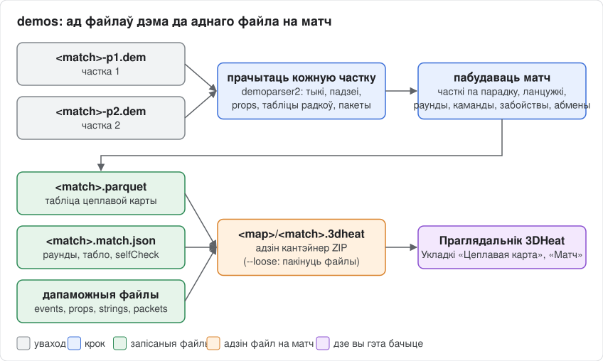

# 3DHeat CS2 {#dheat-cs2}

**Што гэта?** Counter-Strike 2 можа захаваць запіс матча, які завецца
*дэма*. Гэты інструмент ператварае дэма ў файлы, якія праглядальнік 3DHeat можа паказаць у 3D:
дзе ўсе стаялі, гінулі, кідалі і закладалі бомбу, раунд за раундам. Ён таксама можа
ператварыць карту CS2 у 3D-мадэль, на якой гэта паказваецца.

**Навошта гэта мне?** Каб разбіраць свае матчы, накладваць шмат матчаў
адной карты адзін на аднаго як адну цеплавую карту і для статыстыкі матчаў, напрыклад ADR
(сярэдні ўрон за раунд) і KAST (доля раундаў, у якіх гулец забіў,
дапамог, выжыў або быў абменены).

**Прыклад:** на ўваходзе `alpha-vs-bravo-m1.dem`, на выхадзе `out/de_x/alpha-vs-bravo-m1.3dheat`
(`de_x` — выдуманая назва карты).



Больш падрабязна: 3DHeat CS2 ператварае **дэма Counter-Strike 2** у табліцу цеплавой карты і дакумент
матча на кожны матч, а **карту CS2** — у геаметрыю ўзроўню. Вынікі зроблены
для праглядальніка тэлеметрыі [3DHeat](https://holdi601.github.io/3DHeat/)
([код](https://github.com/Holdi601/3DHeat)), але гэта
звычайныя файлы - Parquet, JSON і двайковы glTF - якія можа
прачытаць і што-небудзь іншае.

Гэта маленькі пакет Python, `heat3d_cs2`, які запускаецца з каманднага радка. Ён чытае
дэма з дыска (нічога не спампоўвае) праз
[demoparser2](https://github.com/LaihoE/demoparser) і экспартуе карты з
усталяванай гульні праз кансольную зборку Source2Viewer
([ValveResourceFormat](https://github.com/ValveResourceFormat/ValveResourceFormat)).

## Хуткі старт {#quick-start}

Упершыню ў камандным радку? Спачатку прачытайце [Перад пачаткам](before-you-start.md).

```bash
pip install -r requirements.txt
python -m heat3d_cs2 demos <demo files or folders> -o out   # every match in them
python -m heat3d_cs2 map <map> -o out/<map>/<map>.glb       # the map from the installed game
python -m heat3d_cs2 scoreboard out/<map>/<match>.3dheat    # a match's scoreboard as text
```

Вы ўбачыце `1 match(es), 1 at a time ...`, а потым па радку на матч
(гл. [Каманды](../commands.md#what-is-printed)).

`demos` піша на матч адзін файл у папку з назвай карты:
`out/<map>/<match>.3dheat`, [кантэйнер `.3dheat`](../output-container.md) — фармат
праглядальніка «адзін файл на матч» ([спецыфікацыя](https://holdi601.github.io/3DHeat/container.html)).
Ён змяшчае гэтыя члены; `--loose` піша іх замест гэтага як асобныя файлы:

| Член | Што ў ім | Дзе загружаецца ў праглядальніку |
|---|---|---|
| `<match>.parquet` (роля `table`) | кожны жывы гулец восем разоў за секунду са сваім станам (здароўе, грошы, асляпленне, прыцэл, зона, інвентар, ...), і кожная падзея там, дзе яна адбылася (забойства, смерць, пашкоджанне, стрэл, кідок, выбухі гранат, асляпленне, закладка, абясшкоджанне, выбух і канец раунда на гульца з тым, што раунд яму прынёс), па адным радку | Укладка «Цеплавая карта» |
| `<match>.match.json` (роля `match`, дакумент матча) | каманды, лік, кожны раунд (пераможца, як, эканоміка, закладка, забойствы па парадку, клатчы, тыя, хто выжыў) і радок табло кожнага гульца | Укладка «Матч» |
| `<match>.events/props/strings/packets.parquet` | усё астатняе, што ёсць у дэма, цалкам (дадатковыя файлы) | захоўваецца для паўнаты |

`map` піша `<map>.glb`: меш сутыкненняў карты - падлогі, сцены, скрынкі,
без аздаблення - падзелены на зямлю і пабудовы, у той жа сістэме каардынат і
адзінках, што і табліцы, таму ён ляжыць дакладна пад цеплавой картай (панэль «Фон / узровень»).

## Карта гэтай дакументацыі {#map-of-this-documentation}

| Старонка | Пра што яна |
|---|---|
| [Перад пачаткам](before-you-start.md) | Python, тэрмінал, запаўняльнікі, як выглядаюць поспех і частыя памылкі |
| [Усталёўка](../installing.md) | Python, пакеты, CLI Source2Viewer, дзе павінна быць CS2 |
| [Каманды](../commands.md) | `demos`, `map`, `scoreboard`: кожная опцыя, што друкуецца, коды выхаду |
| [Чытанне дэма](../reading-demos.md) | што чытаецца з файла дэма: выбраныя тыкі, уласцівасці гульцоў, правілы гульні, падзеі |
| [Пабудова матча](../building-matches.md) | часткі і ланцужкі, гадзіннік матча, раунды, каманды і бакі, радкі, забойствы, абмены, адкрыцці, урон, асляпленні, эканоміка |
| [Статыстыка](../statistics.md) | табло: K/D/A, ADR, KAST, HS%, адкрыцці, абмены, мульці-забойствы, клатчы, утыліты, асляпленні |
| [Табліца цеплавой карты](../output-table.md) | файл Parquet: кожны слупок, яго тып, якія падзеі яго запаўняюць, падказкі ў калантытуле `heat3d`, восі |
| [Дакумент матча](../output-match-json.md) | дакумент `.match.json`, поле за полем |
| [Адзін файл на матч](../output-container.md) | кантэйнер `.3dheat`, які `demos` піша па змаўчанні, `--loose` |
| [Экспарт карты](../map-export.md) | як экспартуецца меш сутыкненняў карты, сістэма каардынат, імёны вузлоў, адзінкі |
| [Выкарыстанне з 3DHeat](../using-with-3dheat.md) | загрузка табліц, дакументаў матчаў і карт на ўкладкі «Цеплавая карта» і «Матч» праглядальніка |
| [Абмежаванні](../limits.md) | што дапушчана, што не апрацоўваецца, што не правярана |
| [Абнаўленні](../updates.md) | праверка выпуску на старце і `python -m heat3d_update` |
| [Распрацоўка](../development.md) | структура кода, тэсты, сінтэтычнае дэма |
| [Даведнік каманд](../cli-reference.md) | `--help` кожнай каманды, створаны з кода |
| [Падтрымка](../maintaining.md) | спіс для выпуску гэтых старонак |

## Супраць чаго гэта правярана {#what-it-is-checked-against}

Дэма з рэальнага жыцця — гэта не адзін чысты файл на матч. Пераўтваральнік апрацоўвае
матч, раздзелены на файлы ў любым парадку, сервер, перазапушчаны сярод матча, два
розныя матчы пад адным імем, раунды, адноўленыя з рэзервовай копіі, запіс,
які пачынаецца позна або заканчваецца рана, паўзы і трэнераў на баку каманды -
гл. [Пабудова матча](../building-matches.md). Правярана на вялікай калекцыі
турнірных дэма: у кожным матчы
лік адпавядае пераможцам раундаў, забойствы кожнага боку — гэта смерці другога,
і кожны раунд пачынаецца пяць супраць пяці.

## На што яго накіроўваць {#what-to-point-it-at}

На дэма вашых уласных матчаў, дэма, спампаваныя ўручную з турнірнага сайта,
або дэма з API, да якога ў вас ёсць доступ. Дэма — гэта запіс, чый змест
належыць яго выдаўцу і арганізатарам: выкарыстоўвайце вынік для ўласнага
аналізу і не распаўсюджвайце дэма або вытворныя ад іх даныя. Сайты, што
прапануюць дэма, часта забараняюць аўтаматычнае спампоўванне ў сваіх умовах, таму
інструмент чытае дэма з дыска і нічога не спампоўвае.

## Частка 3DHeat {#part-of-3dheat}

3DHeat CS2 — адзін з бясплатных інструментаў вакол праглядальніка 3DHeat, кожны са сваім
рэпазітарыем, выпускамі і ліцэнзіяй:

| Інструмент | Што ён робіць | Дакументацыя |
|---|---|---|
| [3DHeat](https://github.com/Holdi601/3DHeat) | праглядальнік: цеплавыя карты, аналіз гонак і разбор матчаў у 3D | [сайт](https://holdi601.github.io/3DHeat/) |
| [GameFiles](https://github.com/Holdi601/3DHeat-GameFiles) | трасы і ўзроўні з файлаў, што пастаўляюць гульні, як 3D-мадэлі | [сайт](https://holdi601.github.io/3DHeat-GameFiles/) |
| [GameCapture](https://github.com/Holdi601/3DHeat-GameCapture) | тэлеметрыя кругоў з гоначных гульняў; узроўні, узноўленыя з відэа гульні | [сайт](https://holdi601.github.io/3DHeat-GameCapture/) |
| [Unreal Exporter](https://github.com/Holdi601/3DHeat-UnrealExporter) | убудова Unreal Editor, што экспартуе ўзровень як адну 3D-мадэль | [сайт](https://holdi601.github.io/3DHeat-UnrealExporter/) |
| [CS2](https://github.com/Holdi601/3DHeat-CS2) | дэма Counter-Strike 2 у табліцы і дакументы матчаў; карты ў 3D-мадэлі | [сайт](https://holdi601.github.io/3DHeat-CS2/) |
| [Watcher](https://github.com/Holdi601/3DHeat-Watcher) | запісвае ў фоне тое, што гульні публікуюць пра вашу гульню | [сайт](https://holdi601.github.io/3DHeat-Watcher/) |
| [Ext-WarThunder](https://github.com/Holdi601/3DHeat-Ext-WarThunder) | рэплеі War Thunder у табліцы і дакументы матчаў | [сайт](https://holdi601.github.io/3DHeat-Ext-WarThunder/) |
| [Ext-WoT](https://github.com/Holdi601/3DHeat-Ext-WoT) | рэплеі World of Tanks у табліцы і дакументы матчаў | [сайт](https://holdi601.github.io/3DHeat-Ext-WoT/) |
| [Ext-WoWs](https://github.com/Holdi601/3DHeat-Ext-WoWs) | рэплеі World of Warships у табліцы і дакументы матчаў | [сайт](https://holdi601.github.io/3DHeat-Ext-WoWs/) |
| [Ext-Squad](https://github.com/Holdi601/3DHeat-Ext-Squad) | дэма сервераў Squad у табліцы і дакументы матчаў | [сайт](https://holdi601.github.io/3DHeat-Ext-Squad/) |
| [Ext-DCS](https://github.com/Holdi601/3DHeat-Ext-DCS) | карты DCS World у 3D-мадэлі | [сайт](https://holdi601.github.io/3DHeat-Ext-DCS/) |
| [Ext-IL2](https://github.com/Holdi601/3DHeat-Ext-IL2) | карты IL-2 Sturmovik у 3D-мадэлі | [сайт](https://holdi601.github.io/3DHeat-Ext-IL2/) |

## Ліцэнзія {#licence}

MIT - гл. [`LICENSE`](https://github.com/Holdi601/3DHeat-CS2/blob/main/LICENSE)
і [`LICENSES.md`](https://github.com/Holdi601/3DHeat-CS2/blob/main/LICENSES.md)
пра староннія пакеты і тое, што патрабуюць гульні, якія ён чытае.
