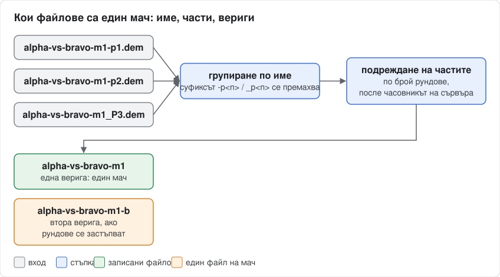

# Изграждане на мач {#building-a-match}

Как се сглобява мач от частите на демото: кои файлове принадлежат заедно, един общ часовник за всичките, рундовете и кой как е спечелил, отборите и страните им, и всеки ред от топлинната таблица - с убийства, размени, първи убийства, щети, заслепявания и икономика. Код:
[`heat3d_cs2/match.py`](https://github.com/Holdi601/3DHeat-CS2/blob/main/heat3d_cs2/match.py).
Таблото със статистиките, изчислено от него, е на [Статистика](statistics.md).

## Общ преглед {#overview}

1. Чете се всеки файл с името на мача ([Четене на демо](reading-demos.md)).
2. Дублираните редове на играчите във всеки файл (възстановени рундове) се оправят.
3. Файловете се подреждат във **вериги** - мачове - и всяка верига се нарежда по ред.
4. Всяка част се поставя на **часовника на мача**.
5. **Рундовете** се намират във всяка част; по-късната част за даден рунд замества по-ранната.
6. **Играчите** и **отборите** получават имена, а страните и резултатът на всеки рунд се дават по име на отбор. Когато страните са известни, се определят дължината на полувремето, пистолните рундове и **покупката** на всяка страна.
7. Изграждат се **редовете**: позиции, изстрели, хвърляния, взривявания, поставяне и обезвреждане на бомба, убийства, смъртни случаи, нараняване, заслепявания, експлозии.
8. Всеки ред получава етикет: рунд, фаза, време в рунда, дали страната му е спечелила и покупката на страната. Редовете извън всеки рунд се отхвърлят.

## Възстановени рундове: един ред на играч на тик {#restored-rounds-one-row-per-player-per-tick}

Когато рунд се възстановява от резервно копие в рамките на един файл, демото носи за няколко секунди и старите тела на играчите заедно с новите: два реда за един играч в един тик - единият там, където закръгленият рунд ги е оставил, другият на мястото на новото появяване в рунда. За всеки такъв играч дублираните тикове се обхождат **назад**, започвайки от първия единичен ред след тях: на всеки тик се запазва кандидатът, най-близък до позицията, която следва, и той става отправна точка за предишния тик. Ако след тях няма единичен ред, се запазва последният кандидат. Така всеки играч запазва реда, който води напред към мястото, където отива.

## Живата част на файла {#the-live-part-of-a-file}

**Живото начало** на файл е тикът на последното му събитие `round_announce_match_start`, а ако няма такова - тик 0 (по-късна част от разделен мач обикновено няма). Всичко преди живото начало се пропуска, също и всичко с отметка `is_warmup_period`. Ножов рунд или рестарт преди обявяването се пропускат; ножов рунд, *който не е* последван от обявяване на начало на мача, не се разпознава като такъв (вижте [Ограничения](limits.md)).

**Рундовете** на файл са събитията `round_freeze_end` от живото начало нататък, извън загряването, разпознати по `total_rounds_played` (номерът на рунда, считан от 0 - индексът на рунда, който предстои). Файл без такива няма рундове и не принадлежи на никой мач.

## Часовникът {#the-clock}

Времето е в секунди. В рамките на файл времето се брои в **тикове**: `game_time` на сървъра при първия взет тик плюс изминалите тикове / 64. Собственият часовник на сървъра спира по време на пауза, докато тиковете продължават; ако се четеше през часовника, два момента от паузиран мач щяха да имат едно и също време.

Всеки файл има *първи часовник* (времето в живото му начало) и *последен часовник* (в последния му взет тик).

### Части и вериги {#parts-and-chains}

Файловете, означени като един мач ([Команди](commands.md#which-files-are-one-match)), първо се подреждат по индекса на първия си рунд, после по първия си часовник. След това всеки, в този ред, се присъединява към първата верига, която продължава, или започва нова верига. Част продължава верига, когато индексът на първия ѝ рунд е поне индексът на последния рунд на последната част във веригата, **и** важи едно от двете:

- часовникът на сървъра върви нататък: първият му часовник не е по-рано от последния часовник на веригата минус 5 s; или
- броенето на рундовете върви нататък: индексът на първия ѝ рунд е равен на последния индекс на веригата или е следващият след него.

Решава броенето на рундовете, а часовникът разрешава спорните случаи, защото сървър, рестартиран за възстановяване на рунд, пуска часовника си отново, докато два различни мача с едно и също име (същите отбори на същата карта на две различни събития) имат припокриващи се бройки на рундовете. Веригите се подреждат по брой обхванати рундове, най-много първо; първата запазва името на мача, другите се записват като `<име>-b`, `<име>-c` и така нататък.

### Часовникът на мача {#the-match-clock}

Нулата на мача е първият часовник на първата част: **време 0 в мача е живото начало на първия файл**. Всяка следваща част се поставя спрямо него:

- където часовникът на сървъра върви нататък (първият му часовник не е по-рано от последния часовник на предишната част минус 5 s), използва се часовникът на сървъра, както е;
- където е рестартиран, частта се поставя да следва **една секунда** след края на предишната.

## Рундове {#rounds}

За всеки `round_freeze_end` на част (по ред на тиковете) прозорецът на рунда продължава до следващия freeze end в същата част или до края на файла. В него рундът е **решен** на първия взет тик, където състоянието на играта показва `total_rounds_played` = индекс на рунда + 1 и `round_win_status` 1 (равен), 2 (спечелили са Т) или 3 (спечелили са CT). Рунд без такава проба в прозореца си е прекъснат от края на файла; номерът му отива в списъка **incomplete** на мача (освен ако друга част има рунда пълен).

| Поле на рунда | От какво идва |
|---|---|
| `number` | индексът + 1 (от 1, както брои играта) |
| `start` | време на мача в края на freeze time - играчите могат да се движат |
| `end` | време на мача на първата проба, показваща рунда като решен |
| `until` | време на мача на следващия `round_prestart` след `end`, ако е в прозореца; иначе краят на прозореца или последният тик на файла, което настъпи първо (и никога преди `end`) |
| `winner` | `T` за статус 2, `CT` за 3, празно за 1: равенството е решено, без победител |
| `reason` | `round_win_reason` на тази проба, наречено както е по-долу |
| `score` | име на отбор -> спечелени рундове след този: `team_rounds_total` на всяка страна при решаващата проба; когато демото няма такова поле - резултатът от предишния рунд плюс едно за победителя |
| `sides` | име на отбор -> `T` / `CT` в този рунд |
| `equipment` | страна -> сборът от `current_equip_value` на **живите** играчи на страната при първата проба от freeze end нататък |
| `buy` | страна -> `pistol`, `eco`, `force` или `full` ([Икономика](#икономика-и-видове-покупка)) |
| `plant` | първото `bomb_planted` след freeze end и до `end`, или няма |
| `exploded` | време на мача на първото `bomb_exploded` след това поставяне и преди следващия freeze end, ако има такова (не е в документа на мача; определя времето на реда `explode`) |

`reason`, от `CSRoundEndReason` на играта:

| Код | `reason` |
|---|---|
| 1 | `bomb` (целта е взривена) |
| 7 | `defuse` (обезвредена) |
| 8, 9 | `elimination` (CT печелят / Т печелят с елиминиране) |
| 10 | `draw` (равенство) |
| 12 | `time` (целта е спасена) |
| 17, 18 | `surrender` (предаване) |
| всичко друго | `other` |

Когато няколко части съдържат един и същ рунд (по индекс), запазва се версията от по-късната част. Рундовете после се подреждат по индекс. Мач, чийто първи рунд не е рунд 1, записва липсващите номера (`missing` в документа на мача); командният ред показва *записано от рунд N*.

### Поставянето на бомбата {#the-plant}

| Поле | От какво идва |
|---|---|
| `site` | `A` или `B`: зоната на бомбата, в която играта казва, че е стоял поставящият (`which_bomb_zone`, 1 A, 2 B); без нея - името на мястото на поставящия (`BombsiteA`, `BombsiteB`); без и него - буквата, която друго поставяне на същия файл в същата зона е дало (номерът на събитието е номерът на обекта на зоната). Празно, когато нищо не казва - никога номер. |
| `time` | секунди **в рунда** (от freeze end), както времето на убийство |
| `player`, `steamid` | поставящият |
| `x`, `y`, `z` | позицията на поставящия в игровите единици: където лежи бомбата |
| `place` | името на мястото на поставящия при поставянето |

### Фазите {#the-phases}

Времето от `start` до `end` е **живата** фаза на рунда; от `end` до `until` - неговата **след** фаза, в която победителите търсят, а губещите се пазят. Ред принадлежи на рунда, чийто интервал `[start, until)` съдържа времето му, и е `after`, когато времето му е по-късно от `end`. Freeze time е между рундовете и не принадлежи на никой.

## Играчи и отбори {#players-and-teams}

**Играч** е всеки, който е бил жив поне веднъж в страна (отбор 2 или 3), извън freeze time и загряване, след живото начало. Треньор или коментатор на страната на отбор никога не е жив и не е играч. Всеки играч се идентифицира по Steam ID; името е последното видяно.

**Отборът** на играча е името на клана, което играта дава на страната му (`team_clan_name`) - това, което е видяно най-често за него; демото го изчиства в самия си край. Мач, изигран без имена на кланове, именува отборите по страната, на която са започнали: `Started T` и `Started CT`.

Страните на всеки рунд идват от това кой е бил на коя страна между freeze end и края на рунда: на всяка страна се дава етикетът на отбора, който най-много от играчите ѝ носят. Списъкът `teams` на мача е в реда на появяване, рунд по рунд, страна T преди CT; обикновено първо е отборът, започнал на T.

## Редовете {#the-rows}

Всяка проба на позиция и всяко събитие става един ред от [топлинната таблица](output-table.md). Играчите са на страна само когато `team_num` е 2 или 3.

### Позиции {#positions}

От взетите редове на живи играчи на страна, извън freeze time и загряване, след живото начало: позиция, посока на погледа, здраве, броня, пари, стойност на екипировката, оръжие в ръка, място.

Посоката на погледа е единичен вектор в координатната система на играта:
`(cos pitch * cos yaw, cos pitch * sin yaw, -sin pitch)` - pitch в играта е положителен, когато се гледа надолу, затова гледането надолу дава отрицателна Z.

Оръжието в ръка е `active_weapon_name`, както го нарича играта, с едно изключение: всяко име, което съдържа `Knife`, `Bayonet`, `Karambit` или `Daggers`, става `Knife`.

### Изстрели и хвърляния {#shots-and-throws}

От `weapon_fire`, на позицията на стрелеца. Ножовете (`knife`, `bayonet` в идентификатора на оръжието) и C4 се пропускат. Гранатите (`smokegrenade`, `flashbang`, `hegrenade`, `molotov`, `incgrenade`, `decoy`) са редове **throw** (хвърляне), всичко друго - редове **shot** (изстрел). Оръжието се назовава така, както го показва играта (по-долу).

### Взривявания на гранати {#grenade-detonations}

| Събитие | Ред | `weapon` |
|---|---|---|
| `smokegrenade_detonate` | `smoke` | Smoke Grenade |
| `flashbang_detonate` | `flash` | Flashbang |
| `hegrenade_detonate` | `he` | High Explosive Grenade |
| `inferno_startburn` (молотов и запалителна) | `molotov` | Molotov |
| `decoy_detonate` | `decoy` | Decoy Grenade |

Позицията е **къде е избухнала гранатата** (`x`, `y`, `z` на събитието); играчът и страната са на хвърлящия. Демото не посочва място за граната, а само за играчи, затова `place` остава празно: редът не твърди място, на което не е бил. Мястото на хвърлящия в този момент се запазва като `throwerPlace`.

### Поставяне и обезвреждане {#plants-and-defuses}

Редове `plant` и `defuse` на позицията на играча, оръжие `C4 Explosive`. Поставена бомба, която е избухнала, получава ред **explode**: на позицията на поставянето, във времето на `bomb_exploded`, с поставящия като играч (с неговия Steam ID), страна `T`, Т отбора на рунда като `team` и мястото на поставянето. Това включва бомба, избухнала след като Т вече са спечелили с елиминиране. Когато демото няма `bomb_exploded`, рунд, спечелен от бомбата (`reason` = `bomb`) с поставяне, получава реда в `end` на рунда.

### Убийства и смъртни случаи {#kills-and-deaths}

Всяко `player_death` в рунд дава един **запис за убийство** (таблицата `kills` на мача) с:

| Поле | Какво е |
|---|---|
| attacker, victim, assister | имена, Steam ID, страни; атакуващият е празен за света (падане, бомба) |
| `weapon` | оръжието от събитието, както го показва играта |
| `headshot` | флагът от събитието |
| `wallbang` | `penetrated` > 0 |
| `throughSmoke` | `thrusmoke` |
| `flashAssist` | `assistedflash` |
| `noscope`, `attackerBlind` | флаговете от събитието (`noscope`, `attackerblind`); колони на редовете `kill` и `death` и в убийствата на документа на мача |
| `suicide` | атакуващият и жертвата са един и същ играч: например собствена граната |
| `teamkill` | атакуващият и жертвата са на една страна, с атакуващ, и не е самоубийство |
| `opening` | първото убийство на враг в рунда (по-долу) |
| `traded`, `trade` | по-долу |
| позиции | позицията и мястото на атакуващия и на жертвата |

От всеки запис таблицата получава ред **death** на позицията на жертвата (всяка смърт, включително от света, teamkill и самоубийство) и - за убийства от враг (с атакуващ, без teamkill, без самоубийство) - ред **kill** на позицията на убиеца.

**Откриване.** Първото убийство на враг в рунда, докато той е жив, е неговият дуел за откриване. Teamkill, самоубийство или смърт от света преди него се пропускат, така че откриването е все още първият дуел на рунда; рунд без убийство на враг, докато е жив, няма откриване.

**Traded** и **trade.** Смърт от враг е **traded** (размяна), когато убиецът му е убит от някой от страната на жертвата в рамките на **5 секунди** след нея (повече от 0 и най-много 5 s по-късно, в същия рунд); първото такова убийство е **trade kill** (убийство в размяна). В таблицата колоната `traded` на ред `kill` е 1 за убийство в размяна; на ред `death` е 1 за смърт, която е отмъстена. Убийствата от след фазата се броят също.

### Щети {#damage}

От `player_hurt`, само между **врагове** (и двамата на страна, различни страни). Щетата е здравето, което наистина е **загубено**: за всяка жертва във всеки рунд здравето започва от 100; всяко попадение се брои като `min(dmg_health, здраве преди него)`, а `health` на събитието (какво е останало) става "преди" за следващото попадение. Попадение в главата за 137 щети на играч с 40 здраве се брои като 40, както брои таблото на играта. Попаденията от `hegrenade`, `inferno`, `molotov` и `incgrenade` са **щети от помощни средства** (utility). Всяко попадение е ред **hurt** на позицията на жертвата, атакуващият като `other`. Щетите по съотборници и самонараняването не са нито в таблицата, нито в статистиките.

### Заслепявания {#flashes}

От `player_blind`, само **врагове** (не съотборници и не треньор или коментатор, който гледа): по един ред **blind** за всеки заслепен играч, на позицията на заслепения, с хвърлилия като `other`, времето на заслепяването в секунди като `duration`. Всяка продължителност се запазва; статистиките броят само заслепявания от поне една секунда.

## Имена на оръжията {#weapon-names}

Идентификаторът на оръжие от събитие (`ak47`, `weapon_ak47`, `knife_karambit`) се показва така, както го назовава играта в `active_weapon_name` на играчите, за да се чете еднакво оръжието при убийство и оръжието в ръка: `ak47` -> `AK-47`, `m4a1` -> `M4A4`, `m4a1_silencer` -> `M4A1-S`, `hkp2000` -> `P2000`, `taser` -> `Zeus x27`, `inferno` и `molotov` -> `Molotov`, `incgrenade` -> `Incendiary Grenade`, `c4` и `planted_c4` -> `C4 Explosive`, `world` -> `World`, и така за всяко оръжие и граната (таблицата `WEAPONS` в `match.py`). Всичко с `knife` или `bayonet` в идентификатора е `Knife`. Идентификатор, който го няма в таблицата, се запазва както е.

## Икономика и видове покупка {#economy-and-buy-types}

В края на freeze time стойността на екипировката на всяка страна се сумира по живите ѝ играчи при първата проба от там нататък и се дели на броя им:

| Рунд | Средна екипировка на играч | `buy` |
|---|---|---|
| пистолен рунд (първият на всяко редовно полувреме) | каквато и да е | `pistol` |
| друг | под 1500 $ | `eco` |
| друг | от 1500 $ до под 4000 $ | `force` |
| друг | 4000 $ или повече | `full` |

Пистолните рундове следват полувремето, с което е изигран мачът, а не фиксиран формат. Полувремето свършва там, където страните за първи път си сменят местата между два следващи един след друг рунда, и двата в редовното време: дължината му (`halfLength` в документа на мача) е рундът преди смяната - 12 в 24-рундовия формат, 15 в 30-рундовия. Рунд 1 и рундът след полувремето са пистолните рундове. Рундът е овертайм, когато броят на овертаймите на играта (`m_nOvertimePlaying`) е над 0 в неговия freeze end; когато демото няма такъв брой, всеки рунд след две полувремена е такъв. Овертайм полувремената започват с пари, зададени от сървъра, и нямат пистолен рунд, макар страните им също да си сменят местата. Запис, който никога не показва смяната на полувремето - започва след нея или свършва преди нея - оставя полувремето неизвестно и само рунд 1 е пистолен.

## Етикетиране и ред {#labelling-and-order}

Накрая всеки ред получава:

- `match` - името на мача; `map` - картата от заглавието на демото;
- `round` и `roundId` (`<мач> #NN`, две цифри);
- `phase` - `live` или `after`;
- `roundTime` - секунди след края на freeze time на рунда;
- `won` - 1, ако страната на реда е спечелила рунда, 0 ако не е, празно за ред без страна;
- `buy` - покупката на страната на реда в този рунд;
- `team` - отборът на играча на реда, по Steam ID.

Редовете, чието време не е в нито един рунд - преди freeze end на първия рунд, по време на freeze time, след последния рунд - се отхвърлят. Редовете се подреждат по време, а при еднакво време - по име на събитието.
