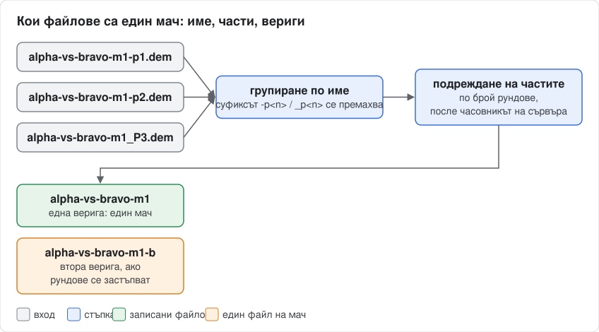

# Команди {#commands}

Ново в командния ред? Първо прочетете [Преди да започнете](before-you-start.md).
Въвеждайте тези команди в терминал, отворен в папката, в която сте разопаковали или клонирали проекта;
`<...>` са места за попълване, а път с интервали се слага в кавички.

```text
python -m heat3d_cs2 demos <demo files or folders> -o <folder> [--every 8] [--jobs N] [--map TEXT] [--force] [--no-bulk] [--loose]
python -m heat3d_cs2 map <map name | path to its .vpk> -o <file.glb> [--game FOLDER] [--source2viewer EXE]
python -m heat3d_cs2 scoreboard <match.3dheat | match.json>
```

`python -m heat3d_cs2 --help` и `python -m heat3d_cs2 <команда> --help` показват същите
опции; [Справочникът на командите](../cli-reference.md) ги показва всичките. Всеки старт първо
прави проверката за нова версия, описана в [Актуализации](updates.md) (изключва се с `HEAT3D_NO_UPDATE=1`).

Код: [`heat3d_cs2/cli.py`](https://github.com/Holdi601/3DHeat-CS2/blob/main/heat3d_cs2/cli.py).

## `demos` - демата към таблици и документи на мачове {#demos---demos-into-tables-and-match-documents}

```powershell
python -m heat3d_cs2 demos D:\Demos\event -o out
python -m heat3d_cs2 demos alpha-vs-bravo-m1-p1.dem alpha-vs-bravo-m1-p2.dem -o out
python -m heat3d_cs2 demos D:\Demos -o out --map final --jobs 4
```

| Аргумент | По подразбиране | Какво прави |
|---|---|---|
| `paths` (един или повече) | - | файлове и папки с демо. Файл се взима, когато разширението му е `.dem` (във всякакъв регистър). Папка се претърсва **рекурсивно** за файлове, които завършват на `.dem`, във всякакъв регистър, в сортиран ред. Компресираните демота (`.dem.zst`, `.dem.bz2`, архиви) не се четат: разопаковайте ги първо. |
| `-o`, `--out` | задължителен | папката, в която се пише; създава се при нужда |
| `--every N` | `8` | взема проба от всеки играч на всеки *N* тика. Демата на CS2 вървят на 64 тика в секунда, така че 8 е осем проби в секунда, 4 - шестнайсет, 64 - една. Събитията винаги се четат в техния собствен тик, каквото и да е *N*. |
| `--jobs N` | `0` = половината от ядрата на процесора | колко мача се превръщат едновременно, всеки в собствен процес. Никога по-малко от 1, никога повече от броя мачове за обработка. |
| `--map TEXT` | - | само мачове, чието **име** съдържа *TEXT*, без значение на главни и малки букви (`--map final`). Филтрира по името на файла, а не по картата, която демото се оказва, че съдържа. |
| `--force` | изключено | превръща отново мачовете, които вече са записани, като ги презаписва |
| `--loose` | изключено | пази всеки мач като отделни файлове - таблица, `.match.json`, помощни файлове - вместо да ги събира в един контейнер `.3dheat`. Вижте [Един файл за мач](output-container.md). |
| `--container` | включено | събира всеки мач в един файл `.3dheat`; това е по подразбиране, затова опцията е само за яснота |
| `--no-bulk` | изключено | оставя потока от същности, командите на играчите и потока от анимации извън помощния файл с пакетите - над половината от размера на демото дори компресирано. Самопроверката на документа на мача ги брои като `lost`, по име. |


### Кои файлове са един мач {#which-files-are-one-match}



Името на мача е името на файла с демо без разширението и без суфикс на част: `-p<цифри>` или `_p<цифри>` в края, без значение на регистъра. Така `alpha-vs-bravo-m1-p1.dem`, `alpha-vs-bravo-m1-p2.dem` и
`alpha-vs-bravo-m1_P3.dem` са частите на един мач, `alpha-vs-bravo-m1`.
Файловете се групират само по това име - два файла с едно и също име в различни папки също се групират.

Суфиксът нищо не казва за реда: `-p2` може да е по-ранната половина. Частите се подреждат по броя на рундовете, които съдържат, и после по часовника на сървъра, а група, която се оказва, че съдържа два различни мача (същите отбори на същата карта на две събития, например), се разделя на **вериги**: веригата с най-много рундове се записва под самото име, следващата като `<име>-b`, после `<име>-c` и така нататък. Файл без нито един рунд (само загряване, пауза) не принадлежи на никоя верига. Как се намират веригите е описано в [Изграждане на мач](building-matches.md#части-и-вериги).

### Какво се записва {#what-is-written}

За всеки мач, в папка, наречена по картата, която заглавието на демото посочва (`unknown`, когато не посочва нито една), се записва по един файл `.3dheat`:

```text
out/
  de_x/
    alpha-vs-bravo-m1.3dheat
    alpha-vs-bravo-m2.3dheat
  de_y/
    ...
```

На синтетичното демо с два рунда от тестовете:


С `--loose` всеки мач е таблицата, документът му и четири помощни файла един до друг ([Един файл за мач](output-container.md)):


Топлинната карта е на една карта, затова зареждането на една папка във визуализатора е зареждане на мачовете на една карта. Вижте [Топлинната таблица](output-table.md) и [Документът на мача](output-match-json.md).

### Какво се пропуска {#what-is-skipped}

Преди да се чете каквото и да е, се изброява всеки `*.3dheat` където и да е под `--out` (контейнерът се записва изцяло или изобщо не се записва) и всеки `*.parquet`, до който стои документът му на мача (`<име>.match.json`). Мач, чието име съвпада с име на такъв файл (без разширението), се пропуска, освен ако не е зададено `--force`. Таблица без документа си на мача - прекъснато изпълнение между двете записвания - не се брои, така че мачът се превръща отново. Проверката е само по име: мач, записан в друга папка на карта или с друго `--every`, пак се брои като готов. Когато няма какво да се направи:

```text
nothing to do: no demos found, or every match already written (--force redoes them)
```

### Какво се извежда {#what-is-printed}

Първо - обемът на работата, после по един ред за всеки мач, когато приключи (в реда, в който свършват, а не в реда на файловете):

```text
3 match(es), 3 at a time
alpha-vs-bravo-m1: de_x, 21 rounds (Alpha 13 Bravo 8), 412,377 rows, lost 0
alpha-vs-bravo-m2: de_y, 30 rounds (Bravo 16 Alpha 14), 598,104 rows, 1 incomplete round(s) left out, lost 0
alpha-vs-bravo-m3: de_y, 18 rounds (Alpha 13 Bravo 5), 330,981 rows, recorded from round 3, lost 1,204,331 (svc_PacketEntities, svc_UserCmds, DEM_AnimationData)
```

(Числата са илюстративни.) Резултатът е този на последния рунд, отбор по отбор в реда, в който документът на мача ги изброява. *incomplete round(s) left out* брои рундовете, които демото е прекъснало, преди да бъдат решени; *recorded from round N* показва, че записът започва късно; *lost* е самопроверката на документа на мача - колко елемента от демото не са отишли никъде и от какви видове (`--no-bulk` прави големите части lost). Мач, който не дава нищо, казва защо:

```text
alpha-vs-bravo-m4: no round in 1 file(s) - nothing written
alpha-vs-bravo-m4-b: no complete round in 1 file(s) - nothing written
```

Грешка в един мач не спира останалите; извежда се като `<име>: failed - <грешка>`.

### Код на изхода {#exit-code}

`0`, когато всеки мач е превърнат (или няма какво да се прави), `1`, когато поне един се е провалил.

### Колко време отнема {#how-long-it-takes}

Всеки мач се чете и се сглобява в работен процес. Папка с няколко стотици демота отнема минути при подразбиращото се `--jobs`. Паметта на работа расте с дължината на мача и с по-малко `--every`: всеки работник държи всеки взет ред на играч от мача си (около десет играча пъти 64 / *N* реда в секунда запис), преди да запише.

Помощните файлове отнемат повече от таблицата: всяко свойство, което парсерът чете, се чете на всеки тик, на прозорци от тикове (около две минути за 40-минутно демо, най-много около 3 GB памет на работа), след което демото се обхожда още веднъж за кадрите и съобщенията.

## `map` - геометрията на картата като `.glb` {#map---a-maps-geometry-as-glb}


```powershell
python -m heat3d_cs2 map <map> -o out/<map>/<map>.glb
python -m heat3d_cs2 map <map> -o <map>.glb --game "D:\Games\Steam\steamapps\common\Counter-Strike Global Offensive"
python -m heat3d_cs2 map "D:\maps\<map>.vpk" -o <map>.glb --source2viewer C:\Tools\Source2Viewer-CLI.exe
```

| Аргумент | По подразбиране | Какво прави |
|---|---|---|
| `name` | - | името на картата (като `de_x`) или пътят до нейния `.vpk`. Път, който завършва на `.vpk` и съществува, се използва както е; всичко друго се търси по името на файла в инсталираната игра. |
| `-o`, `--out` | задължителен | `.glb` файлът за запис; папката му се създава при нужда |
| `--game FOLDER` | библиотеките на Steam | папката на инсталацията на CS2 (тази, която съдържа `game\csgo`), когато Steam не я знае. С `--game` се търси само в тази папка. |
| `--source2viewer EXE` | `HEAT3D_SOURCE2VIEWER`, после `PATH` | изпълнимият файл на командния Source2Viewer |

Извежда се при успех:

```text
out/de_x/de_x.glb: de_x, 412,880 triangles (151,204 ground) in 14 parts
```

(числата са илюстративни). Записването на `.glb` до таблиците на картата (`out/<map>/<map>.glb`) държи данните и геометрията на една карта в една папка. Как работи експортът: [Експорт на карта](map-export.md).

Грешки, всяка извеждана като `error: ...` с код на изхода `2`:

| Съобщение | Значение |
|---|---|
| `no de_x.vpk found in an installed CS2 - pass --game <CS2 folder> or the .vpk path` | картата я няма в никоя намерена библиотека на Steam или името е грешно |
| `Source2Viewer-CLI not found: ...` | нито `--source2viewer`, нито `HEAT3D_SOURCE2VIEWER`, нито `PATH` не дадоха съществуващ файл |
| `Source2Viewer did not export de_x's collision mesh:` и след това края на изхода му | той се е провалил или не е записал `.glb` |
| `de_x's collision mesh has nothing but clip brushes` | след премахването на clip и sky не е останало нищо |

## `scoreboard` - мач като текст {#scoreboard---a-match-as-text}

```bash
python -m heat3d_cs2 scoreboard out/de_x/alpha-vs-bravo-m1.3dheat
python -m heat3d_cs2 scoreboard out/de_x/alpha-vs-bravo-m1.match.json   # след demos --loose
```

Извежда таблото на мача от неговия [документ на мача](output-match-json.md), без да отваря визуализатора. Чете документа в контейнер `.3dheat` или в отделен `<мач>.match.json`.
На синтетичното демо с два рунда от тестовете:


```text
alpha-vs-bravo-m1 - de_test  Alpha 2  Bravo 0

Alpha
player                 K   D   A  +/-    ADR   KAST   HS%  OK-OD  clutch
ash                    1   0   0   +1   50.0 100.0%    0%   0-0     1/1
ace                    1   1   0   +0   50.0 100.0%  100%   1-0     0/0

Bravo
player                 K   D   A  +/-    ADR   KAST   HS%  OK-OD  clutch
ben                    1   1   0   +0   50.0 100.0%    0%   0-0     0/1
bob                    0   1   0   -1    0.0 100.0%    0%   0-1     0/0

rounds  1:TK 2:TB
```

- Първият ред: име на мача, карта и крайният резултат за всеки отбор.
- Таблица за всеки отбор, в реда на `teams` от документа на мача; играчите - в реда на документа на мача (по убийства минус смъртни случаи, после по убийства, най-добрите първо). Имената се съкращават до 19 знака.
- Колони: **K** убийства, **D** смъртни случаи, **A** асистенции, *включително* асистенции за ослепяване, **+/-** убийства минус смъртни случаи, **ADR**, **KAST** (%), **HS%** (закръглено до цял процент), **OK-OD** първи убийства - първи смъртни случаи, **clutch** спечелени clutch-ове / изиграни clutch-ове. Определения: [Статистика](statistics.md).
- Лентата с рундовете: `<рунд>:<победила страна><как>`, с **B** взривена бомба, **D** обезвредена, **K** елиминиране, **T** времето изтече, и **?** за всичко друго (равенство, предаване, друго). При равенство няма победила страна: `<рунд>:?`.

Файл, който не е валиден JSON, или който не е намерен, спира с грешка; JSON документ без полетата на документа на мача се проваля с грешка на Python (не се проверява по-нататък).
