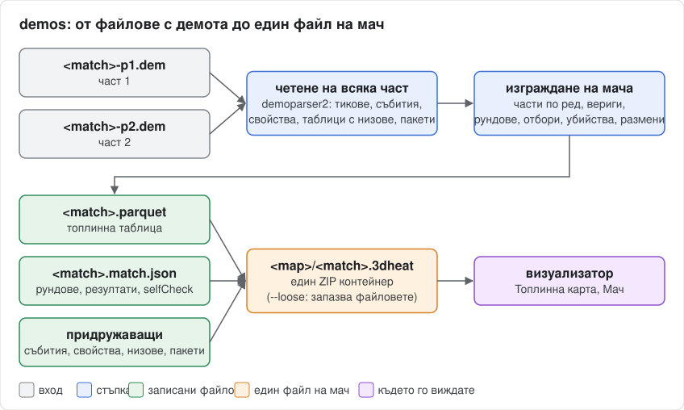

# 3DHeat CS2 {#dheat-cs2}

**Какво е?** Counter-Strike 2 може да запише запис на мач, наречен *демо*. Този инструмент превръща демо във файлове, които визуализаторът 3DHeat може да покаже в 3D: къде е стоял всеки, къде е загинал, хвърлял и поставял бомба, рунд по рунд. Може и да превърне карта на CS2 в триизмерен модел, върху който да ги покаже.

**Защо да го използвам?** За да прегледате собствените си мачове, за да наслоите много мачове на една карта един върху друг като една топлинна карта, и за статистики на мача като ADR (средна щета на рунд) и KAST (делът на рундовете, в които играч е убил, асистирал, оцелял или е бил отмъстен).

**Пример:** `alpha-vs-bravo-m1.dem` на вход, `out/de_x/alpha-vs-bravo-m1.3dheat` на изход (`de_x` е измислено име на карта).



По-подробно: 3DHeat CS2 превръща **демота на Counter-Strike 2** в таблица за топлинна карта и документ за мача за всеки мач, а **карта на CS2** - в геометрия на ниво. Изходните файлове са направени за [3DHeat](https://holdi601.github.io/3DHeat/) визуализатора за телеметрия
([изходен код](https://github.com/Holdi601/3DHeat)), но са обикновени файлове - Parquet, JSON и двоичен glTF - които всичко друго може да чете.

Това е малък пакет на Python, `heat3d_cs2`, който се пуска от командния ред. Чете демота от диска (не изтегля нищо)
с [demoparser2](https://github.com/LaihoE/demoparser), а картите експортира от инсталираната игра с командния вариант на Source2Viewer
([ValveResourceFormat](https://github.com/ValveResourceFormat/ValveResourceFormat)).

## Бърз старт {#quick-start}

Нов ли сте в командния ред? Първо прочетете [Преди да започнете](before-you-start.md).

```bash
pip install -r requirements.txt
python -m heat3d_cs2 demos <demo files or folders> -o out   # всеки мач в тях
python -m heat3d_cs2 map <map> -o out/<map>/<map>.glb       # картата от инсталираната игра
python -m heat3d_cs2 scoreboard out/<map>/<match>.3dheat    # таблицата на резултатите на мача като текст
```

Трябва да видите `1 match(es), 1 at a time ...` и после по един ред за всеки мач
(вижте [Команди](commands.md#what-is-printed)).

`demos` записва, за всеки мач, един файл в папка, наречена на картата:
`out/<map>/<match>.3dheat`, [контейнер `.3dheat`](output-container.md) - форматът на визуализатора с един файл на мач
([спецификация](https://holdi601.github.io/3DHeat/container.html)).
Той съдържа тези части; `--loose` ги записва като отделни файлове:

| Част | Какво съдържа | Зарежда се в |
|---|---|---|
| `<match>.parquet` (роля `table`) | всеки жив играч осем пъти в секунда със състоянието си (здраве, пари, ослепяване, прицелване, зона, инвентар, ...), и всяко събитие там, където е станало (убийство, смърт, нараняване, изстрел, хвърляне, взривове на гранати, ослепяване, поставяне, обезвреждане, експлозия, и край на рунд за всеки играч с това, което рундът му е донесъл), по един ред всяко | раздела Топлинна карта |
| `<match>.match.json` (роля `match`, документът за мача) | отбори, резултат, всеки рунд (победител, как, икономика, поставяне, убийства по ред, клъчове, оцелели) и ред от таблицата с резултатите на всеки играч | раздела Мач |
| `<match>.events/props/strings/packets.parquet` | всичко останало, което демото съдържа, цяло (помощни файлове) | пазят се за пълнотата |

`map` записва `<map>.glb`: мрежата за колизия на картата - подове, стени, кутии, без украса - разделена на земя и конструкция, в същата координатна система и мерни единици като таблиците, така че лежи точно под топлинната карта (панел Фон / ниво).

## Карта на документацията {#map-of-this-documentation}

| Страница | Какво съдържа |
|---|---|
| [Преди да започнете](before-you-start.md) | Python, терминал, места за попълване, как изглеждат успехът и честите грешки |
| [Инсталиране](installing.md) | Python, пакетите, командният интерфейс на Source2Viewer, къде трябва да е CS2 |
| [Команди](commands.md) | `demos`, `map`, `scoreboard`: всяка опция, какво се извежда, кодовете на изход |
| [Четене на демо](reading-demos.md) | какво се чете от файла с демо: семплирани тикове, свойства на играчите, правила на играта, събития |
| [Изграждане на мач](building-matches.md) | части и вериги, часовникът на мача, рундовете, отборите и страните, редовете, убийствата, размените, отварянията, щетите, ослепяванията, икономиката |
| [Статистики](statistics.md) | таблицата с резултатите: K/D/A, ADR, KAST, HS%, отварянията, размените, мултикилове, клъчове, помощни средства, ослепявания |
| [Таблицата на топлинната карта](output-table.md) | файлът Parquet: всяка колона, нейният тип, кои събития я попълват, подсказките в футъра `heat3d`, осите |
| [Документът за мача](output-match-json.md) | документът `.match.json`, поле по поле |
| [Един файл на мач](output-container.md) | контейнерът `.3dheat`, който `demos` записва по подразбиране, `--loose` |
| [Експорт на карта](map-export.md) | как се експортира мрежата за колизия на карта, координатната система, именуването на възлите, мерните единици |
| [Използване с 3DHeat](using-with-3dheat.md) | зареждане на таблици, документи за мачове и карти в раздела Топлинна карта и раздела Мач на визуализатора |
| [Ограничения](limits.md) | какво се приема, какво не се обработва, какво не е проверено |
| [Обновления](updates.md) | проверката за издание при стартиране и `python -m heat3d_update` |
| [Разработка](development.md) | структура на кода, тестове, синтетичният образец на демо |
| [Справка за командите](../cli-reference.md) | `--help` на всяка команда, генериран от кода |
| [Поддръжка](maintaining.md) | списъкът за издаване на тези страници |

## Какво е проверено {#what-it-is-checked-against}

Демотата „от дивото“ не са един чист файл на мач. Преобразувателят се справя с мач, разделен на файлове в
произволен ред, сървър, рестартиран по средата на мача, два различни мача, записани под едно име, рундове,
възстановени от резервно копие, запис, който започва късно или свършва рано, паузи и треньори в отбор
на страната на отбор - вижте [Изграждане на мач](building-matches.md). Проверено върху голяма колекция от
турнирни демота: във всеки мач резултатът следва победителите в рундовете, убийствата на всяка страна са
смъртите на другата, и всеки рунд започва с пет срещу пет.

## Какво да му подавате {#what-to-point-it-at}

Демотата на собствените си мачове, демота, които сте изтеглили ръчно от турнирен сайт, или демота от API, до който имате достъп. Демото е запис,
чието съдържание принадлежи на издателя и организаторите му: използвайте резултата за собствен анализ и не препубликувайте демота или данни,
извлечени от тях. Инструментът чете демата от диска и не изтегля нито едно, а нищо от играта не се разпространява с него: никакви файлове на играта,
никакъв код на играта, никакви DLL файлове.

3DHeat CS2 не е свързан с Valve и не е одобрен от Valve. Counter-Strike 2 и свързаните с нея имена и търговски марки принадлежат на собствениците
си. Носители на права: отворете issue в [github.com/Holdi601/3DHeat-CS2/issues](https://github.com/Holdi601/3DHeat-CS2/issues) - отговаряме бързо и
премахваме каквото и да е при поискване.

## Част от 3DHeat {#part-of-3dheat}

3DHeat CS2 е един от безплатните инструменти около визуализатора 3DHeat, всеки със собствено
хранилище, издания и лиценз:

| Инструмент | Какво прави | Документация |
|---|---|---|
| [3DHeat](https://github.com/Holdi601/3DHeat) | визуализаторът: топлинни карти, анализ на състезания и преглед на мачове в 3D | [сайт](https://holdi601.github.io/3DHeat/) |
| [GameFiles](https://github.com/Holdi601/3DHeat-GameFiles) | трасета и нива от файловете, които игрите доставят, като триизмерни модели | [сайт](https://holdi601.github.io/3DHeat-GameFiles/) |
| [GameCapture](https://github.com/Holdi601/3DHeat-GameCapture) | телеметрия от обиколки в състезателни игри; нива, възстановени от видеозапис на игра | [сайт](https://holdi601.github.io/3DHeat-GameCapture/) |
| [Unreal Exporter](https://github.com/Holdi601/3DHeat-UnrealExporter) | приставка за Unreal Editor, която експортира ниво като един триизмерен модел | [сайт](https://holdi601.github.io/3DHeat-UnrealExporter/) |
| [CS2](https://github.com/Holdi601/3DHeat-CS2) | демота на Counter-Strike 2 в таблици и документи за мачове; карти в триизмерни модели | [сайт](https://holdi601.github.io/3DHeat-CS2/) |
| [Watcher](https://github.com/Holdi601/3DHeat-Watcher) | записва какво публикуват игрите за вашата игра, на заден план | [сайт](https://holdi601.github.io/3DHeat-Watcher/) |
| [Ext-WarThunder](https://github.com/Holdi601/3DHeat-Ext-WarThunder) | повторения на War Thunder в таблици и документи за мачове | [сайт](https://holdi601.github.io/3DHeat-Ext-WarThunder/) |
| [Ext-WoT](https://github.com/Holdi601/3DHeat-Ext-WoT) | повторения на World of Tanks в таблици и документи за мачове | [сайт](https://holdi601.github.io/3DHeat-Ext-WoT/) |
| [Ext-WoWs](https://github.com/Holdi601/3DHeat-Ext-WoWs) | повторения на World of Warships в таблици и документи за мачове | [сайт](https://holdi601.github.io/3DHeat-Ext-WoWs/) |
| [Ext-Squad](https://github.com/Holdi601/3DHeat-Ext-Squad) | демота от сървъри на Squad в таблици и документи за мачове | [сайт](https://holdi601.github.io/3DHeat-Ext-Squad/) |
| [Ext-DCS](https://github.com/Holdi601/3DHeat-Ext-DCS) | карти на DCS World в триизмерни модели | [сайт](https://holdi601.github.io/3DHeat-Ext-DCS/) |
| [Ext-IL2](https://github.com/Holdi601/3DHeat-Ext-IL2) | карти на IL-2 Sturmovik в триизмерни модели | [сайт](https://holdi601.github.io/3DHeat-Ext-IL2/) |

## Лиценз {#licence}

MIT - вижте [`LICENSE`](https://github.com/Holdi601/3DHeat-CS2/blob/main/LICENSE)
и [`LICENSES.md`](https://github.com/Holdi601/3DHeat-CS2/blob/main/LICENSES.md) за
пакетите на трети страни.
