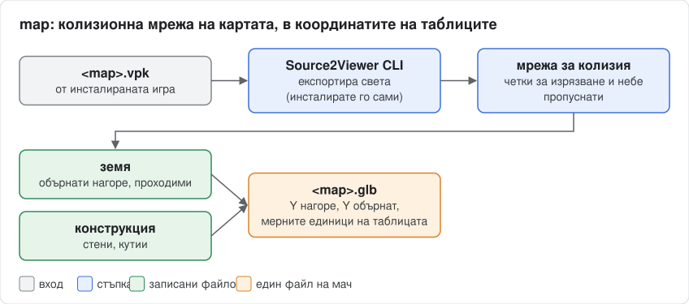

# Експорт на карта (`map`) {#map-export-map}

`python -m heat3d_cs2 map <map> -o <file.glb>` записва карта на CS2 като геометрия на нивото: **колизионната мрежа** на света - в координатната система и мерните единици, в които се чертаят [топлинните таблици](output-table.md). Код:
[`heat3d_cs2/mapexport.py`](https://github.com/Holdi601/3DHeat-CS2/blob/main/heat3d_cs2/mapexport.py),
[`heat3d_cs2/glb.py`](https://github.com/Holdi601/3DHeat-CS2/blob/main/heat3d_cs2/glb.py).
Опции и съобщения: [Команди](commands.md#map---геометрията-на-картата-като-glb).



## Защо колизионната мрежа {#why-the-collision-mesh}

Колизионната мрежа е това, на което стоят играчите и зад което се крият - подове, стени, стълби, кутии - без украсата: без пропове, които само изглеждат като нещо, без текстури, и много по-малко триъгълници от мрежите за рендиране. Точно това трябва на топлинната карта отдолу: нещо, спрямо което да се четат позициите, а не изображение на картата.

## Как се получава {#how-it-is-obtained}

1. **Намиране на картата.** Път, който завършва на `.vpk` и съществува, се използва както е дадено. Иначе се търси `<name>.vpk` в
   `<папка CS2>\game\csgo\maps\`, където папката на CS2 е `--game`, или
   `steamapps\common\Counter-Strike Global Offensive` във всяка намерена библиотека на Steam (вижте [Инсталиране](installing.md#къде-се-търси-cs2)).
2. **Намиране на командния Source2Viewer**: `--source2viewer`, после
   `HEAT3D_SOURCE2VIEWER`, после `Source2Viewer-CLI` / `Source2Viewer-CLI.exe` в `PATH`.
3. **Експорт на физиката на света.** Source2Viewer се пуска така:

   ```text
   Source2Viewer-CLI -i <map>.vpk -d -f maps/<map>/world_physics.vmdl_c --gltf_export_format glb -o <temporary folder>
   ```

   Той декодира компилираната физика на Source 2 от собствения архив на картата и записва модела (празен: светът няма собствена мрежа за рендиране) и физиката до него. Най-големият записан `.glb` е физиката. Ако Source2Viewer се провали или не запише `.glb`, командата спира и показва последните 800 знака от изхода и грешките му.
4. **Четене.** Всеки възел на сцената се обхожда с трансформацията си (матрица, или транслация-ротация-мащаб), и се взима всеки примитив с триъгълници, с или без индексен буфер, в световни координати.
5. **Премахване на всичко, което не е стена или под.** Възел, чието име съдържа `clip` - клипове за играчи, клипове за NPC, клипове за гранати: невидимите стени, които спират играчите и гранатите - или `sky`, без значение от регистъра, се пропуска.
6. **Именуване на повърхността.** Физичните групи се именуват по своята повърхност; името в малки букви, без водещото `physics`, `physics_group` или `physics_passbullets` (и подчертаването след него), е повърхността: `physics_group_concrete` е `concrete`, `physics_passbullets_chainlink` е `chainlink`, а просто `physics_group` е `world`. Повърхностите, през които куршумите минават, се запазват.
7. **Обратно към координатната система на играта.** Source2Viewer записва glTF в метри с оста Y нагоре: (Y, Z, X) на играта, умножено по 0.0254. Това се отменя - всяка точка става (X, Y, Z) на играта в инчове.
8. **Разделяне на терен и конструкция**, триъгълник по триъгълник: стена, чиято нормала сочи нагоре поне 0.7 (компонентата ѝ Z, нормализирана) - наклони до около 45 градуса, приблизително най-стръмното, по което може да върви играч в CS2 - е **терен**; всичко останало, стени и тавани включително, е **конструкция**.
9. **В координатната система на визуализатора.** Всяка точка се записва като (X, Z, -Y): Y нагоре, Y на играта с обратен знак - координатната система, в която визуализаторът чертае таблиците, когато следва техните подсказки `heat3d`. Завъртане, не огледало.
10. **Запис на `.glb`.** Ако не остане нищо (само clip brushes), командата спира с грешка. Иначе отпечатва файла, картата, броя на триъгълниците, колко от тях са терен и броя на частите.

Тук не се чете нищо освен собственият `.vpk` на картата, и нищо от Source2Viewer не се включва или копира.

## Файлът {#the-file}

Двоичен glTF 2.0 (`.glb`), един буфер, записан от `heat3d_cs2` (`asset.generator`):

| Аспект | Какво е |
|---|---|
| Възли | по един на част, всички в корена, без трансформации, всеки със собствена мрежа със същото име |
| Имена на възлите | `ground:<surface>` или `structure:<surface>` (`ground:concrete`, `structure:metal`, `structure:world`), подредени по име |
| Примитиви | по един на мрежа, триъгълници, `POSITION` (float32, с min/max) и `NORMAL` (float32), индекси `uint32` |
| Засенчване | плоско: един връх на ъгъл на триъгълник, всеки с нормалата на своя триъгълник |
| Материали, текстури, UV, цветове | няма |
| Единици | игрови единици (**инчове**), не метри - за разлика от това, което приема glTF |
| Координатна система | (X, Z, -Y) на играта: Y на glTF е височината в играта, Z на glTF е -Y на играта |

Префиксът `ground:` / `structure:` е конвенцията на всички експортери на нива на 3DHeat: визуализаторът приема частта с такова име на думата ѝ, вместо да гадае от геометрията, така че подовете получават сенчестото изобразяване на терен, а стените - изобразяването на конструкция, без стъпка за класификация.

Тъй като единиците са инчове, друг glTF визуализатор показва картата около 39 пъти по-голяма (чете ги като метри); умножете по 0.0254 там, ако има значение. В 3DHeat тя лежи точно под таблицата, която е в същите единици с мащаб 1.

## Проверката, че кадърът е верен {#the-check-that-the-frame-is-right}

Тестът `test_players_stand_on_the_exported_floor` (пуска се само когато са дадени демо и Source2Viewer, вижте [Разработка](development.md#тестове)) експортира картата, на която е изигран демото, взима 300 случайни проби на позиция от мача и за всяка гледа право надолу за най-високия триъгълник на терен най-много 4 единици над стъпалата на играча. Изисква поне 98 % от пробите да намират терен и медианната височина над него да е под 5 единици. Огледална карта го проваля: на карта, огледално отразена по грешната ос, голяма част от играчите стоят над нищо. README съобщава числата от тази проверка за картите на текущия пул за състезания.

## Какво не прави {#what-it-does-not-do}

- Няма геометрия за рендиране, текстури или украса - вижте *защо* по-горе.
- Експортира се само това, което е в модела `world_physics` на картата. Дали движещите се части (врати) или чупливите обекти са в него, не е проверено.
- Без опростяване: визуализаторът 3DHeat опростява при импорт с настройката си **Цел на опростяване**.
- Карти, които не са в инсталираната игра (работни карти на друго място на диска), работят, когато техният `.vpk` се подаде като път и съдържа `maps/<name>/world_physics.vmdl_c`; не е проверено.
