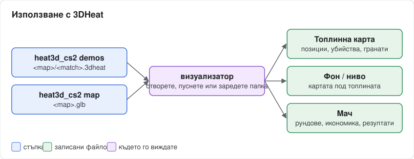

# Работа с 3DHeat {#using-it-with-3dheat}

Изходите отиват на тези места в [визуализатора 3DHeat](https://holdi601.github.io/3DHeat):

| Файл | Къде | Какво дава |
|---|---|---|
| `<match>.3dheat` (по подразбиране) | раздела **Heatmap** (Топлинна карта), панела **Source** (Източник) или раздела **Match** (Мач) | таблицата и документа на мача заедно, един файл за мач ([контейнер](https://holdi601.github.io/3DHeat/container.html)) |
| `<match>.parquet` | раздела **Heatmap** (Топлинна карта), панела **Source** (Източник) | позиции и събития като топлинна карта, повторение с кутии, маршрути |
| `<match>.match.json` | раздела **Match** (Мач), **Load match files…** (Зареждане на файлове с мачове…) | таблото, рундовете, потокът от убийства, статистики през мачовете, връзки към топлинната карта |
| `<map>.glb` | панела **Background / level** (Фон / ниво), **3D model…** (3D модел…) | картата под топлинната карта |

Документацията на визуализатора описва всеки раздел изцяло: страниците му
[Анализ на мач](https://holdi601.github.io/3DHeat/match-analysis.html),
[Зареждане на файлове](https://holdi601.github.io/3DHeat/loading-files.html),
[Съответствие на колоните](https://holdi601.github.io/3DHeat/column-mapping.html)
и [Повторение с кутии](https://holdi601.github.io/3DHeat/box-replay.html). Тази страница е частта на CS2 от нея.



Визуализаторът: [github.com/Holdi601/3DHeat](https://github.com/Holdi601/3DHeat),
документацията: [holdi601.github.io/3DHeat](https://holdi601.github.io/3DHeat/).

## Типична работна сесия {#a-typical-session}

```bash
python -m heat3d_cs2 demos D:\Demos\event -o out
python -m heat3d_cs2 map <map> -o out/<map>/<map>.glb
```

1. **Раздел Heatmap (Топлинна карта) -> Source (Източник):** изберете папката `out/<map>` (или я пуснете върху прозореца). Всеки `.parquet` в нея става един набор от данни; файловете `.json` и `.glb` в същата папка се пропускат като "не е csv/parquet файл". Заредете я.
2. **Background / level (Фон / ниво) -> 3D model… (3D модел…):** изберете `out/<map>/<map>.glb`. **Save to library (Запази в библиотеката)** го пази в браузъра за следващия път.
3. **Раздел Match (Мач) -> Load match files… (Зареждане на файлове с мачове…):** изберете файловете `.match.json` от същата папка (няколко наведнъж), или ги пуснете върху изгледа, докато разделът Match (Мач) е отворен.

Зареждайте само таблиците на една карта наведнъж: координатите на различните карти се припокриват, а топлинна карта на две карти наведнъж не означава нищо. Папката за всяка карта е именно за това.

## Таблицата се отваря без да се настройва нищо {#the-table-opens-with-nothing-to-set}

Визуализаторът чете записа `heat3d` от футъра на първия избран файл ([Топлинната таблица](output-table.md#подсказките-heat3d-в-футъра)) и го поставя върху собствените си предположения:

| Настройка на визуализатора | Да се зададе на |
|---|---|
| Position (Позиция) | `x`, `y`, `z` |
| Up axis in source (Вертикална ос в източника) | Z е нагоре |
| Flip Y (Обърни Y) | включено - така картата е в правилната посока, а не огледално |
| Unit scale (Мащаб на единиците) | 1 - разстоянията в игрови единици (означени с "m"; 1 единица = 1 инч) |
| Time (Време) | `time`, секунди |
| Person (Лице) | `player` |
| Group (Група) | `side` (T / CT) |
| Session (Сесия) | `roundId` - всеки рунд е сесия, `<match> #NN` |
| Look direction (Посока на погледа) | вектор, `dirX` / `dirY` / `dirZ` |
| Filter columns (Колони за филтриране) | `event`, `match`, `round`, `roundTime`, `phase`, `weapon`, `place`, `won`, `buy`, `opening`, `team` |
| Entity size (Размер на обекта) | 32 - повторението с кутии нарисува играча широк 32 единици, с лъч на погледа 4 x 32 |

Всяка подсказана стойност все още се показва в Column mapping (Съответствие на колоните) и може да се промени. Другите колони (`headshot`, `traded`, `other`, `steamid`, `health`, `money`, `damage`, `duration`, ...) могат да се добавят там ръчно като филтри.

Пазете мащаба на единиците на 1, когато картата е заредена: `.glb` е в същите игрови единици и нивото не се преоразмерява заедно с таблицата.

### Полезни филтри {#useful-filters}

- `event` = `position` за това, където са били играчите; `kill` / `death` за това, където дуелите са били спечелени и загубени; `smoke`, `flash`, `molotov`, `he` за това, където е паднала помощната техника; `throw` за това, откъде е хвърлена; `plant` за местата на поставяне.
- `side` (групата) = `T` или `CT`, `phase` = `live`, за да се изключи след фазата, `buy` = `eco` / `force` / `full` за рундове с една икономика, `won` = 1 за рундовете, които страната на реда е спечелила.
- `opening` = 1 с `kill` и `death` за първите дуели.
- `roundTime` като диапазон за момент от рунда: първите 20 секунди, след поставянето.

## Разделът Match (Мач) {#the-match-tab}

Разделът Match (Мач) приема JSON файл, чийто `format` е `heat3d-cs2-match` и който има масивите `rounds`, `players` и `teams` ([Документът на мача](output-match-json.md)). Показва резултата и полувремената, лента с рундовете, оцветени според победилата страна, със знак за това как е приключил всеки, икономиката на всеки рунд, поставянето, потока от убийства, clutch-овете и оцелелите, таблото и статистиките през всички заредени мачове.

Връзките **Show in the heatmap (Покажи в топлинната карта)** не зареждат нищо. Те задават филтри върху таблицата, която вече е заредена в раздела Heatmap (Топлинна карта): `match`, `round` (и сесията на рунда `<match> #NN`), `event`, играчът, страната. Това работи, защото документът на мача и таблицата носят едни и същи имена на мачове, номера на рундове, имена на играчи и страни. **Replay round (Повторение на рунда)** превключва топлинната карта към повторение с кутии и пуска сесията на рунда от началото му.

Затова заредете и двете: таблиците на една карта в раздела Heatmap (Топлинна карта), а документите им на мачове в раздела Match (Мач). Документ на мач без таблицата си още показва таблото и рундовете, а връзките казват, че няма заредени данни за топлинната карта.

## Без 3DHeat {#without-3dheat}

- Таблицата е обикновен Parquet: pandas, Polars, DuckDB, Spark, `arrow` на R я четат всички; записът `heat3d` се пренебрегва, а текстовите колони се четат като низове или категории.
- Документът на мача е обикновен JSON.
- Картата е валиден двоичен glTF, в инчове, а не в метри: умножете по 0.0254 за инструменти, които приемат метри. Координатната ѝ система е тази на glTF (Y нагоре), затова, за да наложите таблицата другаде, чертайте (x, y, z) на всеки ред като (x, z, -y), както го прави 3DHeat.
