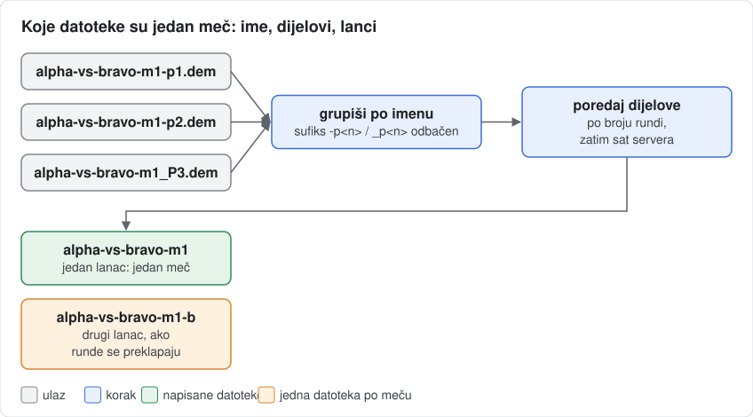

# Slaganje meča {#building-a-match}

Kako se meč slaže od dijelova svog demoa: koje datoteke idu zajedno, jedan sat
preko svih njih, runde i kako je svaka dobijena, timovi i njihove strane, i
svaki red tabele toplotne mape s ubistvima, trade-ovima, otvaranjima, štetom,
flešovima i ekonomijom. Kod:
[`heat3d_cs2/match.py`](https://github.com/Holdi601/3DHeat-CS2/blob/main/heat3d_cs2/match.py).
Tabela rezultata izračunata iz toga nalazi se na stranici [Statistike](statistics.md).

## Pregled {#overview}

1. Čita se svaka datoteka s imenom meča ([Čitanje demoa](reading-demos.md)).
2. U svakoj datoteci rješavaju se dupli redovi igrača (vraćene runde).
3. Datoteke se razvrstavaju u **lance** - mečeve - i svaki lanac se poreda.
4. Svaki dio se postavlja na **sat meča**.
5. U svakom dijelu se nalaze **runde**; opis runde iz kasnijeg dijela
   zamjenjuje raniji.
6. **Igrači** i **timovi** dobijaju imena, a strane i rezultat svake runde
   daju se po imenu tima. Kad su strane poznate, slijede dužina poluvremena,
   pištolj runde i **kupovina** svake strane.
7. Grade se **redovi**: pozicije, pucnji, bacanja, detonacije, postavljanja,
   deaktiviranja, ubistva, smrti, povrede, zasljepljenja, eksplozije.
8. Svaki red dobija oznaku: runda, faza, vrijeme runde, je li njegova strana
   pobijedila i kupovina njegove strane; redovi izvan svih rundi odbacuju se.

## Vraćene runde: jedan red po igraču po tiku {#restored-rounds-one-row-per-player-per-tick}

Kad se runda vrati iz rezervne kopije unutar jedne datoteke, demo nekoliko
sekundi nosi stara tijela igrača uz nova: dva reda za jednog igrača u jednom
tiku, jedan gdje ga je ostavila poništena runda, jedan na spawnu vraćene
runde. Za svakog takvog igrača duplirani tikovi se prolaze **unazad** od
prvog jednostrukog reda iza njih: u svakom tiku zadržava se kandidat najbliži
poziciji koja slijedi, i to postaje referenca za tik prije. Ako iza njih nema
jednostrukog reda, zadržava se zadnji kandidat. Tako svaki igrač zadržava red
koji vodi dalje prema mjestu kamo ide.

## Živi dio datoteke {#the-live-part-of-a-file}

**Živi početak** datoteke je tik njenog zadnjeg događaja
`round_announce_match_start`, ili tik 0 ako ga nema (kasniji dio podijeljenog
meča obično ga nema). Sve prije živog početka se izostavlja, kao i sve
označeno s `is_warmup_period`. Zato se knife runda ili restart prije
objave izostavljaju; knife runda iza koje *ne* slijedi objava početka meča ne
prepoznaje se kao takva (pogledajte [Ograničenja](limits.md)).

**Runde** datoteke su događaji `round_freeze_end` od živog početka nadalje,
izvan zagrijavanja, prepoznati po svom `total_rounds_played` (igrin indeks
runde koja slijedi, počevši od 0). Datoteka bez njih nema runde i ne pripada
nijednom meču.

## Sat {#the-clock}

Vremena su u sekundama. Unutar datoteke vrijeme se računa u **tikovima**:
serverov `game_time` u prvom uzorkovanom tiku, plus tikovi od tada / 64.
Serverov vlastiti sat stoji tokom pauze dok tikovi teku dalje; čitana preko
sata, dva trenutka pauziranog meča dijelila bi isto vrijeme.

Svaka datoteka ima *prvi sat* (vrijeme na njenom živom početku) i *zadnji sat*
(u njenom zadnjem uzorkovanom tiku).

### Dijelovi i lanci {#parts-and-chains}

Datoteke imenovane kao jedan meč ([Komande](commands.md#which-files-are-one-match))
najprije se sortiraju po indeksu svoje prve runde, zatim po prvom satu. Potom
svaka, tim redom, pristupa prvom lancu koji nastavlja ili započinje novi
lanac. Dio nastavlja lanac kad je indeks njegove prve runde najmanje jednak
zadnjem indeksu zadnjeg dijela lanca, **i** vrijedi bilo

- serverov sat teče dalje: njegov prvi sat nije raniji od zadnjeg sata lanca
  minus 5 s; ili
- broj rundi teče dalje: indeks njegove prve runde je zadnji indeks lanca ili
  onaj poslije.

Broj odlučuje, a sat razbija neriješeno, jer server restartovan radi vraćanja
runde ponovo pokreće svoj sat, dok dva različita meča pod istim imenom (isti
timovi na istoj mapi na dva događaja) imaju preklapajuće brojeve rundi. Lanci
se poredaju po broju rundi koje obuhvataju, najviše prvo; prvi zadržava ime
meča, ostali se pišu kao `<name>-b`, `<name>-c`, ...

### Sat meča {#the-match-clock}

Nula meča je prvi sat prvog dijela: **vrijeme meča 0 je živi početak prve
datoteke**. Svaki kasniji dio se na nju postavlja:

- gdje serverov sat teče dalje (njegov prvi sat nije raniji od zadnjeg sata
  prethodnog dijela minus 5 s), koristi se serverov sat takav kakav jest;
- gdje je restartovan, dio se postavlja da slijedi **jednu sekundu** nakon
  što se prethodni završio.

## Runde {#rounds}

Za svaki `round_freeze_end` jednog dijela (redom tikova), prozor runde ide do
sljedećeg freeze enda u tom dijelu, ili do kraja datoteke. Unutar njega runda
je **odlučena** u prvom uzorkovanom tiku u kojem stanje igre pokazuje
`total_rounds_played` = indeks runde + 1 i `round_win_status` 1 (neriješeno),
2 (T pobijedio) ili 3 (CT pobijedio). Runda bez takvog uzorka u svom prozoru
prekinuta je krajem datoteke; njen broj ulazi u listu **nepotpunih** rundi
meča (osim ako neki drugi dio ima tu rundu potpunu).

| Polje runde | Odakle |
|---|---|
| `number` | indeks + 1 (od 1, kako igra broji) |
| `start` | vrijeme meča kraja freeze vremena - igrači se mogu kretati |
| `end` | vrijeme meča prvog uzorka koji pokazuje da je runda odlučena |
| `until` | vrijeme meča sljedećeg `round_prestart` nakon `end`, ako je unutar prozora; inače kraj prozora ili zadnji tik datoteke, šta god dođe prvo (i nikad prije `end`) |
| `winner` | `T` za status pobjede 2, `CT` za 3, prazno za 1: neriješeno je odlučeno, bez pobjednika |
| `reason` | `round_win_reason` u tom uzorku, imenovan kako slijedi |
| `score` | ime tima -> rundi dobijenih nakon ove: `team_rounds_total` svake strane u odlučujućem uzorku; gdje ga demo nema, rezultat prethodne runde plus jedan za pobjednika |
| `sides` | ime tima -> `T` / `CT` u ovoj rundi |
| `equipment` | strana -> zbir `current_equip_value` **živih** igrača te strane u prvom uzorku na ili poslije freeze enda |
| `buy` | strana -> `pistol`, `eco`, `force` ili `full` ([Ekonomija](#economy-and-buy-types)) |
| `plant` | prvi `bomb_planted` poslije freeze enda i do `end`, ili nijedan |
| `exploded` | vrijeme meča prvog `bomb_exploded` nakon tog postavljanja i prije sljedećeg freeze enda, ako ga ima (nije u dokumentu meča; njime se određuje vrijeme reda `explode`) |

`reason`, iz igrinog `CSRoundEndReason`:

| Kod | `reason` |
|---|---|
| 1 | `bomb` (meta uništena bombom) |
| 7 | `defuse` |
| 8, 9 | `elimination` (CT-ovi / T-ovi pobijedili eliminacijom) |
| 10 | `draw` |
| 12 | `time` (meta spašena) |
| 17, 18 | `surrender` |
| bilo šta drugo | `other` |

Kad više dijelova ima istu rundu (po indeksu), zadržava se verzija kasnijeg
dijela. Runde se zatim navode po indeksu. Meč čija prva runda nije runda 1
bilježi brojeve koji nedostaju (`missing` u dokumentu meča); komandna linija
kaže *recorded from round N*.

### Postavljanje bombe {#the-plant}

| Polje | Odakle |
|---|---|
| `site` | `A` ili `B`: zona bombe u kojoj je prema igri stajao postavljač (`which_bomb_zone`, 1 A, 2 B); bez toga, naziv mjesta postavljača (`BombsiteA`, `BombsiteB`); bez toga, slovo koje je dalo drugo postavljanje u istoj datoteci na istoj zoni (`site` događaja je broj entiteta zone). Prazno kad ništa ne govori - nikad broj. |
| `time` | sekunde **u rundi** (od njenog freeze enda), kao vrijeme ubistva |
| `player`, `steamid` | postavljač |
| `x`, `y`, `z` | pozicija postavljača, u igrinim jedinicama: gdje bomba leži |
| `place` | naziv mjesta postavljača pri postavljanju |

### Faze {#the-phases}

Vrijeme od `start` do `end` je **živa** faza runde; od `end` do `until`
njena faza **poslije**, u kojoj pobjednici love a gubitnici spašavaju. Red
pripada rundi čiji `[start, until)` sadrži njegovo vrijeme, i `after` je kad
je njegovo vrijeme poslije `end`. Freeze vrijeme leži između rundi i ni u
jednoj nije.

## Igrači i timovi {#players-and-teams}

**Igrač** je svako ko je bio živ barem jednom na nekoj strani (tim 2 ili 3),
izvan freeze vremena i zagrijavanja, poslije živog početka. Trener ili
komentator na strani tima nikad nije živ i nije igrač. Svaki igrač se vodi po
Steam ID-u; ime je zadnje viđeno.

**Tim** igrača je naziv klana koji je igra dala njegovoj strani
(`team_clan_name`), onaj viđen najčešće za njega - demo ga briše na samom
kraju. Meč odigran bez naziva klanova imenuje timove po strani na kojoj su
počeli: `Started T` i `Started CT`.

**Strane** svake runde dolaze od toga ko je bio na kojoj strani između freeze
enda i kraja runde: svakoj strani se daje oznaka tima koju nosi većina
njenih igrača. Lista `teams` meča ide redom pojavljivanja, runda po runda, T
strana prije CT; obično je tim koji je počeo na T prvi.

## Redovi {#the-rows}

Svaki uzorak pozicije i svaki događaj postaje jedan red
[tabele toplotne mape](output-table.md). Igrači su na strani samo kad je
njihov `team_num` 2 ili 3.

### Pozicije {#positions}

Iz uzorkovanih redova živih igrača na nekoj strani, izvan freeze vremena i
zagrijavanja, poslije živog početka: pozicija, smjer pogleda, zdravlje,
oklop, novac, vrijednost opreme, držano oružje, mjesto.

Smjer pogleda je jedinični vektor u igrinom koordinatnom sistemu:
`(cos pitch * cos yaw, cos pitch * sin yaw, -sin pitch)` - igrin pitch je
pozitivan kad gleda dolje, pa gledanje dolje daje negativan Z.

Držano oružje je `active_weapon_name` kako ga igra imenuje, osim što svako
ime koje sadrži `Knife`, `Bayonet`, `Karambit` ili `Daggers` postaje `Knife`.

### Pucnji i bacanja {#shots-and-throws}

Iz `weapon_fire`, na poziciji strijelca. Noževi (`knife`, `bayonet` u id-u
oružja) i C4 se izostavljaju. Granate (`smokegrenade`, `flashbang`,
`hegrenade`, `molotov`, `incgrenade`, `decoy`) su redovi **throw**, sve ostalo
redovi **shot**. Oružje se imenuje kako ga igra prikazuje (ispod).

### Detonacije granata {#grenade-detonations}

| Događaj | Red | `weapon` |
|---|---|---|
| `smokegrenade_detonate` | `smoke` | Smoke Grenade |
| `flashbang_detonate` | `flash` | Flashbang |
| `hegrenade_detonate` | `he` | High Explosive Grenade |
| `inferno_startburn` (molotov i incendiary) | `molotov` | Molotov |
| `decoy_detonate` | `decoy` | Decoy Grenade |

Pozicija je **gdje je granata eksplodirala** (`x`, `y`, `z` događaja);
igrač i strana su bacačevi. Demo ne imenuje mjesto za granatu, samo za
igrače, pa je `place` ostavljen praznim: red ne tvrdi mjesto na kojem nije
bio. Bacačevo mjesto u tom trenutku čuva se kao `throwerPlace`.

### Postavljanja i deaktiviranja {#plants-and-defuses}

Redovi `plant` i `defuse` na poziciji igrača, oružje `C4 Explosive`.
Postavljena bomba koja je eksplodirala dobija red **explode**: na poziciji
postavljanja, u vrijeme `bomb_exploded`, postavljač kao igrač (s njegovim
Steam ID-em), strana `T`, T tim runde kao `team`, i mjesto postavljanja. To
uključuje bombu koja eksplodira nakon što su T-ovi već pobijedili
eliminacijom. Gdje demo nema `bomb_exploded`, runda dobijena bombom
(`reason` = `bomb`) s postavljanjem dobija red u `end` runde.

### Ubistva i smrti {#kills-and-deaths}

Svaki `player_death` u rundi daje jedan **zapis ubistva** (tabela `kills`
meča) s:

| Polje | Jest |
|---|---|
| attacker, victim, assister | imena, Steam ID-evi, strane; napadač je prazan za svijet (šteta od pada, bomba) |
| `weapon` | oružje događaja imenovano kako ga igra prikazuje |
| `headshot` | zastavica događaja |
| `wallbang` | `penetrated` > 0 |
| `throughSmoke` | `thrusmoke` |
| `flashAssist` | `assistedflash` |
| `noscope`, `attackerBlind` | zastavice događaja (`noscope`, `attackerblind`); kolone redova `kill` i `death`, i u ubistvima dokumenta meča |
| `suicide` | napadač i žrtva isti igrač: recimo vlastita granata |
| `teamkill` | napadač i žrtva na istoj strani, s napadačem, i nije samoubistvo |
| `opening` | prvo ubistvo neprijatelja u rundi (ispod) |
| `traded`, `trade` | ispod |
| pozicije | pozicija i mjesto napadača i žrtve |

Iz svakog zapisa tabela dobija red **death** na poziciji žrtve (svaka smrt,
uključujući svijet, teamkillove i samoubistva) i - za ubistva od neprijatelja
(napadač, nema teamkilla, nema samoubistva) - red **kill** na poziciji
ubice.

**Opening.** Prvo ubistvo neprijatelja u svakoj rundi dok je živa je njen
početni dvoboj. Teamkill, samoubistvo ili smrt od svijeta prije njega
preskaču se, pa je opening i dalje prvi dvoboj runde; runda bez ubistva
neprijatelja dok je živa nema opening.

**Traded** i **trade.** Smrt od neprijatelja je **traded** kad njenog ubicu
ubije neko sa žrtvine strane unutar **5 sekundi** poslije (više od 0 i
najviše 5 s kasnije, u istoj rundi); prvo takvo ubistvo je **trade** ubistvo.
U tabeli je kolona `traded` reda `kill` 1 za trade ubistvo; kod reda `death`
je 1 za smrt koja je osvećena. Ubistva iz faze poslije također se računaju.

### Šteta {#damage}

Iz `player_hurt`, samo među **neprijateljima** (oba na nekoj strani, različite
strane). Šteta je zdravlje koje je zaista **izgubljeno**: za svaku žrtvu u
svakoj rundi zdravlje počinje na 100; svaki pogodak računa
`min(dmg_health, health before)`, a `health` događaja (ono što je ostalo)
postaje "prije" sljedećeg pogotka. Headshot od 137 štete na igraču sa 40
zdravlja računa se 40, kako ga računa igrina tabela rezultata. Pogoci od
`hegrenade`, `inferno`, `molotov` i `incgrenade` su šteta od **utility**.
Svaki pogodak je red **hurt** na poziciji žrtve, napadač kao `other`. Šteta
vlastitom timu i samopovrede nisu ni u tabeli ni u statistikama.

### Flešovi {#flashes}

Iz `player_blind`, samo **neprijatelji** (ne saigrači, ni trener ili
komentator koji gleda): jedan red **blind** po zasljepljenom igraču, na
poziciji zasljepljenog igrača, flešer kao `other`, trajanje zasljepljenja u
sekundama kao `duration`. Svako trajanje se čuva; statistike računaju samo
zasljepljenja od najmanje jedne sekunde.

## Nazivi oružja {#weapon-names}

Id oružja iz događaja (`ak47`, `weapon_ak47`, `knife_karambit`) prikazuje se
kako ga igra imenuje u igračevom vlastitom `active_weapon_name`, pa se
oružje ubistva i držano oružje čitaju isto: `ak47` -> `AK-47`, `m4a1` ->
`M4A4`, `m4a1_silencer` -> `M4A1-S`, `hkp2000` -> `P2000`, `taser` -> `Zeus
x27`, `inferno` i `molotov` -> `Molotov`, `incgrenade` -> `Incendiary
Grenade`, `c4` i `planted_c4` -> `C4 Explosive`, `world` -> `World`, i tako
za svaku pušku i granatu (tabela `WEAPONS` u `match.py`). Sve s `knife` ili
`bayonet` u id-u je `Knife`. Id koji nije u tabeli ostaje kakav jest.

## Ekonomija i vrste kupovine {#economy-and-buy-types}

Na kraju freeze vremena vrijednost opreme svake strane zbraja se preko njenih
živih igrača u prvom uzorku od tada, i dijeli s njihovim brojem:

| Runda | Prosječna oprema po igraču | `buy` |
|---|---|---|
| pištolj runda (prva svakog regularnog poluvremena) | bilo koja | `pistol` |
| druga | ispod $1.500 | `eco` |
| druga | od $1.500 do ispod $4.000 | `force` |
| druga | $4.000 ili više | `full` |

Pištolj runde slijede poluvrijeme s kojim je meč odigran, ne fiksni format.
Poluvrijeme se završava gdje se strane prvi put zamijene između dvije runde
koje slijede jedna drugu, obje u regularnom dijelu: njegova dužina
(`halfLength` u dokumentu meča) je runda prije zamjene - 12 u formatu od 24
runde, 15 u onom od 30. Runda 1 i runda poslije poluvremena su pištolj
runde. Runda je produžetak kad je igrin brojač produžetka
(`m_nOvertimePlaying`) iznad 0 na njenom freeze endu; gdje demo nema takav
brojač, svaka runda poslije dva poluvremena jeste. Poluvremena produžetka
počinju s novcem koji postavlja server i nemaju pištolj rundu, iako im se
strane također mijenjaju. Snimak koji nikad ne pokazuje zamjenu na
poluvremenu - počinje poslije nje ili završava prije - ostavlja poluvrijeme
nepoznatim, i samo je runda 1 pištolj runda.

## Označavanje i redoslijed {#labelling-and-order}

Na kraju svaki red dobija:

- `match` - ime meča; `map` - mapa iz zaglavlja demoa;
- `round` i `roundId` (`<match> #NN`, dvije cifre);
- `phase` - `live` ili `after`;
- `roundTime` - sekunde od kraja freeze vremena runde;
- `won` - 1 ako je strana reda pobijedila u rundi, 0 ako nije, prazno za red
  bez strane;
- `buy` - kupovina strane reda u toj rundi;
- `team` - tim igrača reda, po Steam ID-u.

Redovi čije vrijeme nije ni u jednoj rundi - prije freeze enda prve runde,
tokom freeze vremena, poslije zadnje runde - odbacuju se. Redovi se sortiraju
po vremenu, a unutar istog vremena po nazivu događaja.
