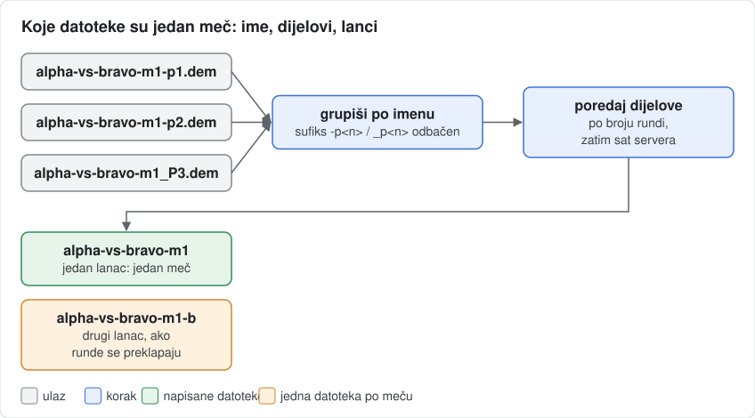

# Komande {#commands}

Novi ste u komandnoj liniji? Prvo pročitajte [Prije nego počnete](before-you-start.md).
Ukucajte ovo u terminalu otvorenom u folderu koji ste raspakovali ili klonirali;
`<...>` su rezervisana mjesta, a putanja s razmacima ide pod navodnike.

```text
python -m heat3d_cs2 demos <demo files or folders> -o <folder> [--every 8] [--jobs N] [--map TEXT] [--force] [--no-bulk] [--loose]
python -m heat3d_cs2 map <map name | path to its .vpk> -o <file.glb> [--game FOLDER] [--source2viewer EXE]
python -m heat3d_cs2 scoreboard <match.3dheat | match.json>
```

`python -m heat3d_cs2 --help` i `python -m heat3d_cs2 <verb> --help` navode
iste opcije; [Referenca komandi](../cli-reference.md) prikazuje sve. Svako pokretanje prvo provodi provjeru izdanja opisanu u
[Ažuriranjima](updates.md) (isključuje se s `HEAT3D_NO_UPDATE=1`).

Kod: [`heat3d_cs2/cli.py`](https://github.com/Holdi601/3DHeat-CS2/blob/main/heat3d_cs2/cli.py).

## `demos` - demoi u tabele i dokumente meča {#demos---demos-into-tables-and-match-documents}

```powershell
python -m heat3d_cs2 demos D:\Demos\event -o out
python -m heat3d_cs2 demos alpha-vs-bravo-m1-p1.dem alpha-vs-bravo-m1-p2.dem -o out
python -m heat3d_cs2 demos D:\Demos -o out --map final --jobs 4
```

| Argument | Zadano | Radi |
|---|---|---|
| `paths` (jedan ili više) | - | demo datoteke i folderi. Datoteka se uzima kad joj je ekstenzija `.dem` (bilo koja veličina slova). Folder se pretražuje **rekurzivno** za datoteke koje završavaju na `.dem`, bilo kojom veličinom slova, sortiranim redom. Komprimirani demoi (`.dem.zst`, `.dem.bz2`, arhive) ne čitaju se: prvo ih raspakuj. |
| `-o`, `--out` | obavezno | folder u koji se piše; kreira se po potrebi |
| `--every N` | `8` | uzorkujte svakog igrača svakih *N* tikova. CS2 demoi rade na 64 tika u sekundi, pa je 8 osam uzoraka u sekundi, 4 je šesnaest, 64 je jedan. Događaji se uvijek čitaju u svom tiku, bez obzira na *N*. |
| `--jobs N` | `0` = pola procesorskih jezgri | koliko se mečeva pretvara istovremeno, svaki u svom procesu. Nikad manje od 1, nikad više nego što ima mečeva za rad. |
| `--map TEXT` | - | samo mečevi čije **ime** sadrži *TEXT*, bez obzira na veličinu slova (`--map final`). Filtrira po imenu datoteke, ne po mapi koju demo zapravo sadrži. |
| `--force` | isključeno | pretvorite mečeve koji su već napisani, prepisujući ih |
| `--loose` | isključeno | čuvajte svaki meč kao zasebne datoteke - tabela, `.match.json`, pomoćne datoteke - umjesto pakovanja u jedan `.3dheat` kontejner. Pogledajte [Jedna datoteka po meču](output-container.md). |
| `--container` | uključeno | spakujte svaki meč u jednu `.3dheat` datoteku; to je zadano, pa služi samo da bude izričito |
| `--no-bulk` | isključeno | izostavite tok entiteta, komande igrača i tok animacija iz sidecara paketa - više od polovine veličine demoa čak i komprimirano. Samoprovjera dokumenta meča ih tada broji kao `lost`, po imenu. |


### Koje datoteke su jedan meč {#which-files-are-one-match}



Ime meča je ime demo datoteke bez ekstenzije i bez sufiksa dijela:
`-p<digits>` ili `_p<digits>` na kraju, bilo koja veličina slova. Dakle
`alpha-vs-bravo-m1-p1.dem`, `alpha-vs-bravo-m1-p2.dem` i
`alpha-vs-bravo-m1_P3.dem` su dijelovi jednog meča, `alpha-vs-bravo-m1`.
Datoteke se grupišu samo po tom imenu - dvije datoteke istog imena u
različitim folderima također se grupišu.

Sufiks ništa ne govori o redoslijedu: `-p2` može biti raniji dio. Dijelovi se
slažu po broju rundi koje sadrže, a zatim po serverovom satu, a grupa koja se
pokaže da sadrži dva različita meča (recimo isti timovi na istoj mapi na dva
događaja) dijeli se na **lance**: lanac s najviše rundi piše se pod samim
imenom, sljedeći kao `<name>-b`, zatim `<name>-c`, i tako dalje. Datoteka
bez ijedne runde (samo zagrijavanje, pauza) ne pripada nijednom lancu. Kako se
lanci nalaze opisano je u
[Slaganju meča](building-matches.md#parts-and-chains).

### Šta se piše {#what-is-written}

Za svaki meč, u folder nazvan po mapi koju navodi zaglavlje demoa
(`unknown` kad ne navodi nijednu), jedna `.3dheat` datoteka:

```text
out/
  de_x/
    alpha-vs-bravo-m1.3dheat
    alpha-vs-bravo-m2.3dheat
  de_y/
    ...
```

Na sintetičkom demou od dvije runde iz testova:


S `--loose` je svaki meč tabela, njegov dokument meča i četiri pomoćne datoteke jedna uz drugu
([Jedna datoteka po meču](output-container.md)):


Toplotna mapa je jedne mape, pa učitavanje jednog foldera u pregledniku znači
učitavanje mečeva jedne mape. Pogledajte [Tabela toplotne mape](output-table.md) i
[Dokument meča](output-match-json.md).

### Šta se preskače {#what-is-skipped}

Prije nego se išta pročita, navodi se svaki `*.3dheat` bilo gdje pod `--out`
(kontejner se piše cijeli ili nikako), i svaki `*.parquet` koji ima
svoj dokument meča (`<name>.match.json`) pored sebe, a meč čije ime
jednako imenu neke od tih datoteka (bez ekstenzije) preskače se, osim uz
`--force`. Tabela bez dokumenta meča - pokretanje prekinuto između pisanja
to dvoje - ne računa se, pa se taj meč pretvara ponovo. Provjera je samo po imenu:
meč pretvoren u
drugi folder mape, ili s drugačijim `--every`, i dalje se računa kao gotov.
Kad nema šta da se radi:

```text
nothing to do: no demos found, or every match already written (--force redoes them)
```

### Šta se ispisuje {#what-is-printed}

Prvo količina posla, zatim jedan red po meču kako koji završi (redom kojim
završavaju, ne redom datoteka):

```text
3 match(es), 3 at a time
alpha-vs-bravo-m1: de_x, 21 rounds (Alpha 13 Bravo 8), 412,377 rows, lost 0
alpha-vs-bravo-m2: de_y, 30 rounds (Bravo 16 Alpha 14), 598,104 rows, 1 incomplete round(s) left out, lost 0
alpha-vs-bravo-m3: de_y, 18 rounds (Alpha 13 Bravo 5), 330,981 rows, recorded from round 3, lost 1,204,331 (svc_PacketEntities, svc_UserCmds, DEM_AnimationData)
```

(Brojevi su ilustrativni.) Rezultat je rezultat zadnje runde, tim po tim
redom kojim ih navodi dokument meča. *incomplete round(s) left out* broji
runde koje je demo prekinuo prije nego što su odlučene; *recorded from round N* kaže
da snimak počinje kasno; *lost* je samoprovjera dokumenta meča - koliko stavki
demoa nije otišlo nikamo, i kojih vrsta (`--no-bulk` čini da je glavnina izgubljena).
Meč koji ne daje ništa kaže zašto:

```text
alpha-vs-bravo-m4: no round in 1 file(s) - nothing written
alpha-vs-bravo-m4-b: no complete round in 1 file(s) - nothing written
```

Greška u jednom meču ne zaustavlja ostale; ispisuje se kao
`<name>: failed - <error>`.

### Izlazni kod {#exit-code}

`0` kad je svaki meč pretvoren (ili nije bilo šta raditi), `1` kad je
barem jedan propao.

### Koliko traje {#how-long-it-takes}

Svaki meč se čita i gradi u radnom procesu. Folder od nekoliko stotina
demoa traje minute sa zadanim `--jobs`. Memorija
po poslu raste s dužinom meča i s manjim `--every`: svaki radnik
drži svaki uzorkovani red igrača svog meča (otprilike deset igrača puta
64 / *N* redova u sekundi snimka) prije pisanja.

Pomoćne datoteke traju duže od tabele: svako svojstvo koje parser čita
čita se u svakom tiku, po jedan prozor tikova, (oko dvije minute za
demo od 40 minuta, najviše blizu 3 GB memorije po poslu), a zatim se demo
prođe još jednom za svoje okvire i poruke.

## `map` - geometrija mape kao `.glb` {#map---a-maps-geometry-as-glb}


```powershell
python -m heat3d_cs2 map <map> -o out/<map>/<map>.glb
python -m heat3d_cs2 map <map> -o <map>.glb --game "D:\Games\Steam\steamapps\common\Counter-Strike Global Offensive"
python -m heat3d_cs2 map "D:\maps\<map>.vpk" -o <map>.glb --source2viewer C:\Tools\Source2Viewer-CLI.exe
```

| Argument | Zadano | Radi |
|---|---|---|
| `name` | - | ime mape (kao `de_x`), ili putanja do njenog `.vpk`. Putanja koja završava na `.vpk` i postoji koristi se takva kakva jest; sve ostalo traži se po nazivu datoteke u instaliranoj igri. |
| `-o`, `--out` | obavezno | `.glb` koji se piše; njegov folder se kreira po potrebi |
| `--game FOLDER` | Steamove biblioteke | CS2 instalacijski folder (onaj koji sadrži `game\csgo`), kad ga Steam ne zna. Uz `--game` pretražuje se samo taj folder. |
| `--source2viewer EXE` | `HEAT3D_SOURCE2VIEWER`, zatim `PATH` | izvršna datoteka Source2Viewer CLI |

Ispisuje se pri uspjehu:

```text
out/de_x/de_x.glb: de_x, 412,880 triangles (151,204 ground) in 14 parts
```

(brojevi ilustrativni). Pisanje `.glb` pored tabela mape
(`out/<map>/<map>.glb`) drži podatke i geometriju jedne mape u jednom folderu. Kako
izvoz radi: [Izvoz mape](map-export.md).

Greške, svaka se ispisuje kao `error: ...` s izlaznim kodom `2`:

| Poruka | Znači |
|---|---|
| `no de_x.vpk found in an installed CS2 - pass --game <CS2 folder> or the .vpk path` | mape nema ni u jednoj pronađenoj Steam biblioteci, ili je ime pogrešno |
| `Source2Viewer-CLI not found: ...` | ni `--source2viewer`, ni `HEAT3D_SOURCE2VIEWER`, ni `PATH` nisu dali postojeću datoteku |
| `Source2Viewer did not export de_x's collision mesh:` iza čega slijedi kraj njegovog ispisa | nije uspio, ili nije napisao `.glb` |
| `de_x's collision mesh has nothing but clip brushes` | nakon izostavljanja clipova i neba ništa nije ostalo |

## `scoreboard` - meč kao tekst {#scoreboard---a-match-as-text}

```bash
python -m heat3d_cs2 scoreboard out/de_x/alpha-vs-bravo-m1.3dheat
python -m heat3d_cs2 scoreboard out/de_x/alpha-vs-bravo-m1.match.json   # after demos --loose
```

Ispisuje tabelu rezultata meča iz njegovog [dokumenta meča](output-match-json.md),
bez otvaranja preglednika. Čita dokument unutar `.3dheat`
kontejnera, ili slobodan `<match>.match.json`.
Na sintetičkom demou od dvije runde iz testova:


```text
alpha-vs-bravo-m1 - de_test  Alpha 2  Bravo 0

Alpha
player                 K   D   A  +/-    ADR   KAST   HS%  OK-OD  clutch
ash                    1   0   0   +1   50.0 100.0%    0%   0-0     1/1
ace                    1   1   0   +0   50.0 100.0%  100%   1-0     0/0

Bravo
player                 K   D   A  +/-    ADR   KAST   HS%  OK-OD  clutch
ben                    1   1   0   +0   50.0 100.0%    0%   0-0     0/1
bob                    0   1   0   -1    0.0 100.0%    0%   0-1     0/0

rounds  1:TK 2:TB
```

- Prvi red: ime meča, mapa i konačni rezultat po timu.
- Tabela po timu, redom `teams` dokumenta meča; igrači redom
  dokumenta meča (po ubistvima minus smrti, zatim ubistvima, najbolji prvi). Imena se
  režu na 19 znakova.
- Kolone: **K** ubistva, **D** smrti, **A** asistencije *uključujući* flash asistencije,
  **+/-** ubistva minus smrti, **ADR**, **KAST** (%), **HS%** (zaokruženo na cijeli
  postotak), **OK-OD** opening ubistva - opening smrti, **clutch** dobijeni clutchevi /
  odigrani clutchevi. Definicije: [Statistike](statistics.md).
- Traka rundi: `<round>:<winning side><how>`, gdje je **B** bomba eksplodirala,
  **D** deaktivirana, **K** eliminacija, **T** vrijeme isteklo, a **?** za sve
  ostalo (neriješeno, predaja, drugo). Neriješeno nema pobjedničku stranu: `<round>:?`.

Datoteka koja nije valjan JSON, ili nije nađena, staje s greškom; JSON
dokument bez polja dokumenta meča propada s Python greškom (dalje se ne
provjerava).
