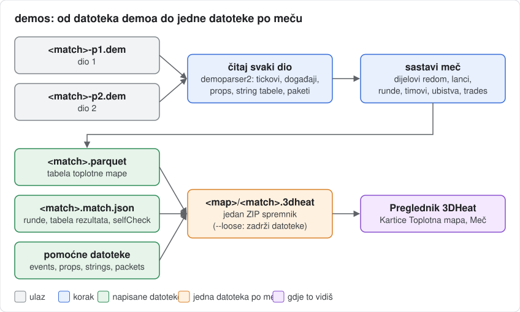

# 3DHeat CS2 {#dheat-cs2}

**Šta je to?** Counter-Strike 2 može spremiti snimak meča, zvan
*demo*. Ovaj alat pretvara demo u datoteke koje preglednik 3DHeat može prikazati u 3D:
gdje je ko stajao, poginuo, bacao i postavljao, runda po rundu. Može i
pretvoriti CS2 mapu u 3D model na kojem se to prikazuje.

**Zašto bih ga koristio?** Da pregledaš vlastite mečeve, da položiš mnogo mečeva
jedne mape jedan preko drugog kao jednu toplotnu mapu i za statistike mečeva kao ADR
(prosječna šteta po rundi) i KAST (udio rundi u kojima je igrač ubio,
asistirao, preživio ili je osvećen (traded)).

**Primjer:** `alpha-vs-bravo-m1.dem` ulazi, `out/de_x/alpha-vs-bravo-m1.3dheat`
izlazi (`de_x` je izmišljeno ime mape).



Detaljnije: 3DHeat CS2 pretvara **Counter-Strike 2 demoe** u tabelu toplotne mape i dokument meča
po meču, a **CS2 mapu** u geometriju nivoa. Izlazi su napravljeni
za preglednik telemetrije [3DHeat](https://holdi601.github.io/3DHeat/)
([izvor](https://github.com/Holdi601/3DHeat)), ali su
obične datoteke - Parquet, JSON i glTF binarni - koje može čitati i
bilo šta drugo.

To je mali Python paket, `heat3d_cs2`, pokreće se iz komandne linije. Demoe čita
s diska (nijedan ne preuzima) pomoću
[demoparser2](https://github.com/LaihoE/demoparser), a mape izvozi iz
instalirane igre pomoću komandno-linijske izvedbe Source2Viewera
([ValveResourceFormat](https://github.com/ValveResourceFormat/ValveResourceFormat)).

## Brzi početak {#quick-start}

Komandna linija ti je nova? Prvo pročitaj [Prije nego počneš](before-you-start.md).

```bash
pip install -r requirements.txt
python -m heat3d_cs2 demos <demo files or folders> -o out   # every match in them
python -m heat3d_cs2 map <map> -o out/<map>/<map>.glb       # the map from the installed game
python -m heat3d_cs2 scoreboard out/<map>/<match>.3dheat    # a match's scoreboard as text
```

Trebao bi vidjeti `1 match(es), 1 at a time ...`, zatim po jedan red za svaki meč
(vidi [Naredbe](../commands.md#what-is-printed)).

`demos` piše, po meču, jednu datoteku u folder nazvan po mapi:
`out/<map>/<match>.3dheat`, [`.3dheat` spremnik](../output-container.md) - format
preglednika s jednom datotekom po meču ([specifikacija](https://holdi601.github.io/3DHeat/container.html)).
Drži ove članove; `--loose` ih umjesto toga piše kao odvojene datoteke:

| Član | Šta drži | Učitava se u preglednikovu |
|---|---|---|
| `<match>.parquet` (uloga `table`) | svakog živog igrača osam puta u sekundi s njegovim stanjem (zdravlje, novac, flash, zumiranje, zona, inventar, ...) i svaki događaj gdje se dogodio (kill, death, hurt, shot, throw, detonacije granata, blind, plant, defuse, explode, te kraj runde po igraču s onim što mu je runda donijela), po jedan red | kartici Toplotna mapa |
| `<match>.match.json` (uloga `match`, dokument meča) | timovi, rezultat, svaka runda (pobjednik, kako, ekonomija, plant, ubistva redom, clutchevi, preživjeli) i red tabele rezultata svakog igrača | kartici Meč |
| `<match>.events/props/strings/packets.parquet` | sve ostalo što demo drži, cjelovito (pomoćne datoteke) | čuva se radi potpunosti |

`map` piše `<map>.glb`: kolizijsku mrežu mape - podove, zidove, kutije,
bez dekoracije - podijeljenu na tlo i građevinu, u istom okviru i
jedinicama kao tabele, pa leži tačno ispod toplotne mape (panel Pozadina / nivo).

## Karta ove dokumentacije {#map-of-this-documentation}

| Stranica | Šta pokriva |
|---|---|
| [Prije nego počneš](before-you-start.md) | Python, terminal, rezervirana mjesta, kako izgledaju uspjeh i česte greške |
| [Instalacija](../installing.md) | Python, paketi, CLI Source2Viewera, gdje CS2 mora biti |
| [Naredbe](../commands.md) | `demos`, `map`, `scoreboard`: svaka opcija, šta se ispisuje, izlazni kodovi |
| [Čitanje demoa](../reading-demos.md) | šta se čita iz datoteke demoa: uzorkovani tickovi, svojstva igrača, pravila igre, događaji |
| [Građenje meča](../building-matches.md) | dijelovi i lanci, sat meča, runde, timovi i strane, redovi, ubistva, trades, otvaranja, šteta, flashevi, ekonomija |
| [Statistike](../statistics.md) | tabela rezultata: K/D/A, ADR, KAST, HS%, otvaranja, trades, višestruka ubistva, clutchevi, pomagala, flashevi |
| [Tabela toplotne mape](../output-table.md) | Parquet datoteka: svaka kolona, njen tip, koji je događaji pune, savjeti u podnožju `heat3d`, osi |
| [Dokument meča](../output-match-json.md) | dokument `.match.json`, polje po polje |
| [Jedna datoteka po meču](../output-container.md) | `.3dheat` spremnik koji `demos` piše zadano, `--loose` |
| [Izvoz mape](../map-export.md) | kako se izvozi kolizijska mreža mape, okvir, imenovanje čvorova, jedinice |
| [Korištenje s 3DHeat](../using-with-3dheat.md) | učitavanje tabela, dokumenata mečeva i mapa u preglednikove kartice Toplotna mapa i Meč |
| [Ograničenja](../limits.md) | šta se pretpostavlja, šta se ne obrađuje, šta nije provjereno |
| [Ažuriranja](../updates.md) | provjera izdanja pri pokretanju i `python -m heat3d_update` |
| [Razvoj](../development.md) | raspored koda, testovi, sintetički demo fixture |
| [Referenca naredbi](../cli-reference.md) | `--help` svake naredbe, generiran iz koda |
| [Održavanje](../maintaining.md) | lista za provjeru pri izdanju ovih stranica |

## Prema čemu je provjeren {#what-it-is-checked-against}

Demoi iz prakse nisu jedna čista datoteka po meču. Konverter obrađuje
meč podijeljen na datoteke bilo kojim redoslijedom, server ponovo pokrenut usred meča, dva
različita meča pohranjena pod jednim imenom, runde vraćene iz rezervne kopije, snimak
koji počinje kasno ili završava rano, pauze i trenere na strani tima -
vidi [Građenje meča](../building-matches.md). Provjereno na velikoj zbirci
turnirskih demoa: u svakom meču rezultat
slijedi pobjednike rundi, ubistva jedne strane su smrti druge strane,
a svaka runda počinje pet protiv pet.

## Na šta ga usmjeriti {#what-to-point-it-at}

Demoi tvojih vlastitih mečeva, demoi koje si ručno preuzeo sa stranice turnira
ili demoi iz API-ja kojem imaš pristup. Demo je snimak čiji sadržaj
pripada njegovom izdavaču i organizatorima: koristi ono što izađe za vlastitu
analizu i ne redistribuiraj demoe ni podatke izvedene iz njih. Stranice koje
nude demoe često u svojim uvjetima zabranjuju automatsko preuzimanje, zbog čega
alat čita demoe s diska i nijedan ne preuzima.

## Dio 3DHeat-a {#part-of-3dheat}

3DHeat CS2 je jedan od besplatnih alata oko preglednika 3DHeat, svaki sa
vlastitim repozitorijem, izdanjima i licencom:

| Alat | Šta radi | Dokumentacija |
|---|---|---|
| [3DHeat](https://github.com/Holdi601/3DHeat) | preglednik: toplotne mape, analiza utrka i pregled mečeva u 3D | [stranica](https://holdi601.github.io/3DHeat/) |
| [GameFiles](https://github.com/Holdi601/3DHeat-GameFiles) | staze i nivoi iz datoteka koje igre isporučuju, kao 3D modeli | [stranica](https://holdi601.github.io/3DHeat-GameFiles/) |
| [GameCapture](https://github.com/Holdi601/3DHeat-GameCapture) | telemetrija krugova iz trkaćih igara; nivoi rekonstruirani iz video snimka igranja | [stranica](https://holdi601.github.io/3DHeat-GameCapture/) |
| [Unreal Exporter](https://github.com/Holdi601/3DHeat-UnrealExporter) | dodatak za Unreal Editor koji izvozi nivo kao jedan 3D model | [stranica](https://holdi601.github.io/3DHeat-UnrealExporter/) |
| [CS2](https://github.com/Holdi601/3DHeat-CS2) | Counter-Strike 2 demoi u tabele i dokumente mečeva; mape u 3D modele | [stranica](https://holdi601.github.io/3DHeat-CS2/) |
| [Watcher](https://github.com/Holdi601/3DHeat-Watcher) | u pozadini bilježi ono što igre objavljuju o tvom igranju | [stranica](https://holdi601.github.io/3DHeat-Watcher/) |
| [Ext-WarThunder](https://github.com/Holdi601/3DHeat-Ext-WarThunder) | War Thunder snimci u tabele i dokumente mečeva | [stranica](https://holdi601.github.io/3DHeat-Ext-WarThunder/) |
| [Ext-WoT](https://github.com/Holdi601/3DHeat-Ext-WoT) | World of Tanks snimci u tabele i dokumente mečeva | [stranica](https://holdi601.github.io/3DHeat-Ext-WoT/) |
| [Ext-WoWs](https://github.com/Holdi601/3DHeat-Ext-WoWs) | World of Warships snimci u tabele i dokumente mečeva | [stranica](https://holdi601.github.io/3DHeat-Ext-WoWs/) |
| [Ext-Squad](https://github.com/Holdi601/3DHeat-Ext-Squad) | Squad serverski demoi u tabele i dokumente mečeva | [stranica](https://holdi601.github.io/3DHeat-Ext-Squad/) |
| [Ext-DCS](https://github.com/Holdi601/3DHeat-Ext-DCS) | DCS World mape u 3D modele | [stranica](https://holdi601.github.io/3DHeat-Ext-DCS/) |
| [Ext-IL2](https://github.com/Holdi601/3DHeat-Ext-IL2) | IL-2 Sturmovik mape u 3D modele | [stranica](https://holdi601.github.io/3DHeat-Ext-IL2/) |

## Licenca {#licence}

MIT - vidi [`LICENSE`](https://github.com/Holdi601/3DHeat-CS2/blob/main/LICENSE),
i [`LICENSES.md`](https://github.com/Holdi601/3DHeat-CS2/blob/main/LICENSES.md)
za pakete trećih strana i ono na šta obavezuju igre koje čita.
