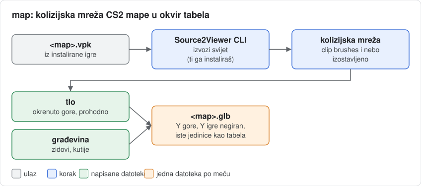

# Izvoz mape (`map`) {#map-export-map}

`python -m heat3d_cs2 map <map> -o <file.glb>` piše CS2 mapu kao geometriju
nivoa: **mrežu kolizije** svijeta, u koordinatnom sistemu i jedinicama u kojima se
crtaju [tabele toplotne mape](output-table.md). Kod:
[`heat3d_cs2/mapexport.py`](https://github.com/Holdi601/3DHeat-CS2/blob/main/heat3d_cs2/mapexport.py),
[`heat3d_cs2/glb.py`](https://github.com/Holdi601/3DHeat-CS2/blob/main/heat3d_cs2/glb.py).
Opcije i poruke: [Komande](commands.md#map---a-maps-geometry-as-glb).



## Zašto mreža kolizije {#why-the-collision-mesh}

Mreža kolizije je ono na čemu igrači stoje i iza čega se kriju - podovi, zidovi,
stepenice, sanduci - bez dekoracije: bez rekvizita koji samo izgledaju kao
nešto, bez tekstura, s daleko manje trouglova od mreža za prikaz. To je
ono što toplotnoj mapi treba ispod nje: nešto prema čemu se čitaju pozicije, a ne
prikaz mape.

## Kako se dobija {#how-it-is-obtained}

1. **Nađite mapu.** Putanja koja završava na `.vpk` i postoji koristi se kako je data.
   Inače se `<name>.vpk` traži u
   `<CS2 folder>\game\csgo\maps\`, gdje je CS2 folder `--game`, ili
   `steamapps\common\Counter-Strike Global Offensive` u svakoj nađenoj Steam biblioteci
   (pogledajte [Instalacija](installing.md#where-cs2-is-looked-for)).
2. **Nađite CLI programa Source2Viewer**: `--source2viewer`, zatim
   `HEAT3D_SOURCE2VIEWER`, zatim `Source2Viewer-CLI` / `Source2Viewer-CLI.exe`
   na `PATH`.
3. **Izvezite fiziku svijeta.** Source2Viewer se pokreće kao

   ```text
   Source2Viewer-CLI -i <map>.vpk -d -f maps/<map>/world_physics.vmdl_c --gltf_export_format glb -o <temporary folder>
   ```

   Dekodira Source 2 kompajliranu fiziku iz arhive same mape i
   piše model (prazan: svijet nema vlastitu mrežu za prikaz) i njegovu
   fiziku pored njega. Najveći napisani `.glb` je fizika. Ako
   Source2Viewer ne uspije ili ne napiše `.glb`, komanda staje i prikazuje
   zadnjih 800 znakova njegovog ispisa i grešaka.
4. **Pročitajte ga.** Svaki čvor scene prolazi se sa svojom transformacijom
   (matrica, ili translacija-rotacija-skala), i svaki primitiv trougla
   uzima se, s baferom indeksa ili bez njega, u svjetskim pozicijama.
5. **Izostavi ono što nije zid ili pod.** Čvor čije ime sadrži
   `clip` - clipovi igrača, NPC clipovi, clipovi granata: nevidljivi zidovi koji
   zaustavljaju igrače i granate - ili `sky`, bez obzira na veličinu slova, odbacuje se.
6. **Imenujte površinu.** Fizičke grupe imenovane su po svojoj površini; ime
   malim slovima, s uklonjenim vodećim `physics`, `physics_group` ili
   `physics_passbullets` (i donjom crtom iza njega) je površina:
   `physics_group_concrete` je `concrete`, `physics_passbullets_chainlink` je `chainlink`, goli
   `physics_group` je `world`. Površine kroz koje meci prolaze se zadržavaju.
7. **Nazad u igrin koordinatni sistem.** Source2Viewer piše glTF u metrima s Y
   prema gore: igrino (Y, Z, X) pomnoženo s 0,0254. To se poništava - svaka tačka
   postaje igrino (X, Y, Z) u inčima.
8. **Razdvojite tlo od strukture**, trougao po trougao: stranica čija normala
   gleda gore za najmanje 0,7 (njena Z komponenta, normalizovana) - kosine do
   oko 45 stepeni, otprilike najstrmije što CS2 igrač može hodati - je **tlo**;
   sve ostalo, zidovi i plafoni uključeni, je **struktura**.
9. **U koordinatni sistem preglednika.** Svaka tačka se piše kao (X, Z, -Y): Y
   prema gore, igrin Y negiran - koordinatni sistem u kojem preglednik crta tabele, kad
   slijedi njihove `heat3d` napomene. Rotacija, ne zrcaljenje.
10. **Napišite `.glb`.** Ako ništa ne ostane (samo clip brushevi), komanda
    staje s greškom. Inače ispisuje datoteku, mapu, broj
    trouglova, koliko ih je tlo, i broj dijelova.

Ništa se ovdje ne čita osim `.vpk` same mape, i ništa iz
Source2Viewera nije priloženo ni kopirano.

## Datoteka {#the-file}

glTF 2.0 binarni (`.glb`), jedan bafer, napisan od `heat3d_cs2` (
`asset.generator`):

| Aspekt | Šta |
|---|---|
| Čvorovi | jedan po dijelu, svi na korijenu, bez transformacija, svaki sa svojom mrežom istog imena |
| Imena čvorova | `ground:<surface>` ili `structure:<surface>` (`ground:concrete`, `structure:metal`, `structure:world`), sortirano po imenu |
| Primitivi | jedan po mreži, trouglovi, `POSITION` (float32, s min/max) i `NORMAL` (float32), `uint32` indeksi |
| Sjenčenje | ravno: jedan vrh po uglu trougla, svaki nosi normalu svog trougla |
| Materijali, teksture, UV-ovi, boje | nema |
| Jedinice | igrine jedinice (**inči**), ne metri - za razliku od onoga što glTF pretpostavlja |
| Koordinatni sistem | (X, Z, -Y) igre: glTF-ov Y je igrina visina, glTF-ov Z je igrin -Y |

Prefiks `ground:` / `structure:` je konvencija svih 3DHeat izvoznika nivoa:
preglednik dio tako imenovan uzima za riječ umjesto da pogađa iz geometrije,
pa podovi dobijaju sjenčenje tla a zidovi crtanje strukture bez ikakvog koraka klasifikacije.

Pošto su jedinice inči, drugi glTF preglednik prikazuje mapu oko 39
puta prevelikom (čita ih kao metre); tamo skaliraj s 0,0254 ako je
bitno. U 3DHeat leži tačno ispod tabele, koja je u istim
jedinicama sa skalom 1.

## Provjera da je koordinatni sistem ispravan {#the-check-that-the-frame-is-right}

Test `test_players_stand_on_the_exported_floor` (pokreće se samo kad su dati demo i
Source2Viewer, pogledajte [Razvoj](development.md#tests)) izvozi
mapu na kojoj je demo odigran, uzima 300 nasumičnih uzoraka pozicije meča, i
za svaki gleda ravno dolje tražeći najviši trougao tla najviše 4 jedinice
iznad igračevih stopala. Traži da barem 98 % uzoraka nađe
tlo, i da je medijan visine iznad njega ispod 5 jedinica. Zrcaljena mapa
pada na njemu: na mapi zrcaljenoj pogrešnom osom velik dio igrača
stoji iznad ničega. README navodi brojke ove provjere preko
mapa trenutnog kompetitivnog skupa.

## Šta ne radi {#what-it-does-not-do}

- Nema geometrije za prikaz, tekstura ni dekoracije - vidi *zašto* gore.
- Izvozi se samo ono što je u modelu `world_physics` mape. Jesu li
  pokretni dijelovi (vrata) ili lomljivi predmeti u njemu nije provjereno.
- Nema pojednostavljivanja: preglednik 3DHeat pojednostavljuje pri uvozu
  postavkom **Cilj pojednostavljivanja**.
- Mape koje nisu u instaliranoj igri (workshop mape negdje drugdje na disku) rade kad
  se njihov `.vpk` proslijedi kao putanja i sadrži `maps/<name>/world_physics.vmdl_c`;
  nije provjereno.
