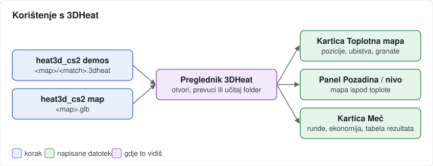

# Korištenje s 3DHeat {#using-it-with-3dheat}

Izlazi idu na ova mjesta
[preglednika 3DHeat](https://holdi601.github.io/3DHeat):

| Datoteka | Gdje | Šta daje |
|---|---|---|
| `<match>.3dheat` (zadano) | kartica **Toplotna mapa**, panel **Izvor**, ili kartica **Meč** | tabelu i dokument meča zajedno, jedna datoteka po meču ([kontejner](https://holdi601.github.io/3DHeat/container.html)) |
| `<match>.parquet` | kartica **Toplotna mapa**, panel **Izvor** | pozicije i događaje kao toplotnu mapu, reprodukciju s kutijama, rute |
| `<match>.match.json` | kartica **Meč**, **Učitaj datoteke mečeva…** | tabelu rezultata, runde, feed ubistava, statistike preko mečeva, linkove u toplotnu mapu |
| `<map>.glb` | panel **Pozadina / nivo**, **3D model…** | mapu ispod toplotne mape |

Vlastita dokumentacija preglednika opisuje svaku karticu u cjelini, na svojim stranicama
[Match analysis](https://holdi601.github.io/3DHeat/match-analysis.html),
[Loading files](https://holdi601.github.io/3DHeat/loading-files.html),
[Column mapping](https://holdi601.github.io/3DHeat/column-mapping.html)
i [Box replay](https://holdi601.github.io/3DHeat/box-replay.html).
Ova stranica je CS2 strana toga.



Preglednik: [github.com/Holdi601/3DHeat](https://github.com/Holdi601/3DHeat),
dokumentacija [holdi601.github.io/3DHeat](https://holdi601.github.io/3DHeat/).

## Tipična sesija {#a-typical-session}

```bash
python -m heat3d_cs2 demos D:\Demos\event -o out
python -m heat3d_cs2 map <map> -o out/<map>/<map>.glb
```

1. **Kartica Toplotna mapa -> Izvor:** odaberite folder `out/<map>` (ili ga ispustite na prozor).
   Svaki `.parquet` u njemu postaje jedan skup podataka; datoteke `.json` i `.glb` u
   istom folderu preskaču se kao "not a csv/parquet file". Učitajte ga.
2. **Pozadina / nivo -> 3D model…:** odaberite `out/<map>/<map>.glb`.
   **Spremi u biblioteku** čuva ga u pregledniku za sljedeći put.
3. **Kartica Meč -> Učitaj datoteke mečeva…:** odaberite `.match.json` datoteke
   istog foldera (nekoliko odjednom), ili ih ispusti na prikaz dok je kartica
   Meč otvorena.

Učitavajte tabele samo jedne mape odjednom: koordinate različitih mapa
se preklapaju, a toplotna mapa dvije mape odjednom ne znači ništa. Folder po mapi
postoji zbog toga.

## Tabela se otvara bez ičeg za postaviti {#the-table-opens-with-nothing-to-set}

Preglednik čita unos `heat3d` u podnožju prve odabrane datoteke
([Tabela toplotne mape](output-table.md#the-heat3d-footer-hints)) i polaže ga
preko vlastitih pretpostavki:

| Postavka preglednika | Postavljeno na |
|---|---|
| Pozicija | `x`, `y`, `z` |
| Osa prema gore u izvoru | Z je prema gore |
| Flip Y | uključeno - da mapa bude okrenuta kako treba, ne zrcaljena |
| Mjerilo jedinica | 1 - udaljenosti u igrinim jedinicama (označene "m"; 1 jedinica = 1 inč) |
| Vrijeme | `time`, sekunde |
| Person id | `player` |
| Grupa | `side` (T / CT) |
| Sesija | `roundId` - svaka runda je sesija, `<match> #NN` |
| Smjer pogleda | vektor, `dirX` / `dirY` / `dirZ` |
| Kolone filtera | `event`, `match`, `round`, `roundTime`, `phase`, `weapon`, `place`, `won`, `buy`, `opening`, `team` |
| Veličina entiteta | 32 - reprodukcija s kutijama crta igrača širokog 32 jedinice, sa zrakom pogleda od 4 x 32 |

Svaka vrijednost iz napomena i dalje se vidi u mapiranju kolona i može se promijeniti. Ostale
kolone (`headshot`, `traded`, `other`, `steamid`, `health`, `money`,
`damage`, `duration`, ...) tamo se mogu ručno dodati kao filteri.

Drži mjerilo jedinica na 1 kad je mapa učitana: `.glb` je u istim igrinim
jedinicama, a nivo se ne skalira zajedno s tabelom.

### Korisni filteri {#useful-filters}

- `event` = `position` za to gdje su igrači bili; `kill` / `death` za to gdje su
  dvoboji dobijeni i izgubljeni; `smoke`, `flash`, `molotov`, `he` za to gdje je
  utility pao; `throw` za to odakle je bačen; `plant` za mjesta
  postavljanja bombe.
- `side` (grupa) = `T` ili `CT`, `phase` = `live` da se izostavi faza
  poslije, `buy` = `eco` / `force` / `full` za runde jedne ekonomije,
  `won` = 1 za runde koje je strana reda dobila.
- `opening` = 1 uz `kill` i `death` za opening dvoboje.
- `roundTime` kao raspon za trenutak runde: prvih 20 sekundi,
  poslije postavljanja bombe.

## Kartica Meč {#the-match-tab}

Kartica Meč prihvata JSON datoteku čiji je `format` `heat3d-cs2-match` i
koja ima nizove `rounds`, `players` i `teams`
([Dokument meča](output-match-json.md)). Prikazuje rezultat i poluvremena,
traku rundi obojenu pobjedničkom stranom s oznakom kako je svaka završila,
ekonomiju svake runde, postavljanje bombe, feed ubistava, clutcheve i preživjele, tabelu rezultata,
i statistike preko svih učitanih mečeva.

Njeni linkovi **Prikaži na toplotnoj mapi** ništa ne učitavaju: postavljaju filtere na
tabelu već učitanu u kartici Toplotna mapa - `match`, `round` (i
sesiju runde `<match> #NN`), `event`, igrača, stranu. To radi
jer dokument meča i tabela nose ista imena mečeva, brojeve rundi,
imena igrača i strane. **Reprodukcija runde** prebacuje toplotnu mapu
na reprodukciju s kutijama i pušta sesiju runde od njenog početka.

Zato učitajte oboje: tabele mape u kartici Toplotna mapa, njihove dokumente mečeva u
kartici Meč. Dokument meča bez svoje tabele i dalje prikazuje tabelu rezultata i runde,
a linkovi kažu da nisu učitani podaci toplotne mape.

## Bez 3DHeat {#without-3dheat}

- Tabela je običan Parquet: pandas, Polars, DuckDB, Spark, R-ov `arrow` svi
  je čitaju, unos `heat3d` se ignoriše, a tekstualne kolone se čitaju kao stringovi
  ili kategorije.
- Dokument meča je običan JSON.
- Mapa je valjan glTF binarni, u inčima a ne u metrima: skalirajte s
  0,0254 za alate koji pretpostavljaju metre. Njen koordinatni sistem je glTF-ov vlastiti (Y prema gore), pa da
  tabelu preklopite drugdje, nacrtajte (x, y, z) svakog reda kao (x, z, -y), kao
  što radi 3DHeat.
