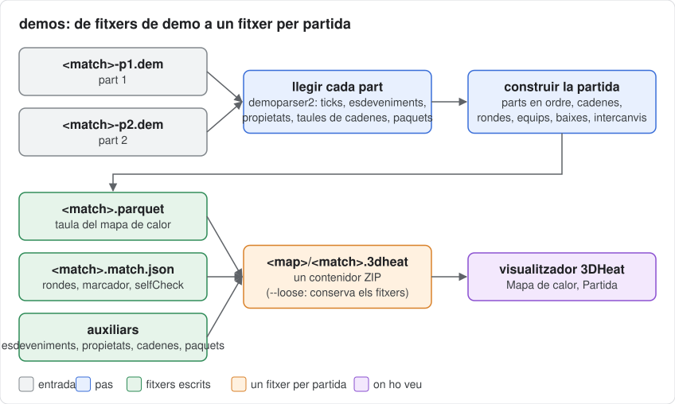

# 3DHeat CS2 {#dheat-cs2}

**Què és?** Counter-Strike 2 pot desar una gravació d'una partida, anomenada *demo*. Aquesta eina converteix una
demo en fitxers que el visualitzador 3DHeat pot mostrar en 3D: on era cadascú, on va morir, on va llançar
i on va plantar, ronda a ronda. També pot convertir un mapa de CS2 en un model 3D perquè hi mostri les partides.

**Per a què la faria servir?** Per revisar les vostres pròpies partides, per superposar moltes partides d'un
mateix mapa en un sol mapa de calor, i per a estadístiques de partida com l'ADR (dany mitjà per ronda) i el
KAST (la proporció de rondes en què un jugador va matar, assistir, sobreviure o ser venjat).

**Exemple:** `alpha-vs-bravo-m1.dem` d'entrada, `out/de_x/alpha-vs-bravo-m1.3dheat` de sortida (`de_x` és un
nom de mapa inventat).



Amb més detall: 3DHeat CS2 converteix les **demos de Counter-Strike 2** en una taula de mapa de calor i en un
document de partida per cada partida, i un **mapa de CS2** en la geometria d'un nivell. Les sortides estan fetes
per al visualitzador de telemetria [3DHeat](https://holdi601.github.io/3DHeat/)
([codi font](https://github.com/Holdi601/3DHeat)), però són fitxers corrents (Parquet, JSON i glTF
binari) que qualsevol altra cosa també pot llegir.

És un petit paquet de Python, `heat3d_cs2`, que s'executa des de la línia d'ordres. Llegeix les demos
del disc (no en descarrega cap) amb [demoparser2](https://github.com/LaihoE/demoparser), i exporta els mapes
del joc instal·lat amb la versió de línia d'ordres de Source2Viewer
([ValveResourceFormat](https://github.com/ValveResourceFormat/ValveResourceFormat)).

## Inici ràpid {#quick-start}

Si és nou amb la línia d'ordres, llegeixi primer [Abans de començar](before-you-start.md).

```bash
pip install -r requirements.txt
python -m heat3d_cs2 demos <fitxers de demo o carpetes> -o out   # cada partida que hi hagi
python -m heat3d_cs2 map <mapa> -o out/<mapa>/<mapa>.glb         # el mapa del joc instal·lat
python -m heat3d_cs2 scoreboard out/<mapa>/<partida>.3dheat      # el marcador d'una partida, com a text
```

Hauria de veure `1 match(es), 1 at a time ...` i després una línia per partida
(vegi [Ordres](../commands.md#what-is-printed)).

`demos` escriu, per cada partida, un fitxer dins d'una carpeta amb el nom del mapa:
`out/<mapa>/<partida>.3dheat`, un [contenidor `.3dheat`](../output-container.md), el format d'un fitxer
per partida del visualitzador ([especificació](https://holdi601.github.io/3DHeat/container.html)).
Conté aquests membres; `--loose` els escriu com a fitxers separats en lloc d'això:

| Membre | Què conté | Carregat al |
|---|---|---|
| `<partida>.parquet` (rol `table`) | cada jugador viu vuit vegades per segon amb el seu estat (salut, diners, flaix, mira, zona, inventari...), i cada esdeveniment en el moment en què passa (baixa, mort, dany, tret, llançament, detonacions de granada, cegament, plantada, desactivació, explosió, i un final de ronda per jugador amb el que li va pagar la ronda), una fila cadascun | pestanya Mapa de calor |
| `<partida>.match.json` (rol `match`, el document de la partida) | equips, marcador, cada ronda (guanyador, com, economia, plantada, baixes en ordre, remuntades, supervivents) i la línia del marcador de cada jugador | pestanya Partida |
| `<partida>.events/props/strings/packets.parquet` | tot el demés que conté la demo, sencer (fitxers auxiliars) | es guarda per ser complet |

`map` escriu `<mapa>.glb`: la malla de col·lisió del mapa (terres, parets, caixes),
sense decoració, dividida en terreny i estructura, en el mateix marc i unitats que les taules, de manera
que queda exactament sota el mapa de calor (panell Fons / nivell).

## Mapa d'aquesta documentació {#map-of-this-documentation}

| Pàgina | Què cobreix |
|---|---|
| [Abans de començar](before-you-start.md) | Python, una terminal, marcadors de posició, com es veuen l'èxit i els errors habituals |
| [Instal·lació](../installing.md) | Python, els paquets, la CLI de Source2Viewer, on ha d'estar CS2 |
| [Ordres](../commands.md) | `demos`, `map`, `scoreboard`: cada opció, què s'imprimeix, codis de sortida |
| [Llegir una demo](../reading-demos.md) | què es llegeix d'un fitxer de demo: fotogrames mostrejats, propietats dels jugadors, regles de joc, esdeveniments |
| [Construir una partida](../building-matches.md) | parts i cadenes, el rellotge de la partida, les rondes, equips i bàndols, files, baixes, intercanvis, obertures, dany, flaixos, economia |
| [Estadístiques](../statistics.md) | el marcador: K/D/A, ADR, KAST, HS%, obertures, intercanvis, multibaixes, remuntades, utilitats, flaixos |
| [La taula del mapa de calor](../output-table.md) | el fitxer Parquet: cada columna, el seu tipus, quins esdeveniments l'omplen, les pistes del peu `heat3d`, els eixos |
| [El document de la partida](../output-match-json.md) | el document `.match.json`, camp per camp |
| [Un fitxer per partida](../output-container.md) | el contenidor `.3dheat` que escriu `demos` per defecte, `--loose` |
| [Exportació del mapa](../map-export.md) | com s'exporta la malla de col·lisió d'un mapa, el marc, els noms de node, les unitats |
| [Ús amb 3DHeat](../using-with-3dheat.md) | carregar taules, documents de partida i mapes als visualitzadors de Mapa de calor i de Partida |
| [Límits](../limits.md) | què es dona per fet, què no es tracta, què no s'ha comprovat |
| [Actualitzacions](../updates.md) | la comprovació de versió en iniciar i `python -m heat3d_update` |
| [Desenvolupament](../development.md) | disposició del codi, proves, la demo sintètica de prova |
| [Referència de l'ordre](../cli-reference.md) | el `--help` de cada ordre, generat a partir del codi |
| [Manteniment](../maintaining.md) | la llista de comprovació de publicació d'aquestes pàgines |

## Què s'ha comprovat {#what-it-is-checked-against}

Les demos que hi ha pel món no són un fitxer net per partida. El convertidor gestiona una partida
partida en diversos fitxers en qualsevol ordre, un servidor reiniciat a mig partida, dues partides
diferents guardades amb un mateix nom, rondes restaurades d'una còpia de seguretat, una gravació que
comença tard o acaba aviat, pauses, i entrenadors al bàndol d'un equip; vegi
[Construir una partida](../building-matches.md). Comprovat sobre una gran col·lecció de demos de torneigs:
en cada partida el marcador segueix els guanyadors de les rondes, les baixes de cada bàndol són les
morts de l'altre, i cada ronda comença amb cinc contra cinc.

## A què apuntar {#what-to-point-it-at}

Les demos de les vostres pròpies partides, les demos que hàgiu descarregat a mà d'un lloc de torneigs,
o les demos d'una API a la qual tingueu accés. Una demo és una gravació el contingut de la qual
pertany al seu editor i als seus organitzadors: useu el que en surti per a la vostra pròpia anàlisi, i no
redistribuïu les demos ni les dades que se'n deriven. Els llocs que ofereixen demos sovint prohibeixen
la descàrrega automàtica a les seves condicions, per això l'eina llegeix les demos del disc i no n'obté cap.

## Part de 3DHeat {#part-of-3dheat}

3DHeat CS2 és una de les eines lliures que envolten el visualitzador 3DHeat, cadascuna amb el seu propi
repositori, les seves pròpies versions i la seva llicència:

| Eina | Què fa | Documentació |
|---|---|---|
| [3DHeat](https://github.com/Holdi601/3DHeat) | el visualitzador: mapes de calor, anàlisi de curses i revisió de partides en 3D | [lloc](https://holdi601.github.io/3DHeat/) |
| [GameFiles](https://github.com/Holdi601/3DHeat-GameFiles) | circuits i nivells dels fitxers que envien els jocs, com a models 3D | [lloc](https://holdi601.github.io/3DHeat-GameFiles/) |
| [GameCapture](https://github.com/Holdi601/3DHeat-GameCapture) | telemetria de voltes de jocs de carreres; nivells reconstruïts a partir de vídeo de joc | [lloc](https://holdi601.github.io/3DHeat-GameCapture/) |
| [Unreal Exporter](https://github.com/Holdi601/3DHeat-UnrealExporter) | un connector per a l'editor d'Unreal que exporta un nivell com un model 3D | [lloc](https://holdi601.github.io/3DHeat-UnrealExporter/) |
| [CS2](https://github.com/Holdi601/3DHeat-CS2) | demos de Counter-Strike 2 en taules i documents de partida; mapes en models 3D | [lloc](https://holdi601.github.io/3DHeat-CS2/) |
| [Watcher](https://github.com/Holdi601/3DHeat-Watcher) | registra el que publiquen els jocs sobre la vostra partida, en segon pla | [lloc](https://holdi601.github.io/3DHeat-Watcher/) |
| [Ext-WarThunder](https://github.com/Holdi601/3DHeat-Ext-WarThunder) | repeticions de War Thunder en taules i documents de partida | [lloc](https://holdi601.github.io/3DHeat-Ext-WarThunder/) |
| [Ext-WoT](https://github.com/Holdi601/3DHeat-Ext-WoT) | repeticions de World of Tanks en taules i documents de partida | [lloc](https://holdi601.github.io/3DHeat-Ext-WoT/) |
| [Ext-WoWs](https://github.com/Holdi601/3DHeat-Ext-WoWs) | repeticions de World of Warships en taules i documents de partida | [lloc](https://holdi601.github.io/3DHeat-Ext-WoWs/) |
| [Ext-Squad](https://github.com/Holdi601/3DHeat-Ext-Squad) | demos de servidors de Squad en taules i documents de partida | [lloc](https://holdi601.github.io/3DHeat-Ext-Squad/) |
| [Ext-DCS](https://github.com/Holdi601/3DHeat-Ext-DCS) | mapes de DCS World en models 3D | [lloc](https://holdi601.github.io/3DHeat-Ext-DCS/) |
| [Ext-IL2](https://github.com/Holdi601/3DHeat-Ext-IL2) | mapes d'IL-2 Sturmovik en models 3D | [lloc](https://holdi601.github.io/3DHeat-Ext-IL2/) |

## Llicència {#licence}

MIT: vegi [`LICENSE`](https://github.com/Holdi601/3DHeat-CS2/blob/main/LICENSE),
i [`LICENSES.md`](https://github.com/Holdi601/3DHeat-CS2/blob/main/LICENSES.md)
per als paquets de tercers i el que obliguen els jocs que llegeix.
