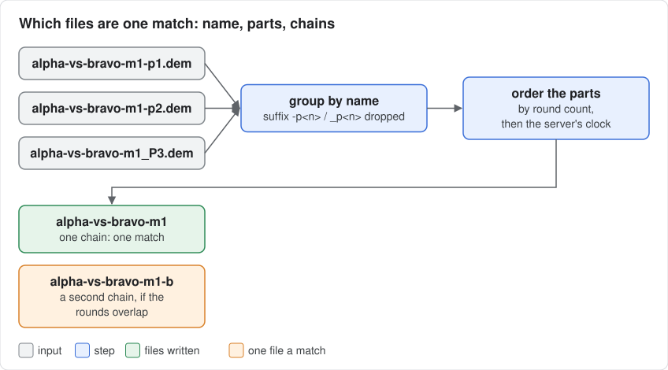
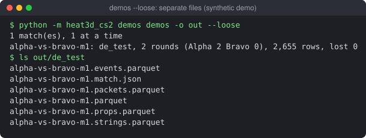

# Commands

New to the command line? Read [Before you start](before-you-start.md) first.
Type these in a terminal opened in the folder you unpacked or cloned;
`<...>` are placeholders, and a path with spaces goes in quotes.

```text
python -m heat3d_cs2 demos <demo files or folders> -o <folder> [--every 8] [--jobs N] [--map TEXT] [--force] [--no-bulk] [--loose] [--levels FOLDER]
python -m heat3d_cs2 map <map name | path to its .vpk> -o <file.glb> [--game FOLDER] [--source2viewer EXE]
python -m heat3d_cs2 scoreboard <match.3dheat | match.json>
```

`python -m heat3d_cs2 --help` and `python -m heat3d_cs2 <verb> --help` list the
same options; the [Command reference](cli-reference.md) shows them all. Every start first runs the release check described in
[Updates](updates.md) (off with `HEAT3D_NO_UPDATE=1`).

Code: [`heat3d_cs2/cli.py`](https://github.com/Holdi601/3DHeat-CS2/blob/main/heat3d_cs2/cli.py).

## `demos` - demos into tables and match documents

```powershell
python -m heat3d_cs2 demos D:\Demos\event -o out
python -m heat3d_cs2 demos alpha-vs-bravo-m1-p1.dem alpha-vs-bravo-m1-p2.dem -o out
python -m heat3d_cs2 demos D:\Demos -o out --map final --jobs 4
```

| Argument | Default | Does |
|---|---|---|
| `paths` (one or more) | - | demo files and folders. A file is taken when its extension is `.dem` (any case). A folder is searched **recursively** for files ending in `.dem`, in any case, in sorted order. Compressed demos (`.dem.zst`, `.dem.bz2`, archives) are not read: unpack them first. |
| `-o`, `--out` | required | the folder to write into; created as needed |
| `--every N` | `8` | sample every player every *N* ticks. CS2 demos run at 64 ticks a second, so 8 is eight samples a second, 4 is sixteen, 64 is one. Events are always read at their own tick, whatever *N* is. |
| `--jobs N` | `0` = half the CPU cores | how many matches are converted at once, each in its own process. Never fewer than 1, never more than there are matches to do. |
| `--map TEXT` | - | only matches whose **name** contains *TEXT*, case-insensitive (`--map final`). It filters on the file name, not on the map the demo turns out to hold. |
| `--force` | off | convert matches that are already written, overwriting them |
| `--loose` | off | keep each match as separate files - table, `.match.json`, sidecars - instead of packing them into one `.3dheat` container. See [One file a match](output-container.md). |
| `--container` | on | pack each match into one `.3dheat` file; the default, so only there to be explicit |
| `--levels FOLDER` | `HEAT3D_LEVELS`, else the 3DHeat levels folder | where the maps' `.glb` from `map` are (`<FOLDER>/cs2/<map>.glb` or `<FOLDER>/<map>.glb`): with the match's map there, every hit is traced through it for what it went through (`wallCount`, `wallThickness`, `wallSurfaces`, `wallGrates`) and railings on its line; without it, those columns stay empty and `wallbang` is told by the hit's damage alone |
| `--no-bulk` | off | leave the entity stream, the players' commands and the animation stream out of the packets sidecar - over half of a demo's size even compressed. The match document's self-check then counts them `lost`, by name. |


### Which files are one match



The match name is the demo file's name without its extension and without a
part suffix: `-p<digits>` or `_p<digits>` at the end, any case. So
`alpha-vs-bravo-m1-p1.dem`, `alpha-vs-bravo-m1-p2.dem` and
`alpha-vs-bravo-m1_P3.dem` are the parts of one match, `alpha-vs-bravo-m1`.
Files are grouped by that name alone - two files of the same name in
different folders are grouped too.

The suffix says nothing about order: a `-p2` can be the earlier half. The
parts are put in order by the round count they hold, and then by the server's
clock, and a group that turns out to hold two different matches (the same
teams on the same map at two events, say) is split into **chains**: the chain
with the most rounds is written under the name itself, the next as
`<name>-b`, then `<name>-c`, and so on. A file with no round in it (warmup
only, a pause) belongs to no chain. How chains are found is described in
[Building a match](building-matches.md#parts-and-chains).

### What is written

For each match, into a folder named after the map the demo header names
(`unknown` when it names none), one `.3dheat` file:

```text
out/
  de_x/
    alpha-vs-bravo-m1.3dheat
    alpha-vs-bravo-m2.3dheat
  de_y/
    ...
```

On the synthetic two-round demo of the tests:


With `--loose` each match is the table, its match document and four sidecars side by side
([One file a match](output-container.md)):



A heatmap is of one map, so loading one folder in the viewer is loading one
map's matches. See [The heatmap table](output-table.md) and
[The match document](output-match-json.md).

### What is skipped

Before anything is read, every `*.3dheat` anywhere under `--out` (a container
is written whole or not at all), and every `*.parquet` that has
its match document (`<name>.match.json`) beside it, is listed, and a match whose name
equals one of their file names (without extension) is skipped, unless
`--force`. A table without its match document - a run stopped between writing the
two - does not count, so that match is converted again. The check is by name
only: a match converted into
a different map folder, or with a different `--every`, still counts as done.
With nothing left to do:

```text
nothing to do: no demos found, or every match already written (--force redoes them)
```

### What is printed

First the amount of work, then one line per match as each finishes (in the
order they finish, not the order of the files):

```text
3 match(es), 3 at a time
alpha-vs-bravo-m1: de_x, 21 rounds (Alpha 13 Bravo 8), 412,377 rows, lost 0
alpha-vs-bravo-m2: de_y, 30 rounds (Bravo 16 Alpha 14), 598,104 rows, 1 incomplete round(s) left out, lost 0
alpha-vs-bravo-m3: de_y, 18 rounds (Alpha 13 Bravo 5), 330,981 rows, recorded from round 3, lost 1,204,331 (svc_PacketEntities, svc_UserCmds, DEM_AnimationData)
```

(The numbers are illustrative.) The score is the last round's, team by team
in the order the match document lists them. *incomplete round(s) left out* counts
rounds a demo cut off before they were decided; *recorded from round N* says
the recording starts late; *lost* is the match document's self-check - how many items
of the demo went nowhere, and of which kinds (`--no-bulk` makes the bulk lost).
A match that yields nothing says why:

```text
alpha-vs-bravo-m4: no round in 1 file(s) - nothing written
alpha-vs-bravo-m4-b: no complete round in 1 file(s) - nothing written
```

An error in one match does not stop the others; it is printed as
`<name>: failed - <error>`.

### Exit code

`0` when every match was converted (or there was nothing to do), `1` when at
least one failed.

### How long it takes

Each match is read and built in a worker process. A folder of a few hundred
demos takes minutes with the default `--jobs`. Memory
per job grows with the match length and with a smaller `--every`: each worker
holds every sampled player row of its match (roughly ten players times
64 / *N* rows per second of recording) before writing.

The sidecars take longer than the table: every property the parser reads is
read at every tick, a window of ticks at a time (about two minutes for a
40-minute demo, near 3 GB of memory at most per job), then the demo is
walked once more for its frames and messages.

## `map` - a map's geometry as `.glb`


```powershell
python -m heat3d_cs2 map <map> -o out/<map>/<map>.glb
python -m heat3d_cs2 map <map> -o <map>.glb --game "D:\Games\Steam\steamapps\common\Counter-Strike Global Offensive"
python -m heat3d_cs2 map "D:\maps\<map>.vpk" -o <map>.glb --source2viewer C:\Tools\Source2Viewer-CLI.exe
```

| Argument | Default | Does |
|---|---|---|
| `name` | - | the map's name (like `de_x`), or the path to its `.vpk`. A path ending in `.vpk` that exists is used as it is; anything else is looked up by its file stem in the installed game. |
| `-o`, `--out` | required | the `.glb` to write; its folder is created as needed |
| `--game FOLDER` | Steam's libraries | the CS2 install folder (the one containing `game\csgo`), when Steam does not know it. With `--game`, only that folder is searched. |
| `--source2viewer EXE` | `HEAT3D_SOURCE2VIEWER`, then `PATH` | the Source2Viewer CLI executable |

Printed on success:

```text
out/de_x/de_x.glb: de_x, 412,880 triangles (151,204 ground) in 14 parts
```

(numbers illustrative). Writing the `.glb` next to the map's tables
(`out/<map>/<map>.glb`) keeps a map's data and geometry in one folder. How
the export works: [Map export](map-export.md).

Errors, each printed as `error: ...` with exit code `2`:

| Message | Means |
|---|---|
| `no de_x.vpk found in an installed CS2 - pass --game <CS2 folder> or the .vpk path` | the map is not in any Steam library found, or the name is wrong |
| `Source2Viewer-CLI not found: ...` | none of `--source2viewer`, `HEAT3D_SOURCE2VIEWER`, `PATH` gave an existing file |
| `Source2Viewer did not export de_x's collision mesh:` followed by the tail of its output | it failed, or wrote no `.glb` |
| `de_x's collision mesh has nothing but clip brushes` | after leaving out clips and sky nothing was left |


## `layouts` - bomb sites, buy zones and spawns

```powershell
python -m heat3d_cs2 layouts <map> -o out/<map>
python -m heat3d_cs2 layouts all -o levels/cs2
```

| Argument | Default | Does |
|---|---|---|
| `names` | - | maps by name (like `de_x`) or `.vpk` path; `all` for every map with a `.glb` in the output folder |
| `-o`, `--out` | required | the folder to write `<map>.layouts.json` into (beside the map's `.glb`), or a `.json` for one map |
| `--game FOLDER`, `--source2viewer EXE` | as for `map` | |

Each bomb site and buy zone is its outline seen from above, with its floor and height; hostage spots and rescue
zones on a hostage map; every T (team 1) and CT (team 2) spawn with its heading. Layouts: `competitive`, and
`wingman` where the map has spawns of its own for it. Printed on success:

```text
out/de_x/de_x.layouts.json: competitive 4 objectives 30 spawns
```

## `scoreboard` - a match as text

```bash
python -m heat3d_cs2 scoreboard out/de_x/alpha-vs-bravo-m1.3dheat
python -m heat3d_cs2 scoreboard out/de_x/alpha-vs-bravo-m1.match.json   # after demos --loose
```

Prints the match's scoreboard from its [match document](output-match-json.md),
without opening the viewer. It reads the document inside a `.3dheat`
container, or a loose `<match>.match.json`.
On the synthetic two-round demo of the tests:


```text
alpha-vs-bravo-m1 - de_test  Alpha 2  Bravo 0

Alpha
player                 K   D   A  +/-    ADR   KAST   HS%  OK-OD  clutch
ash                    1   0   0   +1   50.0 100.0%    0%   0-0     1/1
ace                    1   1   0   +0   50.0 100.0%  100%   1-0     0/0

Bravo
player                 K   D   A  +/-    ADR   KAST   HS%  OK-OD  clutch
ben                    1   1   0   +0   50.0 100.0%    0%   0-0     0/1
bob                    0   1   0   -1    0.0 100.0%    0%   0-1     0/0

rounds  1:TK 2:TB
```

- The first line: match name, map, and the final score per team.
- A table per team, in the order of the match document's `teams`; players in the
  match document's order (by kills minus deaths, then kills, best first). Names are
  cut to 19 characters.
- Columns: **K** kills, **D** deaths, **A** assists *including* flash assists,
  **+/-** kills minus deaths, **ADR**, **KAST** (%), **HS%** (rounded to whole
  percent), **OK-OD** opening kills - opening deaths, **clutch** clutches won /
  clutches played. Definitions: [Statistics](statistics.md).
- The round strip: `<round>:<winning side><how>`, with **B** bomb exploded,
  **D** defused, **K** elimination, **T** time ran out, and **?** for anything
  else (draw, surrender, other). A draw has no winning side: `<round>:?`.

A file that is not valid JSON, or not found, stops with an error; a JSON
document without the match document's fields fails with a Python error (it is not
validated further).
