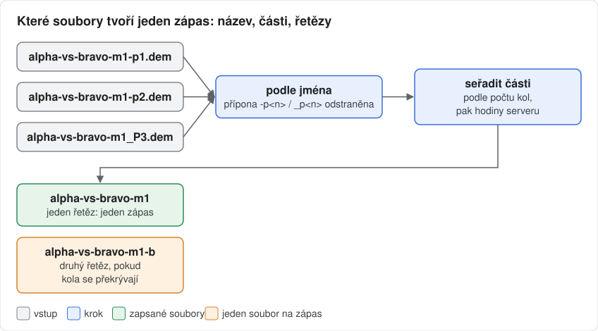

# Sestavení zápasu {#building-a-match}

Jak se zápas skládá z částí dema: které soubory patří k sobě, jeden čas napříč
nimi, kola a jak každé skončilo, týmy a jejich strany a každý řádek tabulky
teplotní mapy se zabitími, odplatami, otevíracími souboji, poškozením,
zábleskami a ekonomikou. Kód:
[`heat3d_cs2/match.py`](https://github.com/Holdi601/3DHeat-CS2/blob/main/heat3d_cs2/match.py).
Výsledková tabule z něj vypočtená je na stránce [Statistiky](statistics.md).

## Přehled {#overview}

1. Načte se každý soubor se jménem zápasu ([Čtení dema](reading-demos.md)).
2. Vyřeší se duplicitní řádky hráčů v každém souboru (obnovená kola).
3. Soubory se seřadí do **řetězů** - zápasů - a každý řetěz se seřadí do
   pořadí.
4. Každá část se zařadí na **herní hodiny zápasu**.
5. **Kola** se najdou v každé části; pozdější zápis kola v části nahradí
   dřívější zápis.
6. **Hráči** a **týmy** se pojmenují a strany a skóre každého kola se uvedou
   podle názvu týmu. Když jsou strany známé, následují délka poločasu,
   pistolová kola a **nákup** každé strany.
7. Sestaví se **řádky**: pozice, výstřely, hody, detonace, položení bomby,
   deaktivace, zabití, smrti, zranění, oslepení, exploze.
8. Každý řádek dostane označení kola, fázi, čas kola, informaci, zda jeho
   strana kolo vyhrála, a nákup své strany; řádky mimo každé kolo se vyřadí.

## Obnovená kola: jeden řádek na hráče a takt {#restored-rounds-one-row-per-player-per-tick}

Když se kolo obnoví ze zálohy uvnitř jednoho souboru, dema nesou staré
herní modely hráčů vedle nových po několik sekund: dva řádky pro jednoho
hráče v jednom taktu, jeden tam, kde zrušené kolo hráče nechalo, a jeden na
místě oživení obnoveného kola. U každého takového hráče se zdvojené takty
procházejí **zpět** od prvního jednoduchého řádku po nich: v každém taktu se
ponechá kandidát nejblíže pozici, která následuje, a ten se stane odkazem pro
takt před ním. Když po nich žádný jednoduchý řádek není, ponechá se poslední
kandidát. Každý hráč si tedy ponechá ten řádek, který vede dál, tam kam
půjde.

## Živá část souboru {#the-live-part-of-a-file}

**Začátek živé části** souboru je takt jeho poslední události
`round_announce_match_start`, nebo takt 0, pokud žádnou nemá (pozdější část
rozděleného zápasu obvykle žádnou nemá). Vše před začátkem živé části se
vynechá, stejně jako vše označené `is_warmup_period`. Kolo nožů nebo restart
před oznámením se proto vynechá; kolo nožů, za kterým **nenásleduje** oznámení
začátku zápasu, se nerozpozná jako takové (viz [Omezení](limits.md)).

**Kola** souboru jsou události `round_freeze_end` od začátku živé části dál,
mimo rozcvičku, rozpoznané podle jejich `total_rounds_played` (od nuly
počítaný index kola, které se má teprve hrát). Soubor bez nich nemá žádná
kola a nepatří do žádného zápasu.

## Hodiny {#the-clock}

Časy jsou v sekundách. Uvnitř souboru se čas počítá v **taktech**: `game_time`
serveru v prvním vzorkovaném taktu plus takty od té doby / 64. Vlastní hodiny
serveru se během pauzy zastaví, zatímco takty běží dál; čteno přes hodiny by
dva okamžiky pozastaveného zápasu měly stejný čas.

Každý soubor má *první hodiny* (čas na začátku jeho živé části) a *poslední
hodiny* (v jeho posledním vzorkovaném taktu).

### Části a řetězy {#parts-and-chains}

Soubory pojmenované jako jeden zápas ([Příkazy](commands.md#which-files-are-one-match))
se nejdřív seřadí podle indexu svého prvního kola, pak podle prvních hodin.
Pak každý v tomto pořadí připojí k prvnímu řetězu, na který navazuje, nebo
začne nový řetěz. Část navazuje na řetěz, když index jejího prvního kola je
alespoň roven indexu posledního kola poslední části řetězu, **a** zároveň
platí jedno z těchto:

- hodiny serveru běží dál: její první hodiny nejsou dříve než poslední hodiny
  řetězu minus 5 s; nebo
- počet kol běží dál: index jejího prvního kola je index posledního kola
  řetězu, nebo ten následující.

Počet kol rozhoduje a hodiny rozhodují jen v případě shody, protože server
restartovaný kvůli obnovení kola spustí své hodiny znovu, zatímco dva různé
zápasy pod jedním názvem (stejné týmy na stejné mapě na dvou akcích) mají
překrývající se počty kol. Řetězy se řadí podle počtu kol, které pokrývají,
od nejvíce; první si ponechá název zápasu, ostatní se zapisují jako
`<název>-b`, `<název>-c`, ...

### Herní hodiny zápasu {#the-match-clock}

Nula zápasu je první hodina první části: **čas zápasu 0 je začátek živé části
prvního souboru**. Každá další část se na ně zařadí:

- kde hodiny serveru běží dál (jeho první hodiny nejsou dříve než poslední
  hodiny předchozí části minus 5 s), použijí se hodiny serveru tak, jak jsou;
- kde byly restartovány, část se zařadí tak, aby navazovala **o jednu
  sekundu** po skončení předchozí části.

## Kola {#rounds}

Pro každé `round_freeze_end` části (v pořadí taktů) běží okno kola až k dalšímu
konci zmrazení v téže části, nebo ke konci souboru. Uvnitř něj je kolo
**rozhodnuto** v prvním vzorkovaném taktu, kde herní stav ukazuje
`total_rounds_played` = index kola + 1 a `round_win_status` 1 (remíza), 2 (T
vyhrálo) nebo 3 (CT vyhrálo). Kolo bez takového vzorku v okně bylo přerušeno
koncem souboru; jeho číslo jde do seznamu **neúplných** kol zápasu (pokud jiná
část nemá kolo úplné).

| Pole kola | Odkud |
|---|---|
| `number` | index + 1 (od 1, jak hra počítá) |
| `start` | čas zápasu konce zmrazení - hráči se mohou hýbat |
| `end` | čas zápasu prvního vzorku, který ukazuje kolo rozhodnuté |
| `until` | čas zápasu dalšího `round_prestart` po `end`, pokud je uvnitř okna; jinak konec okna nebo poslední takt souboru, co nastane dřív (a nikdy ne před `end`) |
| `winner` | `T` pro stav výhry 2, `CT` pro 3, prázdné pro 1: remíza je rozhodnutá, bez vítěze |
| `reason` | `round_win_reason` v tom vzorku, pojmenovaný níže |
| `score` | název týmu -> počet vyhraných kol po tomto kole: `team_rounds_total` každé strany v rozhodujícím vzorku; kde dema žádné nemá, skóre předchozího kola plus jedna pro vítěze |
| `sides` | název týmu -> `T` / `CT` v tomto kole |
| `equipment` | strana -> součet `current_equip_value` **živých** hráčů této strany v prvním vzorku od konce zmrazení nebo později |
| `buy` | strana -> `pistol`, `eco`, `force` nebo `full` ([Ekonomika a typy nákupu](#economy-and-buy-types)) |
| `plant` | první `bomb_planted` po konci zmrazení a až do `end`, jinak žádné |
| `exploded` | čas zápasu prvního `bomb_exploded` po tomto položení a před dalším koncem zmrazení, pokud existuje (není v dokumentu zápasu; určuje čas řádku `explode`) |

`reason`, z `CSRoundEndReason` hry:

| Kód | `reason` |
|---|---|
| 1 | `bomb` (cíl vybuchl) |
| 7 | `defuse` |
| 8, 9 | `elimination` (CT vyhrála / T vyhrálo eliminací) |
| 10 | `draw` |
| 12 | `time` (cíl zachráněn) |
| 17, 18 | `surrender` |
| cokoli jiného | `other` |

Když několik částí obsahuje totéž kolo (podle indexu), ponechá se verze
pozdější části. Kola se pak vypisují podle indexu. Zápas, jehož první kolo
není kolo 1, zaznamená chybějící čísla (`missing` v dokumentu zápasu); řádek
příkazu říká *zaznamenáno od kola N*.

### Položení bomby {#the-plant}

| Pole | Odkud |
|---|---|
| `site` | `A` nebo `B`: zóna bomby, ve které podle hry stál plantér (`which_bomb_zone`, 1 A, 2 B); bez ní název místa plantéra (`BombsiteA`, `BombsiteB`); bez toho písmeno, které dalo jiné položení téhož souboru ve stejné zóně (číslo entity zóny je v události `site`). Prázdné, když nic neříká - nikdy číslo. |
| `time` | sekundy **do kola** (od jeho konce zmrazení), jako čas zabití |
| `player`, `steamid` | plantér |
| `x`, `y`, `z` | pozice plantéra v herních jednotkách: kde bomba leží |
| `place` | název místa plantéra při položení |

### Fáze {#the-phases}

Čas od `start` do `end` je **živá** fáze kola; od `end` do `until` jeho
**fáze po**, kdy vítězové hledají a poražení šetří. Řádek patří tomu kolu,
jehož `[start, until)` obsahuje jeho čas, a je `after`, když jeho čas je
pozdější než `end`. Čas zmrazení leží mezi koly a nepatří do žádného z nich.

## Hráči a týmy {#players-and-teams}

**Hráč** je každý, kdo byl alespoň jednou živý na straně (tým 2 nebo 3), mimo
čas zmrazení a rozcvičku, po začátku živé části. Trenér nebo kaster na straně
týmu nikdy nežije a hráčem není. Každý hráč je veden podle svého Steam ID;
jméno je poslední viděné.

**Tým** hráče je název klanu, který hra dala jeho straně (`team_clan_name`),
ten viděný u něj nejčastěji - dema jej na samém konci vymažou. Zápas hraný bez
názvů klanů pojmenuje týmy podle strany, na které začali: `Started T` a
`Started CT`.

**Strany** každého kola vycházejí z toho, kdo byl na které straně mezi koncem
zmrazení a koncem kola: každé straně se přiřadí označení týmu, které nese
většina jejích hráčů. Seznam `teams` zápasu je v pořadí výskytu, kolo po kole,
strana T před CT; obvykle je první tým, který začal na T.

## Řádky {#the-rows}

Každá vzorkovaná pozice a každá událost se stane jedním řádkem
[teplotní tabulky](output-table.md). Hráči jsou na straně jen tehdy, když je
jejich `team_num` 2 nebo 3.

### Pozice {#positions}

Z vzorkovaných řádků živých hráčů na straně, mimo čas zmrazení a rozcvičku,
po začátku živé části: pozice, směr pohledu, zdraví, pancíř, peníze, hodnota
výbavy, držená zbraň, místo.

Směr pohledu je jednotkový vektor v souřadnicích hry:
`(cos pitch * cos yaw, cos pitch * sin yaw, -sin pitch)` - pitch hry je kladný
při pohledu dolů, takže pohled dolů dává záporné Z.

Držená zbraň je `active_weapon_name` tak, jak ji hra pojmenuje, až na to, že
každý název obsahující `Knife`, `Bayonet`, `Karambit` nebo `Daggers` se stane
`Knife`.

### Výstřely a hody {#shots-and-throws}

Z `weapon_fire`, na pozici střelce. Nože (`knife`, `bayonet` v id zbraně) a C4
se vynechají. Granáty (`smokegrenade`, `flashbang`, `hegrenade`, `molotov`,
`incgrenade`, `decoy`) jsou řádky **throw** (hod), vše ostatní řádky **shot**
(výstřel). Zbraň se uvede tak, jak ji hra zobrazuje (níže).

### Detonace granátů {#grenade-detonations}

| Událost | Řádek | `weapon` |
|---|---|---|
| `smokegrenade_detonate` | `smoke` | Smoke Grenade |
| `flashbang_detonate` | `flash` | Flashbang |
| `hegrenade_detonate` | `he` | High Explosive Grenade |
| `inferno_startburn` (molotov a zápalný granát) | `molotov` | Molotov |
| `decoy_detonate` | `decoy` | Decoy Grenade |

Pozice je **kde granát vybuchl** (události `x`, `y`, `z`); hráč a strana jsou
hodícího. Dema pro granát nepojmenují místo, jen pro hráče, takže `place`
zůstává prázdné: řádek netvrdí místo, kde nebyl. Místo hodícího v ten okamžik
se uchová jako `throwerPlace`.

### Položení a deaktivace {#plants-and-defuses}

Řádky `plant` a `defuse` jsou na pozici hráče, zbraň `C4 Explosive`. Položená
bomba, která vybuchla, dostane řádek **explode**: na pozici položení, v čase
`bomb_exploded`, plantér jako hráč (s jeho Steam ID), strana `T`, tým T kola
jako `team` a místo položení. Patří sem i bomba, která vybuchne poté, co T už
vyhrálo eliminací. Kde dema nemá `bomb_exploded`, dostane řádek kolo, které
vyhrála bomba (`reason` = `bomb`) s položením, a to v `end` kola.

### Zabití a smrti {#kills-and-deaths}

Každé `player_death` v kole dá jeden **záznam zabití** (tabulka `kills`
zápasu) s těmito údaji:

| Pole | Je |
|---|---|
| attacker, victim, assister | jména, Steam ID, strany; útočník je prázdný pro svět (pád, bomba) |
| `weapon` | zbraň z události, pojmenovaná tak, jak ji hra zobrazuje |
| `headshot` | příznak z události |
| `wallbang` | `penetrated` > 0 |
| `throughSmoke` | `thrusmoke` |
| `flashAssist` | `assistedflash` |
| `noscope`, `attackerBlind` | příznaky z události (`noscope`, `attackerblind`); sloupce řádků `kill` a `death` a v zabitích dokumentu zápasu |
| `suicide` | útočník a oběť je tentýž hráč: například vlastní granát |
| `teamkill` | útočník a oběť na téže straně, s útočníkem, a není to sebevražda |
| `opening` | první zabití nepřítele v kole (níže) |
| `traded`, `trade` | níže |
| pozice | pozice a místo útočníka i oběti |

Z každého záznamu dostane tabulka řádek **death** na pozici oběti (každou
smrt, včetně smrtí způsobených světem, týmových zabití a sebevražd) a - pro
zabití nepřítelem (útočník, ne týmové zabití, ne sebevražda) - řádek **kill**
na pozici vraha.

**Otevření.** První zabití nepřítele v každém kole, zatímco je živé, je jeho
otevírací souboj. Týmové zabití, sebevražda nebo smrt způsobená světu před ním
se přeskočí, takže otevření je pořád první souboj kola; kolo bez zabití
nepřítele během živé fáze nemá žádné otevření.

**Traded** a **trade.** Smrt od nepřítele je **odplacena** (`traded`), když
jejího vraha zabije některý ze stran oběti do **5 sekund** po ní (více než 0
a nejvýše 5 s později, ve stejném kole); první takové zabití je **odplata**
(`trade`). V tabulce je sloupec `traded` řádku `kill` 1 u odplaty; u řádku
`death` je 1 u smrti, která byla pomstěna. Počítají se i zabití z fáze po.

### Poškození {#damage}

Z `player_hurt`, jen mezi **nepřáteli** (oba na straně, různé strany).
Poškození je zdraví skutečně **ztracené**: pro každou oběť v každém kole
zdraví začíná na 100; každý zásah počítá `min(dmg_health, zdraví před ním)`
a `health` z události (co zbylo) se stane hodnotou „před“ pro další zásah.
Zásah 137 poškození headshotem na hráče se 40 zdraví počítá jako 40, jak to
počítá výsledková tabule hry. Zásahy od `hegrenade`, `inferno`, `molotov`
a `incgrenade` jsou **poškození utilitou**. Každý zásah je řádek **hurt** na
pozici oběti, útočník jako `other`. Poškození spoluhráčů a vlastní poškození
nejsou v tabulce ani ve statistikách.

### Záblesky {#flashes}

Z `player_blind`, jen **nepřátelé** (ne spoluhráči a ne trenér nebo kaster,
který se dívá): jeden řádek **blind** na každého oslepeného hráče, na pozici
oslepeného hráče, zábleskař jako `other`, doba oslepení v sekundách jako
`duration`. Každá délka se zachová; statistiky počítají jen oslepení alespoň
jednu sekundu.

## Názvy zbraní {#weapon-names}

Id zbraně z události (`ak47`, `weapon_ak47`, `knife_karambit`) se zobrazí tak,
jak ji hra pojmenuje ve vlastním poli `active_weapon_name` hráčů, takže zbraň
zabití a držená zbraň se čtou stejně: `ak47` -> `AK-47`, `m4a1` -> `M4A4`,
`m4a1_silencer` -> `M4A1-S`, `hkp2000` -> `P2000`, `taser` -> `Zeus x27`,
`inferno` a `molotov` -> `Molotov`, `incgrenade` -> `Incendiary Grenade`,
`c4` a `planted_c4` -> `C4 Explosive`, `world` -> `World`, a tak dál pro každou
zbraň a granát (tabulka `WEAPONS` v `match.py`). Cokoli s `knife` nebo
`bayonet` v id je `Knife`. Id, které v tabulce není, se zachová tak, jak je.

## Ekonomika a typy nákupu {#economy-and-buy-types}

Na konci zmrazení se hodnota výbavy každé strany sečte přes její živé hráče
v prvním vzorku od té doby a vydělí počtem hráčů:

| Kolo | Průměrná výbava na hráče | `buy` |
|---|---|---|
| pistolové kolo (první v každém řádném poločase) | jakákoli | `pistol` |
| ostatní | pod 1 500 $ | `eco` |
| ostatní | 1 500 $ až pod 4 000 $ | `force` |
| ostatní | 4 000 $ nebo více | `full` |

Pistolová kola se řídí poločasem, se kterým se zápas hrál, ne pevným
formátem. Poločas končí tam, kde se strany poprvé prohodí mezi dvěma koly, která
na sebe navazují, obě v řádné hře: jeho délka (`halfLength` v dokumentu zápasu)
je kolo před prohozením - 12 ve formátu 24 kol, 15 v tom 30kolovém. Kolo 1 a
kolo po poločase jsou pistolová kola. Kolo je prodloužení, když počet
prodloužení hry (`m_nOvertimePlaying`) je na začátku jeho zmrazení vyšší než
0; kde dema takový počet nemá, je prodloužením každé kolo po dvou poločasech.
Poločasy prodloužení začínají s penězi, které nastaví server, a nemají pistolové
kolo, i když se strany také prohodí. Záznam, který nikdy neukáže prohození
poločasu - začíná po něm, nebo končí před ním - nechá poločas neznámý a
pistolovým kolem je jen kolo 1.

## Označení a pořadí {#labelling-and-order}

Nakonec každý řádek dostane:

- `match` - název zápasu; `map` - mapa z hlavičky dema;
- `round` a `roundId` (`<zápas> #NN`, dvě číslice);
- `phase` - `live` nebo `after`;
- `roundTime` - sekundy od konce zmrazení kola;
- `won` - 1, pokud strana řádku kolo vyhrála, 0 pokud ne, prázdné pro řádek
  bez strany;
- `buy` - nákup strany řádku v tomto kole;
- `team` - tým hráče řádku podle jeho Steam ID.

Řádky, jejichž čas není v žádném kole - před prvním koncem zmrazení prvního
kola, během zmrazení, po posledním kole - se vyřadí. Řádky se řadí podle času
a v rámci téhož času podle názvu události.
