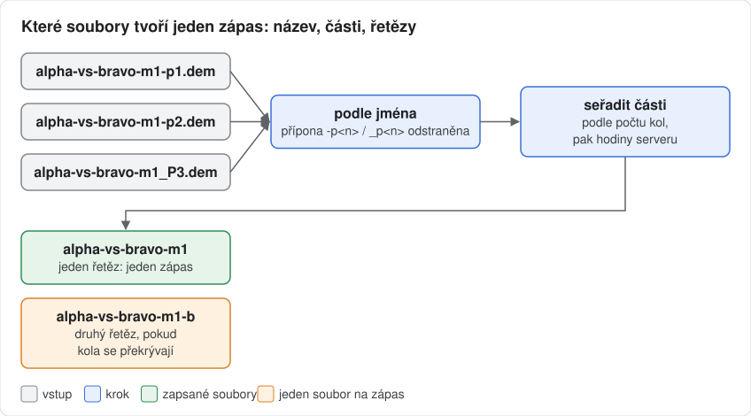

# Příkazy {#commands}

Nejste zvyklí na příkazový řádek? Nejdřív si přečtěte [Než začnete](before-you-start.md).
Tyto příkazy zadávejte v terminálu otevřeném ve složce, kam jste rozbalili nebo
naklonovali program; `<...>` jsou zástupné údaje a cesta s mezerami se dává do
uvozovek.

```text
python -m heat3d_cs2 demos <demo files or folders> -o <folder> [--every 8] [--jobs N] [--map TEXT] [--force] [--no-bulk] [--loose]
python -m heat3d_cs2 map <map name | path to its .vpk> -o <file.glb> [--game FOLDER] [--source2viewer EXE]
python -m heat3d_cs2 scoreboard <match.3dheat | match.json>
```

`python -m heat3d_cs2 --help` a `python -m heat3d_cs2 <verb> --help` vypíší
stejné volby; [Přehled příkazů](../cli-reference.md) je ukazuje všechny. Každé
spuštění nejdřív provede kontrolu vydání popsanou na stránce
[Aktualizace](updates.md) (vypne se proměnnou `HEAT3D_NO_UPDATE=1`).

Kód: [`heat3d_cs2/cli.py`](https://github.com/Holdi601/3DHeat-CS2/blob/main/heat3d_cs2/cli.py).

## `demos` - dema na tabulky a dokumenty zápasů {#demos---demos-into-tables-and-match-documents}

```powershell
python -m heat3d_cs2 demos D:\Demos\event -o out
python -m heat3d_cs2 demos alpha-vs-bravo-m1-p1.dem alpha-vs-bravo-m1-p2.dem -o out
python -m heat3d_cs2 demos D:\Demos -o out --map final --jobs 4
```

| Argument | Výchozí | Dělá |
|---|---|---|
| `paths` (jeden nebo více) | - | soubory dema a složky. Soubor se vezme, když má příponu `.dem` (v jakémkoli psaní). Složka se prohledá **rekurzivně** na soubory končící na `.dem`, bez ohledu na velikost písmen, v seřazeném pořadí. Komprimovaná dema (`.dem.zst`, `.dem.bz2`, archivy) se nečtou: nejdřív je rozbalte. |
| `-o`, `--out` | povinné | složka, do které se zapisuje; vytvoří se podle potřeby |
| `--every N` | `8` | vzorkuje každého hráče každých *N* taktů. Dema CS2 běží na 64 taktů za sekundu, takže 8 je osm vzorků za sekundu, 4 je šestnáct, 64 je jeden. Události se vždy čtou v jejich vlastním taktu, ať je *N* jakékoli. |
| `--jobs N` | `0` = polovina jader procesoru | kolik zápasů se převádí najednou, každý ve vlastním procesu. Nikdy méně než 1, nikdy více než je zápasů k práci. |
| `--map TEXT` | - | jen zápasy, jejichž **název** obsahuje *TEXT*, bez ohledu na velikost písmen (`--map final`). Filtruje se podle názvu souboru, ne podle mapy, kterou dema ve skutečnosti obsahuje. |
| `--force` | vypnuto | převádí i zápasy, které už jsou zapsané, a přepíše je |
| `--loose` | vypnuto | ponechá každý zápas jako samostatné soubory - tabulka, `.match.json`, pomocné soubory - místo jejich sbalení do jednoho kontejneru `.3dheat`. Viz [Jeden soubor na zápas](output-container.md). |
| `--container` | zapnuto | sbalí každý zápas do jednoho souboru `.3dheat`; výchozí, takže je tu jen pro jistotu |
| `--no-bulk` | vypnuto | vynechá proud entit, příkazy hráčů a proud animací z pomocného souboru paketů - přes polovinu velikosti dema i po kompresi. Kontrola zápasu pak tyto položky počítá jako `lost`, podle názvu. |


### Které soubory jsou jeden zápas {#which-files-are-one-match}



Název zápasu je název souboru dema bez přípony a bez označení části: `-p<číslice>`
nebo `_p<číslice>` na konci, bez ohledu na velikost písmen. Takže
`alpha-vs-bravo-m1-p1.dem`, `alpha-vs-bravo-m1-p2.dem` a
`alpha-vs-bravo-m1_P3.dem` jsou části jednoho zápasu, `alpha-vs-bravo-m1`.
Soubory se seskupují jen podle tohoto názvu - dva soubory se stejným názvem
v různých složkách jsou seskupeny také.

Označení části neříká nic o pořadí: `-p2` může být dřívější polovina. Části se
seřadí podle počtu kol, která obsahují, a pak podle hodin serveru; skupina,
která se ukáže jako dva různé zápasy (třeba stejné týmy na stejné mapě na
dvou akcích), se rozdělí na **řetězy**: řetěz s nejvíce koly se zapíše pod
samotným názvem, další jako `<název>-b`, pak `<název>-c` a tak dál. Soubor bez
jediného kola (jen rozcvička, pauza) nepatří do žádného řetězu. Jak se řetězy
hledají, je popsáno na stránce
[Sestavení zápasu](building-matches.md#parts-and-chains).

### Co se zapisuje {#what-is-written}

Pro každý zápas se do složky pojmenované podle mapy, kterou hlavička dema
uvádí (`unknown`, když žádnou neuvádí), zapíše jeden soubor `.3dheat`:

```text
out/
  de_x/
    alpha-vs-bravo-m1.3dheat
    alpha-vs-bravo-m2.3dheat
  de_y/
    ...
```

Na syntetickém dvoukolovém demu z testů:


S `--loose` je každý zápas tabulka, jeho dokument zápasu a čtyři pomocné
soubory vedle sebe ([Jeden soubor na zápas](output-container.md)):


Teplotní mapa je jedné mapy, takže načtení jedné složky v prohlížeči je
načtením zápasů jedné mapy. Viz [Teplotní tabulka](output-table.md) a
[Dokument zápasu](output-match-json.md).

### Co se přeskočí {#what-is-skipped}

Předtím, než se cokoli čte, se vypíše každý `*.3dheat` kdekoli pod `--out`
(kontejner se zapíše celý, nebo vůbec) a každý `*.parquet`, který má vedle sebe
svůj dokument zápasu (`<název>.match.json`). Zápas, jehož název se rovná některému
z těchto názvů souborů (bez přípony), se přeskočí, pokud není `--force`.
Tabulka bez dokumentu zápasu - běh zastavený mezi zápisem těchto dvou - se
nepočítá, takže se zápas převede znovu. Kontrola je jen podle názvu: zápas
převedený do jiné složky mapy nebo s jiným `--every` se pořád počítá jako
hotový. Když není co dělat:

```text
nothing to do: no demos found, or every match already written (--force redoes them)
```

### Co se vypisuje {#what-is-printed}

Nejdřív množství práce, potom jeden řádek na zápas, jakmile je hotový (v pořadí,
v jakém se dokončují, ne v pořadí souborů):

```text
3 match(es), 3 at a time
alpha-vs-bravo-m1: de_x, 21 rounds (Alpha 13 Bravo 8), 412,377 rows, lost 0
alpha-vs-bravo-m2: de_y, 30 rounds (Bravo 16 Alpha 14), 598,104 rows, 1 incomplete round(s) left out, lost 0
alpha-vs-bravo-m3: de_y, 18 rounds (Alpha 13 Bravo 5), 330,981 rows, recorded from round 3, lost 1,204,331 (svc_PacketEntities, svc_UserCmds, DEM_AnimationData)
```

(Čísla jsou jen ukázková.) Skóre je z posledního kola, tým po týmu v pořadí,
v jakém je uvádí dokument zápasu. *incomplete round(s) left out* počítá kola,
která dema přerušilo dříve, než byla rozhodnuta; *recorded from round N* říká,
že záznam začíná pozdě; *lost* je vlastní kontrola dokumentu zápasu - kolik
položek dema se nikam nezapsalo a jakých druhů (`--no-bulk` způsobí, že objemová
data jsou ztracena). Zápas, který nic nedá, to řekne:

```text
alpha-vs-bravo-m4: no round in 1 file(s) - nothing written
alpha-vs-bravo-m4-b: no complete round in 1 file(s) - nothing written
```

Chyba v jednom zápase nezastaví ostatní; vypíše se jako
`<název>: failed - <error>`.

### Návratový kód {#exit-code}

`0`, když byl každý zápas převeden (nebo nebylo co dělat), `1`, když selhal
alespoň jeden.

### Jak dlouho to trvá {#how-long-it-takes}

Každý zápas se čte a sestavuje v pracovním procesu. Složka několika stovek dem
trvá minuty s výchozím `--jobs`. Paměť na jednu úlohu roste s délkou zápasu
a s menším `--every`: každý pracovní proces drží každý vzorkovaný řádek hráče
svého zápasu (zhruba deset hráčů krát 64 / *N* řádků za sekundu záznamu), než
zapíše.

Pomocné soubory trvají déle než tabulka: každá vlastnost, kterou parser čte,
se čte v každém taktu, po okně taktů (asi dvě minuty pro 40minutové dema,
nejvýš zhruba 3 GB paměti na úlohu), a pak se dema projde ještě jednou kvůli
snímkům a zprávám.

## `map` - geometrie mapy jako `.glb` {#map---a-maps-geometry-as-glb}


```powershell
python -m heat3d_cs2 map <map> -o out/<map>/<map>.glb
python -m heat3d_cs2 map <map> -o <map>.glb --game "D:\Games\Steam\steamapps\common\Counter-Strike Global Offensive"
python -m heat3d_cs2 map "D:\maps\<map>.vpk" -o <map>.glb --source2viewer C:\Tools\Source2Viewer-CLI.exe
```

| Argument | Výchozí | Dělá |
|---|---|---|
| `name` | - | název mapy (například `de_x`), nebo cesta k jejímu `.vpk`. Cesta končící na `.vpk`, která existuje, se použije tak, jak je; cokoli jiného se hledá podle názvu souboru v nainstalované hře. |
| `-o`, `--out` | povinné | `.glb`, který se zapíše; jeho složka se vytvoří podle potřeby |
| `--game FOLDER` | knihovny Steamu | složka instalace CS2 (ta, která obsahuje `game\csgo`), když Steam ji nezná. S `--game` se hledá jen v této složce. |
| `--source2viewer EXE` | `HEAT3D_SOURCE2VIEWER`, pak `PATH` | spustitelný soubor Source2Viewer CLI |

Při úspěchu se vypíše:

```text
out/de_x/de_x.glb: de_x, 412,880 triangles (151,204 ground) in 14 parts
```

(čísla jsou jen ukázková). Zápis `.glb` vedle tabulek mapy
(`out/<map>/<map>.glb`) udrží data a geometrii mapy v jedné složce. Jak export
funguje: [Export mapy](map-export.md).

Chyby, každá vypsaná jako `error: ...` s návratovým kódem `2`:

| Zpráva | Znamená |
|---|---|
| `no de_x.vpk found in an installed CS2 - pass --game <CS2 folder> or the .vpk path` | mapa není v žádné nalezené knihovně Steamu, nebo je název špatně |
| `Source2Viewer-CLI not found: ...` | ani `--source2viewer`, ani `HEAT3D_SOURCE2VIEWER`, ani `PATH` nedaly existující soubor |
| `Source2Viewer did not export de_x's collision mesh:` a za ním konec jeho výstupu | selhal, nebo nezapsal žádný `.glb` |
| `de_x's collision mesh has nothing but clip brushes` | po vynechání clipů a oblohy nezbylo nic |

## `scoreboard` - zápas jako text {#scoreboard---a-match-as-text}

```bash
python -m heat3d_cs2 scoreboard out/de_x/alpha-vs-bravo-m1.3dheat
python -m heat3d_cs2 scoreboard out/de_x/alpha-vs-bravo-m1.match.json   # after demos --loose
```

Vypíše výsledkovou tabuli zápasu z jeho [dokumentu zápasu](output-match-json.md),
bez otevření prohlížeče. Čte dokument uvnitř kontejneru `.3dheat`, nebo samostatný
`<zápas>.match.json`. Na syntetickém dvoukolovém demu z testů:


```text
alpha-vs-bravo-m1 - de_test  Alpha 2  Bravo 0

Alpha
player                 K   D   A  +/-    ADR   KAST   HS%  OK-OD  clutch
ash                    1   0   0   +1   50.0 100.0%    0%   0-0     1/1
ace                    1   1   0   +0   50.0 100.0%  100%   1-0     0/0

Bravo
player                 K   D   A  +/-    ADR   KAST   HS%  OK-OD  clutch
ben                    1   1   0   +0   50.0 100.0%    0%   0-0     0/1
bob                    0   1   0   -1    0.0 100.0%    0%   0-1     0/0

rounds  1:TK 2:TB
```

- První řádek: název zápasu, mapa a konečné skóre každého týmu.
- Tabulka pro každý tým, v pořadí `teams` dokumentu zápasu; hráči v pořadí
  dokumentu zápasu (podle zabití mínus smrti, pak zabití, nejlepší první).
  Jména jsou zkrácena na 19 znaků.
- Sloupce: **K** zabití, **D** smrti, **A** asistence *včetně asistencí
  zábleskem*, **+/-** zabití mínus smrti, **ADR**, **KAST** (%), **HS%**
  (zaokrouhleno na celá procenta), **OK-OD** otevírací zabití - otevírací
  smrti, **clutch** vyhrané clutche / odehrané clutche. Definice:
  [Statistiky](statistics.md).
- Pás kol: `<kolo>:<vítězná strana><jak>`, s **B** bomba vybuchla,
  **D** deaktivována, **K** eliminace, **T** vypršel čas, a **?** pro cokoli
  jiného (remíza, vzdání, jiné). Remíza nemá vítěznou stranu: `<kolo>:?`.

Soubor, který není platný JSON, nebo se nenajde, zastaví program chybou; dokument
JSON bez polí dokumentu zápasu spadne s chybou Pythonu (dál se neověřuje).
