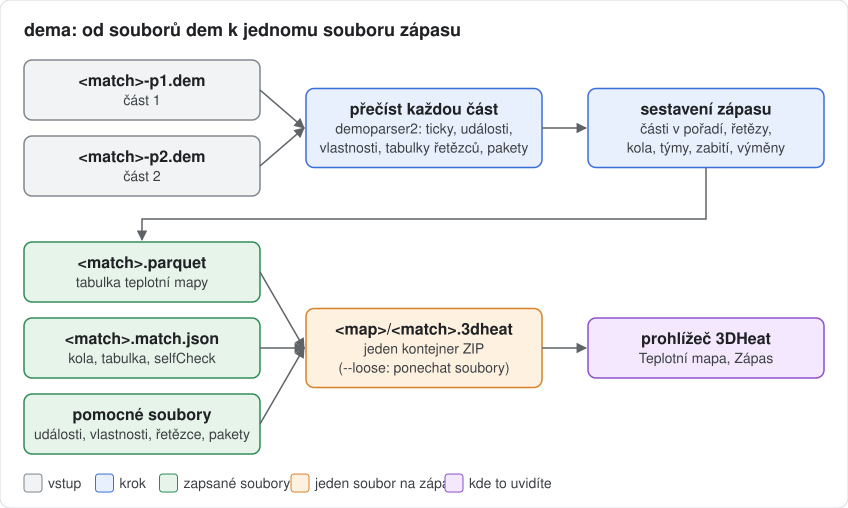

# 3DHeat CS2 {#dheat-cs2}

**Co to je?** Counter-Strike 2 umí uložit záznam zápasu, který se nazývá *demo*. Tento nástroj
promění demo na soubory, které prohlížeč 3DHeat dokáže zobrazit ve 3D: kde kdo stál, umíral,
házel a zakládal bombu, kolo po kole. Umí také promění mapu CS2 na 3D model, na který je zobrazí.

**Proč ho používat?** Abyste si prošli své vlastní zápasy, položili přes sebe více zápasů jedné
mapy jako jednu teplotní mapu, a pro statistiky zápasů, jako ADR (průměrné poškození za kolo)
a KAST (podíl kol, ve kterých hráč zabil, asistoval, přežil nebo byl vyměněn).

**Příklad:** dovnitř `alpha-vs-bravo-m1.dem`, ven `out/de_x/alpha-vs-bravo-m1.3dheat`
(`de_x` je vymyšlený název mapy).



Podrobněji: 3DHeat CS2 promění **dema Counter-Strike 2** na tabulku teplotní mapy a dokument zápasu
pro každý zápas a **mapu CS2** na geometrii úrovně. Výstupy jsou určeny pro
telemetrický prohlížeč [3DHeat](https://holdi601.github.io/3DHeat/)
([zdroj](https://github.com/Holdi601/3DHeat)), ale jsou to běžné soubory – Parquet, JSON
a binární glTF – které může číst i cokoli jiného.

Je to malý balíček v Pythonu, `heat3d_cs2`, spouštěný z příkazového řádku. Čte dema z disku
(žádná nestahuje) pomocí [demoparser2](https://github.com/LaihoE/demoparser) a exportuje mapy
z nainstalované hry pomocí příkazové verze Source2Viewer
([ValveResourceFormat](https://github.com/ValveResourceFormat/ValveResourceFormat)).

## Rychlý start {#quick-start}

Nikdy jste nepracovali s příkazovým řádkem? Nejdřív si přečtěte [Než začnete](before-you-start.md).

```bash
pip install -r requirements.txt
python -m heat3d_cs2 demos <demo files or folders> -o out   # every match in them
python -m heat3d_cs2 map <map> -o out/<map>/<map>.glb       # the map from the installed game
python -m heat3d_cs2 scoreboard out/<map>/<match>.3dheat    # a match's scoreboard as text
```

Měli byste vidět `1 match(es), 1 at a time ...` a pak jeden řádek na každý zápas
(viz [Příkazy](commands.md#what-is-printed)).

`demos` zapíše pro každý zápas jeden soubor do složky pojmenované podle mapy:
`out/<map>/<match>.3dheat`, [kontejner `.3dheat`](output-container.md) – formát prohlížeče
pro jeden soubor na zápas ([specifikace](https://holdi601.github.io/3DHeat/container.html)).
Obsahuje tyto části; `--loose` je zapíše jako samostatné soubory:

| Část | Co obsahuje | Načte se v |
|---|---|---|
| `<match>.parquet` (role `table`) | každý živý hráč osmkrát za sekundu se svým stavem (zdraví, peníze, oslepení, zaměření, zóna, inventář, ...) a každá událost, kde se stala (zabití, smrt, zranění, výstřel, hod, výbuchy granátů, oslepení, založení, odminování, výbuch, a konec kola pro každého hráče s tím, co mu kolo vyneslo), jeden řádek na každou | záložka Teplotní mapa |
| `<match>.match.json` (role `match`, dokument zápasu) | týmy, skóre, každé kolo (vítěz, jak, ekonomika, založení, zabití v pořadí, clutche, přeživší) a řádek tabulky výsledků každého hráče | záložka Zápas |
| `<match>.events/props/strings/packets.parquet` | všechno ostatní, co dema obsahuje, celé (pomocné soubory) | uchováno kvůli úplnosti |

`map` zapíše `<map>.glb`: kolizní síť mapy – podlahy, zdi, krabice, bez dekorací – rozdělenou na terén
a stavbu, ve stejném rámci a jednotkách jako tabulky, takže přesně leží pod teplotní mapou
(panel Pozadí / úroveň).

## Přehled dokumentace {#map-of-this-documentation}

| Stránka | Co obsahuje |
|---|---|
| [Než začnete](before-you-start.md) | Python, terminál, zástupné texty, jak vypadá úspěch a časté chyby |
| [Instalace](installing.md) | Python, balíčky, příkazový řádek Source2Viewer, kde musí být CS2 |
| [Příkazy](commands.md) | `demos`, `map`, `scoreboard`: každá možnost, co se vypisuje, stavové kódy |
| [Čtení dema](reading-demos.md) | co se z demo souboru čte: vzorkované ticky, vlastnosti hráčů, herní pravidla, události |
| [Sestavení zápasu](building-matches.md) | části a řetězy, herní hodiny zápasu, kola, týmy a strany, řádky, zabití, výměny, otevření, poškození, záblesky, ekonomika |
| [Statistiky](statistics.md) | tabulka výsledků: K/D/A, ADR, KAST, HS %, otevření, výměny, multi-killy, clutche, utility, záblesky |
| [Tabulka teplotní mapy](output-table.md) | soubor Parquet: každý sloupec, jeho typ, které události ho plní, nápovědy v patičce `heat3d`, osy |
| [Dokument zápasu](output-match-json.md) | dokument `.match.json`, pole po poli |
| [Jeden soubor na zápas](output-container.md) | kontejner `.3dheat`, který `demos` zapisuje ve výchozím stavu, `--loose` |
| [Export mapy](map-export.md) | jak se exportuje kolizní síť mapy, rámec, pojmenování uzlů, jednotky |
| [Použití s 3DHeat](using-with-3dheat.md) | načtení tabulek, dokumentů zápasů a map do záložek Teplotní mapa a Zápas prohlížeče |
| [Omezení](limits.md) | co se předpokládá, co se nezpracovává, co není ověřeno |
| [Aktualizace](updates.md) | kontrola vydání při startu a `python -m heat3d_update` |
| [Vývoj](development.md) | uspořádání kódu, testy, syntetický testovací demo soubor |
| [Přehled příkazů](../cli-reference.md) | `--help` každého příkazu, vygenerováno z kódu |
| [Údržba](maintaining.md) | kontrolní seznam vydání pro tyto stránky |

## Proti čemu se ověřuje {#what-it-is-checked-against}

Dema z volné přírody nejsou jeden čistý soubor na zápas. Převodník zvládne zápas rozdělený do souborů
v libovolném pořadí, server restartovaný uprostřed zápasu, dva různé zápasy uložené pod jedním
názvem, kola obnovená ze zálohy, záznam, který začíná pozdě nebo končí brzy, pauzy a trenéry
na straně týmu – viz [Sestavení zápasu](building-matches.md). Ověřeno na velkém souboru
turnajových dem: v každém zápase skóre
sleduje vítěze kol, zabití každé strany jsou smrti té druhé a každé kolo začíná pěti proti pěti.

## Na co to použít {#what-to-point-it-at}

Dema vašich vlastních zápasů, dema, která jste ručně stáhli z turnajového webu, nebo dema z API, ke
kterému máte přístup. Dema jsou záznamy, jejichž obsah patří vydavateli a pořadatelům: výstupy
používejte pro svou vlastní analýzu a dema ani data z nich odvozená dál nešiřte. Nástroj čte dema z
disku a žádná nestahuje a nic ze hry se s ním nedodává: žádné herní soubory, žádný herní kód, žádné
DLL.

3DHeat CS2 není spojen se společností Valve ani jí schválen. Counter-Strike 2 a související názvy a
ochranné známky patří jejich vlastníkům. Držitelé práv: založte issue na
[github.com/Holdi601/3DHeat-CS2/issues](https://github.com/Holdi601/3DHeat-CS2/issues) - odpovídáme
rychle a na požádání cokoli odstraníme.

## Součást 3DHeat {#part-of-3dheat}

3DHeat CS2 je jeden z bezplatných nástrojů kolem prohlížeče 3DHeat; každý má vlastní
repozitář, vydání a licenci:

| Nástroj | Co dělá | Dokumentace |
|---|---|---|
| [3DHeat](https://github.com/Holdi601/3DHeat) | prohlížeč: teplotní mapy, analýza závodů a přehled zápasů ve 3D | [web](https://holdi601.github.io/3DHeat/) |
| [GameFiles](https://github.com/Holdi601/3DHeat-GameFiles) | tratě a úrovně ze souborů, které hry dodávají, jako 3D modely | [web](https://holdi601.github.io/3DHeat-GameFiles/) |
| [GameCapture](https://github.com/Holdi601/3DHeat-GameCapture) | telemetrie kol ze závodních her; úrovně přestavěné z videa hry | [web](https://holdi601.github.io/3DHeat-GameCapture/) |
| [Unreal Exporter](https://github.com/Holdi601/3DHeat-UnrealExporter) | zásuvný modul pro Unreal Editor, který exportuje úroveň jako jeden 3D model | [web](https://holdi601.github.io/3DHeat-UnrealExporter/) |
| [CS2](https://github.com/Holdi601/3DHeat-CS2) | dema Counter-Strike 2 do tabulek a dokumentů zápasů; mapy do 3D modelů | [web](https://holdi601.github.io/3DHeat-CS2/) |
| [Watcher](https://github.com/Holdi601/3DHeat-Watcher) | na pozadí zaznamenává, co hry zveřejňují o vaší hře | [web](https://holdi601.github.io/3DHeat-Watcher/) |
| [Ext-WarThunder](https://github.com/Holdi601/3DHeat-Ext-WarThunder) | replaye War Thunder do tabulek a dokumentů zápasů | [web](https://holdi601.github.io/3DHeat-Ext-WarThunder/) |
| [Ext-WoT](https://github.com/Holdi601/3DHeat-Ext-WoT) | replaye World of Tanks do tabulek a dokumentů zápasů | [web](https://holdi601.github.io/3DHeat-Ext-WoT/) |
| [Ext-WoWs](https://github.com/Holdi601/3DHeat-Ext-WoWs) | replaye World of Warships do tabulek a dokumentů zápasů | [web](https://holdi601.github.io/3DHeat-Ext-WoWs/) |
| [Ext-Squad](https://github.com/Holdi601/3DHeat-Ext-Squad) | dema serverů Squad do tabulek a dokumentů zápasů | [web](https://holdi601.github.io/3DHeat-Ext-Squad/) |
| [Ext-DCS](https://github.com/Holdi601/3DHeat-Ext-DCS) | mapy DCS World do 3D modelů | [web](https://holdi601.github.io/3DHeat-Ext-DCS/) |
| [Ext-IL2](https://github.com/Holdi601/3DHeat-Ext-IL2) | mapy IL-2 Sturmovik do 3D modelů | [web](https://holdi601.github.io/3DHeat-Ext-IL2/) |

## Licence {#licence}

MIT – viz [`LICENSE`](https://github.com/Holdi601/3DHeat-CS2/blob/main/LICENSE)
a [`LICENSES.md`](https://github.com/Holdi601/3DHeat-CS2/blob/main/LICENSES.md)
pro balíčky třetích stran.
