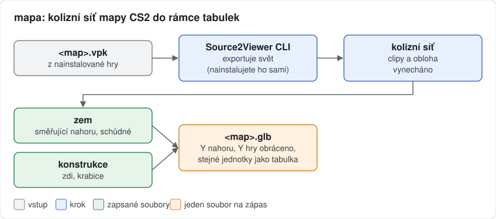

# Export mapy (`map`) {#map-export-map}

`python -m heat3d_cs2 map <map> -o <file.glb>` zapíše mapu CS2 jako geometrii
úrovně: **kolizní síť** světa, v rámci a jednotkách, ve kterých se kreslí
[teplotní tabulky](output-table.md). Kód:
[`heat3d_cs2/mapexport.py`](https://github.com/Holdi601/3DHeat-CS2/blob/main/heat3d_cs2/mapexport.py),
[`heat3d_cs2/glb.py`](https://github.com/Holdi601/3DHeat-CS2/blob/main/heat3d_cs2/glb.py).
Volby a hlášky: [Příkazy](commands.md#map---a-maps-geometry-as-glb).



## Proč kolizní síť {#why-the-collision-mesh}

Kolizní síť je to, na čem hráči stojí a za čím se schovávají - podlahy, zdi,
schody, bedny - bez dekorace: žádné rekvizity, které jen vypadají jako něco,
žádné textury, mnohem méně trojúhelníků než vykreslovací sítě. Teplotní mapa
potřebuje právě tohle pod sebou: něco, podle čeho čte pozice, ne obraz mapy.

## Jak se získá {#how-it-is-obtained}

1. **Najít mapu.** Cesta končící na `.vpk`, která existuje, se použije tak, jak
   je. Jinak se hledá `<name>.vpk` v `<CS2 folder>\game\csgo\maps\`, kde složka
   CS2 je `--game`, nebo `steamapps\common\Counter-Strike Global Offensive` v
   každé nalezené knihovně Steamu (viz [Instalace](installing.md#where-cs2-is-looked-for)).
2. **Najít CLI Source2Vieweru**: `--source2viewer`, pak `HEAT3D_SOURCE2VIEWER`,
   pak `Source2Viewer-CLI` / `Source2Viewer-CLI.exe` na `PATH`.
3. **Exportovat fyziku světa.** Source2Viewer se spustí takto:

   ```text
   Source2Viewer-CLI -i <map>.vpk -d -f maps/<map>/world_physics.vmdl_c --gltf_export_format glb -o <temporary folder>
   ```

   Dekóduje zkompilovanou fyziku Source 2 z vlastního archivu mapy a zapíše
   model (prázdný: svět nemá vlastní vykreslovací síť) a jeho fyziku vedle něj.
   Největší zapsaný `.glb` je fyzika. Když Source2Viewer selže, nebo nezapíše
   žádný `.glb`, příkaz se zastaví a ukáže posledních 800 znaků jeho výstupu a
   chybových hlášení.
4. **Přečíst ji.** Každý uzel scény se projde se svou transformací (matice,
   nebo posunutí-rotace-měřítko) a vezme se každý primitivní trojúhelník, s
   indexovým bufferem i bez něj, v pozicích světa.
5. **Vynechat, co není zeď ani podlaha.** Uzel, jehož název obsahuje `clip` -
   clipy hráčů, clipy NPC, clipy granátů: neviditelné zdi, které zastavují hráče
   a granáty - nebo `sky`, bez ohledu na velikost písmen, se zahodí.
6. **Pojmenovat povrch.** Fyzikální skupiny jsou pojmenované podle svého
   povrchu; název malými písmeny, bez úvodního `physics`, `physics_group` nebo
   `physics_passbullets` (a podtržítka za ním), je povrch: `physics_group_concrete`
   je `concrete`, `physics_passbullets_chainlink` je `chainlink`, a holé
   `physics_group` je `world`. Povrchy, skrz které procházejí kulky, se
   zachovají.
7. **Zpět do rámce hry.** Source2Viewer zapisuje glTF v metrech s osou Y nahoru:
   (Y, Z, X) hry vynásobené 0,0254. To se vrátí - každý bod se stane (X, Y, Z)
   hry v palcích.
8. **Oddělit zem od konstrukce**, trojúhelník po trojúhelníku: plocha, jejíž
   normála míří nahoru alespoň o 0,7 (její složka Z, normalizovaná) - sklony
   až zhruba 45 stupňů, tedy zhruba nejstrmější svahy, po kterých hráč v CS2 chodí, - je
   **zem**; všechno ostatní, včetně stěn a stropů, je **konstrukce**.
9. **Do rámce prohlížeče.** Každý bod se zapíše jako (X, Z, -Y): Y nahoru, Y
   hry se obrátí - rámec, ve kterém prohlížeč kreslí tabulky, když se řídí jejich
   nápovědami `heat3d`. Je to rotace, ne zrcadlení.
10. **Zapsat `.glb`.** Když nezbude nic (jen clipy), příkaz se zastaví s
    chybou. Jinak vypíše soubor, mapu, počet trojúhelníků, kolik jich je zem,
    a počet částí.

Nic tady nečte nic jiného než vlastní `.vpk` mapy a nic ze Source2Vieweru se
nepřibaluje ani nekopíruje.

## Soubor {#the-file}

Binární glTF 2.0 (`.glb`), jeden buffer, zapsaný `heat3d_cs2` (
`asset.generator`):

| Aspekt | Co |
|---|---|
| Uzly | jeden na část, všechny v kořeni, bez transformací, každý se svou vlastní sítí stejného názvu |
| Názvy uzlů | `ground:<surface>` nebo `structure:<surface>` (`ground:concrete`, `structure:metal`, `structure:world`), řazené podle názvu |
| Primitivy | jeden na síť, trojúhelníky, `POSITION` (float32, s min/max) a `NORMAL` (float32), indexy `uint32` |
| Stínování | ploché: jeden vrchol na roh trojúhelníku, každý s normálou svého trojúhelníku |
| Materiály, textury, UV, barvy | žádné |
| Jednotky | herní jednotky (**palce**), ne metry - na rozdíl od toho, co glTF předpokládá |
| Rámec | (X, Z, -Y) hry: Y v glTF je výška ve hře, Z v glTF je -Y ve hře |

Prefix `ground:` / `structure:` je konvence všech exportérů úrovní 3DHeat:
prohlížeč vezme část pojmenovanou tak doslova, místo aby hádal z geometrie, takže
podlahy dostanou stínování země a stěny kreslení konstrukce bez jakéhokoli
kroku klasifikace.

Protože jednotky jsou palce, jiný prohlížeč glTF ukáže mapu asi 39krát větší
(čte je jako metry); tam, kde na tom záleží, vynásobte 0,0254. V 3DHeat leží
přesně pod tabulkou, která je ve stejných jednotkách s měřítkem 1.

## Kontrola, že rámec je správný {#the-check-that-the-frame-is-right}

Test `test_players_stand_on_the_exported_floor` (spouští se jen tehdy, když jsou
dána dema a Source2Viewer, viz [Vývoj](development.md#tests)) vyexportuje mapu,
na které se dema hrála, vezme 300 náhodných vzorků pozic zápasu a pro každý
se podívá přímo dolů na nejvyšší trojúhelník země nejvýš 4 jednotky nad nohama
hráče. Vyžaduje, aby aspoň 98 % vzorků našlo zem, a aby medián výšky nad ní byl
menší než 5 jednotek. Zrcadlená mapa neprojde: když je zrcadlená špatnou osou,
velký podíl hráčů stojí nad ničím. README uvádí čísla této kontroly pro mapy
aktuálního soutěžního výběru.

## Co nedělá {#what-it-does-not-do}

- Žádná vykreslovací geometrie, textury ani dekorace - viz *proč* výše.
- Exportuje se jen to, co je v modelu `world_physics` mapy. Zda jsou v něm
  pohyblivé části (dveře) nebo rozbitné předměty, nebylo ověřeno.
- Žádné zjednodušování: prohlížeč 3DHeat zjednodušuje při importu podle
  nastavení **Cíl zjednodušení**.
- Mapy, které nejsou v nainstalované hře (dílenské mapy jinde na disku), fungují,
  když je jejich `.vpk` předáno jako cesta a obsahuje
  `maps/<name>/world_physics.vmdl_c`; není ověřeno.
