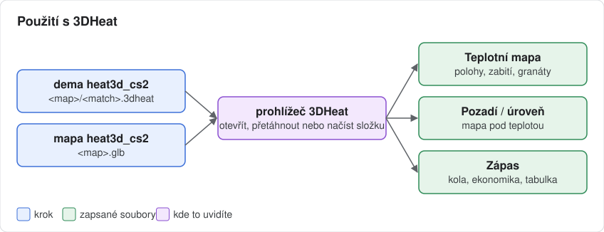

# Použití s 3DHeat {#using-it-with-3dheat}

Výstupy se načítají na tato místa [prohlížeče 3DHeat](https://holdi601.github.io/3DHeat):

| Soubor | Kde | Co dává |
|---|---|---|
| `<zápas>.3dheat` (výchozí) | karta **Teplotní mapa**, panel **Zdroj**, nebo karta **Zápas** | tabulku i dokument zápasu dohromady, jeden soubor na zápas ([kontejner](https://holdi601.github.io/3DHeat/container.html)) |
| `<zápas>.parquet` | karta **Teplotní mapa**, panel **Zdroj** | pozice a události jako teplotní mapa, přehrávání kvádrů, trasy |
| `<zápas>.match.json` | karta **Zápas**, **Načíst soubory zápasů…** | výsledková tabule, kola, průběh zabití, statistiky napříč zápasy, odkazy do teplotní mapy |
| `<map>.glb` | panel **Pozadí / úroveň**, **3D model…** | mapa pod teplotní mapou |

Dokumentace prohlížeče popisuje každou kartu celou: jeho stránky
[Analýza zápasu](https://holdi601.github.io/3DHeat/match-analysis.html),
[Načítání souborů](https://holdi601.github.io/3DHeat/loading-files.html),
[Mapování sloupců](https://holdi601.github.io/3DHeat/column-mapping.html)
a [Přehrávání kvádrů](https://holdi601.github.io/3DHeat/box-replay.html). Tato
stránka je jeho část pro CS2.



Prohlížeč: [github.com/Holdi601/3DHeat](https://github.com/Holdi601/3DHeat),
dokumentace [holdi601.github.io/3DHeat](https://holdi601.github.io/3DHeat/).

## Typická relace {#a-typical-session}

```bash
python -m heat3d_cs2 demos D:\Demos\event -o out
python -m heat3d_cs2 map <map> -o out/<map>/<map>.glb
```

1. **Karta Teplotní mapa -> Zdroj:** vyberte složku `out/<map>` (nebo ji
   přetáhněte). Každý `.parquet` v ní se stane jednou datovou sadou; soubory
   `.json` a `.glb` ve stejné složce se přeskočí jako „not a csv/parquet file“.
   Načtěte ji.
2. **Pozadí / úroveň -> 3D model…:** vyberte `out/<map>/<map>.glb`.
   **Uložit do knihovny** ho ponechá v prohlížeči pro příště.
3. **Karta Zápas -> Načíst soubory zápasů…:** vyberte soubory `.match.json` ze
   stejné složky (několik najednou), nebo je přetáhněte na pohled, zatímco je
   otevřená karta Zápas.

Načtěte najednou jen tabulky jedné mapy: souřadnice různých map se překrývají a
teplotní mapa dvou map současně nic neznamená. Složka na každou mapu je tu právě
kvůli tomu.

## Tabulka se otevře bez jakéhokoli nastavování {#the-table-opens-with-nothing-to-set}

Prohlížeč přečte záznam `heat3d` v patičce prvního vybraného souboru
([Teplotní tabulka](output-table.md#the-heat3d-footer-hints)) a přepíše jím
své vlastní odhady:

| Nastavení prohlížeče | Nastavte na |
|---|---|
| Pozice | `x`, `y`, `z` |
| Osa nahoru ve zdroji | Z je nahoře |
| Obrátit Y | zapnuto - aby mapa byla správně, ne zrcadlově |
| Měřítko jednotek | 1 - vzdálenosti v herních jednotkách (označené „m“; 1 jednotka = 1 palec) |
| Čas | `time`, sekundy |
| Osoba | `player` |
| Skupina | `side` (T / CT) |
| Relace | `roundId` - každé kolo je relace, `<zápas> #NN` |
| Směr pohledu | vektor, `dirX` / `dirY` / `dirZ` |
| Filtrační sloupce | `event`, `match`, `round`, `roundTime`, `phase`, `weapon`, `place`, `won`, `buy`, `opening`, `team` |
| Velikost entity | 32 - přehrávání kvádrů kreslí hráče 32 jednotek široké, s paprskem pohledu 4 x 32 |

Každá nápověděná hodnota se dál ukazuje v mapování sloupců a dá se tam změnit.
Ostatní sloupce (`headshot`, `traded`, `other`, `steamid`, `health`, `money`,
`damage`, `duration`, ...) lze tam ručně přidat jako filtry.

Měřítko jednotek nechte na 1, když je načtena mapa: `.glb` je ve stejných
herních jednotkách a úroveň se tabulkou nepřeměřuje.

### Užitečné filtry {#useful-filters}

- `event` = `position` pro to, kde byli hráči; `kill` / `death` pro to, kde
  souboje vyhrávaly a prohrávaly; `smoke`, `flash`, `molotov`, `he` pro to, kam
  dopadla utilita; `throw` pro místo, odkud se hodila; `plant` pro místa položení.
- `side` (skupina) = `T` nebo `CT`, `phase` = `live`, aby se vynechala fáze po,
  `buy` = `eco` / `force` / `full` pro kola jedné ekonomiky, `won` = 1 pro kola,
  která strana řádku vyhrála.
- `opening` = 1 s `kill` a `death` pro otevírací souboje.
- `roundTime` jako rozsah pro moment kola: prvních 20 sekund, situace po
  položení.

## Karta Zápas {#the-match-tab}

Karta Zápas přijímá soubor JSON, jehož `format` je `heat3d-cs2-match` a který má
pole `rounds`, `players` a `teams` ([Dokument zápasu](output-match-json.md)).
Ukazuje skóre a poločasy, pás kol obarvených podle vítězné strany s označením, jak
každé skončilo, ekonomiku každého kola, položení, průběh zabití, clutche a
přeživší, výsledkovou tabuli a statistiky napříč všemi načtenými zápasy.

Jeho odkazy **Zobrazit v teplotní mapě** nic nenačítají. Nastavují filtry na
tabulku, která už je načtená na kartě Teplotní mapa - `match`, `round` (a relace
kola `<zápas> #NN`), `event`, hráč, strana. Funguje to proto, že dokument zápasu a
tabulka nesou stejné názvy zápasů, čísla kol, jména hráčů a strany. **Přehrát
kolo** přepne teplotní mapu na přehrávání boxů a přehraje relaci kola od jejího
začátku.

Načtěte tedy obojí: tabulky mapy na kartě Teplotní mapa a jejich dokumenty
zápasu na kartě Zápas. Dokument zápasu bez tabulky ukáže výsledkovou tabuli a
kola, a odkazy říkají, že žádná data teplotní mapy nejsou načtena.

## Bez 3DHeat {#without-3dheat}

- Tabulka je obyčejný Parquet: pandas, Polars, DuckDB, Spark, R `arrow` ji
  všechny čtou, položka `heat3d` se ignoruje a textové sloupce se čtou jako
  řetězce nebo kategorie.
- Dokument zápasu je obyčejný JSON.
- Mapa je platný binární glTF, v palcích, ne v metrech: pro nástroje, které
  předpokládají metry, vynásobte 0,0254. Její rámec je vlastní rámec glTF (Y
  nahoře), takže chcete-li tabulku překrýt jinde, nakreslete (x, y, z) každého
  řádku jako (x, z, -y), jako to dělá 3DHeat.
