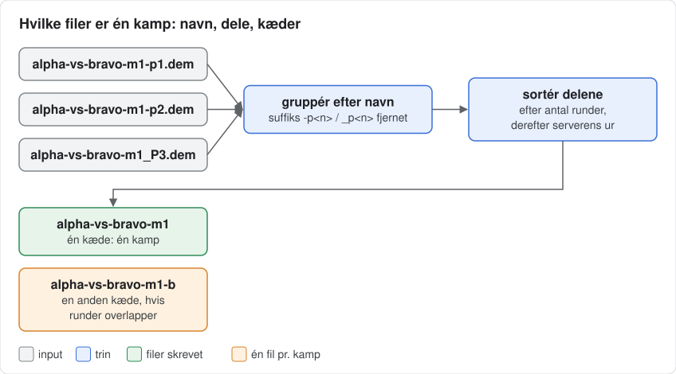

# Sådan bygges en kamp {#building-a-match}

Sådan laves en kamp ud af dens demo-dele: hvilke filer der hører sammen, ét ur på tværs af dem, rundene og hvordan hver blev vundet, holdene og deres sider, og hver række i heatmap-tabellen med kills, trades, åbninger, skade, blændinger og økonomi. Kode:
[`heat3d_cs2/match.py`](https://github.com/Holdi601/3DHeat-CS2/blob/main/heat3d_cs2/match.py).
Scoreboardet, der regnes ud fra den, står på [Statistik](statistics.md).

## Overblik {#overview}

1. Hver fil med et kampnavn bliver læst ([Læsning af en demo](reading-demos.md)).
2. Hver fils dublerede spillerrækker (gendannede runder) bliver løst.
3. Filerne bliver sorteret i **kæder** - kampe - og hver kæde bliver sat i rækkefølge.
4. Hver del bliver placeret på **kampuret**.
5. **Rundene** bliver fundet i hver del; en senere dels beskrivelse af en runde erstatter en tidligere dels.
6. **Spillerne** og **holdene** bliver navngivet, og hver runde får sine sider og sin score efter holdnavn. Når siderne er kendt, følger halvlegens længde, pistolrunderne og hver sides **køb**.
7. **Rækkerne** bliver bygget: positioner, skud, kast, detonationer, plantninger, desarmeringer, kills, dødsfald, skader, blændinger, eksplosioner.
8. Hver række får et mærke med sin runde, fase, rundetid, om dens side vandt, og sin sides køb; rækker uden for alle runder bliver smidt væk.

## Gendannede runder: én række pr. spiller pr. tick {#restored-rounds-one-row-per-player-per-tick}

Når en runde bliver gendannet fra en backup inde i en fil, har demoen spillernes gamle kroppe liggende ved siden af de nye i nogle sekunder: to rækker for én spiller ved ét tick, én hvor den annullerede runde efterlod dem, og én ved den gendannede rundes spawn. For hver sådan spiller bliver de dublerede ticks gennemgået **baglæns** fra den første enkelte række efter dem: ved hvert tick bliver den kandidat, der ligger tættest på den position, der følger, beholdt, og den bliver referencen for tickket før. Uden en enkelt række efter dem bliver den sidste kandidat beholdt. Så beholder hver spiller den række, der fører videre til det sted, de går hen.

## Filens live-del {#the-live-part-of-a-file}

En fils **live-start** er tickets for dens sidste `round_announce_match_start`-hændelse, eller tick 0, hvis den ikke har nogen (en senere del af en delt kamp har normalt ingen). Alt før live-starten bliver udeladt, og det samme gælder alt, der er markeret `is_warmup_period`. En knivrunde eller en genstart før annonceringen bliver derfor udeladt; en knivrunde, der *ikke* efterfølges af en kampstart-annoncering, bliver ikke genkendt som en sådan (se [Begrænsninger](limits.md)).

En fils **runder** er `round_freeze_end`-hændelserne fra live-starten og frem, uden for opvarmning, identificeret ved deres `total_rounds_played` (spillets 0-baserede nummer for den runde, der skal spilles). En fil uden nogen har ingen runder og hører til ingen kamp.

## Uret {#the-clock}

Tider er i sekunder. Inde i en fil bliver tiden talt i **ticks**: serverens `game_time` ved det første samplede tick, plus ticks siden da / 64. Serverens eget ur står stille under en pause, mens ticks løber videre; læst gennem uret ville to øjeblikke i en sat-på-pause kamp få samme tid.

Hver fil har et *første ur* (tiden ved dens live-start) og et *sidste ur* (ved dens sidste samplede tick).

### Dele og kæder {#parts-and-chains}

Filer, der er navngivet som samme kamp ([Kommandoer](commands.md#which-files-are-one-match)), bliver først sorteret efter indekset for deres første runde, dernæst efter deres første ur. Så kommer hver i den rækkefølge og slutter sig til den første kæde, den fortsætter, eller starter en ny kæde. En del fortsætter en kæde, når dens første rundeindeks er mindst kædens sidste dels sidste indeks, **og** enten

- serverens ur løber videre: dets første ur er ikke tidligere end kædens sidste ur minus 5 s; eller
- rundetællingen løber videre: dens første rundeindeks er kædens sidste indeks eller det næste.

Tallet afgør, og uret bryder uafgjorte, fordi en server, der er genstartet for at gendanne en runde, starter sit ur forfra, mens to forskellige kampe under ét navn (de samme hold på samme kort ved to events) har overlappende rundetal. Kæderne bliver sorteret efter hvor mange runder de spænder over, flest først; den første beholder kampnavnet, de andre skrives som `<navn>-b`, `<navn>-c` og så videre.

### Kampuret {#the-match-clock}

Kampens nul er den første dels første ur: **kamptid 0 er live-starten af den første fil**. Hver senere del bliver placeret på det:

- hvor serverens ur løber videre (dets første ur er ikke tidligere end den forrige dels sidste ur minus 5 s), bliver serverens ur brugt, som det er;
- hvor det blev genstartet, bliver delen placeret til at følge **et sekund** efter, den forrige del sluttede.

## Runder {#rounds}

For hver `round_freeze_end` i en del (i tick-rækkefølge) løber rundens vindue til den næste freeze end i den del, eller til filens ende. Inde i det bliver runden **afgjort** ved det første samplede tick, hvor spiltilstanden viser `total_rounds_played` = rundens indeks + 1 og `round_win_status` 1 (uafgjort), 2 (T vandt) eller 3 (CT vandt). En runde uden et sådant sample i sit vindue blev afbrudt af filens ende; dens nummer kommer på kampens liste over **ufuldstændige** runder (medmindre en anden del har runden komplet).

| Rundefelt | Fra |
|---|---|
| `number` | indekset + 1 (1-baseret, som spillet tæller) |
| `start` | kamptid ved freeze-tidens slutning - spillerne kan bevæge sig |
| `end` | kamptid ved det første sample, der viser runden afgjort |
| `until` | kamptid for den næste `round_prestart` efter `end`, hvis den ligger inden for vinduet; ellers vinduets slutning eller filens sidste tick, alt efter hvad der kommer først (og aldrig før `end`) |
| `winner` | `T` for win status 2, `CT` for 3, tom for 1: et uafgjort er afgjort, uden vinder |
| `reason` | `round_win_reason` ved det sample, navngivet som nedenfor |
| `score` | holdnavn -> runder vundet efter denne: hver sides `team_rounds_total` ved det afgørende sample; hvor demoen ikke har en, den forrige rundes score plus en til vinderen |
| `sides` | holdnavn -> `T` / `CT` i denne runde |
| `equipment` | side -> summen af `current_equip_value` for sidens **levende** spillere ved det første sample ved eller efter freeze end |
| `buy` | side -> `pistol`, `eco`, `force` eller `full` ([Økonomi](#economy-and-buy-types)) |
| `plant` | den første `bomb_planted` efter freeze end og op til `end`, eller ingen |
| `exploded` | kamptid for den første `bomb_exploded` efter den plant og før den næste freeze end, hvis der er en (ikke i kampdokumentet; den timer `explode`-rækken) |

`reason`, fra spillets `CSRoundEndReason`:

| Kode | `reason` |
|---|---|
| 1 | `bomb` (målet blev bombet) |
| 7 | `defuse` |
| 8, 9 | `elimination` (CT vinder / T vinder ved elimination) |
| 10 | `draw` |
| 12 | `time` (målet blev reddet) |
| 17, 18 | `surrender` |
| alt andet | `other` |

Når flere dele har den samme runde (efter indeks), beholdes den senere dels version. Rundene bliver derefter listet efter indeks. En kamp, hvis første runde ikke er runde 1, noterer de manglende numre (`missing` i kampdokumentet); kommandolinjen siger `recorded from round N`.

### Plantningen {#the-plant}

| Felt | Fra |
|---|---|
| `site` | `A` eller `B`: bombezonen, som spillet siger, at planteren stod i (`which_bomb_zone`, 1 = A, 2 = B); uden den spillerens stednavn (`BombsiteA`, `BombsiteB`); uden det bogstavet, som en anden plantning i samme fil i samme zone gav (hændelsens `site` er zonens entity-nummer). Tom, når intet siger det - aldrig nummeret. |
| `time` | sekunder **inde i runden** (siden dens freeze end), som en kills tid |
| `player`, `steamid` | planteren |
| `x`, `y`, `z` | planterens position i spilenheder: hvor bomben ligger |
| `place` | planterens stednavn ved plantningen |

### Fasene {#the-phases}

Tiden fra `start` til `end` er rundens **live**-fase; fra `end` til `until` er dens **efter**-fase, hvor vinderne jager og taberne sparer. En række hører til den runde, hvis `[start, until)` indeholder dens tid, og den er `after`, når dens tid er senere end `end`. Freeze-tid ligger mellem runderne og hører til ingen.

## Spillere og hold {#players-and-teams}

En **spiller** er alle, der var i live mindst én gang på en side (hold 2 eller 3), uden for freeze-tid og opvarmning, efter live-starten. En coach eller caster på et holds side er aldrig i live og er ingen spiller. Hver spiller er nøglet med sit Steam-ID; navnet er det sidst set.

En spillers **hold** er klannavnet, spillet gav deres side (`team_clan_name`), det som sås oftest for dem - demoen rydder det helt til sidst. En kamp, der er spillet uden klannavne, navngiver holdene efter den side, de startede på: `Started T` og `Started CT`.

Hver rundes **sider** kommer fra, hvem der var på hvilken side mellem freeze end og rundens slutning: hver side får det holdnavn, de fleste af dens spillere bærer. Kampens `teams`-liste står i den rækkefølge, de først optræder, runde for runde, T-siden før CT; typisk står det hold, der startede på T, først.

## Rækkerne {#the-rows}

Hvert positionssample og hver hændelse bliver til én række i [heatmap-tabellen](output-table.md). Spillere er kun på en side, når deres `team_num` er 2 eller 3.

### Positioner {#positions}

Fra de samplede rækker for levende spillere på en side, uden for freeze-tid og opvarmning, efter live-starten: position, kigge-retning, liv, rustning, penge, udstyrsværdi, våben i hånden og sted.

Kigge-retningen er en enhedsvektor i spillets koordinatsystem: `(cos pitch * cos yaw, cos pitch * sin yaw, -sin pitch)` - spillets pitch er positiv, når man kigger ned, så at kigge ned giver en negativ Z.

Våbnet i hånden er `active_weapon_name`, som spillet navngiver det, bortset fra at ethvert navn med `Knife`, `Bayonet`, `Karambit` eller `Daggers` i sig bliver til `Knife`.

### Skud og kast {#shots-and-throws}

Fra `weapon_fire`, ved skyttens position. Knive (`knife`, `bayonet` i våbnets id) og C4 bliver udeladt. Granater (`smokegrenade`, `flashbang`, `hegrenade`, `molotov`, `incgrenade`, `decoy`) er **kast**-rækker, alt andet er **skud**-rækker. Våbnet er navngivet, som spillet viser det (nedenfor).

### Granatdetonationer {#grenade-detonations}

| Hændelse | Række | `weapon` |
|---|---|---|
| `smokegrenade_detonate` | `smoke` | Smoke Grenade |
| `flashbang_detonate` | `flash` | Flashbang |
| `hegrenade_detonate` | `he` | High Explosive Grenade |
| `inferno_startburn` (molotov og incendiary) | `molotov` | Molotov |
| `decoy_detonate` | `decoy` | Decoy Grenade |

Positionen er **hvor granaten gik af** (hændelsens `x`, `y`, `z`); spilleren og siden er kasterens. Demoen navngiver ikke et sted for en granat, kun for spillere, så `place` står tom: en række påstår ikke et sted, den ikke var på. Kasterens sted på det tidspunkt bliver gemt som `throwerPlace`.

### Plantninger og desarmeringer {#plants-and-defuses}

`plant`- og `defuse`-rækker ligger ved spillerens position, med våbnet `C4 Explosive`. En plantet bombe, der gik af, får en **explode**-række: ved plantningens position, på tidspunktet for `bomb_exploded`, med planteren som spiller (med deres Steam-ID), side `T`, rundens T-hold som `team` og plantningens sted. Det gælder også en bombe, der går af, efter Ts allerede har vundet ved elimination. Hvor demoen ikke har en `bomb_exploded`, får en runde, der er vundet af bomben (`reason` = `bomb`) med en plantning, en række ved rundens `end`.

### Kills og dødsfald {#kills-and-deaths}

Hvert `player_death` i en runde giver én **kill-post** (kampens `kills`-tabel) med:

| Felt | Er |
|---|---|
| attacker, victim, assister | navne, Steam-ID'er, sider; angriberen er tom for verdenen (faldskade, bomben) |
| `weapon` | hændelsens våben, navngivet som spillet viser det |
| `headshot` | hændelsens flag |
| `wallbang` | `penetrated` > 0 |
| `throughSmoke` | `thrusmoke` |
| `flashAssist` | `assistedflash` |
| `noscope`, `attackerBlind` | hændelsens flag (`noscope`, `attackerblind`); kolonner i `kill`- og `death`-rækkerne og i kampdokumentets kills |
| `suicide` | angriber og offer er den samme spiller: en egen granat, for eksempel |
| `teamkill` | angriber og offer på samme side, med en angriber, og ikke et selvmord |
| `opening` | rundens første kill af en fjende (nedenfor) |
| `traded`, `trade` | nedenfor |
| positioner | angriberens og offerets position og sted |

Ud fra hver post får tabellen en **death**-række ved offerets position (hvert dødsfald, også verdenens, teamkills og selvmord) og - for kills af en fjende (en angriber, ikke et teamkill, ikke et selvmord) - en **kill**-række ved dræberens position.

**Åbning.** Den første kill af en fjende i hver runde, mens den er live, er dens åbningsduel. Et teamkill, et selvmord eller et dødsfald til verdenen før den bliver sprunget over, så åbningen stadig er rundens første duel; en runde uden en fjende-kill, mens den er live, har ingen.

**Traded** og **trade.** Et dødsfald ved en fjende er **traded** (hævnet), når dens dræber bliver dræbt af en fra offerets side inden for **5 sekunder** efter det (mere end 0 og højst 5 s senere, i samme runde); den første sådan kill er en **trade**-kill. I tabellen er en `kill`-rækkes `traded`-kolonne 1 for en trade-kill; en `death`-rækkes er 1 for et dødsfald, der blev hævnet. Kills i efter-fasen tæller også med.

### Skade {#damage}

Fra `player_hurt`, kun mellem **fjender** (begge på en side, forskellige sider). Skaden er liv, der faktisk er **mistet**: for hvert offer i hver runde starter liv på 100; hvert hit tæller `min(dmg_health, liv før)`, og hændelsens `health` (det der er tilbage) bliver næste hits "før". Et hovedskud på 137 skade mod en spiller med 40 liv tæller 40, ligesom spillets scoreboard tæller det. Hits fra `hegrenade`, `inferno`, `molotov` og `incgrenade` er **utility-skade**. Hvert hit er en **hurt**-række ved offerets position, med angriberen som `other`. Skade på holdkammerater og egen skade er hverken i tabellen eller i statistikken.

### Blændinger {#flashes}

Fra `player_blind`, kun **fjender** (ikke holdkammerater, og ikke en coach eller caster, der ser med): én **blind**-række pr. blændet spiller, ved den blændede spillers position, med blenderen som `other` og blindtiden i sekunder som `duration`. Hver varighed bliver gemt; statistikken tæller kun blindninger på mindst et sekund.

## Våbennavne {#weapon-names}

Et våben-id fra en hændelse (`ak47`, `weapon_ak47`, `knife_karambit`) bliver vist, som spillet navngiver det i spillernes egen `active_weapon_name`, så en kills våben og et våben i hånden læses ens: `ak47` -> `AK-47`, `m4a1` -> `M4A4`, `m4a1_silencer` -> `M4A1-S`, `hkp2000` -> `P2000`, `taser` -> `Zeus x27`, `inferno` og `molotov` -> `Molotov`, `incgrenade` -> `Incendiary Grenade`, `c4` og `planted_c4` -> `C4 Explosive`, `world` -> `World`, og så videre for hvert våben og hver granat (tabellen `WEAPONS` i `match.py`). Alt med `knife` eller `bayonet` i sit id er `Knife`. Et id, der ikke står i tabellen, bliver beholdt, som det er.

## Økonomi og købstyper {#economy-and-buy-types}

Ved slutningen af freeze-tid bliver hver sides udstyrsværdi lagt sammen over dens levende spillere ved det første sample derfra, og divideret med hvor mange der var:

| Runde | Gennemsnitligt udstyr pr. spiller | `buy` |
|---|---|---|
| en pistolrunde (den første i hver ordinære halvleg) | alle | `pistol` |
| andre | under $1.500 | `eco` |
| andre | $1.500 til under $4.000 | `force` |
| andre | $4.000 eller mere | `full` |

Pistolrunderne følger den halvleg, kampen blev spillet med, ikke et fast format. Halvlegen slutter, hvor siderne først bytter mellem to runder, der følger hinanden, begge i den ordinære spilletid: dens længde (`halfLength` i kampdokumentet) er runden før byttet - 12 i 24-runde-formatet, 15 i 30-runde-formatet. Runde 1 og runden efter halvlegen er pistolrunderne. En runde er overtid, når spillets overtid-tæller (`m_nOvertimePlaying`) er over 0 ved dens freeze end; hvor en demo ikke har en sådan tæller, er hver runde efter to halvlege det. Overtidshalvlege starter med penge, serveren sætter, og har ingen pistolrunde, selv om siderne også bytter. En optagelse, der aldrig viser halvtidsbyttet - den starter efter det eller slutter før - gør halvlegen ukendt, og kun runde 1 er en pistolrunde.

## Mærkning og rækkefølge {#labelling-and-order}

Til sidst får hver række:

- `match` - kampnavnet; `map` - demo-headerens kort;
- `round` og `roundId` (`<match> #NN`, to cifre);
- `phase` - `live` eller `after`;
- `roundTime` - sekunder siden rundens freeze-tid sluttede;
- `won` - 1, hvis rækkens side vandt runden, 0, hvis ikke, tom for en række uden side;
- `buy` - rækkens sides køb den runde;
- `team` - rækkens spillers hold, efter Steam-ID.

Rækker, hvis tid ligger i ingen runde - før første runde's freeze end, under freeze-tid, efter sidste runde - bliver smidt væk. Rækkerne bliver sorteret efter tid og, ved samme tid, efter hændelsens navn.
