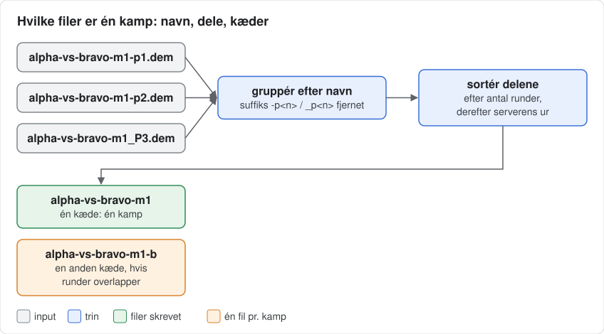

# Kommandoer {#commands}

Ny til kommandolinjen? Læs [Før du går i gang](before-you-start.md) først.
Skriv disse i en terminal, der er åbnet i den mappe, du pakkede ud eller klonede;
`<...>` er pladsholdere, og en sti med mellemrum sættes i anførselstegn.

```text
python -m heat3d_cs2 demos <demo files or folders> -o <folder> [--every 8] [--jobs N] [--map TEXT] [--force] [--no-bulk] [--loose]
python -m heat3d_cs2 map <map name | path to its .vpk> -o <file.glb> [--game FOLDER] [--source2viewer EXE]
python -m heat3d_cs2 scoreboard <match.3dheat | match.json>
```

`python -m heat3d_cs2 --help` og `python -m heat3d_cs2 <verb> --help` viser de
samme valg; [Kommandoreferencen](../cli-reference.md) viser dem alle. Hver start kører først
udgivelsestjekket beskrevet i [Opdateringer](updates.md) (slået fra med `HEAT3D_NO_UPDATE=1`).

Kode: [`heat3d_cs2/cli.py`](https://github.com/Holdi601/3DHeat-CS2/blob/main/heat3d_cs2/cli.py).

## `demos` - demoer til tabeller og kampdokumenter {#demos---demos-into-tables-and-match-documents}

```powershell
python -m heat3d_cs2 demos D:\Demos\event -o out
python -m heat3d_cs2 demos alpha-vs-bravo-m1-p1.dem alpha-vs-bravo-m1-p2.dem -o out
python -m heat3d_cs2 demos D:\Demos -o out --map final --jobs 4
```

| Argument | Standard | Gør |
|---|---|---|
| `paths` (en eller flere) | - | demo-filer og mapper. En fil tages, når dens endelse er `.dem` (uanset store eller små bogstaver). En mappe bliver søgt **rekursivt** for filer, der slutter på `.dem`, i alle skrivemåder, i sorteret rækkefølge. Komprimerede demoer (`.dem.zst`, `.dem.bz2`, arkiver) bliver ikke læst: pak dem ud først. |
| `-o`, `--out` | påkrævet | mappen at skrive i; den bliver oprettet, hvis den mangler |
| `--every N` | `8` | tag et sample af hver spiller hvert *N*. tick. CS2-demoer kører med 64 tick i sekundet, så 8 er otte samples i sekundet, 4 er seksten, 64 er ét. Hændelser bliver altid læst ved deres eget tick, uanset *N*. |
| `--jobs N` | `0` = halvdelen af CPU-kernerne | hvor mange kampe der konverteres samtidig, hver i sin egen proces. Aldrig færre end 1, aldrig flere end der er kampe at lave. |
| `--map TEXT` | - | kun kampe, hvis **navn** indeholder *TEXT*, uden forskel på store og små bogstaver (`--map final`). Det filtrerer på filnavnet, ikke på det kort demoen viser sig at indeholde. |
| `--force` | fra | konverter kampe, der allerede er skrevet, og overskriv dem |
| `--loose` | fra | behold hver kamp som separate filer - tabel, `.match.json`, sidecars - i stedet for at pakke dem i én `.3dheat`-container. Se [Én fil pr. kamp](output-container.md). |
| `--container` | til | pak hver kamp i én `.3dheat`-fil; standarden, så det er kun der for at være eksplicit |
| `--no-bulk` | fra | lad entity-strømmen, spillernes kommandoer og animationsstrømmen ligge uden for packets-sidecaren - over halvdelen af en demos størrelse, selv komprimeret. Kampdokumentets selvtjek tæller dem så som `lost`, navngivet. |


### Hvilke filer er én kamp {#which-files-are-one-match}



Kampnavnet er demo-filens navn uden endelse og uden et del-suffiks: `-p<cifre>` eller `_p<cifre>` til sidst, uanset store eller små bogstaver. Så er `alpha-vs-bravo-m1-p1.dem`, `alpha-vs-bravo-m1-p2.dem` og `alpha-vs-bravo-m1_P3.dem` dele af samme kamp, `alpha-vs-bravo-m1`.
Filer bliver grupperet efter navnet alene - to filer med samme navn i forskellige mapper bliver også grupperet.

Suffikset siger intet om rækkefølge: en `-p2` kan være den tidligere halvdel. Delene bliver sat i rækkefølge efter det antal runder, de indeholder, og dernæst efter serverens ur, og en gruppe, der viser sig at indeholde to forskellige kampe (de samme hold på samme kort ved to events, for eksempel), bliver delt i **kæder**: kæden med flest runder bliver skrevet under selve navnet, den næste som `<navn>-b`, så `<navn>-c` og så videre. En fil uden en eneste runde i sig (kun opvarmning, en pause) hører til ingen kæde. Hvordan kæderne bliver fundet, står i [Sådan bygges en kamp](building-matches.md#parts-and-chains).

### Hvad der skrives {#what-is-written}

For hver kamp, i en mappe med navnet på det kort, demo-headeren angiver (`unknown`, når den ikke angiver et), én `.3dheat`-fil:

```text
out/
  de_x/
    alpha-vs-bravo-m1.3dheat
    alpha-vs-bravo-m2.3dheat
  de_y/
    ...
```

På den syntetiske demo med to runder fra testene:


Med `--loose` er hver kamp tabellen, dens kampdokument og fire sidecars side om side
([Én fil pr. kamp](output-container.md)):


Et heatmap er af ét kort, så at indlæse én mappe i visningen er at indlæse ét korts kampe. Se [Heatmap-tabellen](output-table.md) og
[Kampdokumentet](output-match-json.md).

### Hvad der springes over {#what-is-skipped}

Før noget bliver læst, bliver hver `*.3dheat` et sted under `--out` (en container bliver skrevet hel eller slet ikke), og hver `*.parquet`, der har sit kampdokument (`<navn>.match.json`) ved siden af sig, listet, og en kamp, hvis navn er lig med et af deres filnavne (uden endelse), springes over, medmindre `--force` er brugt. En tabel uden sit kampdokument - en kørsel stoppet mellem skrivningen af de to - tæller ikke, så den kamp konverteres igen. Kontrollen er kun efter navn: en kamp konverteret til en anden kortmappe, eller med et andet `--every`, tæller stadig som færdig. Med intet tilbage at lave:

```text
nothing to do: no demos found, or every match already written (--force redoes them)
```

### Hvad der bliver udskrevet {#what-is-printed}

Først mængden af arbejde, derefter én linje pr. kamp, når den er færdig (i den rækkefølge de bliver færdige, ikke filernes rækkefølge):

```text
3 match(es), 3 at a time
alpha-vs-bravo-m1: de_x, 21 rounds (Alpha 13 Bravo 8), 412,377 rows, lost 0
alpha-vs-bravo-m2: de_y, 30 rounds (Bravo 16 Alpha 14), 598,104 rows, 1 incomplete round(s) left out, lost 0
alpha-vs-bravo-m3: de_y, 18 rounds (Alpha 13 Bravo 5), 330,981 rows, recorded from round 3, lost 1,204,331 (svc_PacketEntities, svc_UserCmds, DEM_AnimationData)
```

(Tallene er illustrative.) Scoren er den sidste runds, hold for hold i den rækkefølge, kampdokumentet angiver dem. *incomplete round(s) left out* tæller runder, en demo afbrød, før de var afgjort; *recorded from round N* siger, at optagelsen starter sent; *lost* er kampdokumentets selvtjek - hvor mange dele af demoen der ikke blev brugt, og af hvilke slags (`--no-bulk` gør bulken til `lost`). En kamp, der ikke giver noget, siger hvorfor:

```text
alpha-vs-bravo-m4: no round in 1 file(s) - nothing written
alpha-vs-bravo-m4-b: no complete round in 1 file(s) - nothing written
```

En fejl i én kamp stopper ikke de andre; den bliver udskrevet som
`<navn>: failed - <fejl>`.

### Exitkode {#exit-code}

`0`, når alle kampe blev konverteret (eller der ikke var noget at lave), `1`, når mindst én fejlede.

### Hvor lang tid det tager {#how-long-it-takes}

Hver kamp bliver læst og bygget i en arbejdsproces. En mappe med et par hundrede demoer tager minutter med standard-`--jobs`. Hukommelsen pr. job vokser med kampens længde og med et mindre `--every`: hver arbejder holder alle de samplede spillerrækker for sin kamp (cirka ti spillere gange 64 / *N* rækker i sekundet af optagelsen), før den skriver.

Sidecars tager længere tid end tabellen: hver egenskab parseren læser, bliver læst ved hvert tick, et vindue af ticks ad gangen (cirka to minutter for en 40 minutters demo, nær 3 GB hukommelse højst pr. job), hvorefter demoen bliver gennemgået én gang til for dens frames og beskeder.

## `map` - en kortgeometri som `.glb` {#map---a-maps-geometry-as-glb}


```powershell
python -m heat3d_cs2 map <map> -o out/<map>/<map>.glb
python -m heat3d_cs2 map <map> -o <map>.glb --game "D:\Games\Steam\steamapps\common\Counter-Strike Global Offensive"
python -m heat3d_cs2 map "D:\maps\<map>.vpk" -o <map>.glb --source2viewer C:\Tools\Source2Viewer-CLI.exe
```

| Argument | Standard | Gør |
|---|---|---|
| `name` | - | kortets navn (som `de_x`), eller stien til dets `.vpk`. En sti, der slutter på `.vpk` og findes, bliver brugt, som den er; alt andet bliver slået op efter sit filnavn i det installerede spil. |
| `-o`, `--out` | påkrævet | den `.glb`, der skal skrives; dens mappe bliver oprettet, hvis den mangler |
| `--game FOLDER` | Steams biblioteker | CS2-installationsmappen (den, der indeholder `game\csgo`), når Steam ikke kender den. Med `--game` bliver kun den mappe søgt. |
| `--source2viewer EXE` | `HEAT3D_SOURCE2VIEWER`, derefter `PATH` | den kørbare fil til Source2Viewers CLI |

Udskrevet ved succes:

```text
out/de_x/de_x.glb: de_x, 412,880 triangles (151,204 ground) in 14 parts
```

(tallene er illustrative). At skrive `.glb`-filen ved siden af kortets tabeller
(`out/<map>/<map>.glb`) holder et korts data og geometri i én mappe. Sådan
virker eksporten: [Kortudtræk](map-export.md).

Fejl, hver udskrevet som `error: ...` med exitkode `2`:

| Besked | Betyder |
|---|---|
| `no de_x.vpk found in an installed CS2 - pass --game <CS2 folder> or the .vpk path` | kortet findes ikke i noget Steam-bibliotek, der blev fundet, eller navnet er forkert |
| `Source2Viewer-CLI not found: ...` | ingen af `--source2viewer`, `HEAT3D_SOURCE2VIEWER`, `PATH` gav en fil, der findes |
| `Source2Viewer did not export de_x's collision mesh:` efterfulgt af slutningen af dens output | den fejlede, eller skrev ingen `.glb` |
| `de_x's collision mesh has nothing but clip brushes` | efter at clips og himlen var udeladt, var intet tilbage |

## `scoreboard` - en kamp som tekst {#scoreboard---a-match-as-text}

```bash
python -m heat3d_cs2 scoreboard out/de_x/alpha-vs-bravo-m1.3dheat
python -m heat3d_cs2 scoreboard out/de_x/alpha-vs-bravo-m1.match.json   # after demos --loose
```

Udskriver kampens scoreboard fra dens [kampdokument](output-match-json.md),
uden at åbne visningen. Den læser dokumentet inde i en `.3dheat`-container eller
et løst `<match>.match.json`.
På den syntetiske demo med to runder fra testene:


```text
alpha-vs-bravo-m1 - de_test  Alpha 2  Bravo 0

Alpha
player                 K   D   A  +/-    ADR   KAST   HS%  OK-OD  clutch
ash                    1   0   0   +1   50.0 100.0%    0%   0-0     1/1
ace                    1   1   0   +0   50.0 100.0%  100%   1-0     0/0

Bravo
player                 K   D   A  +/-    ADR   KAST   HS%  OK-OD  clutch
ben                    1   1   0   +0   50.0 100.0%    0%   0-0     0/1
bob                    0   1   0   -1    0.0 100.0%    0%   0-1     0/0

rounds  1:TK 2:TB
```

- Den første linje: kampnavn, kort og den endelige score pr. hold.
- En tabel pr. hold, i rækkefølgen fra kampdokumentets `teams`; spillere i kampdokumentets rækkefølge (efter kills minus døde, derefter kills, bedste først). Navne bliver skåret ned til 19 tegn.
- Kolonner: **K** kills, **D** døde, **A** assists *inklusive* blændingsassists, **+/-** kills minus døde, **ADR**, **KAST** (%), **HS%** (afrundet til hele procent), **OK-OD** åbningskills - åbningsdød, **clutch** clutches vundet / clutches spillet. Definitioner: [Statistik](statistics.md).
- Rundestriben: `<runde>:<vindende side><hvordan>`, med **B** bombe gik af, **D** desarmeret, **K** elimination, **T** tiden løb ud, og **?** for alt andet (uafgjort, overgivelse, andet). Et uafgjort har ingen vindende side: `<runde>:?`.

En fil, der ikke er gyldig JSON, eller ikke findes, stopper med en fejl; et JSON-dokument uden kampdokumentets felter fejler med en Python-fejl (det bliver ikke valideret yderligere).
