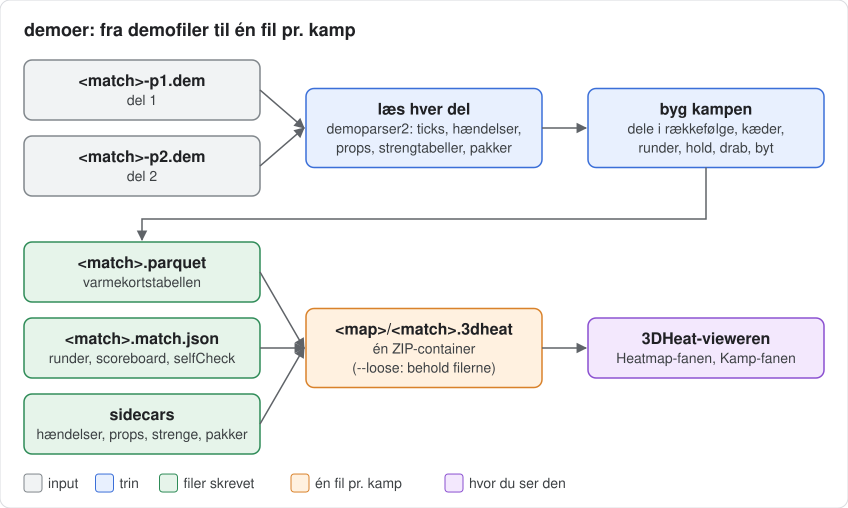

# 3DHeat CS2 {#dheat-cs2}

**Hvad er det?** Counter-Strike 2 kan gemme en optagelse af en kamp, kaldet en
*demo*. Dette værktøj laver en demo om til filer, som 3DHeat-vieweren kan vise i 3D:
hvor alle stod, døde, kastede og plantede, runde for runde. Det kan også
lave et CS2-kort om til en 3D-model, at vise dem på.

**Hvorfor skulle jeg bruge det?** Til at gennemgå dine egne kampe, til at lægge mange kampe på
samme kort ovenpå hinanden som ét varmekort, og til kampstatistik som ADR
(gennemsnitlig skade pr. runde) og KAST (andelen af runder, en spiller dræbte, assisterede,
overlevede eller blev byttet for).

**Eksempel:** `alpha-vs-bravo-m1.dem` ind, `out/de_x/alpha-vs-bravo-m1.3dheat`
ud (`de_x` er et opdigtet kortnavn).



Mere detaljeret: 3DHeat CS2 laver **Counter-Strike 2-demoer** om til en varmekortstabel og et kampdokument
pr. kamp, og et **CS2-kort** til banegeometri. Resultaterne er lavet
til [3DHeat](https://holdi601.github.io/3DHeat/)-telemetrivieweren
([kilde](https://github.com/Holdi601/3DHeat)), men de er
almindelige filer - Parquet, JSON og binær glTF - som alt andet også kan
læse.

Det er en lille Python-pakke, `heat3d_cs2`, der køres fra kommandolinjen. Den læser
demoer fra disken (den henter ingen) med
[demoparser2](https://github.com/LaihoE/demoparser), og eksporterer kort fra det
installerede spil med kommandolinjeversionen af Source2Viewer
([ValveResourceFormat](https://github.com/ValveResourceFormat/ValveResourceFormat)).

## Hurtig start {#quick-start}

Ny til kommandolinjen? Læs [Før du går i gang](before-you-start.md) først.

```bash
pip install -r requirements.txt
python -m heat3d_cs2 demos <demo files or folders> -o out   # every match in them
python -m heat3d_cs2 map <map> -o out/<map>/<map>.glb       # the map from the installed game
python -m heat3d_cs2 scoreboard out/<map>/<match>.3dheat    # a match's scoreboard as text
```

Du bør se `1 match(es), 1 at a time ...` og derefter en linje pr. kamp
(se [Kommandoer](commands.md#what-is-printed)).

`demos` skriver pr. kamp én fil i en mappe, der er opkaldt efter kortet:
`out/<map>/<match>.3dheat`, en [`.3dheat`-container](output-container.md) - viewerens
format med én fil pr. kamp ([specifikation](https://holdi601.github.io/3DHeat/container.html)).
Den holder disse dele; `--loose` skriver dem som separate filer i stedet:

| Del | Hvad den holder | Indlæst i viewerens |
|---|---|---|
| `<match>.parquet` (rolle `table`) | hver levende spiller otte gange i sekundet med deres tilstand (helbred, penge, blænding, scope, zone, inventar, ...), og hver hændelse, hvor den skete (drab, død, skade, skud, kast, granateksplosioner, blænding, plantning, afmontering, eksplosion, og en rundeafslutning pr. spiller med det, runden gav dem), én række hver | Heatmap-fanen |
| `<match>.match.json` (rolle `match`, kampdokumentet) | hold, score, hver runde (vinder, hvordan, økonomi, plantning, drab i rækkefølge, clutches, overlevende) og hver spillers scoreboardlinje | Kamp-fanen |
| `<match>.events/props/strings/packets.parquet` | alt andet, demoen holder, helt (sidecars) | gemt for fuldstændighedens skyld |

`map` skriver `<map>.glb`: kortets kollisionsmesh - gulve, vægge, kasser,
uden dekoration - delt i jord og konstruktion, i samme ramme og
enheder som tabellerne, så den ligger præcist under varmekortet (Baggrund / bane-panel).

## Dokumentationens kort {#map-of-this-documentation}

| Side | Hvad den dækker |
|---|---|
| [Før du går i gang](before-you-start.md) | Python, en terminal, pladsholdere, hvordan succes og de almindelige fejl ser ud |
| [Installation](installing.md) | Python, pakkerne, Source2Viewers CLI, hvor CS2 skal ligge |
| [Kommandoer](commands.md) | `demos`, `map`, `scoreboard`: hver valgmulighed, hvad der udskrives, exit-koder |
| [Læsning af en demo](reading-demos.md) | hvad der læses fra en demofil: samplede ticks, spilleregenskaber, spilleregler, hændelser |
| [Opbygning af en kamp](building-matches.md) | dele og kæder, kampuret, runder, hold og sider, rækker, drab, byt, åbninger, skade, blændinger, økonomi |
| [Statistik](statistics.md) | scoreboardet: K/D/A, ADR, KAST, HS%, åbninger, byt, multi-drab, clutches, utility, blændinger |
| [Varmekortstabellen](output-table.md) | Parquet-filen: hver kolonne, dens type, hvilke hændelser der udfylder den, `heat3d`-footerens hints, akserne |
| [Kampdokumentet](output-match-json.md) | `.match.json`-dokumentet, felt for felt |
| [Én fil pr. kamp](output-container.md) | `.3dheat`-containeren, `demos` skriver som standard, `--loose` |
| [Kortexport](map-export.md) | hvordan et korts kollisionsmesh eksporteres, rammen, knudenavngivning, enheder |
| [Brug det med 3DHeat](using-with-3dheat.md) | indlæsning af tabeller, kampdokumenter og kort i viewerens Heatmap- og Kamp-faner |
| [Begrænsninger](limits.md) | hvad der antages, hvad der ikke håndteres, hvad der ikke er kontrolleret |
| [Opdateringer](updates.md) | udgivelsestjekket ved opstart og `python -m heat3d_update` |
| [Udvikling](development.md) | kodens layout, tests, fixturen med syntetiske demoer |
| [Kommandoreference](../cli-reference.md) | hver kommandos `--help`, genereret ud fra koden |
| [Vedligeholdelse](maintaining.md) | udgivelsestjeklisten for disse sider |

## Hvad det er kontrolleret mod {#what-it-is-checked-against}

Demoer fra det virkelige liv er ikke én ren fil pr. kamp. Konverteren håndterer en kamp, der er
delt over flere filer i en vilkårlig rækkefølge, en server, der er genstartet midt i kampen, to
forskellige kampe gemt under ét navn, runder gendannet fra en backup, en optagelse der starter
sent eller slutter tidligt, pauser og trænere på et holds side -
se [Opbygning af en kamp](building-matches.md). Kontrolleret over en stor samling
turneringsdemoer: i hver kamp følger
scoren rundevinderne, hver sides drab er den andens dødsfald, og hver runde starter fem mod fem.

## Hvad du peger den mod {#what-to-point-it-at}

Dine egne kampes demoer, demoer du har hentet selv fra en turneringsside, eller
demoer fra en API, du har adgang til. En demo er en optagelse, hvis indhold
tilhører udgiveren og arrangørerne: brug det, der kommer ud, til din egen
analyse, og videredistribuer ikke demoer eller data afledt af dem. Værktøjet
læser demoer fra disken og henter ingen, og intet fra spillet følger med: ingen
spilfiler, ingen spilkode, ingen DLL'er.

3DHeat CS2 er ikke tilknyttet eller godkendt af Valve. Counter-Strike 2 og
tilhørende navne og varemærker tilhører deres ejere. Rettighedshavere: opret et
issue på
[github.com/Holdi601/3DHeat-CS2/issues](https://github.com/Holdi601/3DHeat-CS2/issues) -
vi svarer hurtigt og fjerner hvad som helst efter anmodning.

## Del af 3DHeat {#part-of-3dheat}

3DHeat CS2 er et af de gratis værktøjer omkring 3DHeat-vieweren, hver med sit eget
repository med sine egne udgivelser og licens:

| Værktøj | Hvad det gør | Dokumentation |
|---|---|---|
| [3DHeat](https://github.com/Holdi601/3DHeat) | vieweren: varmekort, løbsanalyse og kampgennemgang i 3D | [site](https://holdi601.github.io/3DHeat/) |
| [GameFiles](https://github.com/Holdi601/3DHeat-GameFiles) | baner og kort ud af de filer, spil leverer, som 3D-modeller | [site](https://holdi601.github.io/3DHeat-GameFiles/) |
| [GameCapture](https://github.com/Holdi601/3DHeat-GameCapture) | omgangstelemetri fra løbsspil; baner genskabt ud fra spilvideo | [site](https://holdi601.github.io/3DHeat-GameCapture/) |
| [Unreal Exporter](https://github.com/Holdi601/3DHeat-UnrealExporter) | et Unreal Editor-plugin, der eksporterer en bane som én 3D-model | [site](https://holdi601.github.io/3DHeat-UnrealExporter/) |
| [CS2](https://github.com/Holdi601/3DHeat-CS2) | Counter-Strike 2-demoer til tabeller og kampdokumenter; kort til 3D-modeller | [site](https://holdi601.github.io/3DHeat-CS2/) |
| [Watcher](https://github.com/Holdi601/3DHeat-Watcher) | optager, hvad spil udgiver om dit spil, i baggrunden | [site](https://holdi601.github.io/3DHeat-Watcher/) |
| [Ext-WarThunder](https://github.com/Holdi601/3DHeat-Ext-WarThunder) | War Thunder-replays til tabeller og kampdokumenter | [site](https://holdi601.github.io/3DHeat-Ext-WarThunder/) |
| [Ext-WoT](https://github.com/Holdi601/3DHeat-Ext-WoT) | World of Tanks-replays til tabeller og kampdokumenter | [site](https://holdi601.github.io/3DHeat-Ext-WoT/) |
| [Ext-WoWs](https://github.com/Holdi601/3DHeat-Ext-WoWs) | World of Warships-replays til tabeller og kampdokumenter | [site](https://holdi601.github.io/3DHeat-Ext-WoWs/) |
| [Ext-Squad](https://github.com/Holdi601/3DHeat-Ext-Squad) | Squad-serverdemoer til tabeller og kampdokumenter | [site](https://holdi601.github.io/3DHeat-Ext-Squad/) |
| [Ext-DCS](https://github.com/Holdi601/3DHeat-Ext-DCS) | DCS World-kort til 3D-modeller | [site](https://holdi601.github.io/3DHeat-Ext-DCS/) |
| [Ext-IL2](https://github.com/Holdi601/3DHeat-Ext-IL2) | IL-2 Sturmovik-kort til 3D-modeller | [site](https://holdi601.github.io/3DHeat-Ext-IL2/) |

## Licens {#licence}

MIT - se [`LICENSE`](https://github.com/Holdi601/3DHeat-CS2/blob/main/LICENSE)
og [`LICENSES.md`](https://github.com/Holdi601/3DHeat-CS2/blob/main/LICENSES.md)
for tredjepartspakkerne.
