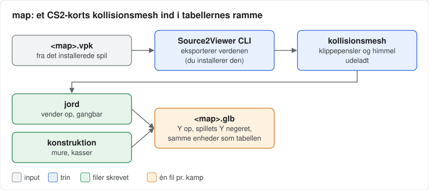

# Kortudtræk (`map`) {#map-export-map}

`python -m heat3d_cs2 map <map> -o <file.glb>` skriver et CS2-kort som banegeometri: verdenens **kollisionsmesh**, i det koordinatsystem og de enheder, [heatmap-tabellerne](output-table.md) er tegnet i. Kode:
[`heat3d_cs2/mapexport.py`](https://github.com/Holdi601/3DHeat-CS2/blob/main/heat3d_cs2/mapexport.py),
[`heat3d_cs2/glb.py`](https://github.com/Holdi601/3DHeat-CS2/blob/main/heat3d_cs2/glb.py).
Valg og meddelelser: [Kommandoer](commands.md#map---a-maps-geometry-as-glb).



## Hvorfor kollisionsmeshen {#why-the-collision-mesh}

Kollisionsmeshen er det, spillerne står på og gemmer sig bag - gulve, vægge, trapper, kasser - uden dekorationen: ingen rekvisitter, der kun ser ud til at være noget, ingen teksturer, langt færre trekanter end renderingsmeshene. Det er det, et heatmap behøver under sig: noget at læse positioner op imod, ikke en gengivelse af kortet.

## Sådan bliver det hentet {#how-it-is-obtained}

1. **Find kortet.** En sti, der slutter på `.vpk` og findes, bliver brugt, som den er. Ellers bliver `<name>.vpk` søgt i `<CS2 folder>\game\csgo\maps\`, hvor CS2-mappen er `--game`, eller `steamapps\common\Counter-Strike Global Offensive` i hvert Steam-bibliotek, der findes (se [Installation](installing.md#where-cs2-is-looked-for)).
2. **Find Source2Viewers CLI**: `--source2viewer`, derefter `HEAT3D_SOURCE2VIEWER`, derefter `Source2Viewer-CLI` / `Source2Viewer-CLI.exe` på `PATH`.
3. **Eksportér verdenens fysik.** Source2Viewer bliver kørt således:

   ```text
   Source2Viewer-CLI -i <map>.vpk -d -f maps/<map>/world_physics.vmdl_c --gltf_export_format glb -o <temporary folder>
   ```

   Den afkoder Source 2's kompilerede fysik fra kortets eget arkiv og skriver modellen (tom: verdenen har ingen egen render-mesh) og dens fysik ved siden af den. Den største skrevne `.glb` er fysikken. Hvis Source2Viewer fejler eller ikke skriver nogen `.glb`, stopper kommandoen og viser de sidste 800 tegn af dens output og dens fejl.
4. **Læs den.** Hver node i scenen bliver gennemgået med sin transformation (matrix, eller translation-rotation-skala), og hver trekant-primitiv bliver taget, med eller uden et indeksbuffer, i verdenspositioner.
5. **Lad det ligge, der ikke er en væg eller et gulv.** En node, hvis navn indeholder `clip` - spillerclips, NPC-clips, granatclips: de usynlige vægge, der stopper spillere og granater - eller `sky`, uanset store eller små bogstaver, bliver smidt væk.
6. **Navngiv overfladen.** Fysikgrupperne er navngivet efter deres overflade; navnet med småt og uden et foranstillet `physics`, `physics_group` eller `physics_passbullets` (og understregningen efter det) fjernet er overfladen: `physics_group_concrete` er `concrete`, `physics_passbullets_chainlink` er `chainlink`, og en nøgen `physics_group` er `world`. Overflader, kugler går igennem, bliver beholdt.
7. **Tilbage til spillets koordinatsystem.** Source2Viewer skriver glTF i meter med Y opad: spillets (Y, Z, X) ganget med 0,0254. Det bliver fortrudt - hvert punkt bliver spillets (X, Y, Z) i tommer.
8. **Adskil gulv fra struktur**, trekant for trekant: en flade, hvis normal peger opad med mindst 0,7 (dens Z-komponent, normaliseret) - skråninger op til cirka 45 grader, nogenlunde det stejleste, en CS2-spiller går på - er **gulv**; alt andet, vægge og lofter inklusive, er **struktur**.
9. **Ind i visningens koordinatsystem.** Hvert punkt bliver skrevet som (X, Z, -Y): Y opad, spillets Y negeret - det koordinatsystem visningen tegner tabellerne i, når den følger deres `heat3d`-hints. En rotation, ikke en spejling.
10. **Skriv `.glb`'en.** Hvis intet er tilbage (kun clip-brushes), stopper kommandoen med en fejl. Ellers udskriver den filen, kortet, antallet af trekanter, hvor mange der er gulv, og antallet af dele.

Intet her læser andet end kortets egen `.vpk`, og intet af Source2Viewer er med i pakken eller kopieret.

## Filen {#the-file}

En glTF 2.0 binær (`.glb`), én buffer, skrevet af `heat3d_cs2` (`asset.generator`):

| Aspekt | Hvad |
|---|---|
| Noder | én pr. del, alle i roden, uden transformationer, hver med sin egen mesh af samme navn |
| Nodenavne | `ground:<surface>` eller `structure:<surface>` (`ground:concrete`, `structure:metal`, `structure:world`), sorteret efter navn |
| Primitiver | én pr. mesh, trekanter, `POSITION` (float32, med min/max) og `NORMAL` (float32), `uint32`-indekser |
| Skygge | flad: ét hjørnepunkt pr. trekanthjørne, hver med sin trekants normal |
| Materialer, teksturer, UV'er, farver | ingen |
| Enheder | spilenheder (**tommer**), ikke meter - anderledes end det glTF antager |
| Koordinatsystem | (X, Z, -Y) for spillet: glTF's Y er spillets højde, glTF's Z er spillets -Y |

Præfikset `ground:` / `structure:` er konventionen for alle 3DHeat-niveau-eksportører: visningen tager en del med det navn for gode varer i stedet for at gætte ud fra geometrien, så gulvene får gulvskyggen og væggene struktur-tegningen uden noget klassificeringstrin.

Fordi enhederne er tommer, viser et andet glTF-program kortet cirka 39 gange for stort (det læser dem som meter); skaler med 0,0254 der, hvis det har betydning. I 3DHeat ligger det præcis under tabellen, som er i de samme enheder med skala 1.

## Kontrollen af at koordinatsystemet er rigtigt {#the-check-that-the-frame-is-right}

Testen `test_players_stand_on_the_exported_floor` (kun kørt, når en demo og Source2Viewer er givet, se [Udvikling](development.md#tests)) eksporterer det kort, en demo blev spillet på, tager 300 tilfældige positionssamples af kampen, og for hver kigger den lige ned efter den højeste gulvtrekant højst 4 enheder over spillerens fødder. Den kræver, at mindst 98 % af samples finder gulv, og at medianhøjden over det er under 5 enheder. Et spejlvendt kort fejler: på et kort spejlvendt om den forkerte akse står en stor del af spillerne over ingenting. README'en rapporterer tallene fra denne kontrol over kortene i den aktuelle konkurrencepulje.

## Hvad den ikke gør {#what-it-does-not-do}

- Ingen render-geometri, teksturer eller dekoration - se *hvorfor* ovenfor.
- Kun det, der er i kortets `world_physics`-model, bliver eksporteret. Om bevægelige dele (døre) eller ting, der kan gå i stykker, er med, er ikke tjekket.
- Ingen forenkling: 3DHeat-visningen forenkler ved import med sin indstilling **Forenklingsmål**.
- Kort, der ikke er i det installerede spil (workshop-kort andre steder på disken), virker, når deres `.vpk` bliver givet som sti og indeholder `maps/<name>/world_physics.vmdl_c`; ikke verificeret.
