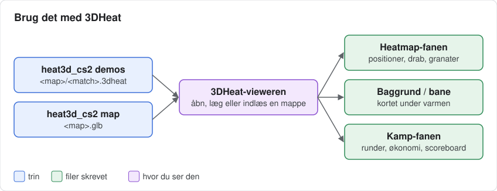

# Brug det med 3DHeat {#using-it-with-3dheat}

Output'et går ind de her steder i [3DHeat-visningen](https://holdi601.github.io/3DHeat):

| Fil | Hvor | Hvad den giver |
|---|---|---|
| `<match>.3dheat` (standarden) | fanen **Heatmap**, panelet **Kilde**, eller fanen **Kamp** | tabellen og kampdokumentet sammen, én fil pr. kamp ([container](https://holdi601.github.io/3DHeat/container.html)) |
| `<match>.parquet` | fanen **Heatmap**, panelet **Kilde** | positioner og hændelser som et heatmap, boksreplay, ruter |
| `<match>.match.json` | fanen **Kamp**, **Indlæs kampfiler …** | scoreboardet, rundene, kill-feedet, statistik på tværs af kampe, links ind i heatmappet |
| `<map>.glb` | panelet **Baggrund / bane**, **3D-model …** | kortet under heatmappet |

Visningens egen dokumentation beskriver hver fane fuldt ud på sine sider
[Kampanalyse](https://holdi601.github.io/3DHeat/match-analysis.html),
[Indlæsning af filer](https://holdi601.github.io/3DHeat/loading-files.html),
[Kolonnetilknytning](https://holdi601.github.io/3DHeat/column-mapping.html)
og [Boksreplay](https://holdi601.github.io/3DHeat/box-replay.html). Denne side er CS2-siden af det.



Visningen: [github.com/Holdi601/3DHeat](https://github.com/Holdi601/3DHeat),
dokumentation [holdi601.github.io/3DHeat](https://holdi601.github.io/3DHeat/).

## En typisk session {#a-typical-session}

```bash
python -m heat3d_cs2 demos D:\Demos\event -o out
python -m heat3d_cs2 map <map> -o out/<map>/<map>.glb
```

1. **Fanen Heatmap -> Kilde:** vælg mappen `out/<map>` (eller slip den der).
   Hver `.parquet` i den bliver til ét datasæt; `.json`- og `.glb`-filerne i
   samme mappe springes over som "not a csv/parquet file". Indlæs den.
2. **Baggrund / bane -> 3D-model …:** vælg `out/<map>/<map>.glb`.
   **Gem i biblioteket** gemmer den i browseren til næste gang.
3. **Fanen Kamp -> Indlæs kampfiler …:** vælg `.match.json`-filerne i
   samme mappe (flere ad gangen), eller slip dem på visningen, mens fanen Kamp er åben.

Indlæs kun ét korts tabeller ad gangen: koordinaterne for forskellige kort overlapper, og et heatmap af to kort på én gang betyder ingenting. Mappen pr. kort er der til netop det.

## Tabellen åbner uden at du skal sætte noget {#the-table-opens-with-nothing-to-set}

Visningen læser den første valgte fils `heat3d`-footerpost
([Heatmap-tabellen](output-table.md#the-heat3d-footer-hints)) og lægger den over sine egne gæt:

| Visningsindstilling | Sæt til |
|---|---|
| Position | `x`, `y`, `z` |
| Opadakse i kilden | Z er opad |
| Vend Y | til - så kortet vender rigtigt, ikke spejlvendt |
| Enhedsskala | 1 - afstande i spilenheder (mærket "m"; 1 enhed = 1 tomme) |
| Tid | `time`, sekunder |
| Person | `player` |
| Gruppe | `side` (T / CT) |
| Session | `roundId` - hver runde er en session, `<match> #NN` |
| Blikretning | vektor, `dirX` / `dirY` / `dirZ` |
| Filterkolonner | `event`, `match`, `round`, `roundTime`, `phase`, `weapon`, `place`, `won`, `buy`, `opening`, `team` |
| Entitetsstørrelse | 32 - boksreplayet tegner en spiller 32 enheder på tværs, med en kigge-stråle på 4 x 32 |

Hver hintet værdi vises stadig under kolonnetilknytningen og kan ændres. De andre kolonner (`headshot`, `traded`, `other`, `steamid`, `health`, `money`, `damage`, `duration`, ...) kan tilføjes som filtre dér i hånden.

Hold enhedsskalaen på 1, når et kort er indlæst: `.glb`'en er i de samme spilenheder, og banen bliver ikke skaleret sammen med tabellen.

### Nyttige filtre {#useful-filters}

- `event` = `position` for hvor spillerne var; `kill` / `death` for hvor dueller blev vundet og tabt; `smoke`, `flash`, `molotov`, `he` for hvor utility landede; `throw` for hvor det blev kastet fra; `plant` for plantningssteder.
- `side` (gruppen) = `T` eller `CT`, `phase` = `live` for at udelade efter-fasen, `buy` = `eco` / `force` / `full` for runder med én økonomi, `won` = 1 for runder, rækkens side vandt.
- `opening` = 1 med `kill` og `death` for åbningsduellerne.
- `roundTime` som et interval for et øjeblik i runden: de første 20 sekunder, efter-plantningen.

## Kamp-fanen {#the-match-tab}

Kamp-fanen accepterer en JSON-fil, hvis `format` er `heat3d-cs2-match`, og som har arrays `rounds`, `players` og `teams`
([Kampdokumentet](output-match-json.md)). Den viser score og halvlege, en stribe af runder farvet efter den vindende side med et mærke for, hvordan hver endte, hver rundes økonomi, plantning, kill-feed, clutches og overlevende, scoreboardet og statistik på tværs af alle indlæste kampe.

Dens **Vis i heatmappet**-links indlæser ikke noget. De sætter kun filtre på tabellen, der allerede er indlæst i fanen Heatmap - `match`, `round` (og rundens session `<match> #NN`), `event`, spilleren, siden. Det virker, fordi kampdokumentet og tabellen bærer de samme kampnavne, rundenumre, spillernavne og sider. **Afspil runde** skifter heatmappet til boksreplay og afspiller rundens session fra dens start.

Så indlæs begge dele: et korts tabeller i fanen Heatmap, og deres kampdokumenter i fanen Kamp. Et kampdokument uden sin tabel viser stadig scoreboardet og runderne, og linkene siger, at ingen heatmap-data er indlæst.

## Uden 3DHeat {#without-3dheat}

- Tabellen er almindelig Parquet: pandas, Polars, DuckDB, Spark, R's `arrow` læser den alle; `heat3d`-posten bliver ignoreret, og tekstkolonnerne læses som strenge eller kategorier.
- Kampdokumentet er almindelig JSON.
- Kortet er en gyldig glTF-binær, i tommer frem for meter: skaler med 0,0254 for værktøjer, der antager meter. Dets koordinatsystem er glTF's eget (Y opad), så for at lægge tabellen ovenpå et andet sted tegnes hver rækkes (x, y, z) som (x, z, -y), ligesom 3DHeat gør.
