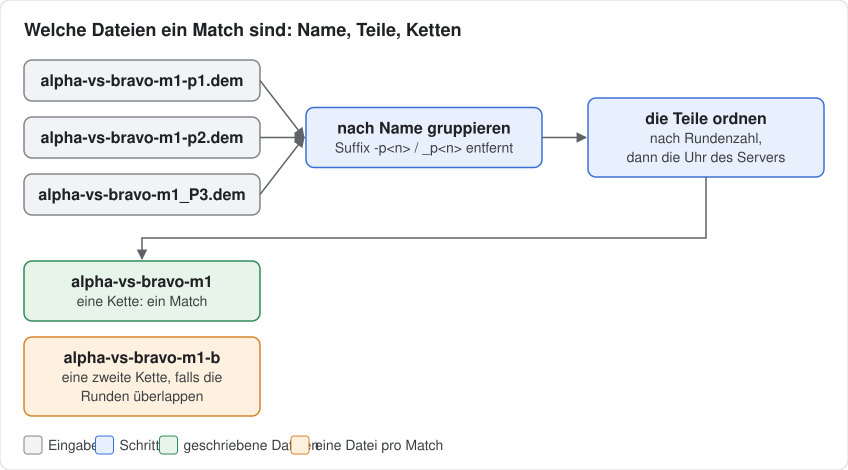

# Ein Match aufbauen {#building-a-match}

Wie ein Match aus seinen Demo-Teilen entsteht: welche Dateien zusammengehören, eine Uhr für alle,
die Runden und wie jede gewonnen wurde, die Teams und ihre Seiten und jede Zeile der Heatmap-Tabelle
mit Kills, Trades, Openings, Schaden, Blendungen und Wirtschaft. Code:
[`heat3d_cs2/match.py`](https://github.com/Holdi601/3DHeat-CS2/blob/main/heat3d_cs2/match.py).
Das Scoreboard, das daraus berechnet wird, steht auf [Statistiken](statistics.md).

## Überblick {#overview}

1. Jede Datei eines Match-Namens wird gelesen ([Ein Demo lesen](reading-demos.md)).
2. Doppelte Spielerzeilen jeder Datei (wiederhergestellte Runden) werden aufgelöst.
3. Die Dateien werden in **Ketten** - Matches - sortiert, und jede Kette wird in die richtige
   Reihenfolge gebracht.
4. Jeder Teil wird auf die **Match-Uhr** gesetzt.
5. Die **Runden** werden in jedem Teil gefunden; der Bericht eines späteren Teils über eine Runde
   ersetzt den eines früheren.
6. Die **Spieler** und **Teams** werden benannt, und die Seiten und das Ergebnis jeder Runde
   werden über den Teamnamen angegeben. Sind die Seiten bekannt, folgen die Länge der Hälfte, die
   Pistolenrunden und der **Buy** jeder Seite.
7. Die **Zeilen** werden gebaut: Positionen, Schüsse, Würfe, Detonationen, Bombenlegungen,
   Entschärfungen, Kills, Tode, Treffer, Blendungen, Explosionen.
8. Jede Zeile bekommt ihre Runde, ihre Phase, die Rundenzeit, ob ihre Seite gewonnen hat, und den
   Buy ihrer Seite; Zeilen außerhalb jeder Runde fallen weg.

## Wiederhergestellte Runden: eine Zeile pro Spieler und Tick {#restored-rounds-one-row-per-player-per-tick}

Wenn eine Runde innerhalb einer Datei aus einer Sicherung wiederhergestellt wird, trägt das Demo
für einige Sekunden die alten Körper der Spieler neben den neuen: zwei Zeilen für einen Spieler
im selben Tick, eine dort, wo die ungültig gewordene Runde sie zurückließ, eine am Spawn der
wiederhergestellten Runde. Für jeden solchen Spieler werden die doppelten Ticks **rückwärts**
abgelaufen, ausgehend von der ersten einzelnen Zeile danach: bei jedem Tick wird der Kandidat
behalten, der der Position des folgenden Ticks am nächsten liegt, und er wird zur Referenz für den
Tick davor. Gibt es keine einzelne Zeile danach, wird der letzte Kandidat behalten. So behält jeder
Spieler die Zeile, die ihn dorthin führt, wohin er als Nächstes geht.

## Der Live-Teil einer Datei {#the-live-part-of-a-file}

Der **Live-Start** einer Datei ist der Tick ihres letzten Ereignisses `round_announce_match_start`,
oder Tick 0, wenn sie keines hat (ein späterer Teil eines geteilten Matches hat meist keines).
Alles vor dem Live-Start fällt weg, ebenso alles, was `is_warmup_period` markiert. Eine Messer-Runde
oder ein Neustart vor der Ankündigung fällt also weg; eine Messer-Runde, *auf die keine*
Match-Start-Ankündigung folgt, wird nicht als solche erkannt (siehe [Grenzen](limits.md)).

Die **Runden** einer Datei sind die Ereignisse `round_freeze_end` ab dem Live-Start, außerhalb des
Warmups, erkannt an ihrem `total_rounds_played` (dem nullbasierten Index der Runde, die als Nächstes
gespielt wird). Eine Datei ohne solche Ereignisse hat keine Runden und gehört zu keinem Match.

## Die Uhr {#the-clock}

Zeiten sind in Sekunden. Innerhalb einer Datei wird die Zeit in **Ticks** gezählt: die
`game_time` des Servers beim ersten abgetasteten Tick, plus die Ticks seither geteilt durch 64.
Die Uhr des Servers steht während einer Pause still, während die Ticks weiterlaufen; liest man über
die Uhr, hätten zwei Momente einer pausierten Partie dieselbe Zeit.

Jede Datei hat eine *erste Uhr* (die Zeit an ihrem Live-Start) und eine *letzte Uhr* (an ihrem
letzten abgetasteten Tick).

### Teile und Ketten {#parts-and-chains}

Dateien, die als ein Match benannt sind ([Befehle](commands.md#which-files-are-one-match)), werden
zuerst nach dem Index ihrer ersten Runde sortiert, dann nach ihrer ersten Uhr. Danach tritt jede
Datei in dieser Reihenfolge der ersten Kette bei, die sie fortsetzt, oder beginnt eine neue Kette.
Ein Teil setzt eine Kette fort, wenn sein erster Rundenindex mindestens so groß ist wie der letzte
Index des letzten Teils der Kette, **und** entweder

- die Uhr des Servers weiterläuft: seine erste Uhr liegt nicht früher als die letzte Uhr der
  Kette minus 5 s; oder
- die Rundenzählung weiterläuft: sein erster Rundenindex ist der letzte Index der Kette oder der
  danach.

Die Zählung entscheidet, die Uhr bricht Gleichstände. Denn ein Server, der zur Wiederherstellung
einer Runde neu gestartet wurde, startet seine Uhr neu, während zwei verschiedene Matches unter
einem Namen (dieselben Teams auf derselben Karte bei zwei Events) sich überlappende Rundenzählungen
haben. Ketten werden nach der Anzahl ihrer Runden sortiert, die meisten zuerst; die erste behält den
Match-Namen, die anderen heißen `<name>-b`, `<name>-c`, ...

### Die Match-Uhr {#the-match-clock}

Der Nullpunkt des Matches ist die erste Uhr des ersten Teils: **Match-Zeit 0 ist der Live-Start der
ersten Datei**. Jeder spätere Teil wird darauf gesetzt:

- wo die Uhr des Servers weiterläuft (seine erste Uhr liegt nicht früher als die letzte Uhr des
  vorherigen Teils minus 5 s), wird die Uhr des Servers so übernommen, wie sie ist;
- wo sie neu gestartet wurde, wird der Teil so gesetzt, dass er **eine Sekunde** nach dem Ende des
  vorherigen Teils folgt.

## Runden {#rounds}

Für jedes `round_freeze_end` eines Teils (in Tick-Reihenfolge) reicht das Fenster der Runde bis zum
nächsten Freeze-Ende in diesem Teil oder bis zum Ende der Datei. Innerhalb davon ist die Runde
**entschieden** beim ersten abgetasteten Tick, an dem der Spielstand `total_rounds_played` = Index
der Runde + 1 zeigt und `round_win_status` 1 (Unentschieden), 2 (T gewinnt) oder 3 (CT gewinnt).
Eine Runde ohne solche Abtastung in ihrem Fenster wurde vom Dateiende abgeschnitten; ihre Nummer
kommt in die Liste **incomplete** des Matches (es sei denn, ein anderer Teil hat die Runde vollständig).

| Feld der Runde | Von |
|---|---|
| `number` | der Index + 1 (ab 1, so wie das Spiel zählt) |
| `start` | Match-Zeit, wenn das Freeze-Ende vorbei ist - die Spieler können sich bewegen |
| `end` | Match-Zeit der ersten Abtastung, die die Runde als entschieden zeigt |
| `until` | Match-Zeit des nächsten `round_prestart` nach `end`, wenn es im Fenster liegt; sonst das Ende des Fensters oder der letzte Tick der Datei, je nachdem, was früher kommt (und nie vor `end`) |
| `winner` | `T` bei Win-Status 2, `CT` bei 3, leer bei 1: ein Unentschieden ist entschieden, ohne Gewinner |
| `reason` | `round_win_reason` bei dieser Abtastung, so benannt wie unten |
| `score` | Teamname -> gewonnene Runden nach dieser: der `team_rounds_total` jeder Seite bei der entscheidenden Abtastung; hat das Demo keinen, der Stand der vorigen Runde plus eins für den Gewinner |
| `sides` | Teamname -> `T` / `CT` in dieser Runde |
| `equipment` | Seite -> die summierte `current_equip_value` der **lebenden** Spieler dieser Seite bei der ersten Abtastung ab Freeze-Ende |
| `buy` | Seite -> `pistol`, `eco`, `force` oder `full` ([Wirtschaft](#economy-and-buy-types)) |
| `plant` | die erste `bomb_planted` nach Freeze-Ende und bis `end`, oder keine |
| `exploded` | Match-Zeit der ersten `bomb_exploded` nach dieser Bombenlegung und vor dem nächsten Freeze-Ende, falls vorhanden (nicht im Match-Dokument; sie setzt die Zeit der Zeile `explode`) |

`reason`, aus dem `CSRoundEndReason` des Spiels:

| Code | `reason` |
|---|---|
| 1 | `bomb` (Ziel gesprengt) |
| 7 | `defuse` (entschärft) |
| 8, 9 | `elimination` (CTs gewinnen / Ts gewinnen durch Eliminierung) |
| 10 | `draw` (Unentschieden) |
| 12 | `time` (Ziel gerettet) |
| 17, 18 | `surrender` (Aufgabe) |
| alles andere | `other` |

Hält mehr als ein Teil dieselbe Runde (nach Index), bleibt die Fassung des späteren Teils. Die Runden
werden dann nach Index aufgeführt. Beginnt die erste Runde eines Matches nicht bei Runde 1, werden
die fehlenden Nummern notiert (`missing` im Match-Dokument); die Befehlszeile sagt *recorded from
round N* (aufgezeichnet ab Runde N).

### Die Bombenlegung {#the-plant}

| Feld | Von |
|---|---|
| `site` | `A` oder `B`: die Bombenzone, in der nach Angabe des Spiels der Leger stand (`which_bomb_zone`, 1 A, 2 B); ohne sie der Ortsname des Legers (`BombsiteA`, `BombsiteB`); ohne den der Buchstabe, den eine andere Legung derselben Datei in derselben Zone angegeben hat (die Entity-Nummer der Zone steht im Ereignis `site`). Leer, wenn nichts Auskunft gibt - niemals die Nummer. |
| `time` | Sekunden **in der Runde** (seit deren Freeze-Ende), wie die Zeit eines Kills |
| `player`, `steamid` | der Leger |
| `x`, `y`, `z` | die Position des Legers in Spieleinheiten: wo die Bombe liegt |
| `place` | der Ortsname des Legers bei der Legung |

### Die Phasen {#the-phases}

Die Zeit von `start` bis `end` ist die **Live-Phase** der Runde; von `end` bis `until` ihre
**After-Phase**, in der die Gewinner jagen und die Verlierer sparen. Eine Zeile gehört zu der Runde,
deren `[start, until)` ihre Zeit enthält, und ist `after`, wenn ihre Zeit nach `end` liegt. Freeze-Zeit
liegt zwischen den Runden und gehört zu keiner.

## Spieler und Teams {#players-and-teams}

Ein **Spieler** ist jeder, der mindestens einmal auf einer Seite (Team 2 oder 3) lebte, außerhalb
der Freeze-Zeit und des Warmups, nach dem Live-Start. Ein Coach oder Caster auf der Seite eines
Teams lebt nie und ist kein Spieler. Jeder Spieler wird über seine Steam-ID geführt; der Name ist der
zuletzt gesehene.

Das **Team** eines Spielers ist der Clan-Name, den das Spiel seiner Seite gegeben hat
(`team_clan_name`), der am häufigsten für ihn gesehen wurde - das Demo löscht ihn ganz am Ende. Ein
Match ohne Clan-Namen benennt seine Teams nach der Seite, auf der sie starteten: `Started T` und
`Started CT`.

Die **Seiten** einer Runde ergeben sich daraus, wer zwischen Freeze-Ende und dem Ende der Runde auf
welcher Seite war: jede Seite bekommt das Teamkürzel, das die meisten ihrer Spieler tragen. Die Liste
`teams` des Matches ist in der Reihenfolge des ersten Auftretens, Runde für Runde, T-Seite vor
CT-Seite; meist steht das Team, das auf T startete, vorn.

## Die Zeilen {#the-rows}

Jede Positionsabtastung und jedes Ereignis wird zu einer Zeile der [Heatmap-Tabelle](output-table.md).
Spieler sind nur dann auf einer Seite, wenn ihr `team_num` 2 oder 3 ist.

### Positionen {#positions}

Aus den abgetasteten Zeilen lebender Spieler auf einer Seite, außerhalb der Freeze-Zeit und des
Warmups, nach dem Live-Start: Position, Blickrichtung, Gesundheit, Rüstung, Geld, Ausrüstungswert,
gehaltene Waffe, Ort.

Die Blickrichtung ist ein Einheitsvektor im Koordinatensystem des Spiels:
`(cos Neigung * cos Gier, cos Neigung * sin Gier, -sin Neigung)` - die Neigung des Spiels ist nach
unten positiv, daher ergibt der Blick nach unten eine negative Z-Komponente.

Die gehaltene Waffe ist `active_weapon_name`, so wie das Spiel sie benennt, mit einer Ausnahme: Jeder
Name, der `Knife`, `Bayonet`, `Karambit` oder `Daggers` enthält, wird zu `Knife`.

### Schüsse und Würfe {#shots-and-throws}

Aus `weapon_fire`, an der Position des Schützen. Messer (`knife`, `bayonet` in der Waffen-ID) und das
C4 fallen weg. Granaten (`smokegrenade`, `flashbang`, `hegrenade`, `molotov`, `incgrenade`, `decoy`)
sind **Wurf**-Zeilen, alles andere **Schuss**-Zeilen. Die Waffe wird so benannt, wie das Spiel sie
zeigt (unten).

### Granatendetonationen {#grenade-detonations}

| Ereignis | Zeile | `weapon` |
|---|---|---|
| `smokegrenade_detonate` | `smoke` | Smoke Grenade |
| `flashbang_detonate` | `flash` | Flashbang |
| `hegrenade_detonate` | `he` | High Explosive Grenade |
| `inferno_startburn` (Molotov und Brandgranate) | `molotov` | Molotov |
| `decoy_detonate` | `decoy` | Decoy Grenade |

Die Position ist **wo die Granate detonierte** (die `x`, `y`, `z` des Ereignisses); Spieler und Seite
sind die des Werfers. Das Demo nennt für eine Granate keinen Ort, nur für Spieler, daher bleibt
`place` leer: eine Zeile behauptet keinen Ort, an dem sie nicht war. Der Ort des Werfers in diesem
Moment wird als `throwerPlace` festgehalten.

### Bombenlegungen und Entschärfungen {#plants-and-defuses}

Die Zeilen `plant` und `defuse` stehen an der Position des Spielers, Waffe `C4 Explosive`. Eine
gelegte Bombe, die detonierte, bekommt eine Zeile **explode**: an der Position der Legung, zur Zeit
von `bomb_exploded`, der Leger als Spieler (mit seiner Steam-ID), Seite `T`, das Team der T-Seite der
Runde als `team` und der Ort der Legung. Dazu gehört auch eine Bombe, die nach einem bereits durch
Eliminierung gewonnenen T-Sieg explodiert. Hat das Demo kein `bomb_exploded`, bekommt eine Runde, die
durch die Bombe gewonnen wurde (`reason` = `bomb`) mit einer Legung, die Zeile am `end` der Runde.

### Kills und Tode {#kills-and-deaths}

Jedes `player_death` in einer Runde ergibt einen **Kill-Datensatz** (die Tabelle `kills` des Matches)
mit:

| Feld | Ist |
|---|---|
| Angreifer, Opfer, Assist | Namen, Steam-IDs, Seiten; der Angreifer ist leer für die Welt (Fallschaden, die Bombe) |
| `weapon` | die Waffe des Ereignisses, so benannt, wie das Spiel sie zeigt |
| `headshot` | das Flag des Ereignisses |
| `wallbang` | `penetrated` > 0 |
| `throughSmoke` | `thrusmoke` |
| `flashAssist` | `assistedflash` |
| `noscope`, `attackerBlind` | die Flags des Ereignisses (`noscope`, `attackerblind`); Spalten der Zeilen `kill` und `death` und in den kills des Match-Dokuments |
| `suicide` | Angreifer und Opfer derselbe Spieler: etwa eine eigene Granate |
| `teamkill` | Angreifer und Opfer auf derselben Seite, mit einem Angreifer, und kein Suizid |
| `opening` | der erste Kill eines Gegners in der Runde (unten) |
| `traded`, `trade` | unten |
| Positionen | Position und Ort von Angreifer und Opfer |

Aus jedem Datensatz bekommt die Tabelle eine Zeile **death** an der Position des Opfers (jeder Tod,
auch der durch die Welt, Teamkills und Suizide) und - für Kills durch einen Gegner (ein Angreifer,
kein Teamkill, kein Suizid) - eine Zeile **kill** an der Position des Killers.

**Opening.** Der erste Kill eines Gegners in jeder Runde, solange sie live ist, ist ihr Opening-Duell.
Ein Teamkill, ein Suizid oder ein Tod durch die Welt davor wird übergangen, das Opening bleibt also
das erste Duell der Runde; eine Runde ohne Gegner-Kill während des Live-Teils hat kein Opening.

**Traded** und **trade.** Ein Tod durch einen Gegner ist **getradet**, wenn sein Killer innerhalb von
**5 Sekunden** danach von einem Teamkollegen des Opfers getötet wird (mehr als 0 und höchstens 5 s
später, in derselben Runde); der erste solche Kill ist ein **Trade-Kill**. In der Tabelle ist die
Spalte `traded` einer `kill`-Zeile 1 bei einem Trade-Kill; die einer `death`-Zeile 1 bei einem Tod,
der gerächt wurde. Auch Kills der After-Phase zählen.

### Schaden {#damage}

Aus `player_hurt`, nur zwischen **Gegnern** (beide auf einer Seite, verschiedene Seiten). Der Schaden
ist die Gesundheit, die tatsächlich **verloren** ging: Für jedes Opfer in jeder Runde beginnt die
Gesundheit bei 100; jeder Treffer zählt `min(dmg_health, Gesundheit vorher)`, und die `health` des
Ereignisses (was übrig bleibt) wird zum „vorher“ des nächsten Treffers. Ein Kopftreffer mit 137 Schaden
auf einen Spieler mit 40 Gesundheit zählt 40, so wie es die Anzeige des Spiels zählt. Treffer durch
`hegrenade`, `inferno`, `molotov` und `incgrenade` sind **Utility-Schaden**. Jeder Treffer ist eine
Zeile **hurt** an der Position des Opfers, der Angreifer als `other`. Teamschaden und Selbstschaden
stehen weder in der Tabelle noch in der Statistik.

### Blendungen {#flashes}

Aus `player_blind`, nur **Gegner** (keine Teamkameraden und kein Coach oder Caster, der zusieht): eine
Zeile **blind** pro geblendetem Spieler, an der Position des geblendeten Spielers, der Blender als
`other`, die Blendzeit in Sekunden als `duration`. Jede Dauer wird behalten; die Statistik zählt nur
Blendungen von mindestens einer Sekunde.

## Waffennamen {#weapon-names}

Eine Waffen-ID aus einem Ereignis (`ak47`, `weapon_ak47`, `knife_karambit`) wird so angezeigt, wie das
Spiel sie in `active_weapon_name` der Spieler nennt, damit die Waffe eines Kills und eine gehaltene
Waffe gleich lauten: `ak47` -> `AK-47`, `m4a1` -> `M4A4`, `m4a1_silencer` -> `M4A1-S`, `hkp2000` ->
`P2000`, `taser` -> `Zeus x27`, `inferno` und `molotov` -> `Molotov`, `incgrenade` ->
`Incendiary Grenade`, `c4` und `planted_c4` -> `C4 Explosive`, `world` -> `World`, und so weiter für
jede Waffe und Granate (die Tabelle `WEAPONS` in `match.py`). Alles mit `knife` oder `bayonet` in
der ID ist `Knife`. Eine ID, die nicht in der Tabelle steht, bleibt unverändert.

## Wirtschaft und Buy-Typen {#economy-and-buy-types}

Am Ende der Freeze-Zeit wird der Ausrüstungswert jeder Seite über ihre lebenden Spieler summiert, beim
ersten Abtastwert ab da, und durch ihre Anzahl geteilt:

| Runde | Durchschnittliche Ausrüstung pro Spieler | `buy` |
|---|---|---|
| eine Pistolenrunde (die erste jeder regulären Hälfte) | egal | `pistol` |
| andere | unter 1.500 $ | `eco` |
| andere | 1.500 $ bis unter 4.000 $ | `force` |
| andere | 4.000 $ oder mehr | `full` |

Die Pistolenrunden richten sich nach der Hälfte, mit der das Match gespielt wurde, nicht nach einem
festen Format. Die Hälfte endet dort, wo die Seiten zum ersten Mal zwischen zwei aufeinander folgenden
Runden tauschen, beide in der regulären Spielzeit: ihre Länge (`halfLength` im Match-Dokument) ist die
Runde vor dem Tausch - 12 im Format mit 24 Runden, 15 im Format mit 30. Runde 1 und die Runde nach der
Hälfte sind die Pistolenrunden. Eine Runde ist eine Verlängerung, wenn der Verlängerungszähler des
Spiels (`m_nOvertimePlaying`) bei ihrem Freeze-Ende über 0 liegt; wo ein Demo keinen solchen Zähler
hat, ist jede Runde nach zwei Hälften eine. Verlängerungs-Hälften starten mit Geld, das der Server
festlegt, und haben keine Pistolenrunde, auch wenn die Seiten dort ebenfalls tauschen. Eine Aufnahme,
die den Halbzeit-Tausch nie zeigt - sie beginnt danach oder endet davor -, lässt die Hälfte unbekannt,
und nur Runde 1 ist eine Pistolenrunde.

## Beschriftung und Reihenfolge {#labelling-and-order}

Zuletzt bekommt jede Zeile:

- `match` - der Match-Name; `map` - die Karte aus dem Demo-Header;
- `round` und `roundId` (`<match> #NN`, zwei Stellen);
- `phase` - `live` oder `after`;
- `roundTime` - Sekunden seit dem Ende der Freeze-Zeit der Runde;
- `won` - 1, wenn die Seite der Zeile die Runde gewonnen hat, 0, wenn nicht, leer für eine Zeile ohne
  Seite;
- `buy` - der Buy der Seite der Zeile in dieser Runde;
- `team` - das Team des Spielers der Zeile, über dessen Steam-ID.

Zeilen, deren Zeit in keiner Runde liegt - vor dem Freeze-Ende der ersten Runde, während der
Freeze-Zeit, nach der letzten Runde -, fallen weg. Die Zeilen werden nach Zeit sortiert, bei gleicher
Zeit nach Ereignisname.
