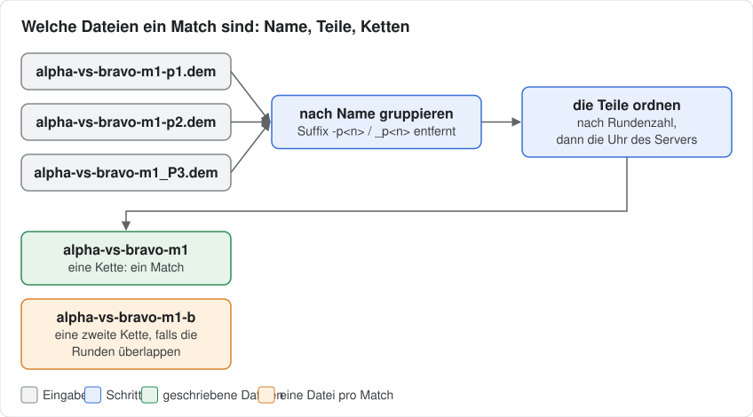

# Befehle {#commands}

Neu in der Kommandozeile? Lies zuerst [Bevor du anfängst](before-you-start.md).
Tippe diese Befehle in ein Terminal, das im Ordner geöffnet ist, den du entpackt oder geklont hast;
`<...>` sind Platzhalter, und ein Pfad mit Leerzeichen kommt in Anführungszeichen.

```text
python -m heat3d_cs2 demos <Demo-Dateien oder Ordner> -o <Ordner> [--every 8] [--jobs N] [--map TEXT] [--force] [--no-bulk] [--loose]
python -m heat3d_cs2 map <Kartenname oder Pfad zu ihrer .vpk> -o <Datei.glb> [--game ORDNER] [--source2viewer EXE]
python -m heat3d_cs2 scoreboard <match.3dheat oder match.json>
```

`python -m heat3d_cs2 --help` und `python -m heat3d_cs2 <Befehl> --help` listen dieselben Optionen auf;
die [Befehlsreferenz](../cli-reference.md) zeigt sie alle. Jeder Start führt zuerst die Versionsprüfung aus,
die unter [Updates](updates.md) beschrieben ist (abschaltbar mit `HEAT3D_NO_UPDATE=1`).

Code: [`heat3d_cs2/cli.py`](https://github.com/Holdi601/3DHeat-CS2/blob/main/heat3d_cs2/cli.py).

## `demos` - Demos zu Tabellen und Match-Dokumenten {#demos---demos-into-tables-and-match-documents}

```powershell
python -m heat3d_cs2 demos D:\Demos\event -o out
python -m heat3d_cs2 demos alpha-vs-bravo-m1-p1.dem alpha-vs-bravo-m1-p2.dem -o out
python -m heat3d_cs2 demos D:\Demos -o out --map final --jobs 4
```

| Argument | Standard | Tut |
|---|---|---|
| `paths` (eine oder mehrere) | - | Demo-Dateien und Ordner. Eine Datei wird genommen, wenn ihre Endung `.dem` ist (egal, ob groß oder klein). Ein Ordner wird **rekursiv** nach Dateien durchsucht, die auf `.dem` enden, egal in welcher Schreibweise, in sortierter Reihenfolge. Komprimierte Demos (`.dem.zst`, `.dem.bz2`, Archive) werden nicht gelesen: entpacke sie zuerst. |
| `-o`, `--out` | Pflicht | der Ordner, in den geschrieben wird; er wird bei Bedarf angelegt |
| `--every N` | `8` | tastet jeden Spieler alle *N* Ticks ab. CS2-Demos laufen mit 64 Ticks pro Sekunde, also sind 8 acht Abtastungen pro Sekunde, 4 sind sechzehn, 64 ist eine. Ereignisse werden immer bei ihrem eigenen Tick gelesen, egal welches *N*. |
| `--jobs N` | `0` = halbe Anzahl der CPU-Kerne | wie viele Matches gleichzeitig konvertiert werden, jedes in einem eigenen Prozess. Nie weniger als 1, nie mehr als Matches zu tun sind. |
| `--map TEXT` | - | nur Matches, deren **Name** *TEXT* enthält, ohne Unterschied zwischen Groß- und Kleinschreibung (`--map final`). Es filtert nach dem Dateinamen, nicht nach der Karte, die das Demo am Ende enthält. |
| `--force` | aus | konvertiert Matches, die schon geschrieben sind, und überschreibt sie |
| `--loose` | aus | hält jedes Match als eigene Dateien - Tabelle, `.match.json`, Beiwerk - statt sie in einen `.3dheat`-Container zu packen. Siehe [Eine Datei pro Match](output-container.md). |
| `--container` | an | packt jedes Match in eine `.3dheat`-Datei; das ist der Standard, die Option ist nur zur Deutlichkeit da |
| `--no-bulk` | aus | lässt den Entity-Strom, die Befehle der Spieler und den Animationsstrom aus dem Packets-Beiwerk weg - selbst komprimiert mehr als die Hälfte der Größe eines Demos. Die Selbstprüfung des Match-Dokuments zählt sie dann als `lost`, nach Name. |


### Welche Dateien ein Match ergeben {#which-files-are-one-match}



Der Match-Name ist der Dateiname des Demos ohne Endung und ohne Teil-Suffix: `-p<Ziffern>` oder
`_p<Ziffern>` am Ende, egal in welcher Schreibweise. So sind `alpha-vs-bravo-m1-p1.dem`,
`alpha-vs-bravo-m1-p2.dem` und `alpha-vs-bravo-m1_P3.dem` die Teile eines Matches,
`alpha-vs-bravo-m1`. Dateien werden allein nach diesem Namen gruppiert - zwei Dateien mit gleichem
Namen in verschiedenen Ordnern werden ebenfalls gruppiert.

Das Suffix sagt nichts über die Reihenfolge: ein `-p2` kann die frühere Hälfte sein. Die Teile werden
nach der Anzahl ihrer Runden und dann nach der Uhr des Servers sortiert. Eine Gruppe, die sich als zwei
verschiedene Matches herausstellt (etwa dieselben Teams auf derselben Karte bei zwei Events), wird in
**Ketten** geteilt: die Kette mit den meisten Runden bekommt den Namen selbst, die nächste heißt
`<name>-b`, dann `<name>-c`, und so weiter. Eine Datei ohne eine einzige Runde (nur Warmup, eine Pause)
gehört zu keiner Kette. Wie die Ketten gefunden werden, steht unter
[Ein Match aufbauen](building-matches.md#parts-and-chains).

### Was geschrieben wird {#what-is-written}

Für jedes Match, in einen Ordner mit dem Namen der Karte aus dem Demo-Header (`unknown`, wenn keiner
angegeben ist), eine `.3dheat`-Datei:

```text
out/
  de_x/
    alpha-vs-bravo-m1.3dheat
    alpha-vs-bravo-m2.3dheat
  de_y/
    ...
```

Beim synthetischen Demo mit zwei Runden aus den Tests:


Mit `--loose` ist jedes Match die Tabelle, ihr Match-Dokument und vier Beiwerk-Dateien nebeneinander
([Eine Datei pro Match](output-container.md)):


Eine Heatmap gehört zu einer Karte, daher lädt ein Ordner im Viewer die Matches einer Karte. Siehe
[Die Heatmap-Tabelle](output-table.md) und [Das Match-Dokument](output-match-json.md).

### Was übersprungen wird {#what-is-skipped}

Bevor etwas gelesen wird, werden alle `*.3dheat` irgendwo unter `--out` (ein Container wird ganz oder
gar nicht geschrieben) und alle `*.parquet`, neben denen ihr Match-Dokument (`<name>.match.json`) liegt,
aufgelistet. Ein Match, dessen Name einem dieser Dateinamen (ohne Endung) entspricht, wird übersprungen,
außer mit `--force`. Eine Tabelle ohne ihr Match-Dokument - ein Lauf, der zwischen den beiden Schreibvorgängen
angehalten wurde - zählt nicht, daher wird dieses Match erneut konvertiert. Die Prüfung erfolgt allein
nach dem Namen: ein Match, das in einen anderen Kartenordner oder mit einem anderen `--every` konvertiert
wurde, zählt trotzdem als erledigt. Ist nichts mehr zu tun:

```text
nothing to do: no demos found, or every match already written (--force redoes them)
```

### Was ausgegeben wird {#what-is-printed}

Zuerst die Menge der Arbeit, dann eine Zeile pro Match, sobald es fertig ist (in der Reihenfolge des
Fertigwerdens, nicht der Reihenfolge der Dateien):

```text
3 match(es), 3 at a time
alpha-vs-bravo-m1: de_x, 21 rounds (Alpha 13 Bravo 8), 412,377 rows, lost 0
alpha-vs-bravo-m2: de_y, 30 rounds (Bravo 16 Alpha 14), 598,104 rows, 1 incomplete round(s) left out, lost 0
alpha-vs-bravo-m3: de_y, 18 rounds (Alpha 13 Bravo 5), 330,981 rows, recorded from round 3, lost 1,204,331 (svc_PacketEntities, svc_UserCmds, DEM_AnimationData)
```

(Die Zahlen sind Beispiele.) Das Ergebnis ist das der letzten Runde, Team für Team in der Reihenfolge,
die das Match-Dokument angibt. *incomplete round(s) left out* zählt Runden, die ein Demo abschnitt, bevor
sie entschieden waren; *recorded from round N* sagt, dass die Aufnahme spät beginnt; *lost* ist die
Selbstprüfung des Match-Dokuments - wie viele Teile des Demos nirgendwohin gingen, und welcher Art sie
waren (`--no-bulk` macht den Bulk zu `lost`). Ein Match, das nichts ergibt, sagt warum:

```text
alpha-vs-bravo-m4: no round in 1 file(s) - nothing written
alpha-vs-bravo-m4-b: no complete round in 1 file(s) - nothing written
```

Ein Fehler in einem Match hält die anderen nicht an; er wird ausgegeben als
`<name>: failed - <error>`.

### Exit-Code {#exit-code}

`0`, wenn jedes Match konvertiert wurde (oder nichts zu tun war), `1`, wenn mindestens eines fehlschlug.

### Wie lange es dauert {#how-long-it-takes}

Jedes Match wird in einem Arbeitsprozess gelesen und gebaut. Ein Ordner mit einigen hundert Demos braucht
mit dem Standard-`--jobs` Minuten. Der Speicher pro Job wächst mit der Länge des Matches und mit einem
kleineren `--every`: jeder Arbeiter hält jede abgetastete Spielerzeile seines Matches, bevor er schreibt
(grob zehn Spieler mal 64 / *N* Zeilen pro Sekunde Aufnahme).

Die Beiwerk-Dateien brauchen länger als die Tabelle: jede Eigenschaft, die der Parser liest, wird bei
jedem Tick gelesen, ein Fenster von Ticks nach dem anderen (etwa zwei Minuten für ein 40-minütiges Demo,
höchstens rund 3 GB Speicher pro Job); danach wird das Demo noch einmal für seine Frames und Nachrichten
durchlaufen.

## `map` - die Geometrie einer Karte als `.glb` {#map---a-maps-geometry-as-glb}


```powershell
python -m heat3d_cs2 map <Karte> -o out/<Karte>/<Karte>.glb
python -m heat3d_cs2 map <Karte> -o <Karte>.glb --game "D:\Games\Steam\steamapps\common\Counter-Strike Global Offensive"
python -m heat3d_cs2 map "D:\maps\<Karte>.vpk" -o <Karte>.glb --source2viewer C:\Tools\Source2Viewer-CLI.exe
```

| Argument | Standard | Tut |
|---|---|---|
| `name` | - | der Name der Karte (etwa `de_x`) oder der Pfad zu ihrer `.vpk`. Ein Pfad, der auf `.vpk` endet und existiert, wird so genommen, wie er ist; alles andere wird über seinen Dateinamen ohne Endung im installierten Spiel gesucht. |
| `-o`, `--out` | Pflicht | die `.glb`-Datei, die geschrieben wird; ihr Ordner wird bei Bedarf angelegt |
| `--game ORDNER` | Steam-Bibliotheken | der Installationsordner von CS2 (der, der `game\csgo` enthält), wenn Steam ihn nicht kennt. Mit `--game` wird nur dieser Ordner durchsucht. |
| `--source2viewer EXE` | `HEAT3D_SOURCE2VIEWER`, dann `PATH` | die ausführbare Datei der Source2Viewer-CLI |

Ausgabe bei Erfolg:

```text
out/de_x/de_x.glb: de_x, 412,880 triangles (151,204 ground) in 14 parts
```

(Zahlen sind Beispiele.) Wenn du die `.glb` neben die Tabellen der Karte schreibst
(`out/<Karte>/<Karte>.glb`), bleiben Daten und Geometrie einer Karte in einem Ordner. Wie der Export
funktioniert: [Karten-Export](map-export.md).

Fehler, jeweils als `error: ...` mit Exit-Code `2` ausgegeben:

| Meldung | Bedeutet |
|---|---|
| `no de_x.vpk found in an installed CS2 - pass --game <CS2 folder> or the .vpk path` | die Karte ist in keiner gefundenen Steam-Bibliothek, oder der Name ist falsch |
| `Source2Viewer-CLI not found: ...` | keiner der Wege `--source2viewer`, `HEAT3D_SOURCE2VIEWER`, `PATH` ergab eine vorhandene Datei |
| `Source2Viewer did not export de_x's collision mesh:` gefolgt vom Ende seiner Ausgabe | es ist fehlgeschlagen oder hat keine `.glb` geschrieben |
| `de_x's collision mesh has nothing but clip brushes` | nach dem Weglassen von Clips und Himmel blieb nichts übrig |

## `scoreboard` - ein Match als Text {#scoreboard---a-match-as-text}

```bash
python -m heat3d_cs2 scoreboard out/de_x/alpha-vs-bravo-m1.3dheat
python -m heat3d_cs2 scoreboard out/de_x/alpha-vs-bravo-m1.match.json   # nach demos --loose
```

Gibt das Scoreboard des Matches aus seinem [Match-Dokument](output-match-json.md) aus, ohne den Viewer
zu öffnen. Es liest das Dokument in einem `.3dheat`-Container oder eine lose `<match>.match.json`.
Beim synthetischen Demo mit zwei Runden aus den Tests:


```text
alpha-vs-bravo-m1 - de_test  Alpha 2  Bravo 0

Alpha
player                 K   D   A  +/-    ADR   KAST   HS%  OK-OD  clutch
ash                    1   0   0   +1   50.0 100.0%    0%   0-0     1/1
ace                    1   1   0   +0   50.0 100.0%  100%   1-0     0/0

Bravo
player                 K   D   A  +/-    ADR   KAST   HS%  OK-OD  clutch
ben                    1   1   0   +0   50.0 100.0%    0%   0-0     0/1
bob                    0   1   0   -1    0.0 100.0%    0%   0-1     0/0

rounds  1:TK 2:TB
```

- Die erste Zeile: Matchname, Karte und das Endergebnis pro Team.
- Eine Tabelle pro Team, in der Reihenfolge der `teams` des Match-Dokuments; Spieler in der Reihenfolge
  des Match-Dokuments (nach Kills minus Tode, dann Kills, die besten zuerst). Namen werden auf
  19 Zeichen gekürzt.
- Spalten: **K** Kills, **D** Tode, **A** Assists *einschließlich* Flash-Assists, **+/-** Kills minus
  Tode, **ADR**, **KAST** (%), **HS%** (auf ganze Prozent gerundet), **OK-OD** Opening-Kills minus
  Opening-Tode, **clutch** gewonnene Clutches / gespielte Clutches. Definitionen:
  [Statistiken](statistics.md).
- Der Rundenstreifen: `<Runde>:<gewinnende Seite><wie>`, mit **B** Bombe explodiert, **D** entschärft,
  **K** Eliminierung, **T** Zeit abgelaufen, und **?** für alles andere (Unentschieden, Aufgabe,
  Sonstiges). Ein Unentschieden hat keine gewinnende Seite: `<Runde>:?`.

Eine Datei, die kein gültiges JSON ist oder nicht gefunden wird, bricht mit einem Fehler ab; ein
JSON-Dokument ohne die Felder eines Match-Dokuments scheitert mit einem Python-Fehler (weiter geprüft
wird es nicht).
