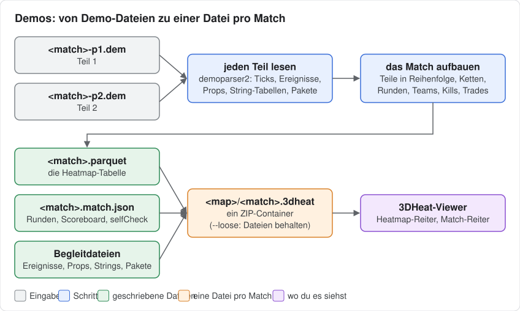

# 3DHeat CS2 {#dheat-cs2}

**Was ist das?** Counter-Strike 2 kann eine Aufnahme eines Matches speichern, ein sogenanntes
*Demo*. Dieses Werkzeug verwandelt ein Demo in Dateien, die der 3DHeat-Viewer in 3D zeigen kann: wo alle
standen, starben, warfen und die Bombe legten, Runde für Runde. Es kann außerdem eine CS2-Karte in ein
3D-Modell verwandeln, auf dem man das alles zeigt.

**Wozu brauche ich das?** Um deine eigenen Matches auszuwerten, um viele Matches derselben Karte als eine
Heatmap übereinanderzulegen, und für Match-Statistiken wie ADR (durchschnittlicher Schaden pro Runde) und
KAST (den Anteil der Runden, in denen ein Spieler getötet, assistiert, überlebt oder getradet hat).

**Beispiel:** `alpha-vs-bravo-m1.dem` hinein, `out/de_x/alpha-vs-bravo-m1.3dheat` heraus (`de_x` ist ein
erfundener Kartenname).



Genauer: 3DHeat CS2 verwandelt **Counter-Strike-2-Demos** in eine Heatmap-Tabelle und ein Match-Dokument pro
Match und eine **CS2-Karte** in Level-Geometrie. Die Ausgaben sind für den
[3DHeat](https://holdi601.github.io/3DHeat/)-Telemetrie-Viewer gemacht
([Quelle](https://github.com/Holdi601/3DHeat)), aber es sind gewöhnliche Dateien - Parquet, JSON und
binäres glTF -, die auch andere Programme lesen können.

Es ist ein kleines Python-Paket, `heat3d_cs2`, das über die Kommandozeile läuft. Es liest Demos von der
Festplatte (es lädt keine herunter) mit [demoparser2](https://github.com/LaihoE/demoparser), und es exportiert
Karten aus dem installierten Spiel mit der Kommandozeilen-Version von Source2Viewer
([ValveResourceFormat](https://github.com/ValveResourceFormat/ValveResourceFormat)).

## Schnellstart {#quick-start}

Neu in der Kommandozeile? Lies zuerst [Bevor du anfängst](before-you-start.md).

```bash
pip install -r requirements.txt
python -m heat3d_cs2 demos <demo files or folders> -o out   # every match in them
python -m heat3d_cs2 map <map> -o out/<map>/<map>.glb       # the map from the installed game
python -m heat3d_cs2 scoreboard out/<map>/<match>.3dheat    # a match's scoreboard as text
```

Du solltest `1 match(es), 1 at a time ...` sehen und dann eine Zeile pro Match
(siehe [Befehle](commands.md#what-is-printed)).

`demos` schreibt pro Match eine Datei in einen Ordner, der nach der Karte benannt ist:
`out/<map>/<match>.3dheat`, ein [`.3dheat`-Container](output-container.md) - das Ein-Datei-pro-Match-Format
des Viewers ([Spezifikation](https://holdi601.github.io/3DHeat/container.html)).
Er enthält diese Teile; `--loose` schreibt sie stattdessen als einzelne Dateien:

| Teil | Was es enthält | Geladen im |
|---|---|---|
| `<match>.parquet` (Rolle `table`) | jeder lebende Spieler achtmal pro Sekunde mit seinem Zustand (Gesundheit, Geld, Blendung, Zielfernrohr, Zone, Inventar, ...), und jedes Ereignis, wo es geschah (Kill, Tod, Verletzung, Schuss, Wurf, Granatdetonationen, Blendung, Bombe legen, entschärfen, explodieren, und ein Rundenende pro Spieler mit dem, was die Runde ihm einbrachte), eine Zeile je Eintrag | Heatmap-Tab |
| `<match>.match.json` (Rolle `match`, das Match-Dokument) | Teams, Stand, jede Runde (Sieger, wie, Wirtschaft, Bombe, Kills in Reihenfolge, Clutches, Überlebende) und die Scoreboard-Zeile jedes Spielers | Match-Tab |
| `<match>.events/props/strings/packets.parquet` | alles andere, was die Demo enthält, ganz (Begleitdateien) | zur Vollständigkeit behalten |

`map` schreibt `<map>.glb`: das Kollisionsnetz der Karte - Böden, Wände, Kisten, ohne Dekoration - aufgeteilt
in Boden und Bauwerk, im selben Rahmen und in denselben Einheiten wie die Tabellen, sodass es genau unter der
Heatmap liegt (Panel „Hintergrund / Level“).

## Karte dieser Dokumentation {#map-of-this-documentation}

| Seite | Was sie behandelt |
|---|---|
| [Bevor du anfängst](before-you-start.md) | Python, ein Terminal, Platzhalter, wie Erfolg und die häufigen Fehler aussehen |
| [Installation](installing.md) | Python, die Pakete, die CLI von Source2Viewer, wo CS2 liegen muss |
| [Befehle](commands.md) | `demos`, `map`, `scoreboard`: jede Option, was ausgegeben wird, Exit-Codes |
| [Ein Demo lesen](reading-demos.md) | was aus einer Demo-Datei gelesen wird: abgetastete Ticks, Spielereigenschaften, Spielregeln, Ereignisse |
| [Ein Match aufbauen](building-matches.md) | Teile und Ketten, die Match-Uhr, Runden, Teams und Seiten, Zeilen, Kills, Trades, Eröffnungen, Schaden, Blendungen, Wirtschaft |
| [Statistiken](statistics.md) | das Scoreboard: K/D/A, ADR, KAST, HS%, Eröffnungen, Trades, Mehrfach-Kills, Clutches, Utility, Blendungen |
| [Die Heatmap-Tabelle](output-table.md) | die Parquet-Datei: jede Spalte, ihr Typ, welche Ereignisse sie füllen, die `heat3d`-Footer-Hinweise, die Achsen |
| [Das Match-Dokument](output-match-json.md) | das `.match.json`-Dokument, Feld für Feld |
| [Eine Datei pro Match](output-container.md) | der `.3dheat`-Container, den `demos` standardmäßig schreibt, `--loose` |
| [Karten-Export](map-export.md) | wie das Kollisionsnetz einer Karte exportiert wird, der Rahmen, Knotenbenennung, Einheiten |
| [Nutzung mit 3DHeat](using-with-3dheat.md) | Tabellen, Match-Dokumente und Karten in die Tabs Heatmap und Match des Viewers laden |
| [Grenzen](limits.md) | was angenommen wird, was nicht behandelt wird, was ungeprüft ist |
| [Updates](updates.md) | die Release-Prüfung beim Start und `python -m heat3d_update` |
| [Entwicklung](development.md) | Code-Aufbau, Tests, das synthetische Demo-Testmaterial |
| [Befehlsreferenz](../cli-reference.md) | das `--help` jedes Befehls, aus dem Code erzeugt |
| [Pflege](maintaining.md) | die Release-Checkliste für diese Seiten |

## Was es geprüft wird {#what-it-is-checked-against}

Demos aus der freien Wildbahn sind nicht eine saubere Datei pro Match. Der Konverter kommt mit einem Match zurecht,
das auf mehrere Dateien in beliebiger Reihenfolge verteilt ist, mit einem Server, der mitten im Match neu gestartet
wurde, mit zwei verschiedenen Matches unter einem Namen, mit Runden aus einer Sicherung, mit einer Aufnahme, die
spät beginnt oder früh endet, mit Pausen und mit Coaches auf der Seite eines Teams - siehe
[Ein Match aufbauen](building-matches.md). Geprüft über eine große Sammlung von Turnier-Demos: In jedem Match
folgt der Stand den Rundensiegern, die Kills jeder Seite sind die Tode der anderen Seite, und jede Runde beginnt
mit fünf gegen fünf.

## Worauf man es richtet {#what-to-point-it-at}

Auf die Demos deiner eigenen Matches, auf Demos, die du von Hand von einer Turnierseite heruntergeladen hast,
oder auf Demos aus einer API, zu der du Zugang hast. Ein Demo ist eine Aufnahme, deren Inhalt dem Herausgeber und
den Veranstaltern gehört: Verwende, was herauskommt, für deine eigene Auswertung, und gib weder Demos noch daraus
abgeleitete Daten weiter. Das Tool liest Demos von der Festplatte und lädt keine herunter, und nichts aus dem
Spiel wird mitgeliefert: keine Spieldateien, kein Spielcode, keine DLLs.

3DHeat CS2 ist nicht mit Valve verbunden und wird nicht von Valve unterstützt. Counter-Strike 2 und die
zugehörigen Namen und Marken gehören ihren Inhabern. Rechteinhaber: Bitte eröffnet ein Issue unter
[github.com/Holdi601/3DHeat-CS2/issues](https://github.com/Holdi601/3DHeat-CS2/issues) - wir antworten schnell
und entfernen auf Anfrage alles.

## Teil von 3DHeat {#part-of-3dheat}

3DHeat CS2 ist eines der kostenlosen Werkzeuge rund um den 3DHeat-Viewer, jedes mit eigenem Repository,
eigenen Releases und eigener Lizenz:

| Werkzeug | Was es tut | Doku |
|---|---|---|
| [3DHeat](https://github.com/Holdi601/3DHeat) | der Viewer: Heatmaps, Rennanalyse und Match-Auswertung in 3D | [Seite](https://holdi601.github.io/3DHeat/) |
| [GameFiles](https://github.com/Holdi601/3DHeat-GameFiles) | Strecken und Levels aus den Dateien, die Spiele mitliefern, als 3D-Modelle | [Seite](https://holdi601.github.io/3DHeat-GameFiles/) |
| [GameCapture](https://github.com/Holdi601/3DHeat-GameCapture) | Rundentelemetrie aus Rennspielen; Levels aus Spielvideos nachgebaut | [Seite](https://holdi601.github.io/3DHeat-GameCapture/) |
| [Unreal Exporter](https://github.com/Holdi601/3DHeat-UnrealExporter) | ein Unreal-Editor-Plugin, das ein Level als ein 3D-Modell exportiert | [Seite](https://holdi601.github.io/3DHeat-UnrealExporter/) |
| [CS2](https://github.com/Holdi601/3DHeat-CS2) | Counter-Strike-2-Demos in Tabellen und Match-Dokumente; Karten in 3D-Modelle | [Seite](https://holdi601.github.io/3DHeat-CS2/) |
| [Watcher](https://github.com/Holdi601/3DHeat-Watcher) | nimmt im Hintergrund auf, was Spiele über dein Spiel veröffentlichen | [Seite](https://holdi601.github.io/3DHeat-Watcher/) |
| [Ext-WarThunder](https://github.com/Holdi601/3DHeat-Ext-WarThunder) | War-Thunder-Replays in Tabellen und Match-Dokumente | [Seite](https://holdi601.github.io/3DHeat-Ext-WarThunder/) |
| [Ext-WoT](https://github.com/Holdi601/3DHeat-Ext-WoT) | World-of-Tanks-Replays in Tabellen und Match-Dokumente | [Seite](https://holdi601.github.io/3DHeat-Ext-WoT/) |
| [Ext-WoWs](https://github.com/Holdi601/3DHeat-Ext-WoWs) | World-of-Warships-Replays in Tabellen und Match-Dokumente | [Seite](https://holdi601.github.io/3DHeat-Ext-WoWs/) |
| [Ext-Squad](https://github.com/Holdi601/3DHeat-Ext-Squad) | Squad-Server-Demos in Tabellen und Match-Dokumente | [Seite](https://holdi601.github.io/3DHeat-Ext-Squad/) |
| [Ext-DCS](https://github.com/Holdi601/3DHeat-Ext-DCS) | DCS-World-Karten in 3D-Modelle | [Seite](https://holdi601.github.io/3DHeat-Ext-DCS/) |
| [Ext-IL2](https://github.com/Holdi601/3DHeat-Ext-IL2) | IL-2-Sturmovik-Karten in 3D-Modelle | [Seite](https://holdi601.github.io/3DHeat-Ext-IL2/) |
| [Ext-Dota](https://github.com/Holdi601/3DHeat-Ext-Dota) | die Dota-2-Karte aus deiner eigenen Installation als 3D-Level | [Seite](https://holdi601.github.io/3DHeat-Ext-Dota/) |
| [Ext-DotaReplay](https://github.com/Holdi601/3DHeat-Ext-DotaReplay) | Dota-2-Replays | [Seite](https://holdi601.github.io/3DHeat-Ext-DotaReplay/) |
| [Ext-Riot](https://github.com/Holdi601/3DHeat-Ext-Riot) | League-of-Legends- und VALORANT-Replays (was sie unverschlüsselt enthalten) | [Seite](https://holdi601.github.io/3DHeat-Ext-Riot/) |
| [Ext-Forza](https://github.com/Holdi601/3DHeat-Ext-Forza) | Forza-Strecken, -Rennen und -Autos aus deiner eigenen Installation | [Seite](https://holdi601.github.io/3DHeat-Ext-Forza/) |
| [Ext-Battlefield](https://github.com/Holdi601/3DHeat-Ext-Battlefield) | Battlefield-Level (Frostbite) als 3D-Level | [Seite](https://holdi601.github.io/3DHeat-Ext-Battlefield/) |
| [Ext-BeamNG](https://github.com/Holdi601/3DHeat-Ext-BeamNG) | BeamNG.drive-Strecken | [Seite](https://holdi601.github.io/3DHeat-Ext-BeamNG/) |
| [Ext-ACRally](https://github.com/Holdi601/3DHeat-Ext-ACRally) | Assetto-Corsa-Rally-Etappen als Strecken | [Seite](https://holdi601.github.io/3DHeat-Ext-ACRally/) |
| [Ext-Reforger](https://github.com/Holdi601/3DHeat-Ext-Reforger) | Arma-Reforger-Welten (Enfusion) als 3D-Level | [Seite](https://holdi601.github.io/3DHeat-Ext-Reforger/) |
| [Ext-R6](https://github.com/Holdi601/3DHeat-Ext-R6) | Rainbow-Six-Siege-Match-Replays | [Seite](https://holdi601.github.io/3DHeat-Ext-R6/) |

## Lizenz {#licence}

MIT - siehe [`LICENSE`](https://github.com/Holdi601/3DHeat-CS2/blob/main/LICENSE)
und [`LICENSES.md`](https://github.com/Holdi601/3DHeat-CS2/blob/main/LICENSES.md)
für die Pakete von Dritten.
