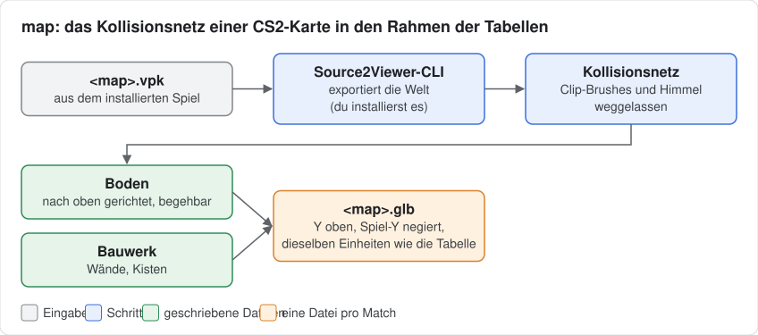

# Karten-Export (`map`) {#map-export-map}

`python -m heat3d_cs2 map <Karte> -o <Datei.glb>` schreibt eine CS2-Karte als Level-Geometrie: das
**Kollisionsnetz** der Welt, im Koordinatensystem und in den Einheiten, in denen die
[Heatmap-Tabellen](output-table.md) gezeichnet werden. Code:
[`heat3d_cs2/mapexport.py`](https://github.com/Holdi601/3DHeat-CS2/blob/main/heat3d_cs2/mapexport.py),
[`heat3d_cs2/glb.py`](https://github.com/Holdi601/3DHeat-CS2/blob/main/heat3d_cs2/glb.py).
Optionen und Meldungen: [Befehle](commands.md#map---a-maps-geometry-as-glb).



## Warum das Kollisionsnetz {#why-the-collision-mesh}

Das Kollisionsnetz ist das, worauf Spieler stehen und hinter dem sie sich verstecken - Böden, Wände, Treppen,
Kisten -, ohne die Dekoration: keine Props, die nur so aussehen, als wären sie etwas, keine Texturen, weit
weniger Dreiecke als die Rendernetze. Das braucht eine Heatmap darunter: etwas, an dem sich Positionen messen
lassen, keine Darstellung der Karte.

## Wie es gewonnen wird {#how-it-is-obtained}

1. **Die Karte finden.** Ein Pfad, der auf `.vpk` endet und existiert, wird so genommen, wie er ist. Sonst wird
   `<Name>.vpk` gesucht in `<CS2-Ordner>\game\csgo\maps\`, wobei der CS2-Ordner `--game` ist oder
   `steamapps\common\Counter-Strike Global Offensive` in jeder gefundenen Steam-Bibliothek (siehe
   [Installation](installing.md#where-cs2-is-looked-for)).
2. **Die CLI von Source2Viewer finden**: `--source2viewer`, dann `HEAT3D_SOURCE2VIEWER`, dann
   `Source2Viewer-CLI` / `Source2Viewer-CLI.exe` im `PATH`.
3. **Die Physik der Welt exportieren.** Source2Viewer wird so gestartet:

   ```text
   Source2Viewer-CLI -i <map>.vpk -d -f maps/<map>/world_physics.vmdl_c --gltf_export_format glb -o <temporary folder>
   ```

   Es dekodiert die kompilierte Physik von Source 2 aus dem eigenen Archiv der Karte und schreibt das Modell
   (leer: die Welt hat kein eigenes Rendernetz) und seine Physik daneben. Die größte geschriebene `.glb` ist die
   Physik. Schlägt Source2Viewer fehl oder schreibt keine `.glb`, bricht der Befehl ab und zeigt die letzten 800
   Zeichen seiner Ausgabe und seiner Fehler.
4. **Lesen.** Jeder Knoten der Szene wird mit seiner Transformation (Matrix oder Verschiebung-Drehung-Skalierung)
   durchlaufen, und jedes Dreiecks-Primitiv wird genommen, mit oder ohne Index-Puffer, in Weltkoordinaten.
5. **Weglassen, was keine Wand und kein Boden ist.** Ein Knoten, dessen Name `clip` enthält - Spieler-Clips,
   NPC-Clips, Granaten-Clips: die unsichtbaren Wände, die Spieler und Granaten aufhalten - oder `sky`, egal in
   welcher Schreibweise, fällt weg.
6. **Die Oberfläche benennen.** Die Physikgruppen sind nach ihrer Oberfläche benannt; der Name in Kleinbuchstaben,
   ohne führendes `physics`, `physics_group` oder `physics_passbullets` (und den Unterstrich danach), ist die
   Oberfläche: `physics_group_concrete` wird zu `concrete`, `physics_passbullets_chainlink` zu `chainlink`, ein
   nacktes `physics_group` zu `world`. Oberflächen, durch die Kugeln fliegen, bleiben erhalten.
7. **Zurück in das Koordinatensystem des Spiels.** Source2Viewer schreibt glTF in Metern mit Y nach oben: das (Y,
   Z, X) des Spiels mal 0,0254. Das wird rückgängig gemacht - jeder Punkt wird zum (X, Y, Z) des Spiels in Zoll.
8. **Boden von Struktur trennen**, Dreieck für Dreieck: eine Fläche, deren Normale mindestens 0,7 nach oben zeigt
   (ihre Z-Komponente, normiert) - Neigungen bis etwa 45 Grad, ungefähr das Steilste, was ein CS2-Spieler geht -,
   ist **Boden**; alles andere, Wände und Decken eingeschlossen, ist **Struktur**.
9. **In das Koordinatensystem des Viewers.** Jeder Punkt wird als (X, Z, -Y) geschrieben: Y nach oben, das Y des
   Spiels negiert - das Koordinatensystem, in dem der Viewer die Tabellen zeichnet, wenn er ihren `heat3d`-Hinweisen
   folgt. Eine Drehung, keine Spiegelung.
10. **Die `.glb` schreiben.** Bleibt nichts übrig (nur Clip-Brushes), bricht der Befehl mit einem Fehler ab.
    Sonst gibt er die Datei, die Karte, die Anzahl der Dreiecke, wie viele davon Boden sind, und die Anzahl der
    Teile aus.

Hier wird nichts gelesen außer der eigenen `.vpk` der Karte, und nichts von Source2Viewer wird mitgeliefert oder
kopiert.

## Die Datei {#the-file}

Eine glTF-2.0-Binärdatei (`.glb`), ein Puffer, geschrieben von `heat3d_cs2` (das `asset.generator`):

| Aspekt | Was |
|---|---|
| Knoten | einer pro Teil, alle an der Wurzel, ohne Transformationen, jeder mit seinem eigenen Mesh desselben Namens |
| Knotennamen | `ground:<Oberfläche>` oder `structure:<Oberfläche>` (`ground:concrete`, `structure:metal`, `structure:world`), nach Namen sortiert |
| Primitive | eines pro Mesh, Dreiecke, `POSITION` (float32, mit Min/Max) und `NORMAL` (float32), `uint32`-Indizes |
| Schattierung | flach: ein Vertex pro Dreiecksecke, jeder mit der Normale seines Dreiecks |
| Materialien, Texturen, UVs, Farben | keine |
| Einheiten | Spieleinheiten (**Zoll**), nicht Meter - anders als glTF annimmt |
| Koordinatensystem | (X, Z, -Y) des Spiels: das Y von glTF ist die Höhe des Spiels, das Z von glTF ist das -Y des Spiels |

Das Präfix `ground:` / `structure:` ist die Konvention aller 3DHeat-Level-Exporter: Der Viewer nimmt einen so
benannten Teil beim Wort, statt die Geometrie zu raten, damit die Böden die Bodenschattierung und die Wände die
Strukturzeichnung bekommen, ohne einen Klassifizierungsschritt.

Weil die Einheiten Zoll sind, zeigt ein anderer glTF-Viewer die Karte etwa 39-mal zu groß (er liest sie als
Meter); skaliere dort mit 0,0254, wenn es darauf ankommt. In 3DHeat liegt sie genau unter der Tabelle, die in
denselben Einheiten mit Maßstab 1 ist.

## Die Prüfung, dass das Koordinatensystem stimmt {#the-check-that-the-frame-is-right}

Der Test `test_players_stand_on_the_exported_floor` (läuft nur, wenn ein Demo und Source2Viewer angegeben sind,
siehe [Entwicklung](development.md#tests)) exportiert die Karte, auf der ein Demo gespielt wurde, nimmt 300
zufällige Positionsproben des Matches und sucht für jede senkrecht nach unten das höchste Bodendreieck, das
höchstens 4 Einheiten über den Füßen des Spielers liegt. Verlangt wird, dass mindestens 98 % der Proben Boden
finden und dass die mediane Höhe darüber unter 5 Einheiten liegt. Eine gespiegelte Karte fällt durch: Bei einer
Karte, die an der falschen Achse gespiegelt ist, stehen viele Spieler über nichts. Die README nennt die Zahlen
dieser Prüfung über die Karten des aktuellen Wettkampfpools.

## Was er nicht tut {#what-it-does-not-do}

- Keine Rendergeometrie, keine Texturen und keine Dekoration - siehe *warum* oben.
- Nur was in dem Modell `world_physics` der Karte steht, wird exportiert. Ob bewegliche Teile (Türen) oder
  Zerstörbares darin stehen, ist nicht geprüft.
- Keine Vereinfachung: der 3DHeat-Viewer vereinfacht beim Import mit seiner Einstellung **Vereinfachungsziel**.
- Karten, die nicht im installierten Spiel liegen (Workshop-Karten woanders auf der Platte), funktionieren, wenn
  ihre `.vpk` als Pfad übergeben wird und `maps/<name>/world_physics.vmdl_c` enthält; nicht geprüft.
