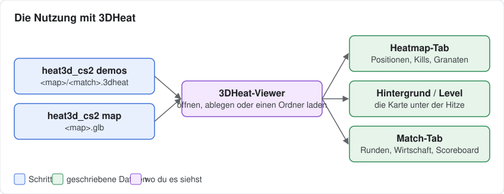

# Mit 3DHeat verwenden {#using-it-with-3dheat}

Die Ausgaben gehen in diese Stellen des [3DHeat-Viewers](https://holdi601.github.io/3DHeat):

| Datei | Wo | Was sie gibt |
|---|---|---|
| `<match>.3dheat` (der Standard) | **Heatmap**-Tab, **Quelle**-Panel, oder der **Match**-Tab | die Tabelle und das Match-Dokument zusammen, eine Datei pro Match ([Container](https://holdi601.github.io/3DHeat/container.html)) |
| `<match>.parquet` | **Heatmap**-Tab, **Quelle**-Panel | Positionen und Ereignisse als Heatmap, Box-Replay, Routen |
| `<match>.match.json` | **Match**-Tab, **Match-Dateien laden…** | das Scoreboard, die Runden, der Killfeed, Statistiken über mehrere Matches, Verknüpfungen in die Heatmap |
| `<map>.glb` | **Hintergrund / Level**-Panel, **3D-Modell…** | die Karte unter der Heatmap |

Die eigene Dokumentation des Viewers beschreibt jeden Tab vollständig auf den Seiten
[Match-Analyse](https://holdi601.github.io/3DHeat/match-analysis.html),
[Dateien laden](https://holdi601.github.io/3DHeat/loading-files.html),
[Spaltenzuordnung](https://holdi601.github.io/3DHeat/column-mapping.html) und
[Box-Replay](https://holdi601.github.io/3DHeat/box-replay.html). Diese Seite ist die CS2-Seite davon.



Der Viewer: [github.com/Holdi601/3DHeat](https://github.com/Holdi601/3DHeat),
Dokumentation [holdi601.github.io/3DHeat](https://holdi601.github.io/3DHeat/).

## Eine typische Sitzung {#a-typical-session}

```bash
python -m heat3d_cs2 demos D:\Demos\event -o out
python -m heat3d_cs2 map <map> -o out/<map>/<map>.glb
```

1. **Heatmap-Tab -> Quelle:** wähle den Ordner `out/<map>` (oder zieh ihn hinein).
   Jede `.parquet` darin wird zu einem Datensatz; die `.json`- und `.glb`-Dateien im selben Ordner werden als
   „keine csv/parquet-Datei“ übersprungen. Lade ihn.
2. **Hintergrund / Level -> 3D-Modell…:** wähle `out/<map>/<map>.glb`. **In Bibliothek speichern** behält sie im
   Browser für das nächste Mal.
3. **Match-Tab -> Match-Dateien laden…:** wähle die `.match.json`-Dateien aus demselben Ordner (mehrere auf einmal),
   oder zieh sie auf die Ansicht, während der Match-Tab offen ist.

Lade immer nur die Tabellen einer Karte auf einmal: die Koordinaten verschiedener Karten überlappen sich, und eine
Heatmap von zwei Karten zugleich bedeutet nichts. Der Ordner pro Karte ist genau dafür da.

## Die Tabelle öffnet sich ohne Einstellungen {#the-table-opens-with-nothing-to-set}

Der Viewer liest den `heat3d`-Eintrag im Footer der ersten ausgewählten Datei
([Die Heatmap-Tabelle](output-table.md#the-heat3d-footer-hints)) und legt ihn über seine eigenen Vermutungen:

| Viewer-Einstellung | Stellen auf |
|---|---|
| Position | `x`, `y`, `z` |
| Hochachse in der Quelle | Z ist oben |
| Y spiegeln | an - damit die Karte richtig herum steht, nicht gespiegelt |
| Einheitenmaßstab | 1 - Entfernungen in Spieleinheiten (als „m“ beschriftet; 1 Einheit = 1 Zoll) |
| Zeit | `time`, Sekunden |
| Person | `player` |
| Gruppe | `side` (T / CT) |
| Session | `roundId` - jede Runde ist eine Session, `<match> #NN` |
| Blickrichtung | Vektor, `dirX` / `dirY` / `dirZ` |
| Filterspalten | `event`, `match`, `round`, `roundTime`, `phase`, `weapon`, `place`, `won`, `buy`, `opening`, `team` |
| Entitätsgröße | 32 - das Box-Replay zeichnet einen Spieler 32 Einheiten breit, mit einem Blickstrahl von 4 x 32 |

Jeder vorgegebene Wert ist noch in der Spaltenzuordnung zu sehen und kann geändert werden. Die übrigen Spalten
(`headshot`, `traded`, `other`, `steamid`, `health`, `money`, `damage`, `duration`, ...) lassen sich dort von Hand als
Filter hinzufügen.

Lass den Einheitenmaßstab bei 1, wenn eine Karte geladen ist: die `.glb` ist in denselben Spieleinheiten, und das Level
wird nicht zusammen mit der Tabelle neu skaliert.

### Nützliche Filter {#useful-filters}

- `event` = `position` für wo Spieler waren; `kill` / `death` für wo Duelle gewonnen und verloren wurden; `smoke`,
  `flash`, `molotov`, `he` für wo Utility landete; `throw` für wo sie geworfen wurde; `plant` für Legeorte.
- `side` (die Gruppe) = `T` oder `CT`, `phase` = `live`, um die After-Phase wegzulassen, `buy` = `eco` / `force` /
  `full` für Runden einer Wirtschaftsstufe, `won` = 1 für Runden, die die Seite der Zeile gewonnen hat.
- `opening` = 1 mit `kill` und `death` für die Opening-Duelle.
- `roundTime` als Bereich für einen Moment der Runde: die ersten 20 Sekunden, die Zeit nach der Legung.

## Der Match-Tab {#the-match-tab}

Der Match-Tab nimmt eine JSON-Datei an, deren `format` `heat3d-cs2-match` ist und die die Arrays `rounds`, `players` und
`teams` hat ([Das Match-Dokument](output-match-json.md)). Er zeigt den Stand und die Hälften, einen Streifen der Runden,
eingefärbt nach der gewinnenden Seite, mit einer Markierung, wie jede endete, die Wirtschaft jeder Runde, Legung,
Killfeed, Clutches und Überlebende, das Scoreboard und Statistiken über alle geladenen Matches.

Seine Verknüpfungen **Im Heatmap zeigen** laden nichts: sie setzen Filter auf der Tabelle, die schon im Heatmap-Tab
geladen ist - `match`, `round` (und die Session der Runde `<match> #NN`), `event`, der Spieler, die Seite. Das klappt,
weil das Match-Dokument und die Tabelle dieselben Match-Namen, Rundennummern, Spielernamen und Seiten tragen.
**Runde abspielen** schaltet die Heatmap auf Box-Replay und spielt die Session der Runde vom Anfang an.

Lade also beides: die Tabellen einer Karte im Heatmap-Tab, ihre Match-Dokumente im Match-Tab. Ein Match-Dokument ohne
seine Tabelle zeigt trotzdem das Scoreboard und die Runden, und die Verknüpfungen sagen, dass keine Heatmap-Daten
geladen sind.

## Ohne 3DHeat {#without-3dheat}

- Die Tabelle ist gewöhnliches Parquet: pandas, Polars, DuckDB, Spark, R's `arrow` lesen sie alle; der Eintrag `heat3d`
  wird ignoriert, und die Textspalten werden als Strings oder Kategorien gelesen.
- Das Match-Dokument ist gewöhnliches JSON.
- Die Karte ist eine gültige glTF-Binärdatei, in Zoll statt Metern: für Werkzeuge, die Meter annehmen, mit 0,0254
  skalieren. Ihr Koordinatensystem ist das eigene von glTF (Y nach oben); um die Tabelle anderswo darüberzulegen,
  zeichne jede Zeile (x, y, z) als (x, z, -y), wie es 3DHeat tut.
