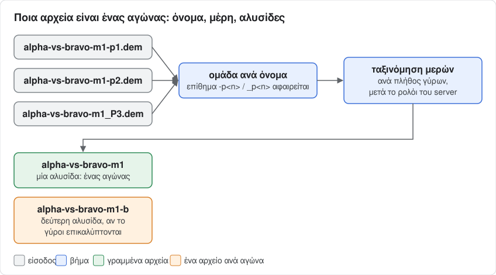

# Δημιουργία αγώνα {#building-a-match}

Πώς φτιάχνεται ένας αγώνας από τα κομμάτια του demo: ποια αρχεία ανήκουν μαζί, ένα κοινό ρολόι για όλα,
οι γύροι και πώς κερδήθηκε καθένας, οι ομάδες και οι πλευρές τους, και κάθε γραμμή του πίνακα χάρτη θερμότητας
με φόνους, trades, ανοίγματα, ζημιά, φλας και οικονομία. Κώδικας:
[`heat3d_cs2/match.py`](https://github.com/Holdi601/3DHeat-CS2/blob/main/heat3d_cs2/match.py).
Το σκορ που υπολογίζεται από αυτόν είναι στη σελίδα [Στατιστικά](statistics.md).

## Επισκόπηση {#overview}

1. Διαβάζεται κάθε αρχείο ενός ονόματος αγώνα ([Ανάγνωση demo](reading-demos.md)).
2. Λύνονται οι διπλές γραμμές παικτών κάθε αρχείου (οι επαναφερμένοι γύροι).
3. Τα αρχεία ταξινομούνται σε **αλυσίδες** - αγώνες - και κάθε αλυσίδα μπαίνει στη σειρά της.
4. Κάθε κομμάτι τοποθετείται στο **ρολόι του αγώνα**.
5. Οι **γύροι** βρίσκονται σε κάθε κομμάτι· η εκδοχή ενός γύρου από μεταγενέστερο κομμάτι αντικαθιστά την προηγούμενη.
6. Οι **παίκτες** και οι **ομάδες** παίρνουν ονόματα, και οι πλευρές και το σκορ κάθε γύρου δίνονται με το όνομα της
   ομάδας. Όταν είναι γνωστές οι πλευρές, βγαίνουν το μήκος του ημιχρόνου, οι γύροι πιστολιού και η **αγορά**
   κάθε πλευράς.
7. Χτίζονται οι **γραμμές**: θέσεις, βολές, ρίψεις, εκρήξεις χειροβομβίδων, φυτέματα, απενεργοποιήσεις, φόνοι,
   θάνατοι, χτυπήματα, τυφλώσεις, εκρήξεις.
8. Κάθε γραμμή παίρνει τον γύρο της, τη φάση της, τον χρόνο του γύρου, αν κέρδισε η πλευρά της και την αγορά της
   πλευράς της· οι γραμμές έξω από κάθε γύρο πετιούνται.

## Γύροι που επαναφέρθηκαν: μία γραμμή ανά παίκτη ανά tick {#restored-rounds-one-row-per-player-per-tick}

Όταν ένας γύρος επαναφέρεται από αντίγραφο μέσα σε ένα αρχείο, το demo κρατά για μερικά δευτερόλεπτα και τα παλιά
σώματα των παικτών μαζί με τα καινούργια: δύο γραμμές για έναν παίκτη σε ένα tick, μία εκεί που τον άφησε ο
ακυρωμένος γύρος και μία στο σημείο εμφάνισης του επαναφερμένου γύρου. Για κάθε τέτοιον παίκτη, τα διπλά tick
διατρέχονται **προς τα πίσω**, από την πρώτη μονή γραμμή που ακολουθεί. Σε κάθε tick κρατιέται η υποψήφια που είναι
πιο κοντά στη θέση του επόμενου tick, και αυτή γίνεται η αναφορά για το tick πριν. Αν δεν υπάρχει μονή γραμμή μετά,
κρατιέται η τελευταία υποψήφια. Έτσι κάθε παίκτης κρατά τη γραμμή που οδηγεί προς το σημείο όπου πάει στη συνέχεια.

## Το ζωντανό μέρος ενός αρχείου {#the-live-part-of-a-file}

Η **ζωντανή αρχή** ενός αρχείου είναι το tick του τελευταίου `round_announce_match_start`, ή το tick 0 αν δεν έχει
κανένα (ένα μεταγενέστερο κομμάτι ενός χωρισμένου αγώνα συνήθως δεν έχει). Αφήνεται έξω ό,τι είναι πριν από τη
ζωντανή αρχή, και ό,τι σημαίνεται ως `is_warmup_period`. Ένας knife round ή μια επανεκκίνηση πριν από την ανακοίνωση
λοιπόν αφήνονται έξω· ένας knife round που **δεν** ακολουθείται από ανακοίνωση έναρξης αγώνα δεν αναγνωρίζεται ως
τέτοιος (βλ. [Όρια](limits.md)).

Οι **γύροι** ενός αρχείου είναι τα `round_freeze_end` από τη ζωντανή αρχή και μετά, εκτός του warmup, αναγνωρισμένα
από το `total_rounds_played` τους (ο δείκτης του γύρου που πρόκειται να παιχτεί, με αρίθμηση από το 0 του παιχνιδιού).
Ένα αρχείο χωρίς γύρους δεν έχει γύρους και δεν ανήκει σε κανέναν αγώνα.

## Το ρολόι {#the-clock}

Οι χρόνοι είναι σε δευτερόλεπτα. Μέσα σε ένα αρχείο ο χρόνος μετριέται σε **ticks**: το `game_time` του
διακομιστή στο πρώτο δειγματισμένο tick, συν τα ticks από τότε / 64. Το δικό του ρολόι του διακομιστή σταματά στη
διάρκεια μιας παύσης ενώ τα ticks συνεχίζουν· αν διαβάζαμε το ρολόι, δύο στιγμές ενός παυμένου αγώνα θα είχαν τον
ίδιο χρόνο.

Κάθε αρχείο έχει ένα *πρώτο ρολόι* (ο χρόνος στη ζωντανή αρχή του) και ένα *τελευταίο ρολόι* (στο τελευταίο
δειγματισμένο tick του).

### Κομμάτια και αλυσίδες {#parts-and-chains}

Τα αρχεία με το ίδιο όνομα αγώνα ([Εντολές](commands.md#which-files-are-one-match)) ταξινομούνται πρώτα κατά τον
δείκτη του πρώτου γύρου τους και μετά κατά το πρώτο ρολόι τους. Έπειτα καθένα, με αυτή τη σειρά, μπαίνει στην πρώτη
αλυσίδα που συνεχίζει, ή ξεκινά νέα αλυσίδα. Ένα κομμάτι συνεχίζει μια αλυσίδα όταν ο πρώτος δείκτης γύρου του είναι
τουλάχιστον ίσος με τον τελευταίο δείκτη του τελευταίου κομματιού της αλυσίδας, **και** ισχύει ένα από τα δύο:

- το ρολόι του διακομιστή συνεχίζει: το πρώτο ρολόι του δεν είναι νωρίτερα από το τελευταίο ρολόι της αλυσίδας
  μείον 5 s· ή
- η μέτρηση των γύρων συνεχίζει: ο πρώτος δείκτης γύρου του είναι ο τελευταίος δείκτης της αλυσίδας ή ο επόμενος.

Αποφασίζει η μέτρηση των γύρων και το ρολόι κάνει τη διαφορά, επειδή ένας διακομιστής που ξανάρχισε για να
επαναφέρει έναν γύρο ξεκινά πάλι το ρολόι του, ενώ δύο διαφορετικοί αγώνες με το ίδιο όνομα (οι ίδιες ομάδες στον
ίδιο χάρτη σε δύο διοργανώσεις) έχουν επικαλυπτόμενες μετρήσεις γύρων. Οι αλυσίδες ταξινομούνται κατά τον αριθμό
των γύρων που καλύπτουν, πρώτα η μεγαλύτερη· η πρώτη κρατά το όνομα του αγώνα, και οι άλλες γράφονται ως `<όνομα>-b`,
`<όνομα>-c`, και ούτω καθεξής.

### Το ρολόι του αγώνα {#the-match-clock}

Το μηδέν του αγώνα είναι το πρώτο ρολόι του πρώτου κομματιού: **ο χρόνος αγώνα 0 είναι η ζωντανή αρχή του πρώτου
αρχείου**. Κάθε επόμενο κομμάτι τοποθετείται πάνω του ως εξής:

- όπου το ρολόι του διακομιστή συνεχίζει (το πρώτο ρολόι του δεν είναι νωρίτερα από το τελευταίο ρολόι του
  προηγούμενου κομματιού μείον 5 s), χρησιμοποιείται το ρολόι του διακομιστή όπως είναι·
- όπου ξανάρχισε, το κομμάτι τοποθετείται ώστε να ακολουθεί **ένα δευτερόλεπτο** μετά τη λήξη του προηγούμενου.

## Γύροι {#rounds}

Για κάθε `round_freeze_end` ενός κομματιού (με τη σειρά των tick), το παράθυρο του γύρου φτάνει ως το επόμενο
τέλος παγώματος σε εκείνο το κομμάτι, ή ως το τέλος του αρχείου. Μέσα σε αυτό, ο γύρος **αποφασίζεται** στο πρώτο
δειγματισμένο tick όπου η κατάσταση του παιχνιδιού δείχνει `total_rounds_played` = δείκτης του γύρου + 1 και
`round_win_status` 1 (ισοπαλία), 2 (νίκη T) ή 3 (νίκη CT). Ένας γύρος χωρίς τέτοιο δείγμα στο παράθυρό του
κόπηκε από το τέλος του αρχείου· ο αριθμός του μπαίνει στη λίστα **ημιτελών** του αγώνα (εκτός αν άλλο κομμάτι
έχει τον γύρο πλήρη).

| Πεδίο γύρου | Από |
|---|---|
| `number` | ο δείκτης + 1 (από το 1, όπως μετράει το παιχνίδι) |
| `start` | χρόνος αγώνα όταν τελειώνει ο χρόνος παγώματος - οι παίκτες μπορούν πλέον να κινηθούν |
| `end` | χρόνος αγώνα του πρώτου δείγματος που δείχνει τον γύρο αποφασισμένο |
| `until` | χρόνος αγώνα του επόμενου `round_prestart` μετά το `end`, αν είναι μέσα στο παράθυρο· αλλιώς το τέλος του παραθύρου ή το τελευταίο tick του αρχείου, όποιο έρθει πρώτο (και ποτέ πριν από το `end`) |
| `winner` | `T` για κατάσταση νίκης 2, `CT` για 3, κενό για 1: η ισοπαλία αποφασίζεται, χωρίς νικητή |
| `reason` | το `round_win_reason` σε εκείνο το δείγμα, με τα ονόματα που φαίνονται πιο κάτω |
| `score` | όνομα ομάδας -> γύροι που κέρδισε μετά από αυτόν: το `team_rounds_total` κάθε πλευράς στο δείγμα της απόφασης· όπου το demo δεν έχει τέτοιο πεδίο, το σκορ του προηγούμενου γύρου συν ένα για τον νικητή |
| `sides` | όνομα ομάδας -> `T` / `CT` σε αυτόν τον γύρο |
| `equipment` | πλευρά -> το άθροισμα του `current_equip_value` των **ζωντανών** παικτών της, στο πρώτο δείγμα από το τέλος του παγώματος ή μετά |
| `buy` | πλευρά -> `pistol`, `eco`, `force` ή `full` ([Οικονομία και τύποι αγορών](#economy-and-buy-types)) |
| `plant` | το πρώτο `bomb_planted` μετά το τέλος του παγώματος και έως το `end`, ή τίποτα |
| `exploded` | χρόνος αγώνα της πρώτης `bomb_exploded` μετά από αυτό το φύτεμα και πριν από το επόμενο τέλος παγώματος, αν υπάρχει (δεν είναι στο έγγραφο του αγώνα· ορίζει τον χρόνο της γραμμής `explode`) |

Το `reason`, από το `CSRoundEndReason` του παιχνιδιού:

| Κωδικός | `reason` |
|---|---|
| 1 | `bomb` (ο στόχος ανατινάχθηκε) |
| 7 | `defuse` |
| 8, 9 | `elimination` (νίκη των CT / νίκη των T με εξόντωση) |
| 10 | `draw` |
| 12 | `time` (ο στόχος σώθηκε) |
| 17, 18 | `surrender` |
| οτιδήποτε άλλο | `other` |

Όταν πολλά κομμάτια έχουν τον ίδιο γύρο (με τον δείκτη), κρατιέται η εκδοχή του μεταγενέστερου κομματιού. Οι γύροι
μπαίνουν μετά σε λίστα με τον δείκτη τους. Ένας αγώνας του οποίου ο πρώτος γύρος δεν είναι ο γύρος 1 καταγράφει
τους λείποντες αριθμούς (`missing` στο έγγραφο του αγώνα)· η γραμμή εντολών γράφει *recorded from round N*.

### Το φύτεμα {#the-plant}

| Πεδίο | Από |
|---|---|
| `site` | `A` ή `B`: η ζώνη βόμβας στην οποία λέει το παιχνίδι ότι στεκόταν ο φυτευτής (`which_bomb_zone`, 1 A, 2 B)· χωρίς αυτό, το όνομα τοποθεσίας του φυτευτή (`BombsiteA`, `BombsiteB`)· χωρίς κι αυτό, το γράμμα που έδωσε άλλο φύτεμα του ίδιου αρχείου στην ίδια ζώνη (ο αριθμός οντότητας της ζώνης είναι το `site` του γεγονότος). Κενό όταν τίποτα δεν λέει κάτι - ποτέ ο αριθμός. |
| `time` | δευτερόλεπτα **μέσα στον γύρο** (από το τέλος του παγώματος), όπως ο χρόνος ενός φόνου |
| `player`, `steamid` | ο φυτευτής |
| `x`, `y`, `z` | η θέση του φυτευτή, σε μονάδες παιχνιδιού: εκεί που βρίσκεται η βόμβα |
| `place` | το όνομα τοποθεσίας του φυτευτή τη στιγμή του φυτέματος |

### Οι φάσεις {#the-phases}

Ο χρόνος από το `start` ως το `end` είναι η **ζωντανή** φάση του γύρου· από το `end` ως το `until` είναι η
**μετά** φάση του, όπου οι νικητές κυνηγούν και οι χαμένοι σώζουν. Μια γραμμή ανήκει στον γύρο του οποίου το
`[start, until)` περιέχει τον χρόνο της, και είναι `after` όταν ο χρόνος της είναι μετά το `end`. Ο χρόνος παγώματος
βρίσκεται ανάμεσα στους γύρους και δεν ανήκει σε κανέναν.

## Παίκτες και ομάδες {#players-and-teams}

**Παίκτης** είναι όποιος ήταν ζωντανός τουλάχιστον μία φορά σε μια πλευρά (ομάδα 2 ή 3), εκτός παγώματος και
warmup, μετά τη ζωντανή αρχή. Ένας coach ή ένας caster στην πλευρά μιας ομάδας δεν είναι ποτέ ζωντανός και δεν είναι
παίκτης. Κάθε παίκτης αναγνωρίζεται με το Steam ID του· το όνομα είναι το τελευταίο που φάνηκε.

Η **ομάδα** ενός παίκτη είναι το όνομα κλαμπ που έδωσε το παιχνίδι στην πλευρά του (`team_clan_name`), αυτό που φάνηκε
πιο συχνά για αυτόν· το demo το καθαρίζει στο πολύ τέλος του. Ένας αγώνας που παίχτηκε χωρίς ονόματα κλαμπ ονομάζει
τις ομάδες με την πλευρά από την οποία ξεκίνησαν: `Started T` και `Started CT`.

Οι **πλευρές** κάθε γύρου προκύπτουν από το ποιος ήταν σε ποια πλευρά από το τέλος του παγώματος ως το τέλος του
γύρου: σε κάθε πλευρά δίνεται η ετικέτα ομάδας που φέρουν οι περισσότεροι από τους παίκτες της. Η λίστα `teams` του
αγώνα είναι με τη σειρά εμφάνισης, γύρο προς γύρο, πρώτα η πλευρά T και μετά η CT· συνήθως η ομάδα που ξεκίνησε στο T
είναι πρώτη.

## Οι γραμμές {#the-rows}

Κάθε δείγμα θέσης και κάθε γεγονός γίνεται μία γραμμή του [πίνακα χάρτη θερμότητας](output-table.md). Οι παίκτες
είναι σε πλευρά μόνο όταν το `team_num` τους είναι 2 ή 3.

### Θέσεις {#positions}

Από τα δειγματισμένα στοιχεία των ζωντανών παικτών σε μια πλευρά, εκτός παγώματος και warmup, μετά τη ζωντανή αρχή:
θέση, κατεύθυνση βλέμματος, υγεία, θωράκιση, χρήματα, αξία εξοπλισμού, όπλο στο χέρι, τοποθεσία.

Η κατεύθυνση του βλέμματος είναι ένα μοναδιαίο διάνυσμα στο πλαίσιο του παιχνιδιού:
`(cos pitch * cos yaw, cos pitch * sin yaw, -sin pitch)`. Το pitch του παιχνιδιού είναι θετικό όταν κοιτάς κάτω,
οπότε το βλέμμα προς τα κάτω δίνει αρνητικό Z.

Το όπλο στο χέρι είναι το `active_weapon_name` όπως το ονομάζει το παιχνίδι, με μία αλλαγή: κάθε όνομα που περιέχει
`Knife`, `Bayonet`, `Karambit` ή `Daggers` γίνεται `Knife`.

### Βολές και ρίψεις {#shots-and-throws}

Από το `weapon_fire`, στη θέση του σκοπευτή. Τα μαχαίρια (`knife`, `bayonet` στο αναγνωριστικό του όπλου) και η C4
αφήνονται έξω. Οι χειροβομβίδες (`smokegrenade`, `flashbang`, `hegrenade`, `molotov`, `incgrenade`, `decoy`) είναι
γραμμές **ρίψης** (`throw`), και όλα τα άλλα είναι γραμμές **βολής** (`shot`). Το όπλο δίνεται όπως το δείχνει το
παιχνίδι (πιο κάτω).

### Εκρήξεις χειροβομβίδων {#grenade-detonations}

| Γεγονός | Γραμμή | `weapon` |
|---|---|---|
| `smokegrenade_detonate` | `smoke` | Smoke Grenade |
| `flashbang_detonate` | `flash` | Flashbang |
| `hegrenade_detonate` | `he` | High Explosive Grenade |
| `inferno_startburn` (molotov και incendiary) | `molotov` | Molotov |
| `decoy_detonate` | `decoy` | Decoy Grenade |

Η θέση είναι **εκεί όπου έσκασε η χειροβομβίδα** (τα `x`, `y`, `z` του γεγονότος)· ο παίκτης και η πλευρά είναι
του ρίχνοντα. Το demo δεν δίνει τοποθεσία για μια χειροβομβίδα, μόνο για τους παίκτες, οπότε το `place` μένει κενό:
μια γραμμή δεν διεκδικεί τόπο όπου δεν βρισκόταν. Η τοποθεσία του ρίχνοντα εκείνη τη στιγμή κρατιέται ως
`throwerPlace`.

### Φυτέματα και απενεργοποιήσεις {#plants-and-defuses}

Γραμμές `plant` και `defuse` στη θέση του παίκτη, με όνομα όπλου `C4 Explosive`. Μια φυτεμένη βόμβα που
εξερράγη παίρνει γραμμή **explode**: στη θέση του φυτέματος, την ώρα της `bomb_exploded`, με τον φυτευτή ως
παίκτη (με το Steam ID του), πλευρά `T`, την ομάδα T του γύρου ως `team` και την τοποθεσία του φυτέματος. Αυτό
περιλαμβάνει και βόμβα που εξερράγη αφού οι T είχαν ήδη κερδίσει με εξόντωση. Όπου το demo δεν έχει
`bomb_exploded`, ένας γύρος που κερδήθηκε από τη βόμβα (`reason` = `bomb`) με φύτεμα παίρνει τη γραμμή στο `end`
του γύρου.

### Φόνοι και θάνατοι {#kills-and-deaths}

Κάθε `player_death` σε έναν γύρο δίνει μία **εγγραφή φόνου** (ο πίνακας `kills` του αγώνα) με:

| Πεδίο | Είναι |
|---|---|
| attacker, victim, assister | ονόματα, Steam ID, πλευρές· ο attacker είναι κενός για τον κόσμο (πτώση, βόμβα) |
| `weapon` | το όπλο του γεγονότος, όπως το ονομάζει το παιχνίδι |
| `headshot` | η σημαία του γεγονότος |
| `wallbang` | `penetrated` > 0 |
| `throughSmoke` | `thrusmoke` |
| `flashAssist` | `assistedflash` |
| `noscope`, `attackerBlind` | οι σημαίες του γεγονότος (`noscope`, `attackerblind`)· στήλες των γραμμών `kill` και `death`, και στους φόνους του εγγράφου του αγώνα |
| `suicide` | ο attacker και το θύμα είναι ο ίδιος παίκτης: μια δική του χειροβομβίδα, για παράδειγμα |
| `teamkill` | attacker και θύμα στην ίδια πλευρά, με attacker, και όχι αυτοκτονία |
| `opening` | ο πρώτος φόνος εχθρού του γύρου (πιο κάτω) |
| `traded`, `trade` | πιο κάτω |
| θέσεις | η θέση και η τοποθεσία του attacker και του θύματος |

Από κάθε εγγραφή ο πίνακας παίρνει μία γραμμή **death** στη θέση του θύματος (κάθε θάνατος, και αυτοί του κόσμου,
τα teamkills και οι αυτοκτονίες) και -για φόνους από εχθρό (attacker, χωρίς teamkill, χωρίς αυτοκτονία)- μία
γραμμή **kill** στη θέση του δολοφόνου.

**Άνοιγμα.** Ο πρώτος φόνος εχθρού σε κάθε γύρο, όσο ο γύρος είναι ζωντανός, είναι η **μονομαχία ανοίγματος**
του. Ένα teamkill, μια αυτοκτονία ή ένας θάνατος από τον κόσμο πριν από αυτόν προσπερνιούνται, άρα το άνοιγμα είναι
ακόμα η πρώτη μονομαχία του γύρου· ένας γύρος χωρίς φόνο εχθρού ενώ είναι ζωντανός δεν έχει άνοιγμα.

**Traded** και **trade.** Ένας θάνατος από εχθρό είναι **traded** όταν ο δολοφόνος του σκοτώνεται από κάποιον της
πλευράς του θύματος μέσα σε **5 δευτερόλεπτα** μετά (περισσότερο από 0 και το πολύ 5 s αργότερα, στον ίδιο γύρο)·
ο πρώτος τέτοιος φόνος είναι ένας **trade** φόνος. Στον πίνακα, η στήλη `traded` μιας γραμμής `kill` είναι 1 για
τον trade φόνο· η στήλη μιας γραμμής `death` είναι 1 για θάνατο που εκδικήθηκε. Μετράνε και οι φόνοι της μετά φάσης.

### Ζημιά {#damage}

Από το `player_hurt`, **μόνο μεταξύ εχθρών** (και οι δύο σε πλευρά, σε διαφορετικές πλευρές). Η ζημιά είναι η υγεία
που **χάθηκε** στ' αλήθεια: για κάθε θύμα σε κάθε γύρο, η υγεία ξεκινά στο 100· κάθε χτύπημα μετράει
`min(dmg_health, υγεία πριν)`, και η `health` του γεγονότος (ό,τι απομένει) γίνεται η «πριν» του επόμενου χτυπήματος.
Ένα headshot 137 ζημιάς σε παίκτη με 40 υγεία μετράει 40, όπως το μετράει το σκορ του παιχνιδιού. Τα χτυπήματα από
`hegrenade`, `inferno`, `molotov` και `incgrenade` είναι **ζημιά από χειροβομβίδες**. Κάθε χτύπημα είναι μία γραμμή
**hurt** στη θέση του θύματος, με τον attacker ως `other`. Η ζημιά ομαδικού παιχνιδιού και η αυτοζημιά δεν μπαίνουν
ούτε στον πίνακα ούτε στα στατιστικά.

### Φλας {#flashes}

Από το `player_blind`, **μόνο εχθροί** (όχι συμπαίκτες, ούτε coach ή caster που παρακολουθεί): μία γραμμή **blind**
για κάθε τυφλωμένο παίκτη, στη θέση του, με τον ρίχτη ως `other` και τη διάρκεια της τύφλωσης σε δευτερόλεπτα ως
`duration`. Κάθε διάρκεια κρατιέται· τα στατιστικά μετράνε μόνο τις τυφλώσεις τουλάχιστον 1 δευτερολέπτου.

## Ονόματα όπλων {#weapon-names}

Ένα αναγνωριστικό όπλου από γεγονός (`ak47`, `weapon_ak47`, `knife_karambit`) δείχνεται όπως το ονομάζει το
παιχνίδι στο `active_weapon_name` των ίδιων των παικτών, ώστε το όπλο ενός φόνου και το όπλο στο χέρι να διαβάζονται
το ίδιο: `ak47` -> `AK-47`, `m4a1` -> `M4A4`, `m4a1_silencer` -> `M4A1-S`, `hkp2000` -> `P2000`, `taser` ->
`Zeus x27`, `inferno` και `molotov` -> `Molotov`, `incgrenade` -> `Incendiary Grenade`, `c4` και `planted_c4` ->
`C4 Explosive`, `world` -> `World`, και ούτω καθεξής για κάθε όπλο και χειροβομβίδα (ο πίνακας `WEAPONS` στο
`match.py`). Όποιο αναγνωριστικό έχει `knife` ή `bayonet` είναι `Knife`. Ένα αναγνωριστικό που δεν υπάρχει στον πίνακα
κρατιέται όπως είναι.

## Οικονομία και τύποι αγορών {#economy-and-buy-types}

Στο τέλος του παγώματος, η αξία εξοπλισμού κάθε πλευράς αθροίζεται στους ζωντανούς της παίκτες, στο πρώτο δείγμα από
τότε και μετά, και διαιρείται με το πλήθος τους:

| Γύρος | Μέσος εξοπλισμός ανά παίκτη | `buy` |
|---|---|---|
| γύρος πιστολιού (ο πρώτος κάθε κανονικού ημιχρόνου) | οποιαδήποτε | `pistol` |
| άλλος | κάτω από $1.500 | `eco` |
| άλλος | από $1.500 έως κάτω από $4.000 | `force` |
| άλλος | $4.000 ή περισσότερα | `full` |

Οι γύροι πιστολιού ακολουθούν τον ημιχρόνο με τον οποίο παίχτηκε ο αγώνας, και όχι ένα σταθερό σχήμα. Ο ημίχρονος
τελειώνει εκεί όπου οι πλευρές αλλάζουν πρώτη φορά ανάμεσα σε δύο γύρους που ακολουθούν ο ένας τον άλλον, και οι
δύο κανονικοί: το μήκος του (`halfLength` στο έγγραφο του αγώνα) είναι ο γύρος πριν από την αλλαγή - 12 στο σχήμα
των 24 γύρων, 15 στο σχήμα των 30. Ο γύρος 1 και ο γύρος μετά τον ημίχρονο είναι οι γύροι πιστολιού. Ένας γύρος
είναι παράταση όταν ο μετρητής παράτασης του παιχνιδιού (`m_nOvertimePlaying`) είναι πάνω από 0 στο τέλος του
παγώματός του· όπου ένα demo δεν έχει τέτοιο μετρητή, είναι κάθε γύρος μετά από δύο ημίχρονα. Οι ημίχρονοι
παράτασης ξεκινούν με χρήματα που ορίζει ο διακομιστής και δεν έχουν γύρο πιστολιού, αν και οι πλευρές τους
αλλάζουν επίσης. Μια εγγραφή που δεν δείχνει ποτέ την αλλαγή ημιχρόνου (ξεκινά μετά από αυτή, ή τελειώνει πριν από
αυτή) αφήνει τον ημίχρονο άγνωστο, και μόνο ο γύρος 1 είναι γύρος πιστολιού.

## Ετικέτες και σειρά {#labelling-and-order}

Στο τέλος κάθε γραμμή παίρνει:

- `match`: το όνομα του αγώνα· `map`: ο χάρτης από την κεφαλίδα του demo.
- `round` και `roundId` (`<match> #NN`, δύο ψηφία).
- `phase`: `live` ή `after`.
- `roundTime`: δευτερόλεπτα από τότε που τελείωσε το πάγωμα του γύρου.
- `won`: 1 αν η πλευρά της γραμμής κέρδισε τον γύρο, 0 αν όχι, κενό για γραμμή χωρίς πλευρά.
- `buy`: η αγορά της πλευράς της γραμμής εκείνον τον γύρο.
- `team`: η ομάδα του παίκτη της γραμμής, με το Steam ID.

Οι γραμμές των οποίων ο χρόνος δεν ανήκει σε κανέναν γύρο (πριν από το πρώτο τέλος παγώματος, κατά το πάγωμα, μετά
τον τελευταίο γύρο) πετιούνται. Οι γραμμές ταξινομούνται κατά χρόνο, και μέσα στην ίδια στιγμή κατά όνομα γεγονότος.
