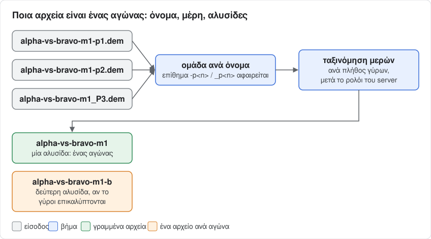

# Εντολές {#commands}

Δεν έχετε ξαναδουλέψει με τη γραμμή εντολών; Διαβάστε πρώτα το [Πριν ξεκινήσετε](before-you-start.md). Πληκτρολογήστε αυτές
τις εντολές σε ένα τερματικό ανοιχτό στον φάκελο που αποσυμπιέσατε ή κλωνοποιήσατε. Τα `<...>` είναι θέσεις για τα
δικά σας στοιχεία, και μια διαδρομή με κενά μπαίνει σε εισαγωγικά.

```text
python -m heat3d_cs2 demos <demo files or folders> -o <folder> [--every 8] [--jobs N] [--map TEXT] [--force] [--no-bulk] [--loose]
python -m heat3d_cs2 map <map name | path to its .vpk> -o <file.glb> [--game FOLDER] [--source2viewer EXE]
python -m heat3d_cs2 scoreboard <match.3dheat | match.json>
```

Το `python -m heat3d_cs2 --help` και το `python -m heat3d_cs2 <εντολή> --help` δείχνουν τις ίδιες επιλογές· η
[Αναφορά εντολών](../cli-reference.md) τις δείχνει όλες. Κάθε εκκίνηση τρέχει πρώτα τον έλεγχο έκδοσης που περιγράφεται
στα [Ενημερώσεις](updates.md) (απενεργοποιείται με `HEAT3D_NO_UPDATE=1`).

Κώδικας: [`heat3d_cs2/cli.py`](https://github.com/Holdi601/3DHeat-CS2/blob/main/heat3d_cs2/cli.py).

## `demos` - demo σε πίνακες και έγγραφα αγώνα {#demos---demos-into-tables-and-match-documents}

```powershell
python -m heat3d_cs2 demos D:\Demos\event -o out
python -m heat3d_cs2 demos alpha-vs-bravo-m1-p1.dem alpha-vs-bravo-m1-p2.dem -o out
python -m heat3d_cs2 demos D:\Demos -o out --map final --jobs 4
```

| Όρισμα | Προεπιλογή | Κάνει |
|---|---|---|
| `paths` (ένα ή περισσότερα) | - | αρχεία και φάκελοι demo. Ένα αρχείο παίρνεται όταν η κατάληξή του είναι `.dem` (με οποιαδήποτε πεζά ή κεφαλαία). Ένας φάκελος ψάχνεται **αναδρομικά** για αρχεία που τελειώνουν σε `.dem`, με οποιαδήποτε πεζά ή κεφαλαία, με ταξινομημένη σειρά. Τα συμπιεσμένα demo (`.dem.zst`, `.dem.bz2`, αρχειοθήκες) δεν διαβάζονται: αποσυμπιέστε τα πρώτα. |
| `-o`, `--out` | υποχρεωτικό | ο φάκελος όπου γράφονται τα αποτελέσματα· δημιουργείται αν χρειάζεται |
| `--every N` | `8` | δειγματίζει κάθε παίκτη κάθε *N* tick. Τα demo του CS2 τρέχουν στα 64 tick το δευτερόλεπτο, οπότε το 8 είναι οκτώ δείγματα το δευτερόλεπτο, το 4 δέκα έξι, το 64 ένα. Τα γεγονότα διαβάζονται πάντα στο δικό τους tick, όποιο και να είναι το *N*. |
| `--jobs N` | `0` = το μισό των πυρήνων του επεξεργαστή | πόσοι αγώνες μετατρέπονται ταυτόχρονα, καθένας στη δική του διεργασία. Ποτέ λιγότεροι από 1, ποτέ περισσότεροι από τους αγώνες που μένουν. |
| `--map TEXT` | - | μόνο οι αγώνες των οποίων το **όνομα** περιέχει το *TEXT*, χωρίς διάκριση πεζών-κεφαλαίων (`--map final`). Φιλτράρει με το όνομα του αρχείου, όχι με τον χάρτη που βρίσκεται τελικά μέσα στο demo. |
| `--force` | απενεργοποιημένο | μετατρέπει ξανά αγώνες που ήδη έχουν γραφτεί, αντικαθιστώντας τους |
| `--loose` | απενεργοποιημένο | κρατά κάθε αγώνα ως ξεχωριστά αρχεία - πίνακα, `.match.json`, βοηθητικά αρχεία - αντί να τα πακετάρει σε ένα κοντέινερ `.3dheat`. Βλ. [Ένα αρχείο ανά αγώνα](output-container.md). |
| `--container` | ενεργοποιημένο | πακετάρει κάθε αγώνα σε ένα αρχείο `.3dheat`· είναι η προεπιλογή, οπότε υπάρχει μόνο για να είναι ρητό |
| `--no-bulk` | απενεργοποιημένο | αφήνει έξω τη ροή οντοτήτων, τις εντολές των παικτών και τη ροή κινήσεων από το βοηθητικό αρχείο των πακέτων - πάνω από το μισό του μεγέθους ενός demo ακόμα και συμπιεσμένο. Ο αυτοέλεγχος του εγγράφου αγώνα τις μετράει τότε ως `lost`, με το όνομά τους. |


### Ποια αρχεία είναι ένας αγώνας {#which-files-are-one-match}



Το όνομα του αγώνα είναι το όνομα του αρχείου demo χωρίς την κατάληξη και χωρίς κατάληξη κομματιού: `-p<ψηφία>` ή
`_p<ψηφία>` στο τέλος, με οποιαδήποτε πεζά ή κεφαλαία. Άρα τα `alpha-vs-bravo-m1-p1.dem`, `alpha-vs-bravo-m1-p2.dem`
και `alpha-vs-bravo-m1_P3.dem` είναι τα κομμάτια ενός αγώνα, του `alpha-vs-bravo-m1`. Τα αρχεία ομαδοποιούνται μόνο
με βάση αυτό το όνομα· δύο αρχεία με το ίδιο όνομα σε διαφορετικούς φακέλους ομαδοποιούνται επίσης.

Η κατάληξη δεν λέει τίποτα για τη σειρά: ένα `-p2` μπορεί να είναι ο πρώτος ημίχρονος. Τα κομμάτια μπαίνουν σε σειρά
με βάση τον αριθμό γύρων που περιέχουν, και μετά με βάση το ρολόι του διακομιστή. Μια ομάδα που αποδεικνύεται ότι
περιέχει δύο διαφορετικούς αγώνες (για παράδειγμα, οι ίδιες ομάδες στον ίδιο χάρτη σε δύο διοργανώσεις) χωρίζεται σε
**αλυσίδες**: η αλυσίδα με τους περισσότερους γύρους γράφεται με το ίδιο το όνομα, η επόμενη ως `<όνομα>-b`, μετά ως
`<όνομα>-c`, και ούτω καθεξής. Ένα αρχείο χωρίς γύρο μέσα του (μόνο warmup, μια παύση) δεν ανήκει σε καμία αλυσίδα.
Πώς βρίσκονται οι αλυσίδες περιγράφεται στο [Δημιουργία αγώνα](building-matches.md#parts-and-chains).

### Τι γράφεται {#what-is-written}

Για κάθε αγώνα, σε φάκελο με το όνομα του χάρτη που δηλώνει η κεφαλίδα του demo (`unknown` όταν δεν δηλώνει κανέναν),
ένα αρχείο `.3dheat`:

```text
out/
  de_x/
    alpha-vs-bravo-m1.3dheat
    alpha-vs-bravo-m2.3dheat
  de_y/
    ...
```

Στο συνθετικό demo δύο γύρων των δοκιμών:


Με `--loose`, κάθε αγώνας είναι ο πίνακας, το έγγραφο αγώνα του και τέσσερα βοηθητικά αρχεία δίπλα-δίπλα
([Ένα αρχείο ανά αγώνα](output-container.md)):


Ένας χάρτης θερμότητας είναι για έναν χάρτη, οπότε το άνοιγμα ενός φακέλου στον προβολέα φορτώνει τους αγώνες ενός
χάρτη. Βλ. [Ο πίνακας χάρτη θερμότητας](output-table.md) και [Το έγγραφο αγώνα](output-match-json.md).

### Τι παραλείπεται {#what-is-skipped}

Πριν διαβαστεί οτιδήποτε, λίστα γίνεται από κάθε `*.3dheat` κάτω από το `--out` (ένα κοντέινερ γράφεται ολόκληρο ή
καθόλου), και από κάθε `*.parquet` που έχει δίπλα του το έγγραφο αγώνα του (`<όνομα>.match.json`). Ένας αγώνας του
οποίου το όνομα ισούται με ένα από αυτά τα ονόματα αρχείων (χωρίς κατάληξη) παραλείπεται, εκτός αν υπάρχει
`--force`. Ένας πίνακας χωρίς το έγγραφο αγώνα του - μια εκτέλεση που σταμάτησε ανάμεσα στο γράψιμο των δύο - δεν
μετράει, οπότε ο αγώνας μετατρέπεται ξανά. Ο έλεγχος γίνεται μόνο με το όνομα: ένας αγώνας που γράφτηκε σε άλλον
φάκελο χάρτη, ή με άλλο `--every`, μετράει ακόμα ως γίνεται. Όταν δεν μένει τίποτα να γίνει:

```text
nothing to do: no demos found, or every match already written (--force redoes them)
```

### Τι τυπώνεται {#what-is-printed}

Πρώτα η ποσότητα της δουλειάς, και μετά μία γραμμή για κάθε αγώνα όταν τελειώνει (με τη σειρά που τελειώνουν, όχι με τη
σειρά των αρχείων):

```text
3 match(es), 3 at a time
alpha-vs-bravo-m1: de_x, 21 rounds (Alpha 13 Bravo 8), 412,377 rows, lost 0
alpha-vs-bravo-m2: de_y, 30 rounds (Bravo 16 Alpha 14), 598,104 rows, 1 incomplete round(s) left out, lost 0
alpha-vs-bravo-m3: de_y, 18 rounds (Alpha 13 Bravo 5), 330,981 rows, recorded from round 3, lost 1,204,331 (svc_PacketEntities, svc_UserCmds, DEM_AnimationData)
```

(Οι αριθμοί είναι ενδεικτικοί.) Το σκορ είναι αυτό του τελευταίου γύρου, ομάδα προς ομάδα με τη σειρά που δίνει το
έγγραφο αγώνα. *incomplete round(s) left out* μετράει τους γύρους που έκοψε το demo πριν αποφασιστούν· το
*recorded from round N* λέει ότι η εγγραφή ξεκινά αργά· το *lost* είναι ο αυτοέλεγχος του εγγράφου αγώνα - πόσα
στοιχεία του demo δεν πήγαν πουθενά, και τι είδους (το `--no-bulk` κάνει τα bulk `lost`). Ένας αγώνας που δεν δίνει
τίποτα το λέει:

```text
alpha-vs-bravo-m4: no round in 1 file(s) - nothing written
alpha-vs-bravo-m4-b: no complete round in 1 file(s) - nothing written
```

Ένα σφάλμα σε έναν αγώνα δεν σταματά τους άλλους· τυπώνεται ως `<όνομα>: failed - <σφάλμα>`.

### Κωδικός εξόδου {#exit-code}

`0` όταν μετατράπηκε κάθε αγώνας (ή δεν υπήρχε τίποτα να γίνει), `1` όταν απέτυχε τουλάχιστον ένας.

### Πόσο χρόνο παίρνει {#how-long-it-takes}

Κάθε αγώνας διαβάζεται και χτίζεται σε μία διεργασία εργασίας. Ένας φάκελος με μερικές εκατοντάδες demo θέλει λεπτά με
την προεπιλεγμένη τιμή του `--jobs`. Η μνήμη ανά εργασία αυξάνεται με τη διάρκεια του αγώνα και με μικρότερο
`--every`: κάθε εργασία κρατά κάθε δειγματισμένη γραμμή παίκτη του αγώνα της (περίπου δέκα παίκτες επί 64 / *N* γραμμές
το δευτερόλεπτο εγγραφής) πριν γράψει.

Τα βοηθητικά αρχεία παίρνουν περισσότερο χρόνο από τον πίνακα: κάθε ιδιότητα που διαβάζει ο αναλυτής διαβάζεται σε
κάθε tick, ένα παράθυρο ticks τη φορά (περίπου δύο λεπτά για ένα demo 40 λεπτών, και το πολύ περίπου 3 GB μνήμη ανά
εργασία), και μετά το demo διατρέχεται άλλη μία φορά για τα καρέ και τα μηνύματά του.

## `map` - η γεωμετρία ενός χάρτη ως `.glb` {#map---a-maps-geometry-as-glb}


```powershell
python -m heat3d_cs2 map <map> -o out/<map>/<map>.glb
python -m heat3d_cs2 map <map> -o <map>.glb --game "D:\Games\Steam\steamapps\common\Counter-Strike Global Offensive"
python -m heat3d_cs2 map "D:\maps\<map>.vpk" -o <map>.glb --source2viewer C:\Tools\Source2Viewer-CLI.exe
```

| Όρισμα | Προεπιλογή | Κάνει |
|---|---|---|
| `name` | - | το όνομα του χάρτη (όπως `de_x`), ή η διαδρομή προς το `.vpk` του. Μια διαδρομή που τελειώνει σε `.vpk` και υπάρχει χρησιμοποιείται όπως είναι· οτιδήποτε άλλο αναζητείται με το όνομα αρχείου του στο εγκατεστημένο παιχνίδι. |
| `-o`, `--out` | υποχρεωτικό | το `.glb` που γράφεται· ο φάκελός του δημιουργείται αν χρειάζεται |
| `--game FOLDER` | οι βιβλιοθήκες Steam | ο φάκελος εγκατάστασης του CS2 (αυτός που περιέχει το `game\csgo`), όταν το Steam δεν τον ξέρει. Με `--game`, ψάχνεται μόνο αυτός ο φάκελος. |
| `--source2viewer EXE` | `HEAT3D_SOURCE2VIEWER`, μετά `PATH` | το εκτελέσιμο της γραμμής εντολών του Source2Viewer |

Τι τυπώνεται όταν πετύχει:

```text
out/de_x/de_x.glb: de_x, 412,880 triangles (151,204 ground) in 14 parts
```

(οι αριθμοί είναι ενδεικτικοί). Το να γράφετε το `.glb` δίπλα στους πίνακες του χάρτη (`out/<map>/<map>.glb`) κρατά τα
δεδομένα και τη γεωμετρία ενός χάρτη στον ίδιο φάκελο. Πώς δουλεύει η εξαγωγή: [Εξαγωγή χάρτη](map-export.md).

Σφάλματα, το καθένα τυπώνεται ως `error: ...` με κωδικό εξόδου `2`:

| Μήνυμα | Σημαίνει |
|---|---|
| `no de_x.vpk found in an installed CS2 - pass --game <CS2 folder> or the .vpk path` | ο χάρτης δεν βρίσκεται σε καμία βιβλιοθήκη Steam που βρέθηκε, ή το όνομα είναι λάθος |
| `Source2Viewer-CLI not found: ...` | ούτε το `--source2viewer`, ούτε το `HEAT3D_SOURCE2VIEWER`, ούτε το `PATH` έδωσε υπάρχον αρχείο |
| `Source2Viewer did not export de_x's collision mesh:` ακολουθούμενο από το τέλος της εξόδου του | απέτυχε, ή δεν έγραψε `.glb` |
| `de_x's collision mesh has nothing but clip brushes` | μετά την αφαίρεση των clip και του ουρανού δεν έμεινε τίποτα |

## `scoreboard` - ένας αγώνας ως κείμενο {#scoreboard---a-match-as-text}

```bash
python -m heat3d_cs2 scoreboard out/de_x/alpha-vs-bravo-m1.3dheat
python -m heat3d_cs2 scoreboard out/de_x/alpha-vs-bravo-m1.match.json   # after demos --loose
```

Τυπώνει το σκορ του αγώνα από το [έγγραφο αγώνα](output-match-json.md), χωρίς να ανοίξει ο προβολέας. Διαβάζει το
έγγραφο μέσα σε ένα κοντέινερ `.3dheat`, ή ένα ξεχωριστό `<match>.match.json`.
Στο συνθετικό demo δύο γύρων των δοκιμών:


```text
alpha-vs-bravo-m1 - de_test  Alpha 2  Bravo 0

Alpha
player                 K   D   A  +/-    ADR   KAST   HS%  OK-OD  clutch
ash                    1   0   0   +1   50.0 100.0%    0%   0-0     1/1
ace                    1   1   0   +0   50.0 100.0%  100%   1-0     0/0

Bravo
player                 K   D   A  +/-    ADR   KAST   HS%  OK-OD  clutch
ben                    1   1   0   +0   50.0 100.0%    0%   0-0     0/1
bob                    0   1   0   -1    0.0 100.0%    0%   0-1     0/0

rounds  1:TK 2:TB
```

- Η πρώτη γραμμή: το όνομα του αγώνα, ο χάρτης και το τελικό σκορ κάθε ομάδας.
- Ένας πίνακας ανά ομάδα, με τη σειρά των `teams` του εγγράφου αγώνα· οι παίκτες με τη σειρά του εγγράφου (κατά
  φόνους μείον θανάτους, και μετά φόνους, πρώτος ο καλύτερος). Τα ονόματα κόβονται στους 19 χαρακτήρες.
- Στήλες: **K** φόνοι, **D** θάνατοι, **A** βοηθείες *συμπεριλαμβανομένων* των βοηθειών φλας, **+/-** φόνοι μείον
  θάνατοι, **ADR**, **KAST** (%), **HS%** (στρογγυλοποιημένο σε ακέραιο ποσοστό), **OK-OD** άνοιγμα φόνων - άνοιγμα
  θανάτων, **clutch** clutch που κερδήθηκαν / clutch που παίχτηκαν. Ορισμοί: [Στατιστικά](statistics.md).
- Η λωρίδα γύρων: `<γύρος>:<νικήτρια πλευρά><πώς>`, με **B** έκρηξη βόμβας, **D** απενεργοποίηση, **K** εξόντωση,
  **T** έληξε ο χρόνος, και **?** για οτιδήποτε άλλο (ισοπαλία, παράδοση, άλλο). Η ισοπαλία δεν έχει νικήτρια πλευρά:
  `<γύρος>:?`.

Ένα αρχείο που δεν είναι έγκυρο JSON, ή δεν βρέθηκε, σταματά με σφάλμα· ένα έγγραφο JSON χωρίς τα πεδία του εγγράφου
αγώνα αποτυγχάνει με σφάλμα Python (δεν ελέγχεται περαιτέρω).
