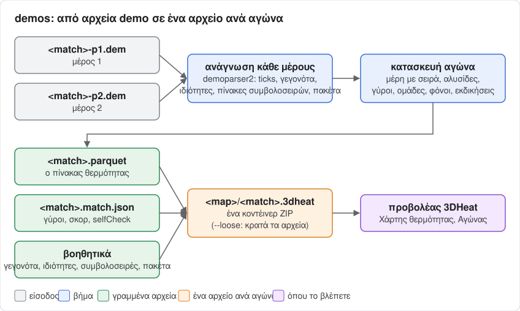

# 3DHeat CS2 {#dheat-cs2}

**Τι είναι;** Το Counter-Strike 2 μπορεί να αποθηκεύσει την εγγραφή ενός αγώνα, που λέγεται
*demo*. Αυτό το εργαλείο μετατρέπει ένα demo σε αρχεία που μπορεί να δείξει ο προβολέας 3DHeat σε 3D:
πού στεκόταν ο καθένας, πού πέθανε, πού πέταξε και πού τοποθέτησε τη βόμβα, γύρο προς γύρο. Μπορεί επίσης να
μετατρέψει έναν χάρτη του CS2 σε τρισδιάστατο μοντέλο, για να φαίνονται πάνω του.

**Γιατί να το χρησιμοποιήσω;** Για να αναλύσετε τους δικούς σας αγώνες, για να βάλετε πάνω το ένα στο άλλο πολλούς
αγώνες του ίδιου χάρτη σε έναν θερμικό χάρτη, και για στατιστικά αγώνα όπως το ADR (μέση ζημιά ανά γύρο) και το KAST
(το ποσοστό των γύρων στους οποίους ένας παίκτης σκότωσε, βοήθησε, επέζησε ή εκδικήθηκε).

**Παράδειγμα:** το `alpha-vs-bravo-m1.dem` μπαίνει, το `out/de_x/alpha-vs-bravo-m1.3dheat` βγαίνει
(το `de_x` είναι ένα φανταστικό όνομα χάρτη).



Πιο αναλυτικά: το 3DHeat CS2 μετατρέπει **demo του Counter-Strike 2** σε έναν πίνακα θερμότητας και ένα έγγραφο
αγώνα για κάθε αγώνα, και έναν **χάρτη του CS2** σε γεωμετρία επιπέδου. Τα αποτελέσματα είναι φτιαγμένα για τον
προβολέα τηλεμετρίας [3DHeat](https://holdi601.github.io/3DHeat/) ([πηγαίος κώδικας](https://github.com/Holdi601/3DHeat)),
αλλά είναι συνηθισμένα αρχεία — Parquet, JSON και δυαδικό glTF — που μπορεί να διαβάσει οποιοδήποτε άλλο εργαλείο.

Είναι ένα μικρό πακέτο Python, το `heat3d_cs2`, που τρέχει από τη γραμμή εντολών. Διαβάζει τα demo από τον δίσκο
(δεν κατεβάζει κανένα) με το [demoparser2](https://github.com/LaihoE/demoparser), και εξάγει τους χάρτες από το
εγκατεστημένο παιχνίδι με την έκδοση γραμμής εντολών του Source2Viewer
([ValveResourceFormat](https://github.com/ValveResourceFormat/ValveResourceFormat)).

## Γρήγορη εκκίνηση {#quick-start}

Δεν έχετε ξαναδουλέψει με τη γραμμή εντολών; Διαβάστε πρώτα το [Πριν ξεκινήσετε](before-you-start.md).

```bash
pip install -r requirements.txt
python -m heat3d_cs2 demos <demo files or folders> -o out   # every match in them
python -m heat3d_cs2 map <map> -o out/<map>/<map>.glb       # the map from the installed game
python -m heat3d_cs2 scoreboard out/<map>/<match>.3dheat    # a match's scoreboard as text
```

Θα δείτε `1 match(es), 1 at a time ...` και μετά μία γραμμή για κάθε αγώνα
(δείτε [Εντολές](commands.md#what-is-printed)).

Το `demos` γράφει, για κάθε αγώνα, ένα αρχείο μέσα σε φάκελο που παίρνει το όνομα του χάρτη:
`out/<map>/<match>.3dheat`, ένα [κοντέινερ `.3dheat`](output-container.md) — η μορφή ενός αγώνα σε ένα αρχείο του
προβολέα ([προδιαγραφή](https://holdi601.github.io/3DHeat/container.html)).
Περιέχει τα εξής μέλη· το `--loose` τα γράφει ως χωριστά αρχεία:

| Μέλος | Τι περιέχει | Φορτώνεται στην |
|---|---|---|
| `<match>.parquet` (ρόλος `table`) | κάθε ζωντανός παίκτης οκτώ φορές το δευτερόλεπτο με την κατάστασή του (υγεία, χρήματα, φλας, σκόπευση, ζώνη, απόθεμα, ...), και κάθε γεγονός όπου συνέβη (φόνος, θάνατος, τραυματισμός, βολή, ρίψη, εκρήξεις χειροβομβίδων, τύφλωση, τοποθέτηση, εξουδετέρωση, έκρηξη, και ένα τέλος γύρου για κάθε παίκτη με ό,τι του πλήρωσε ο γύρος), μία γραμμή το καθένα | καρτέλα Χάρτης θερμότητας |
| `<match>.match.json` (ρόλος `match`, το έγγραφο αγώνα) | ομάδες, σκορ, κάθε γύρος (νικητής, τρόπος, οικονομία, τοποθέτηση, φόνοι με τη σειρά τους, clutches, επιζώντες) και η γραμμή του σκορ κάθε παίκτη | καρτέλα Αγώνας |
| `<match>.events/props/strings/packets.parquet` | όλα τα υπόλοιπα που κρατά το demo, ολόκληρα (βοηθητικά αρχεία) | διατηρούνται για πληρότητα |

Το `map` γράφει το `<map>.glb`: το μέσο σύγκρουσης του χάρτη — δάπεδα, τοίχοι, κουτιά, χωρίς διακόσμηση —
χωρισμένο σε έδαφος και κατασκευή, στο ίδιο πλαίσιο και στις ίδιες μονάδες με τους πίνακες, ώστε να κάθεται
ακριβώς κάτω από τον θερμικό χάρτη (πάνελ «Φόντο / πίστα»).

## Χάρτης της τεκμηρίωσης {#map-of-this-documentation}

| Σελίδα | Τι καλύπτει |
|---|---|
| [Πριν ξεκινήσετε](before-you-start.md) | Python, τερματικό, σημεία κράτησης θέσης, πώς μοιάζει η επιτυχία και τα συνηθισμένα σφάλματα |
| [Εγκατάσταση](installing.md) | Python, τα πακέτα, η γραμμή εντολών του Source2Viewer, πού πρέπει να βρίσκεται το CS2 |
| [Εντολές](commands.md) | `demos`, `map`, `scoreboard`: κάθε επιλογή, τι τυπώνεται, κωδικοί εξόδου |
| [Ανάγνωση ενός demo](reading-demos.md) | τι διαβάζεται από ένα αρχείο demo: δειγματοληπτημένα ticks, ιδιότητες παικτών, κανόνες παιχνιδιού, γεγονότα |
| [Κατασκευή ενός αγώνα](building-matches.md) | τμήματα και αλυσίδες, το ρολόι του αγώνα, γύροι, ομάδες και πλευρές, γραμμές, φόνοι, εκδικήσεις, εναρκτήρια, ζημιά, φλας, οικονομία |
| [Στατιστικά](statistics.md) | το σκορ: K/D/A, ADR, KAST, HS%, εναρκτήρια, εκδικήσεις, πολλαπλοί φόνοι, βοηθήματα, φλας |
| [Ο πίνακας θερμότητας](output-table.md) | το αρχείο Parquet: κάθε στήλη, ο τύπος της, ποια γεγονότα τη γεμίζουν, οι οδηγίες του υποσέλιδου `heat3d`, οι άξονες |
| [Το έγγραφο αγώνα](output-match-json.md) | το έγγραφο `.match.json`, πεδίο προς πεδίο |
| [Ένα αρχείο ανά αγώνα](output-container.md) | το κοντέινερ `.3dheat` που γράφει το `demos` από προεπιλογή, και το `--loose` |
| [Εξαγωγή χάρτη](map-export.md) | πώς εξάγεται το μέσο σύγκρουσης ενός χάρτη, το πλαίσιο, η ονομασία κόμβων, οι μονάδες |
| [Χρήση με το 3DHeat](using-with-3dheat.md) | φόρτωση πινάκων, εγγράφων αγώνα και χαρτών στις καρτέλες Χάρτης θερμότητας και Αγώνας του προβολέα |
| [Όρια](limits.md) | τι υποτίθεται, τι δεν χειρίζεται, τι δεν έχει επαληθευτεί |
| [Ενημερώσεις](updates.md) | ο έλεγχος κυκλοφορίας κατά την εκκίνηση και το `python -m heat3d_update` |
| [Ανάπτυξη](development.md) | δομή κώδικα, τεστ, το συνθετικό demo δοκιμών |
| [Αναφορά εντολών](../cli-reference.md) | το `--help` κάθε εντολής, παραγόμενο από τον κώδικα |
| [Συντήρηση](maintaining.md) | η λίστα ελέγχου κυκλοφορίας για αυτές τις σελίδες |

## Τι έχει ελεγχθεί με {#what-it-is-checked-against}

Τα demo που βρίσκονται στη φύση δεν είναι ένα καθαρό αρχείο ανά αγώνα. Ο μετατροπέας χειρίζεται έναν αγώνα
χωρισμένο σε αρχεία με οποιαδήποτε σειρά, έναν server που ξεκίνησε ξανά στη μέση του αγώνα, δύο διαφορετικούς αγώνες
αποθηκευμένους με το ίδιο όνομα, γύρους που επαναφέρθηκαν από αντίγραφο ασφαλείας, μια εγγραφή που ξεκινά αργά ή
τελειώνει νωρίς, παύσεις, και προπονητές στην πλευρά μιας ομάδας — δείτε [Κατασκευή ενός αγώνα](building-matches.md).
Ελέγχθηκε σε μεγάλη συλλογή demo τουρνουά: σε κάθε αγώνα το σκορ ακολουθεί τους νικητές των γύρων, οι φόνοι κάθε πλευράς
είναι οι θάνατοι της άλλης, και κάθε γύρος αρχίζει πέντε εναντίον πέντε.

## Σε τι να το στρέψετε {#what-to-point-it-at}

Τα demo των δικών σας αγώνων, demo που κατεβάσατε με το χέρι από ιστότοπο τουρνουά, ή demo από ένα API στο οποίο έχετε
πρόσβαση. Ένα demo είναι εγγραφή της οποίας το περιεχόμενο ανήκει στον εκδότη του και στους διοργανωτές του: χρησιμοποιήστε
όσα βγαίνουν για τη δική σας ανάλυση, και μην αναδιανέμετε demo ή δεδομένα που προέρχονται από αυτά. Το εργαλείο διαβάζει τα
demo από τον δίσκο και δεν κατεβάζει κανένα, και τίποτα από το παιχνίδι δεν διανέμεται μαζί του: κανένα αρχείο παιχνιδιού,
κανένας κώδικας παιχνιδιού, κανένα DLL.

Το 3DHeat CS2 δεν συνδέεται με τη Valve ούτε έχει την έγκρισή της. Το Counter-Strike 2 και τα σχετικά ονόματα και εμπορικά
σήματα ανήκουν στους κατόχους τους. Δικαιούχοι: ανοίξτε ένα issue στο
[github.com/Holdi601/3DHeat-CS2/issues](https://github.com/Holdi601/3DHeat-CS2/issues) - απαντάμε γρήγορα και αφαιρούμε
οτιδήποτε κατόπιν αιτήματος.

## Μέρος του 3DHeat {#part-of-3dheat}

Το 3DHeat CS2 είναι ένα από τα δωρεάν εργαλεία γύρω από τον προβολέα 3DHeat, καθένα με το δικό του
αποθετήριο, τις δικές του εκδόσεις και την άδειά του:

| Εργαλείο | Τι κάνει | Τεκμηρίωση |
|---|---|---|
| [3DHeat](https://github.com/Holdi601/3DHeat) | ο προβολέας: θερμικοί χάρτες, ανάλυση αγώνα και επισκόπηση αγώνα σε 3D | [σελίδα](https://holdi601.github.io/3DHeat/) |
| [GameFiles](https://github.com/Holdi601/3DHeat-GameFiles) | πίστες και επίπεδα από τα αρχεία που κυκλοφορούν τα παιχνίδια, ως τρισδιάστατα μοντέλα | [σελίδα](https://holdi601.github.io/3DHeat-GameFiles/) |
| [GameCapture](https://github.com/Holdi601/3DHeat-GameCapture) | τηλεμετρία γύρων από αγώνες· επίπεδα ανακατασκευασμένα από βίντεο παιχνιδιού | [σελίδα](https://holdi601.github.io/3DHeat-GameCapture/) |
| [Unreal Exporter](https://github.com/Holdi601/3DHeat-UnrealExporter) | ένα πρόσθετο του Unreal Editor που εξάγει ένα επίπεδο ως ένα τρισδιάστατο μοντέλο | [σελίδα](https://holdi601.github.io/3DHeat-UnrealExporter/) |
| [CS2](https://github.com/Holdi601/3DHeat-CS2) | demo του Counter-Strike 2 σε πίνακες και έγγραφα αγώνα· χάρτες σε τρισδιάστατα μοντέλα | [σελίδα](https://holdi601.github.io/3DHeat-CS2/) |
| [Watcher](https://github.com/Holdi601/3DHeat-Watcher) | καταγράφει, στο παρασκήνιο, όσα δημοσιεύουν τα παιχνίδια για το παιχνίδι σας | [σελίδα](https://holdi601.github.io/3DHeat-Watcher/) |
| [Ext-WarThunder](https://github.com/Holdi601/3DHeat-Ext-WarThunder) | replay του War Thunder σε πίνακες και έγγραφα αγώνα | [σελίδα](https://holdi601.github.io/3DHeat-Ext-WarThunder/) |
| [Ext-WoT](https://github.com/Holdi601/3DHeat-Ext-WoT) | replay του World of Tanks σε πίνακες και έγγραφα αγώνα | [σελίδα](https://holdi601.github.io/3DHeat-Ext-WoT/) |
| [Ext-WoWs](https://github.com/Holdi601/3DHeat-Ext-WoWs) | replay του World of Warships σε πίνακες και έγγραφα αγώνα | [σελίδα](https://holdi601.github.io/3DHeat-Ext-WoWs/) |
| [Ext-Squad](https://github.com/Holdi601/3DHeat-Ext-Squad) | demo από servers του Squad σε πίνακες και έγγραφα αγώνα | [σελίδα](https://holdi601.github.io/3DHeat-Ext-Squad/) |
| [Ext-DCS](https://github.com/Holdi601/3DHeat-Ext-DCS) | χάρτες του DCS World σε τρισδιάστατα μοντέλα | [σελίδα](https://holdi601.github.io/3DHeat-Ext-DCS/) |
| [Ext-IL2](https://github.com/Holdi601/3DHeat-Ext-IL2) | χάρτες του IL-2 Sturmovik σε τρισδιάστατα μοντέλα | [σελίδα](https://holdi601.github.io/3DHeat-Ext-IL2/) |

## Άδεια {#licence}

MIT — δείτε το [`LICENSE`](https://github.com/Holdi601/3DHeat-CS2/blob/main/LICENSE)
και το [`LICENSES.md`](https://github.com/Holdi601/3DHeat-CS2/blob/main/LICENSES.md)
για τα πακέτα τρίτων.
