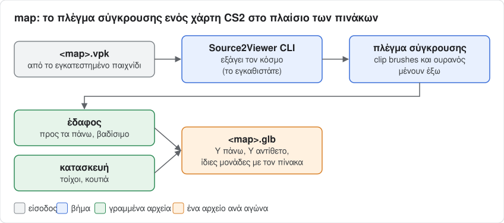

# Εξαγωγή χάρτη (`map`) {#map-export-map}

Η εντολή `python -m heat3d_cs2 map <map> -o <file.glb>` γράφει έναν χάρτη CS2 ως γεωμετρία επιπέδου: το **collision
mesh** του κόσμου, στο πλαίσιο και στις μονάδες στα οποία σχεδιάζονται οι [πίνακες χάρτη θερμότητας](output-table.md).
Κώδικας:
[`heat3d_cs2/mapexport.py`](https://github.com/Holdi601/3DHeat-CS2/blob/main/heat3d_cs2/mapexport.py),
[`heat3d_cs2/glb.py`](https://github.com/Holdi601/3DHeat-CS2/blob/main/heat3d_cs2/glb.py).
Επιλογές και μηνύματα: [Εντολές](commands.md#map---a-maps-geometry-as-glb).



## Γιατί το collision mesh {#why-the-collision-mesh}

Το collision mesh είναι αυτό πάνω στο οποίο στέκονται και πίσω από το οποίο κρύβονται οι παίκτες - δάπεδα, τοίχοι,
σκάλες, κιβώτια - χωρίς τη διακόσμηση: χωρίς αντικείμενα που απλώς μοιάζουν με κάτι, χωρίς υφές, και με πολύ λιγότερα
τρίγωνα από τα mesh απόδοσης. Αυτό χρειάζεται ένας χάρτης θερμότητας από κάτω του: κάτι για να διαβάζονται οι θέσεις
πάνω του, όχι μια απόδοση του χάρτη.

## Πώς λαμβάνεται {#how-it-is-obtained}

1. **Εύρεση του χάρτη.** Μια διαδρομή που τελειώνει σε `.vpk` και υπάρχει χρησιμοποιείται όπως δίνεται. Αλλιώς
   αναζητείται το `<name>.vpk` στο `<φάκελος CS2>\game\csgo\maps\`, όπου ο φάκελος CS2 είναι το `--game`, ή
   `steamapps\common\Counter-Strike Global Offensive` σε κάθε βιβλιοθήκη Steam που βρέθηκε (βλ.
   [Εγκατάσταση](installing.md#where-cs2-is-looked-for)).
2. **Εύρεση της γραμμής εντολών του Source2Viewer**: `--source2viewer`, μετά `HEAT3D_SOURCE2VIEWER`, μετά
   `Source2Viewer-CLI` / `Source2Viewer-CLI.exe` στο `PATH`.
3. **Εξαγωγή της φυσικής του κόσμου.** Το Source2Viewer τρέχει ως

   ```text
   Source2Viewer-CLI -i <map>.vpk -d -f maps/<map>/world_physics.vmdl_c --gltf_export_format glb -o <temporary folder>
   ```

   Αποκωδικοποιεί τη συμπιεσμένη φυσική της Source 2 από το δικό αρχείο του χάρτη και γράφει το μοντέλο (κενό: ο κόσμος
   δεν έχει δικό του mesh απόδοσης) και τη φυσική του δίπλα του. Το μεγαλύτερο `.glb` που γράφεται είναι η φυσική. Αν το
   Source2Viewer αποτύχει ή δεν γράψει `.glb`, η εντολή σταματά και δείχνει τους τελευταίους 800 χαρακτήρες της εξόδου
   και των σφαλμάτων του.
4. **Ανάγνωση.** Κάθε κόμβος της σκηνής διατρέχεται με τον μετασχηματισμό του (πίνακας, ή μετάθεση-περιστροφή-κλίμακα),
   και κάθε πρωτογενές στοιχείο τριγώνων παίρνεται, με ή χωρίς buffer δεικτών, σε παγκόσμιες θέσεις.
5. **Αφαίρεση ό,τι δεν είναι τοίχος ή δάπεδο.** Ένας κόμβος του οποίου το όνομα περιέχει `clip` - clip παικτών, clip
   NPC, clip χειροβομβίδων: οι αόρατοι τοίχοι που σταματούν τους παίκτες και τις χειροβομβίδες - ή `sky`, με οποιαδήποτε
   πεζά ή κεφαλαία, πετιέται.
6. **Ονομασία της επιφάνειας.** Οι ομάδες φυσικής ονομάζονται από την επιφάνειά τους· το όνομα με πεζά γράμματα, χωρίς
   το αρχικό `physics`, `physics_group` ή `physics_passbullets` (και την κάτω παύλα που ακολουθεί), είναι η επιφάνεια:
   το `physics_group_concrete` γίνεται `concrete`, το `physics_passbullets_chainlink` γίνεται `chainlink`, και ένα απλό
   `physics_group` γίνεται `world`. Οι επιφάνειες από τις οποίες περνούν οι σφαίρες κρατιούνται.
7. **Πίσω στο πλαίσιο του παιχνιδιού.** Το Source2Viewer γράφει glTF σε μέτρα με Y προς τα πάνω: το (Y, Z, X) του
   παιχνιδιού πολλαπλασιασμένο επί 0,0254. Αυτό αναιρείται - κάθε σημείο γίνεται το (X, Y, Z) του παιχνιδιού, σε ίντσες.
8. **Διαχωρισμός εδάφους από κατασκευή**, τρίγωνο προς τρίγωνο: μια έδρα της οποίας η κάθετος δείχνει προς τα πάνω κατά
   τουλάχιστον 0,7 (η συνιστώσα Z της, κανονικοποιημένη) - κλίσεις έως περίπου 45 μοίρες, περίπου το πιο απότομο που
   περπατά ένας παίκτης του CS2 - είναι **έδαφος**· ό,τι άλλο, τοίχοι και ταβάνια μαζί, είναι **κατασκευή**.
9. **Στο πλαίσιο του προβολέα.** Κάθε σημείο γράφεται ως (X, Z, -Y): Y προς τα πάνω, με το Y του παιχνιδιού αντίστροφο -
   το πλαίσιο στο οποίο σχεδιάζει ο προβολέας τους πίνακες, όταν ακολουθεί τις υποδείξεις `heat3d` τους. Μια περιστροφή,
   όχι καθρέφτισμα.
10. **Γράψιμο του `.glb`.** Αν δεν μένει τίποτα (μόνο clip brush), η εντολή σταματά με σφάλμα. Αλλιώς τυπώνει το αρχείο,
    τον χάρτη, το πλήθος των τριγώνων, πόσα από αυτά είναι έδαφος, και τον αριθμό των κομματιών.

Τίποτα εδώ δεν διαβάζει τίποτα άλλο πέρα από το δικό `.vpk` του χάρτη, και δεν συνοδεύεται ούτε αντιγράφεται τίποτα
από το Source2Viewer.

## Το αρχείο {#the-file}

Ένα δυαδικό glTF 2.0 (`.glb`), ένας buffer, γραμμένο από το `heat3d_cs2` (ο `asset.generator`):

| Ιδιότητα | Τι είναι |
|---|---|
| Κόμβοι | ένας ανά κομμάτι, όλοι στη ρίζα, χωρίς μετασχηματισμούς, καθένας με το δικό του mesh του ίδιου ονόματος |
| Ονόματα κόμβων | `ground:<surface>` ή `structure:<surface>` (`ground:concrete`, `structure:metal`, `structure:world`), ταξινομημένα κατά όνομα |
| Πρωτογενή στοιχεία | ένα ανά mesh, τρίγωνα, `POSITION` (float32, με min/max) και `NORMAL` (float32), δείκτες `uint32` |
| Σκίαση | επίπεδη: μία κορυφή ανά γωνία τριγώνου, καθεμία με την κάθετο του τριγώνου της |
| Υλικά, υφές, UV, χρώματα | κανένα |
| Μονάδες | μονάδες παιχνιδιού (**ίντσες**), όχι μέτρα - σε αντίθεση με ό,τι υποθέτει το glTF |
| Πλαίσιο | (X, Z, -Y) του παιχνιδιού: το Y του glTF είναι το ύψος του παιχνιδιού, το Z του glTF είναι το -Y του παιχνιδιού |

Το πρόθεμα `ground:` / `structure:` είναι η σύμβαση όλων των εξαγωγέων επιπέδων του 3DHeat: ο προβολέας παίρνει ένα
κομμάτι με αυτό το όνομα ως έχει, αντί να μαντεύει από τη γεωμετρία, οπότε τα δάπεδα παίρνουν τη σκίαση του εδάφους και
οι τοίχοι το σχέδιο της κατασκευής, χωρίς κανένα βήμα ταξινόμησης.

Επειδή οι μονάδες είναι ίντσες, ένας άλλος προβολέας glTF δείχνει τον χάρτη περίπου 39 φορές μεγαλύτερο (τις διαβάζει ως
μέτρα)· κλιμακώστε με 0,0254 εκεί, αν έχει σημασία. Στο 3DHeat βρίσκεται ακριβώς κάτω από τον πίνακα, που είναι στις
ίδιες μονάδες με κλίμακα 1.

## Ο έλεγχος ότι το πλαίσιο είναι σωστό {#the-check-that-the-frame-is-right}

Η δοκιμή `test_players_stand_on_the_exported_floor` (τρέχει μόνο όταν δίνονται demo και Source2Viewer, βλ.
[Ανάπτυξη](development.md#tests)) εξάγει τον χάρτη πάνω στον οποίο έγινε ένα demo, παίρνει 300 τυχαία δείγματα θέσης
του αγώνα, και για καθένα ψάχνει κατακόρυφα το υψηλότερο τρίγωνο εδάφους το πολύ 4 μονάδες πάνω από τα πόδια του
παίκτη. Απαιτεί τουλάχιστον το 98 % των δειγμάτων να βρίσκουν έδαφος, και η μέση υψομετρική διαφορά από αυτό να είναι
μικρότερη από 5 μονάδες. Ένας καθρεφτισμένος χάρτης αποτυγχάνει: σε χάρτη καθρεφτισμένο με λάθος άξονα, ένα μεγάλο
μέρος των παικτών στέκεται πάνω σε τίποτα. Το README αναφέρει τα νούμερα αυτού του ελέγχου για τους χάρτες της τρέχουσας
ανταγωνιστικής δεξαμενής.

## Τι δεν κάνει {#what-it-does-not-do}

- Καμία γεωμετρία απόδοσης, υφές ή διακόσμηση - βλ. το *γιατί* πιο πάνω.
- Εξάγεται μόνο ό,τι υπάρχει στο μοντέλο `world_physics` του χάρτη. Το αν τα κινούμενα μέρη (πόρτες) ή τα σπαστά
  αντικείμενα περιλαμβάνονται δεν έχει ελεγχθεί.
- Καμία απλοποίηση: ο προβολέας του 3DHeat απλοποιεί κατά την εισαγωγή, με τη ρύθμιση **Στόχος απλοποίησης**.
- Χάρτες που δεν είναι στο εγκατεστημένο παιχνίδι (χάρτες του Workshop που βρίσκονται αλλού στον δίσκο) δουλεύουν όταν
  το `.vpk` τους δίνεται ως διαδρομή και περιέχει `maps/<name>/world_physics.vmdl_c`· δεν έχει επαληθευτεί.
