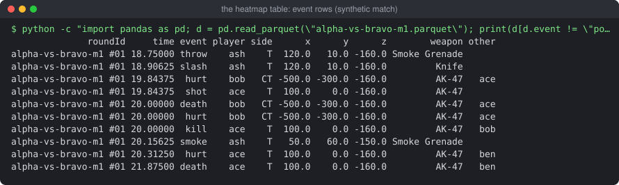

# Ο πίνακας χάρτη θερμότητας (`<match>.parquet`) {#the-heatmap-table-parquet}

Ένα αρχείο Parquet για κάθε αγώνα: η θέση κάθε ζωντανού παίκτη, δειγματισμένη, και κάθε γεγονός εκεί όπου συνέβη, μία
γραμμή το καθένα - ένας μακρύς πίνακας που ο προβολέας του 3DHeat τον διαβάζει ως χάρτη θερμότητας, και οποιοδήποτε άλλο
εργαλείο ως απλό πίνακα. Κώδικας:
[`heat3d_cs2/output.py`](https://github.com/Holdi601/3DHeat-CS2/blob/main/heat3d_cs2/output.py)
(το αρχείο), [`heat3d_cs2/match.py`](https://github.com/Holdi601/3DHeat-CS2/blob/main/heat3d_cs2/match.py)
(οι γραμμές· βλ. [Δημιουργία αγώνα](building-matches.md)).

Το αρχείο γράφεται με συμπίεση Snappy, σε ομάδες γραμμών των 256.000 γραμμών. Οι γραμμές είναι ταξινομημένες κατά
`time`, και μετά κατά `event`. Μέσα του μπαίνουν μόνο γραμμές μέσα σε γύρο (από το τέλος του παγώματος του γύρου ως
την έναρξη του επόμενου).

Στο συνθετικό demo των δοκιμών, οι γραμμές γεγονότων του πρώτου γύρου:



Σε ένα κοντέινερ `.3dheat`, ο πίνακας είναι το μέλος με ρόλο `table`
([Ένα αρχείο ανά αγώνα](output-container.md)).

## Στήλες {#columns}

Οι στήλες, πάντα με αυτή τη σειρά. Οι στήλες κειμένου είναι συμβολοσειρές με λεξικό (`dictionary<int32, string>`) και
δεν είναι ποτέ null: η «καμία τιμή» είναι κενή συμβολοσειρά. Οι αριθμητικές στήλες είναι null όπου μια γραμμή δεν έχει
τιμή.

| Στήλη | Τύπος | Τι είναι |
|---|---|---|
| `match` | συμβολοσειρά | το όνομα του αγώνα (`alpha-vs-bravo-m1`, ή `...-b` για δεύτερη αλυσίδα) |
| `map` | συμβολοσειρά | ο χάρτης, από την κεφαλίδα του demo (`de_x`) |
| `round` | int16 | ο αριθμός του γύρου, από το 1 |
| `roundId` | συμβολοσειρά | `<match> #NN`, ο αριθμός του γύρου με δύο ψηφία (`alpha-vs-bravo-m1 #07`): μοναδικό σε όλους τους αγώνες, η συνεδρία του προβολέα |
| `phase` | συμβολοσειρά | `freeze` στο πάγωμα του γύρου (από το τέλος του προηγούμενου), `live` μέχρι να αποφασιστεί ο γύρος, `after` όσο οι νικητές κυνηγούν και οι χαμένοι σώζουν |
| `time` | float64 | δευτερόλεπτα από την έναρξη του αγώνα (η ζωντανή αρχή του πρώτου αρχείου του), σε ένα κοινό ρολόι για τα αρχεία του |
| `roundTime` | float32 | δευτερόλεπτα από τότε που τελείωσε το πάγωμα αυτού του γύρου· αρνητικό κατά το πάγωμα |
| `event` | συμβολοσειρά | τι είναι η γραμμή - βλ. [Γεγονότα](#events) |
| `player` | συμβολοσειρά | το όνομα του παίκτη (για κάθε γεγονός, ποιος παίκτης αναφέρεται πιο κάτω) |
| `steamid` | συμβολοσειρά | το Steam ID του παίκτη (64 bit, ως κείμενο) |
| `side` | συμβολοσειρά | `T` ή `CT` σε αυτόν τον γύρο· κενό όταν ο παίκτης δεν ήταν σε πλευρά |
| `team` | συμβολοσειρά | το όνομα της ομάδας του παίκτη (ή `Started T` / `Started CT`)· για `explode`, η ομάδα που φύτεψε |
| `x`, `y`, `z` | float32 | θέση στις δικές του συντεταγμένες του παιχνιδιού: ίντσες (μονάδες παιχνιδιού), **Z προς τα πάνω**, δεξιόστροφο σύστημα |
| `dirX`, `dirY`, `dirZ` | float32 | προς τα πού κοιτάζει ο παίκτης, μοναδιαίο διάνυσμα στο ίδιο πλαίσιο· μόνο για θέσεις |
| `health` | int16 | 0-100· για θέσεις, και για `hurt` ό,τι έμεινε μετά το χτύπημα |
| `armor` | int16 | 0-100· για θέσεις, και για `hurt` ό,τι έμεινε μετά το χτύπημα |
| `money` | int32 | τα χρήματα του παίκτη· μόνο για θέσεις |
| `equipment` | int32 | η αξία όσων κουβαλά ο παίκτης· μόνο για θέσεις |
| `weapon` | συμβολοσειρά | το όπλο όπως το ονομάζει το παιχνίδι (`AK-47`, `M4A1-S`, `Knife` για κάθε skin μαχαιριού) |
| `place` | συμβολοσειρά | το όνομα τοποθεσίας του χάρτη στη θέση της γραμμής (`BombsiteA`, `CTSpawn`)· κενό στις εκρήξεις χειροβομβίδων: το demo δεν δίνει τοποθεσία για το πού έσκασε μια χειροβομβίδα |
| `throwerPlace` | συμβολοσειρά | το όνομα τοποθεσίας του ρίχτη όταν έσκασε η χειροβομβίδα· μόνο για εκρήξεις χειροβομβίδων |
| `other` | συμβολοσειρά | ο άλλος παίκτης ενός φόνου, θανάτου, χτυπήματος ή φλας |
| `damage` | float32 | υγεία που χάθηκε· μόνο `hurt` |
| `duration` | float32 | δευτερόλεπτα τύφλωσης· μόνο `blind` |
| `headshot` | int8 | 0/1· μόνο `kill` και `death` |
| `opening` | int8 | 0/1, ο πρώτος φόνος εχθρού του γύρου· μόνο `kill` και `death` |
| `traded` | int8 | 0/1. Για `kill`: ήταν trade φόνος. Για `death`: ο θάνατος εκδικήθηκε μέσα σε 5 s. Μόνο `kill` και `death`. |
| `noscope` | int8 | 0/1, ο φόνος έγινε με όπλο με σκόπευτρο που βγήκε χωρίς σκόπευση (το `noscope` του γεγονότος)· μόνο `kill` και `death` |
| `attackerBlind` | int8 | 0/1, ο δολοφόνος είχε τυφλωθεί όταν σκότωσε (το `attackerblind` του γεγονότος)· μόνο `kill` και `death` |
| `won` | int8 | 0/1, αν η πλευρά αυτής της γραμμής κέρδισε τον γύρο· null όταν το `side` είναι κενό |
| `matchWon` | int8 | 0/1, αν η ομάδα αυτής της γραμμής κέρδισε τον αγώνα· null όταν το `team` είναι κενό ή η εγγραφή δεν δείχνει το τέλος (βλ. το `winner` του εγγράφου αγώνα) |
| `roundEndReason` | συμβολοσειρά | πώς έληξε ο γύρος της γραμμής: `elimination`, `bomb` (έσκασε η βόμβα), `defuse`, `time`, `surrender`, `draw`, `other` |
| `buy` | συμβολοσειρά | η αγορά της πλευράς αυτής της γραμμής σε αυτόν τον γύρο: `pistol`, `eco`, `force`, `full` |
| `detail` | συμβολοσειρά | κάθε πεδίο του γεγονότος που δεν το έχουν οι άλλες στήλες, ως αντικείμενο JSON (με τα ονόματα του παιχνιδιού)· η βολή (`fire_bullets`: αρχή, γωνίες, ακρίβεια, διασπορά, δείκτης ανάκρουσης, σπόρος...), το `dominated`, `revenge`, `attackerinair`, `wipe`... ενός θανάτου, το `defindex` ενός αντικειμένου, ένα βήμα δεν έχει τίποτα |
| `text` | συμβολοσειρά | μία γραμμή συνομιλίας· μόνο `chat` |
| `entity` | int32 | η οντότητα της χειροβομβίδας: η πτήση μιας `throw` (γραμμές `grenade`), η έκρηξή της και οι παίκτες που τύφλωσε τη μοιράζονται |
| `hitgroup` | συμβολοσειρά | πού χτύπησε η σφαίρα (`head`, `chest`, ...)· `hurt`, `kill`, `death` |
| `armorDamage` | int16 | θωράκιση που χάθηκε· μόνο `hurt` |
| `hitLocalX`, `hitLocalY`, `hitLocalZ` | float32 | πού στο σώμα χτύπησε η σφαίρα, στο πλαίσιο του θύματος σε μέτρα (x μπροστά, y προς τα πάνω από τα πόδια, z δεξιά)· η ακτίνα του πυροβολισμού (`fire_bullets`, αλλιώς το μάτι και η κατεύθυνση του επιτιθέμενου) ανιχνεύεται πάνω σε σώμα στην πόζα του θύματος όπως στεκόταν και σκυμμένο, στο μέρος που ονομάζει το `hitgroup`· μόνο `hurt` |
| `hitDirX`, `hitDirY`, `hitDirZ` | float32 | η κατεύθυνση του πυροβολισμού στο ίδιο πλαίσιο· το `hitMiss` πόσο (σε μέτρα) πέρασε η ακτίνα δίπλα από το μέρος που ονομάζει· `hitFrom` `bullet` ή `aim` |
| `penetrated` | int16 | τοίχοι που πέρασε η σφαίρα του φόνου· `kill` και `death` |
| `throughSmoke` | int8 | 0/1, φόνος μέσα από καπνό· `kill` και `death` |
| `distance` | float32 | η απόσταση του φόνου όπως την μετράει το παιχνίδι (μέτρα)· `kill` και `death` |
| `assister` | συμβολοσειρά | ποιος βοήθησε· `kill` και `death` |
| `flash`, `flashAlpha` | float32 | δευτερόλεπτα φλας που απομένουν, και πόσο λευκό· θέσεις |
| `helmet`, `defuser`, `scoped`, `walking`, `airborne`, `buyZone`, `bombZone`, `defusing`, `spotted` | int8 | 0/1· θέσεις |
| `zoom`, `duck`, `moveType` | | το επίπεδο ζουμ του σκοπευτρού, πόσο είναι σκυμμένος (0-1), ο τύπος κίνησης του παιχνιδιού· θέσεις |
| `spottedBy` | συμβολοσειρά | τα Steam ID των εχθρών που βλέπουν αυτόν τον παίκτη, χωρισμένα με `\|`· θέσεις |
| `inventory` | συμβολοσειρά | όλα όσα κουβαλά ο παίκτης, χωρισμένα με `\|`· θέσεις |
| `ammo`, `ammoReserve`, `shotsFired` | int16 | το γεμιστήρα και το απόθεμα του όπλου στο χέρι· οι βολές της τρέχουσας σειράς· θέσεις |
| `punchPitch`, `punchYaw` | float32 | η ανάκρουση του σκοπευτρού, σε μοίρες· θέσεις |
| `ping` | int16 | χιλιοστά του δευτερολέπτου· θέσεις |
| `killsTotal`, `deathsTotal`, `assistsTotal`, `headshotKillsTotal`, `damageTotal`, `utilityDamageTotal`, `enemiesFlashedTotal`, `objectiveTotal`, `aceRoundsTotal`, `threeKillRoundsTotal`, `aliveTimeTotal`, `moneySavedTotal`, `mvps`, `score` | int | οι δικές του μετρήσεις του παιχνιδιού για τον αγώνα μέχρι εκείνη τη στιγμή· θέσεις |
| `cashSpent`, `cashSpentTotal`, `roundStartEquipment` | int32 | τα χρήματα που ξοδεύτηκαν στον γύρο και στον αγώνα· η αξία εξοπλισμού όταν ξεκίνησε ο γύρος· θέσεις |
| `state_helmet`, `state_defuser`, `state_kevlar`, `state_scoped`, `state_flashed` | int8 | 0/1, η κατάσταση του παίκτη τη στιγμή της γραμμής, μαζί με τα γεγονότα: κράνος, κιτ απενεργοποίησης, οποιαδήποτε θωράκιση, σκοπευμένος (από το τελευταίο δείγμα θέσης του ως τη γραμμή), τυφλωμένος (μέσα σε `blind` που τον χτύπησε)· κάθε γραμμή που αναφέρει παίκτη |
| `state_utility` | int16 | οι χειροβομβίδες που κουβαλά τη στιγμή (από το `inventory`)· κάθε γραμμή που αναφέρει παίκτη |
| `state_weapon` | συμβολοσειρά | το όπλο στο χέρι τη στιγμή (σε `death`, το δικό του του θύματος, όπου το `weapon` είναι του δολοφόνου)· κάθε γραμμή που αναφέρει παίκτη |
| `earn_round_cs2` | int16 | τι πλήρωσε ο γύρος: στο `round_end` η ανταμοιβή νίκης ή το μπόνους ήττας (με το μπόνους της φυτεύτριας πλευράς), στο `plant` και στο `defuse` τα 300 του παίκτη |

## Γεγονότα {#events}

Ποιον παίκτη αναφέρει μια γραμμή, πού βρίσκεται, και ποιες στήλες γεμίζει.
Τα `match`, `map`, `round`, `roundId`, `phase`, `time`, `roundTime`, `event`, `won`, `roundEndReason` και `buy`
γεμίζουν σε κάθε γραμμή (το `matchWon` όπου είναι γνωστός ο νικητής του αγώνα)· τα `inventory`, `money`, `equipment` και
οι στήλες `state_*` σε κάθε γραμμή που αναφέρει παίκτη (τα γεγονότα τα παίρνουν από το τελευταίο δείγμα θέσης του
παίκτη).

| `event` | `player` / `side` / `team` | `x`, `y`, `z` | Γεμίζουν και | 
|---|---|---|---|
| `position` | ο παίκτης | ο παίκτης (τα πόδια) | `dirX`-`dirZ`, `health`, `armor`, `money`, `equipment`, `weapon` (στο χέρι), `place`, και η πλήρης κατάσταση του παίκτη (οι στήλες από το `flash` και μετά)· ακόμα και στο πάγωμα |
| `kill` | ο δολοφόνος | πού στεκόταν ο δολοφόνος | `other` (θύμα), `weapon`, `headshot`, `opening`, `traded` (trade φόνος), `noscope`, `attackerBlind`, `place` |
| `death` | το θύμα | πού έπεσε το θύμα | `other` (δολοφόνος· κενό για τον κόσμο), `weapon`, `headshot`, `opening`, `traded` (εκδικήθηκε), `noscope`, `attackerBlind`, `place` |
| `hurt` | το θύμα | πού χτυπήθηκε το θύμα | `other` (επιτιθέμενος), `damage`, `health`, `armor`, `armorDamage`, `hitgroup`, `weapon`, `place`· χτυπήματα και από συμπαίκτες και από τον κόσμο |
| `shot` | ο σκοπευτής | από πού πυροβολήθηκε | `weapon`, `place`, `detail` (η καταγραφή του παιχνιδιού για τις σφαίρες) |
| `slash` | ο παίκτης | πού έγινε το χτύπημα με μαχαίρι | `weapon` = `Knife` |
| `grenade` | ο ρίχτης | η χειροβομβίδα στον αέρα, στον δειγματισμό των παικτών και εκεί που σταμάτησε | `weapon` (η χειροβομβίδα), `entity` |
| `throw` | ο ρίχτης | από πού ρίχτηκε η χειροβομβίδα | `weapon` (η χειροβομβίδα), `place` |
| `smoke`, `flash`, `he`, `molotov`, `decoy` | ο ρίχτης | πού έσκασε | `weapon`, `throwerPlace` (η τοποθεσία του ρίχτη εκείνη τη στιγμή)· το `place` μένει κενό |
| `blind` | ο τυφλωμένος παίκτης | πού στεκόταν | `other` (αυτός που έριξε το φλας), `duration`, `weapon` = `Flashbang`, `entity`, `place`· τυφλωμένοι και συμπαίκτες |
| `plant` | ο φυτευτής | πού φύτεψε | `weapon` = `C4 Explosive`, `place`, `earn_round_cs2` (300) |
| `defuse` | ο απενεργοποιητής | πού απενεργοποίησε | `weapon` = `C4 Explosive`, `place`, `earn_round_cs2` (300) |
| `round_end` | κάθε παίκτης που έπαιξε τον γύρο | πού στεκόταν τελευταία φορά ο παίκτης | `won`, `earn_round_cs2` (τι του πλήρωσε ο γύρος: η αύξηση των χρημάτων της πλευράς μέχρι το επόμενο πάγωμα όπου το επιτρέπουν οι κανόνες, αλλιώς το ποσό των κανόνων), `detail` (`winner`, `reason`, `lossBonus`, `plant`) |
| `explode` | ο φυτευτής (με το Steam ID του), πλευρά `T`, η ομάδα που φύτεψε | η θέση του φυτέματος | `weapon` = `C4 Explosive`, `place` (του φυτευτή τη στιγμή του φυτέματος· εκεί που βρισκόταν η βόμβα)· ο χρόνος της είναι όταν έσκασε η βόμβα |
| `chat` | ο αποστολέας | πού ήταν | `text` |
| κάθε άλλο γεγονός παιχνιδιού που αφορά παίκτη, με το όνομά του στο παιχνίδι: `item_pickup`, `item_equip`, `player_footstep`, `player_jump`, `weapon_reload`, `weapon_zoom`, `player_spawn`, `bomb_beginplant`, `bomb_begindefuse`, `bomb_dropped`, `bomb_pickup`, `bomb_exploded`, `smokegrenade_expired`, `inferno_expire`, `decoy_started`, `player_team`, `player_disconnect`, ... | ο παίκτης | πού βρισκόταν (των γεγονότων χειροβομβίδας: πού ήταν η χειροβομβίδα) | `weapon` (ενός αντικειμένου), `entity`, `detail` (κάθε πεδίο του γεγονότος) |

Τι μπαίνει και τι όχι:

- Οι γραμμές **position** είναι ζωντανοί παίκτες σε πλευρά, εκτός παγώματος και warmup, κάθε `--every` tick (οκτώ το
  δευτερόλεπτο από προεπιλογή).
- Οι γραμμές **kill** είναι μόνο φόνοι από εχθρό - όχι teamkill, αυτοκτονία ή θάνατος από τον κόσμο. Οι γραμμές
  **death** είναι κάθε θάνατος, και αυτοί μέσα.
- Οι γραμμές **explode** είναι κάθε φυτεμένη βόμβα που εξερράγη, με το `bomb_exploded` του demo: και στη μετά φάση,
  όταν οι T είχαν ήδη κερδίσει με εξόντωση. Ένα demo χωρίς αυτό το γεγονός παίρνει μία για κάθε γύρο που κέρδισε η
  βόμβα, στο τέλος του γύρου.
- Οι γραμμές **hurt** και **blind** είναι μόνο μεταξύ εχθρών.
- Η **shot** αφήνει έξω τα μαχαίρια και τη C4· οι χειροβομβίδες είναι γραμμές **throw**.
- Η **molotov** καλύπτει τα molotov και τα incendiary (η αρχή της φωτιάς).
- Η ζημιά συμπαικτών, τα φλας συμπαικτών και θεατών, τα γεγονότα του παγώματος και οτιδήποτε ανάμεσα σε γύρους δεν
  μπαίνουν στον πίνακα.

Ένα εργασμένο παράδειγμα, από το συνθετικό demo των δοκιμών (ένας καπνός που ρίχτηκε, ένας φόνος ανοίγματος με
headshot, trades):

| time | roundTime | event | player | side | x | y | weapon | other | damage | headshot | opening | traded |
|---|---|---|---|---|---|---|---|---|---|---|---|---|
| 18.75 | 8.75 | throw | ash | T | 120 | 10 | Smoke Grenade | | | | | |
| 19.84 | 9.84 | hurt | bob | CT | -500 | -300 | AK-47 | ace | 60 | | | |
| 20.00 | 10.00 | death | bob | CT | -500 | -300 | AK-47 | ace | | 1 | 1 | 1 |
| 20.00 | 10.00 | hurt | bob | CT | -500 | -300 | AK-47 | ace | 40 | | | |
| 20.00 | 10.00 | kill | ace | T | 100 | 0 | AK-47 | bob | | 1 | 1 | 0 |
| 20.16 | 10.16 | smoke | ash | T | 50 | 60 | Smoke Grenade | | | | | |
| 21.88 | 11.88 | death | ace | T | 100 | 0 | AK-47 | ben | | 0 | 0 | 1 |
| 21.88 | 11.88 | kill | ben | CT | -520 | -320 | AK-47 | ace | | 0 | 0 | 1 |

Ο θάνατος του bob εκδικείται από τον φόνο του ace από τον ben 1,9 s αργότερα (η γραμμή `death` του bob: traded 1· η
γραμμή `kill` του ben: trade φόνος, traded 1)· το δεύτερο χτύπημα στον bob ήταν 137 ζημιά σε 40 υγεία, οπότε μετράει 40.

## Οι υποδείξεις `heat3d` στο υποσέλιδο {#the-heat3d-footer-hints}

Το υποσέλιδο Parquet του αρχείου (τα μεταδεδομένα κλειδιού/τιμής του σχήματος) κρατά οδηγίες ανάγνωσης κάτω από το κλειδί
**`heat3d`**, ένα αντικείμενο JSON:

```json
{
  "version": 1,
  "kind": "cs2-demo",
  "axes": {"up": "z", "flipX": false, "flipY": true, "flipZ": false, "scale": 1},
  "entity": {"size": 32},
  "columns": {
    "x": "x", "y": "y", "z": "z",
    "time": "time", "timeUnit": "seconds",
    "personId": "player",
    "teamId": "side",
    "sessionId": "roundId",
    "lookMode": "vector", "dirX": "dirX", "dirY": "dirY", "dirZ": "dirZ",
    "extra": ["event", "match", "round", "roundTime", "phase", "weapon", "place", "won", "matchWon", "roundEndReason", "buy", "opening", "team", ...]
  }
}
```

| Εγγραφή | Λέει |
|---|---|
| `version`, `kind` | η έκδοση των υποδείξεων (1) και τι τις έγραψε (`cs2-demo`) |
| `axes.up` | το Z του αρχείου είναι προς τα πάνω |
| `axes.flipY` | αντιστρέψτε το Y του αρχείου (βλ. πιο κάτω) |
| `axes.scale` | 1: οι θέσεις χρησιμοποιούνται όπως είναι, σε μονάδες παιχνιδιού |
| `entity.size` | ένας παίκτης έχει **32 μονάδες** πλάτος - το πλάτος του παίκτη του CS2 - το μέγεθος που σχεδιάζει το κουτί επανάληψης |
| `columns.x` / `y` / `z` | οι στήλες θέσης |
| `columns.time`, `timeUnit` | η `time`, σε δευτερόλεπτα |
| `columns.personId` | ο παίκτης είναι το πρόσωπο |
| `columns.teamId` | η πλευρά είναι η ομάδα (άρα T και CT, όχι τα ονόματα των ομάδων, χρωματίζουν τις ομάδες) |
| `columns.sessionId` | κάθε γύρος (`roundId`) είναι μια συνεδρία |
| `columns.lookMode` και `dirX`-`dirZ` | η κατεύθυνση του βλέμματος είναι διάνυσμα σε εκείνες τις στήλες |
| `columns.extra` | οι στήλες που κρατιούνται ως φίλτρα, με σειρά χρησιμότητας |

Ένας προβολέας που ξέρει το κλειδί ανοίγει το αρχείο χωρίς να ρυθμίσετε τίποτα. Οτιδήποτε άλλο το αγνοεί. Για να το
διαβάσετε μόνοι σας:

```python
import json
import pyarrow.parquet as pq

table = pq.read_table("out/de_x/alpha-vs-bravo-m1.parquet")
hints = json.loads(table.schema.metadata[b"heat3d"])
rows = table.to_pandas()
kills = rows[rows["event"] == "kill"]
```

## Άξονες και μονάδες {#axes-and-units}

Οι συντεταγμένες είναι του ίδιου του παιχνιδιού: **ίντσες** (μία μονάδα παιχνιδιού· ένας παίκτης έχει ύψος 72 μονάδες
όρθιος και πλάτος 32), **Z προς τα πάνω**, και δεξιόστροφο σύστημα.

Ένας προβολέας του οποίου ο κόσμος έχει Y προς τα πάνω πρέπει να σχεδιάσει το (x, y, z) του παιχνιδιού ως
**(x, z, -y)** - το Z γίνεται το ύψος και το Y αντιστρέφεται. Είναι περιστροφή, όχι καθρέφτισμα. Αν σχεδιαστεί όπως ένας
αριστερόστροφος κόσμος με Z προς τα πάνω, ως (x, z, y), κάθε χάρτης βγαίνει καθρεφτισμένος, με το A στη λάθος πλευρά·
το `flipY: true` είναι αυτό που λένε οι υποδείξεις για να το αποφύγουν. Η [εξαγωγή χάρτη](map-export.md) γράφει ήδη τη
γεωμετρία της στο πλαίσιο (x, z, -y), στις ίδιες μονάδες, οπότε μπαίνει κάτω από τον πίνακα χωρίς καμία προσαρμογή.

Οι αποστάσεις στον προβολέα δίνονται σε μέτρα· με κλίμακα 1 είναι μονάδες παιχνιδιού. Πολλαπλασιάστε επί 0,0254 για
μέτρα.

## Μέγεθος {#size}

Τα κύρια βάρη είναι οι θέσεις: περίπου δέκα παίκτες επί 8 δείγματα το δευτερόλεπτο ζωντανού παιχνιδιού, με το
προεπιλεγμένο `--every 8`, λιγότερα για νεκρούς παίκτες και στο πάγωμα. Ο διπλασιασμός του `--every` μειώνει τα δείγματα
στη μισή, τα γεγονότα δεν επηρεάζονται.
