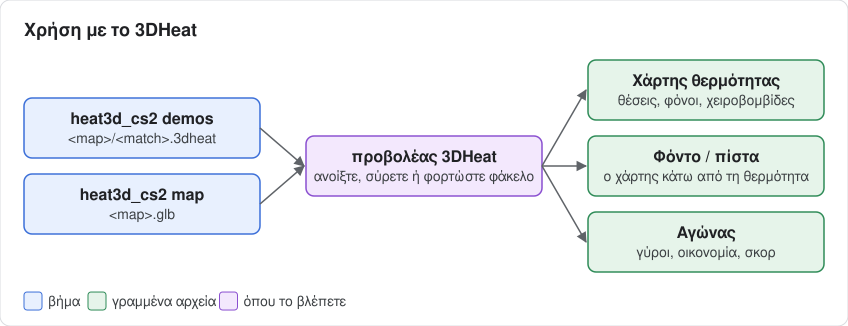

# Χρήση με το 3DHeat {#using-it-with-3dheat}

Τα αρχεία εξόδου πηγαίνουν σε αυτά τα σημεία του
[προβολέα του 3DHeat](https://holdi601.github.io/3DHeat):

| Αρχείο | Πού | Τι δίνει |
|---|---|---|
| `<match>.3dheat` (η προεπιλογή) | καρτέλα **Χάρτης θερμότητας**, πλαίσιο **Πηγή**, ή καρτέλα **Αγώνας** | ο πίνακας και το έγγραφο αγώνα μαζί, ένα αρχείο ανά αγώνα ([κοντέινερ](https://holdi601.github.io/3DHeat/container.html)) |
| `<match>.parquet` | καρτέλα **Χάρτης θερμότητας**, πλαίσιο **Πηγή** | θέσεις και γεγονότα ως χάρτης θερμότητας, κουτί επανάληψης, διαδρομές |
| `<match>.match.json` | καρτέλα **Αγώνας**, **Φόρτωση αρχείων αγώνων…** | το σκορ, οι γύροι, η ροή των φόνων, στατιστικά σε όλους τους αγώνες, συνδέσεις προς τον χάρτη θερμότητας |
| `<map>.glb` | πλαίσιο **Φόντο / πίστα**, **3D μοντέλο…** | ο χάρτης κάτω από τον χάρτη θερμότητας |

Η τεκμηρίωση του ίδιου του προβολέα περιγράφει κάθε καρτέλα πλήρως: οι σελίδες του
[Ανάλυση αγώνα](https://holdi601.github.io/3DHeat/match-analysis.html),
[Φόρτωση αρχείων](https://holdi601.github.io/3DHeat/loading-files.html),
[Αντιστοίχιση στηλών](https://holdi601.github.io/3DHeat/column-mapping.html)
και [Κουτί επανάληψης](https://holdi601.github.io/3DHeat/box-replay.html). Αυτή η σελίδα είναι η πλευρά του CS2 της
τεκμηρίωσης.



Ο προβολέας: [github.com/Holdi601/3DHeat](https://github.com/Holdi601/3DHeat), η τεκμηρίωση:
[holdi601.github.io/3DHeat](https://holdi601.github.io/3DHeat/).

## Μια τυπική συνεδρία {#a-typical-session}

```bash
python -m heat3d_cs2 demos D:\Demos\event -o out
python -m heat3d_cs2 map <map> -o out/<map>/<map>.glb
```

1. **Καρτέλα Χάρτης θερμότητας -> Πηγή:** επιλέξτε τον φάκελο `out/<map>` (ή σύρετέ τον μέσα).
   Κάθε `.parquet` μέσα του γίνεται ένα σύνολο δεδομένων· τα αρχεία `.json` και `.glb` του ίδιου φακέλου παραλείπονται ως
   «not a csv/parquet file». Φορτώστε το.
2. **Φόντο / πίστα -> 3D μοντέλο…:** διαλέξτε το `out/<map>/<map>.glb`. Το **Αποθήκευση στη βιβλιοθήκη** το κρατά στον
   περιηγητή για την επόμενη φορά.
3. **Καρτέλα Αγώνας -> Φόρτωση αρχείων αγώνων…:** διαλέξτε τα αρχεία `.match.json` του ίδιου φακέλου (πολλά μαζί), ή
   σύρετέ τα πάνω στην προβολή όσο η καρτέλα Αγώνας είναι ανοιχτή.

Φορτώστε μόνο τους πίνακες ενός χάρτη κάθε φορά: οι συντεταγμένες διαφορετικών χαρτών επικαλύπτονται, και ένας χάρτης
θερμότητας δύο χαρτών ταυτόχρονα δεν σημαίνει τίποτα. Ο φάκελος ανά χάρτη υπάρχει ακριβώς γι' αυτό.

## Ο πίνακας ανοίγει χωρίς να ρυθμίσετε τίποτα {#the-table-opens-with-nothing-to-set}

Ο προβολέας διαβάζει την εγγραφή `heat3d` του υποσέλιδου του πρώτου επιλεγμένου αρχείου
([Ο πίνακας χάρτη θερμότητας](output-table.md#the-heat3d-footer-hints)) και τη βάζει πάνω από τις δικές του εκτιμήσεις:

| Ρύθμιση του προβολέα | Ορίστε |
|---|---|
| Θέση | `x`, `y`, `z` |
| Άξονας προς τα πάνω στην πηγή | το Z είναι προς τα πάνω |
| Αναστροφή Y | ενεργό - ώστε ο χάρτης να είναι στη σωστή φορά, όχι καθρέφτης |
| Κλίμακα μονάδας | 1 - αποστάσεις σε μονάδες παιχνιδιού (με ετικέτα "m"· 1 μονάδα = 1 ίντσα) |
| Χρόνος | `time`, σε δευτερόλεπτα |
| Αναγνωριστικό ατόμου | `player` |
| Ομάδα | `side` (T / CT) |
| Συνεδρία | `roundId` - κάθε γύρος είναι συνεδρία, `<match> #NN` |
| Κατεύθυνση βλέμματος | διάνυσμα, `dirX` / `dirY` / `dirZ` |
| Στήλες φίλτρου | `event`, `match`, `round`, `roundTime`, `phase`, `weapon`, `place`, `won`, `buy`, `opening`, `team` |
| Μέγεθος οντότητας | 32 - το κουτί επανάληψης σχεδιάζει έναν παίκτη 32 μονάδες πλάτος, με ακτίνα βλέμματος 4 x 32 |

Κάθε υποδεικνυόμενη τιμή φαίνεται ακόμα στην Αντιστοίχιση στηλών και μπορεί να αλλάξει. Οι άλλες στήλες (`headshot`,
`traded`, `other`, `steamid`, `health`, `money`, `damage`, `duration`, ...) μπορούν να προστεθούν εκεί ως φίλτρα με το χέρι.

Κρατήστε την κλίμακα μονάδας στο 1 όταν φορτώνεται χάρτης: το `.glb` είναι στις ίδιες μονάδες παιχνιδιού, και η πίστα δεν
αλλάζει μέγεθος μαζί με τον πίνακα.

### Χρήσιμα φίλτρα {#useful-filters}

- `event` = `position` για το πού ήταν οι παίκτες· `kill` / `death` για το πού κερδήθηκαν και χάθηκαν οι μονομαχίες·
  `smoke`, `flash`, `molotov`, `he` για το πού προσγειώθηκαν τα βοηθήματα· `throw` για το πού ρίχτηκαν· `plant` για τα
  σημεία φυτέματος.
- `side` (η ομάδα) = `T` ή `CT`, `phase` = `live` για να μείνει έξω η μετά φάση, `buy` = `eco` / `force` / `full` για
  γύρους μιας οικονομίας, `won` = 1 για γύρους που κέρδισε η πλευρά της γραμμής.
- `opening` = 1 με `kill` και `death` για τις μονομαχίες ανοίγματος.
- `roundTime` ως εύρος για μια στιγμή του γύρου: τα πρώτα 20 δευτερόλεπτα, η μετά-φύτεμα.

## Η καρτέλα Αγώνας {#the-match-tab}

Η καρτέλα Αγώνας δέχεται ένα αρχείο JSON του οποίου το `format` είναι `heat3d-cs2-match` και που έχει τους πίνακες
`rounds`, `players` και `teams` ([Το έγγραφο αγώνα](output-match-json.md)). Δείχνει το σκορ και τους ημιχρόνους, μια
λωρίδα γύρων χρωματισμένη με τη νικήτρια πλευρά και με σημάδι για το πώς έληξε ο καθένας, την οικονομία κάθε γύρου, το
φύτεμα, τη ροή των φόνων, τα clutch και τους επιζώντες, τη γραμμή σκορ, και στατιστικά σε όλους τους φορτωμένους αγώνες.

Οι συνδέσεις **Εμφάνιση στον χάρτη θερμότητας** δεν φορτώνουν τίποτα. Θέτουν φίλτρα στον πίνακα που είναι ήδη φορτωμένος στην
καρτέλα Χάρτης θερμότητας: `match`, `round` (και τη συνεδρία του γύρου `<match> #NN`), `event`, τον παίκτη, την πλευρά.
Αυτό δουλεύει επειδή το έγγραφο αγώνα και ο πίνακας έχουν τα ίδια ονόματα αγώνων, αριθμούς γύρων, ονόματα παικτών και
πλευρές. Η **Επανάληψη γύρου** βάζει τον χάρτη θερμότητας σε κουτί επανάληψης και παίζει τη συνεδρία του γύρου από την
αρχή της.

Φορτώστε λοιπόν και τα δύο: τους πίνακες ενός χάρτη στην καρτέλα Χάρτης θερμότητας, και τα έγγραφά τους στην καρτέλα
Αγώνας. Ένα έγγραφο αγώνα χωρίς τον πίνακά του δείχνει ακόμα το σκορ και τους γύρους, και οι συνδέσεις λένε ότι δεν
υπάρχουν δεδομένα χάρτη θερμότητας φορτωμένα.

## Χωρίς το 3DHeat {#without-3dheat}

- Ο πίνακας είναι απλό Parquet: τον διαβάζουν τα pandas, το Polars, το DuckDB, το Spark, το `arrow` της R· η
  εγγραφή `heat3d` αγνοείται, και οι στήλες κειμένου διαβάζονται ως συμβολοσειρές ή κατηγορικές.
- Το έγγραφο αγώνα είναι απλό JSON.
- Ο χάρτης είναι έγκυρο δυαδικό glTF, σε ίντσες και όχι σε μέτρα: κλιμακώστε με 0,0254 για εργαλεία που υποθέτουν μέτρα.
  Το πλαίσιό του είναι το δικό του του glTF (Y προς τα πάνω)· για να μπει ο πίνακας πάνω του αλλού, σχεδιάστε το (x, y, z)
  κάθε γραμμής ως (x, z, -y), όπως κάνει το 3DHeat.
