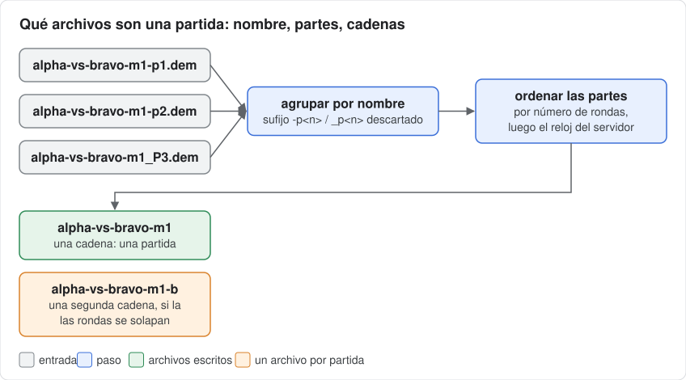

# Cómo se arma una partida {#building-a-match}

Cómo se hace una partida a partir de sus partes de demo: qué archivos van juntos, un solo
reloj para todos, las rondas y cómo se ganó cada una, los equipos y sus bandos, y cada fila
de la tabla del mapa de calor con eliminaciones, venganzas, aperturas, daño, cegados y
economía. Código:
[`heat3d_cs2/match.py`](https://github.com/Holdi601/3DHeat-CS2/blob/main/heat3d_cs2/match.py).
El marcador que se calcula a partir de ella está en [Estadísticas](statistics.md).

## Resumen {#overview}

1. Se lee cada archivo de un nombre de partida ([Leer una demo](reading-demos.md)).
2. Se resuelven las filas de jugadores duplicadas de cada archivo (rondas restauradas).
3. Los archivos se ordenan en **cadenas** (partidas) y cada cadena se pone en orden.
4. Cada parte se coloca en el **reloj de la partida**.
5. Las **rondas** se buscan en cada parte; el relato de una ronda de una parte posterior
   sustituye al de una parte anterior.
6. Se nombran los **jugadores** y los **equipos**, y el bando y el marcador de cada ronda se
   dan por nombre de equipo. Con los bandos conocidos, se calculan la duración de la mitad, las
   rondas de pistola y la **compra** de cada bando.
7. Se construyen las **filas**: posiciones, disparos, lanzamientos, detonaciones, colocaciones,
   desactivaciones, eliminaciones, muertes, heridas, cegados y explosiones.
8. Cada fila recibe su ronda, su fase, el tiempo de ronda, si su bando ganó y la compra de su
   bando; las filas fuera de toda ronda se descartan.

## Rondas restauradas: una fila por jugador y tick {#restored-rounds-one-row-per-player-per-tick}

Cuando una ronda se restaura desde una copia de seguridad dentro de un mismo archivo, la demo
guarda durante unos segundos los cuerpos antiguos de los jugadores junto a los nuevos: dos filas
para un mismo jugador en un mismo tick, una donde la ronda anulada los dejó y otra en la
aparición de la ronda restaurada. Para cada jugador así, los ticks duplicados se recorren **hacia
atrás** desde la primera fila única que llega después: en cada tick se mantiene el candidato más
cercano a la posición que sigue, y ese pasa a ser la referencia del tick anterior. Si no hay fila
única después, se mantiene el último candidato. Así, cada jugador conserva la fila que lleva hacia
donde va después.

## La parte en vivo de un archivo {#the-live-part-of-a-file}

El **inicio en vivo** de un archivo es el tick de su último evento `round_announce_match_start`, o
el tick 0 si no tiene ninguno (una parte posterior de una partida dividida suele no tenerlo). Todo
lo anterior al inicio en vivo se deja fuera, y también todo lo marcado con `is_warmup_period`. Una
ronda de cuchillos o un reinicio anterior al anuncio se dejan fuera; una ronda de cuchillos que
**no** va seguida de un anuncio de inicio de partida no se reconoce como tal (ver [Límites](limits.md)).

Las **rondas** de un archivo son los eventos `round_freeze_end` desde el inicio en vivo en
adelante, fuera del calentamiento, identificados por su `total_rounds_played` (el índice de la
ronda que está a punto de jugarse, empezando en 0). Un archivo sin ninguno no tiene rondas y no
pertenece a ninguna partida.

## El reloj {#the-clock}

Los tiempos se dan en segundos. Dentro de un archivo, el tiempo se cuenta en **ticks**: el
`game_time` del servidor en el primer tick muestreado, más los ticks transcurridos desde entonces
divididos entre 64. El reloj propio del servidor se detiene durante una pausa mientras los ticks
siguen corriendo; si se leyera por ese reloj, dos momentos de una partida pausada tendrían el mismo
tiempo.

Cada archivo tiene un *primer reloj* (el tiempo en su inicio en vivo) y un *último reloj* (en su
último tick muestreado).

### Partes y cadenas {#parts-and-chains}

Los archivos con nombre de una misma partida ([Comandos](commands.md#which-files-are-one-match))
se ordenan primero por el índice de su primera ronda y luego por su primer reloj. Después, cada uno,
en ese orden, se une a la primera cadena a la que continúa, o empieza una cadena nueva. Una parte
continúa una cadena cuando su índice de primera ronda es al menos el índice de la última ronda de la
última parte de la cadena, **y** se cumple una de estas dos cosas:

- el reloj del servidor sigue corriendo: su primer reloj no es anterior al último reloj de la cadena
  menos 5 s; o
- el conteo de rondas sigue: su índice de primera ronda es el último índice de la cadena o el
  siguiente.

Decide el conteo y el reloj desempata, porque un servidor reiniciado para restaurar una ronda vuelve
a empezar su reloj, mientras que dos partidas distintas con un mismo nombre (los mismos equipos en
el mismo mapa en dos eventos) tienen conteos de rondas que se solapan. Las cadenas se ordenan por
el número de rondas que abarcan, de más a menos; la primera conserva el nombre de la partida y las
demás se escriben como `<nombre>-b`, `<nombre>-c`, ...

### El reloj de la partida {#the-match-clock}

El cero de la partida es el primer reloj de la primera parte: **el tiempo 0 de la partida es el
inicio en vivo del primer archivo**. Cada parte posterior se coloca sobre él:

- donde el reloj del servidor sigue corriendo (su primer reloj no es anterior al último reloj de la
  parte anterior menos 5 s), se usa el reloj del servidor tal cual;
- donde se reinició, la parte se coloca para seguir **un segundo** después de que terminara la parte
  anterior.

## Rondas {#rounds}

Para cada `round_freeze_end` de una parte (en orden de tick), la ventana de la ronda llega hasta el
siguiente freeze end de esa parte, o hasta el final del archivo. Dentro de ella, la ronda queda
**decidida** en el primer tick muestreado en el que el estado del juego muestra
`total_rounds_played` = el índice de la ronda + 1 y `round_win_status` 1 (empate), 2 (gana T) o 3
(gana CT). Una ronda sin ninguna muestra así en su ventana quedó cortada por el final del archivo;
su número va a la lista de **incompletas** de la partida (salvo que otra parte tenga la ronda
completa).

| Campo de la ronda | De dónde sale |
|---|---|
| `number` | el índice + 1 (desde 1, como cuenta el juego) |
| `start` | tiempo de partida en que termina el tiempo de congelación: los jugadores ya pueden moverse |
| `end` | tiempo de partida de la primera muestra que muestra la ronda decidida |
| `until` | tiempo de partida del siguiente `round_prestart` después de `end`, si cae dentro de la ventana; si no, el final de la ventana o el último tick del archivo, lo que llegue primero (y nunca antes de `end`) |
| `winner` | `T` para el estado de victoria 2, `CT` para 3, vacío para 1: un empate se decide, sin ganador |
| `reason` | `round_win_reason` en esa muestra, con el nombre que se da más abajo |
| `score` | nombre de equipo -> rondas ganadas después de esta: el `team_rounds_total` de cada bando en la muestra que decide; cuando la demo no lo tiene, la puntuación de la ronda anterior más uno para el ganador |
| `sides` | nombre de equipo -> `T` / `CT` en esta ronda |
| `equipment` | bando -> la suma de `current_equip_value` de los jugadores **vivos** de ese bando en la primera muestra en o después del freeze end |
| `buy` | bando -> `pistol`, `eco`, `force` o `full` ([Economía](#economy-and-buy-types)) |
| `plant` | el primer `bomb_planted` después del freeze end y hasta `end`, o ninguno |
| `exploded` | tiempo de partida del primer `bomb_exploded` después de esa colocación y antes del siguiente freeze end, si lo hay (no aparece en el documento de la partida; marca el momento de la fila `explode`) |

`reason`, a partir de `CSRoundEndReason` del juego:

| Código | `reason` |
|---|---|
| 1 | `bomb` (objetivo bombardeado) |
| 7 | `defuse` (bomba desactivada) |
| 8, 9 | `elimination` (ganan los CT / ganan los T por eliminación) |
| 10 | `draw` (empate) |
| 12 | `time` (objetivo salvado) |
| 17, 18 | `surrender` (rendición) |
| cualquier otro | `other` |

Cuando varias partes tienen la misma ronda (por índice), se conserva la versión de la parte posterior.
Las rondas se listan luego por índice. Una partida cuya primera ronda no es la 1 registra los números
que faltan (`missing` en el documento de la partida); la línea de comandos dice *registrada desde la
ronda N*.

### La colocación {#the-plant}

| Campo | De dónde sale |
|---|---|
| `site` | `A` o `B`: la zona de bomba en la que el juego dice que estaba el colocador (`which_bomb_zone`, 1 A, 2 B); sin ese dato, el nombre del lugar del colocador (`BombsiteA`, `BombsiteB`); sin eso, la letra que dio otra colocación del mismo archivo en la misma zona (el `site` del evento es el número de entidad de la zona). Vacío cuando nada lo dice; nunca el número. |
| `time` | segundos **dentro de la ronda** (desde su freeze end), como el tiempo de una eliminación |
| `player`, `steamid` | el colocador |
| `x`, `y`, `z` | la posición del colocador, en unidades del juego: donde queda la bomba |
| `place` | el nombre del lugar del colocador en el momento de la colocación |

### Las fases {#the-phases}

El tiempo desde `start` hasta `end` es la fase **en vivo** de la ronda; desde `end` hasta `until`,
su fase **posterior**, en la que los ganadores buscan y los perdedores ahorran. Una fila pertenece a
la ronda cuyo `[start, until)` contiene su tiempo, y es `after` cuando su tiempo es posterior a
`end`. El tiempo de congelación queda entre rondas y no pertenece a ninguna.

## Jugadores y equipos {#players-and-teams}

Un **jugador** es todo aquel que estuvo vivo al menos una vez en un bando (equipo 2 o 3), fuera del
tiempo de congelación y del calentamiento, después del inicio en vivo. Un entrenador o un
comentarista en el bando de un equipo nunca está vivo y no es jugador. Cada jugador se identifica por
su ID de Steam; el nombre es el último que se vio.

El **equipo** de un jugador es el nombre de clan que el juego dio a su bando (`team_clan_name`), el
que más veces se vio para él; la demo lo borra en su mismo final. Una partida jugada sin nombres de
clan nombra a sus equipos por el bando con el que empezaron: `Started T` y `Started CT`.

Los **bandos** de cada ronda salen de quién estaba en cada bando entre el freeze end y el final de la
ronda: a cada bando se le da la etiqueta de equipo que lleva la mayoría de sus jugadores. La lista
`teams` de la partida sigue el orden de aparición, ronda a ronda, con el bando T antes que el CT;
normalmente el equipo que empezó en T va primero.

## Las filas {#the-rows}

Cada muestra de posición y cada evento se convierte en una fila de la [tabla del mapa de
calor](output-table.md). Los jugadores están en un bando solo cuando su `team_num` es 2 o 3.

### Posiciones {#positions}

Salen de las filas muestreadas de jugadores vivos de un bando, fuera del tiempo de congelación y del
calentamiento, después del inicio en vivo: posición, dirección de la mirada, salud, armadura, dinero,
valor del equipo, arma en la mano y lugar.

La dirección de la mirada es un vector unitario en el sistema del juego:
`(cos pitch * cos yaw, cos pitch * sin yaw, -sin pitch)`. El pitch del juego es positivo cuando se
mira hacia abajo, así que mirar hacia abajo da una Z negativa.

El arma en la mano es `active_weapon_name` tal como la llama el juego, salvo que cualquier nombre que
contenga `Knife`, `Bayonet`, `Karambit` o `Daggers` pasa a ser `Knife`.

### Disparos y lanzamientos {#shots-and-throws}

Salen de `weapon_fire`, en la posición del tirador. Los cuchillos (`knife`, `bayonet` en el id del
arma) y la C4 se dejan fuera. Las granadas (`smokegrenade`, `flashbang`, `hegrenade`, `molotov`,
`incgrenade`, `decoy`) son filas de **lanzamiento**; todo lo demás, filas de **disparo**. El arma se
nombra como la muestra el juego (más abajo).

### Detonaciones de granadas {#grenade-detonations}

| Evento | Fila | `weapon` |
|---|---|---|
| `smokegrenade_detonate` | `smoke` | Smoke Grenade |
| `flashbang_detonate` | `flash` | Flashbang |
| `hegrenade_detonate` | `he` | High Explosive Grenade |
| `inferno_startburn` (molotov e incendiaria) | `molotov` | Molotov |
| `decoy_detonate` | `decoy` | Decoy Grenade |

La posición es **donde estalló la granada** (los `x`, `y`, `z` del evento); el jugador y el bando son
los del lanzador. La demo no da un lugar para una granada, solo para los jugadores, así que `place`
queda vacío: una fila no reclama un lugar en el que no estuvo. El lugar del lanzador en ese momento se
guarda como `throwerPlace`.

### Colocaciones y desactivaciones {#plants-and-defuses}

Las filas `plant` y `defuse` están en la posición del jugador, con el arma `C4 Explosive`. Una bomba
colocada que llegó a explotar obtiene una fila **explode**: en la posición de la colocación, con el
tiempo de `bomb_exploded`, el colocador como jugador (con su ID de Steam), bando `T`, el equipo T de
la ronda como `team`, y el lugar de la colocación. Esto incluye una bomba que explota después de que
los T ya ganaran por eliminación. Cuando la demo no tiene `bomb_exploded`, una ronda ganada por la
bomba (`reason` = `bomb`) con una colocación recibe la fila en el `end` de la ronda.

### Eliminaciones y muertes {#kills-and-deaths}

Cada `player_death` dentro de una ronda da un **registro de eliminación** (la tabla `kills` de la
partida) con:

| Campo | Es |
|---|---|
| atacante, víctima, asistente | nombres, IDs de Steam, bandos; el atacante queda vacío para el mundo (daño por caída, la bomba) |
| `weapon` | el arma del evento, nombrada como la muestra el juego |
| `headshot` | la marca del evento |
| `wallbang` | `penetrated` > 0 |
| `throughSmoke` | `thrusmoke` |
| `flashAssist` | `assistedflash` |
| `noscope`, `attackerBlind` | las marcas del evento (`noscope`, `attackerblind`); columnas de las filas `kill` y `death`, y de las eliminaciones del documento de la partida |
| `suicide` | atacante y víctima son el mismo jugador: una granada propia, por ejemplo |
| `teamkill` | atacante y víctima en el mismo bando, con atacante, y no es suicidio |
| `opening` | la primera eliminación de un enemigo en la ronda (abajo) |
| `traded`, `trade` | abajo |
| posiciones | la posición y el lugar del atacante y de la víctima |

De cada registro, la tabla recibe una fila **death** en la posición de la víctima (todas las muertes,
también las del mundo, las de compañeros y los suicidios) y, para las eliminaciones de un enemigo
(un atacante, sin compañero y sin suicidio), una fila **kill** en la posición del que mató.

**Apertura.** La primera eliminación de un enemigo en cada ronda mientras está en vivo es su duelo de
apertura. Una eliminación de compañero, un suicidio o una muerte a manos del mundo antes de ella se
pasan por alto, así que la apertura sigue siendo el primer duelo de la ronda; una ronda sin ninguna
eliminación de enemigo mientras está en vivo no tiene apertura.

**Vengada** y **venganza.** Una muerte a manos de un enemigo se considera **vengada** cuando su asesino
es eliminado por alguien del bando de la víctima dentro de los **5 segundos** siguientes (más de 0 y
hasta 5 s después, en la misma ronda); la primera de esas eliminaciones es una **eliminación de
venganza**. En la tabla, la columna `traded` de una fila `kill` vale 1 para una eliminación de
venganza; la de una fila `death` vale 1 para una muerte que fue vengada. Las eliminaciones de la fase
posterior cuentan también.

### Daño {#damage}

Sale de `player_hurt`, solo entre **enemigos** (ambos en un bando, bandos distintos). El daño es la
salud realmente **perdida**: para cada víctima en cada ronda, la salud empieza en 100; cada golpe
cuenta `min(dmg_health, salud antes)`, y la `health` del evento (lo que queda) pasa a ser la salud
"antes" del golpe siguiente. Un golpe en la cabeza de 137 de daño a un jugador con 40 de salud cuenta
40, igual que lo cuenta el marcador del juego. Los golpes de `hegrenade`, `inferno`, `molotov` e
`incgrenade` son daño de **utilidad**. Cada golpe es una fila **hurt** en la posición de la víctima,
con el atacante como `other`. El daño entre compañeros y el daño propio no están ni en la tabla ni en
las estadísticas.

### Cegados {#flashes}

Sale de `player_blind`, solo de **enemigos** (no de compañeros, ni de un entrenador o comentarista que
mira): una fila **blind** por cada jugador cegado, en la posición del jugador cegado, con quien le
cegó como `other`, y el tiempo de ceguera en segundos como `duration`. Se guarda cada duración; las
estadísticas cuentan solo los cegados de al menos un segundo.

## Nombres de armas {#weapon-names}

Un id de arma de un evento (`ak47`, `weapon_ak47`, `knife_karambit`) se muestra como lo nombra el
juego en el `active_weapon_name` de los jugadores, para que el arma de una eliminación y el arma en la
mano se lean igual: `ak47` -> `AK-47`, `m4a1` -> `M4A4`, `m4a1_silencer` -> `M4A1-S`, `hkp2000` ->
`P2000`, `taser` -> `Zeus x27`, `inferno` y `molotov` -> `Molotov`, `incgrenade` -> `Incendiary
Grenade`, `c4` y `planted_c4` -> `C4 Explosive`, `world` -> `World`, y así con cada arma y granada (la
tabla `WEAPONS` de `match.py`). Todo id con `knife` o `bayonet` es `Knife`. Un id que no está en la
tabla se conserva tal cual.

## Economía y tipos de compra {#economy-and-buy-types}

Al final del tiempo de congelación, el valor de equipo de cada bando se suma sobre sus jugadores vivos
en la primera muestra desde entonces, y se divide entre cuántos había:

| Ronda | Equipo medio por jugador | `buy` |
|---|---|---|
| una ronda de pistola (la primera de cada mitad reglamentaria) | cualquiera | `pistol` |
| otra | menos de 1.500 $ | `eco` |
| otra | de 1.500 $ a menos de 4.000 $ | `force` |
| otra | 4.000 $ o más | `full` |

Las rondas de pistola siguen la mitad con la que se jugó la partida, no un formato fijo. La mitad
termina donde los bandos cambian de lado por primera vez entre dos rondas seguidas, ambas
reglamentarias: su duración (`halfLength` en el documento de la partida) es la ronda anterior al
cambio: 12 en el formato de 24 rondas, 15 en el de 30. La ronda 1 y la ronda posterior a la mitad son
las rondas de pistola. Una ronda es de prórroga cuando el número de prórroga del juego
(`m_nOvertimePlaying`) es mayor que 0 en su freeze end; cuando una demo no tiene ese número, lo son
todas las rondas después de dos mitades. Las mitades de prórroga empiezan con el dinero que fija el
servidor y no tienen ronda de pistola, aunque sus bandos también cambian de lado. Una grabación que
nunca muestra el cambio de lado en el descanso (empieza después de él, o termina antes) deja la mitad
desconocida, y solo la ronda 1 es de pistola.

## Etiquetado y orden {#labelling-and-order}

Por último, a cada fila se le da:

- `match`: el nombre de la partida; `map`: el mapa de la cabecera de la demo;
- `round` y `roundId` (`<partida> #NN`, con dos dígitos);
- `phase`: `live` o `after`;
- `roundTime`: segundos desde que terminó el tiempo de congelación de la ronda;
- `won`: 1 si el bando de la fila ganó la ronda, 0 si no, vacío para una fila sin bando;
- `buy`: la compra del bando de la fila en esa ronda;
- `team`: el equipo del jugador de la fila, por ID de Steam.

Las filas cuyo tiempo no cae en ninguna ronda (antes del freeze end de la primera ronda, durante el
tiempo de congelación, después de la última ronda) se descartan. Las filas se ordenan por tiempo, y
por nombre de evento dentro de un mismo tiempo.
