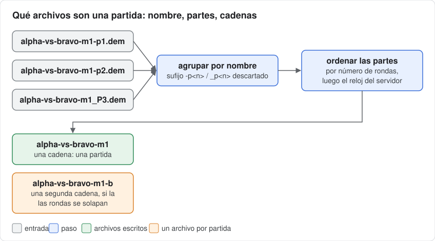

# Comandos {#commands}

¿Nuevo en la línea de comandos? Lee primero [Antes de empezar](before-you-start.md).
Escribe estos comandos en una terminal abierta en la carpeta que descomprimiste o clonaste;
`<...>` son marcadores que debes sustituir, y una ruta con espacios va entre comillas.

```text
python -m heat3d_cs2 demos <demo files or folders> -o <folder> [--every 8] [--jobs N] [--map TEXT] [--force] [--no-bulk] [--loose]
python -m heat3d_cs2 map <map name | path to its .vpk> -o <file.glb> [--game FOLDER] [--source2viewer EXE]
python -m heat3d_cs2 scoreboard <match.3dheat | match.json>
```

`python -m heat3d_cs2 --help` y `python -m heat3d_cs2 <verbo> --help` muestran las mismas
opciones; la [Referencia de comandos](../cli-reference.md) las muestra todas. Cada inicio ejecuta
antes la comprobación de versión que se describe en [Actualizaciones](updates.md) (se desactiva
con `HEAT3D_NO_UPDATE=1`).

Código: [`heat3d_cs2/cli.py`](https://github.com/Holdi601/3DHeat-CS2/blob/main/heat3d_cs2/cli.py).

## `demos` - demos en tablas y documentos de partida {#demos---demos-into-tables-and-match-documents}

```powershell
python -m heat3d_cs2 demos D:\Demos\event -o out
python -m heat3d_cs2 demos alpha-vs-bravo-m1-p1.dem alpha-vs-bravo-m1-p2.dem -o out
python -m heat3d_cs2 demos D:\Demos -o out --map final --jobs 4
```

| Argumento | Por defecto | Qué hace |
|---|---|---|
| `paths` (uno o más) | - | archivos de demo y carpetas. Se toma un archivo cuando su extensión es `.dem` (en cualquier mayúscula o minúscula). Una carpeta se busca **de forma recursiva** en busca de archivos que terminen en `.dem`, en cualquier mayúscula o minúscula, en orden alfabético. Las demos comprimidas (`.dem.zst`, `.dem.bz2`, archivos comprimidos) no se leen: descomprímelas antes. |
| `-o`, `--out` | obligatorio | la carpeta donde escribir; se crea si hace falta |
| `--every N` | `8` | muestrea cada jugador cada *N* ticks. Las demos de CS2 van a 64 ticks por segundo, así que 8 son ocho muestras por segundo, 4 son dieciséis, 64 es una. Los eventos siempre se leen en su propio tick, sea cual sea *N*. |
| `--jobs N` | `0` = la mitad de los núcleos de la CPU | cuántas partidas se convierten a la vez, cada una en su propio proceso. Nunca menos de 1, nunca más que partidas pendientes. |
| `--map TEXT` | - | solo las partidas cuyo **nombre** contiene *TEXT*, sin distinguir mayúsculas (`--map final`). Filtra por el nombre del archivo, no por el mapa que resulte tener la demo. |
| `--force` | desactivado | convierte también las partidas ya escritas, sobrescribiéndolas |
| `--loose` | desactivado | guarda cada partida como archivos separados - tabla, `.match.json`, archivos auxiliares - en lugar de empaquetarlos en un solo contenedor `.3dheat`. Ver [Un archivo por partida](output-container.md). |
| `--container` | activado | empaqueta cada partida en un archivo `.3dheat`; es el valor por defecto, así que solo está para ser explícito |
| `--no-bulk` | desactivado | deja fuera del archivo de paquetes auxiliar el flujo de entidades, los comandos de los jugadores y el flujo de animación: más de la mitad del tamaño de una demo, incluso comprimida. La autocomprobación del documento de la partida los cuenta entonces como `lost`, por nombre. |


### Qué archivos son una partida {#which-files-are-one-match}



El nombre de la partida es el nombre del archivo de demo sin la extensión y sin el sufijo de parte:
`-p<dígitos>` o `_p<dígitos>` al final, en cualquier mayúscula o minúscula. Así,
`alpha-vs-bravo-m1-p1.dem`, `alpha-vs-bravo-m1-p2.dem` y `alpha-vs-bravo-m1_P3.dem` son las partes de
una misma partida, `alpha-vs-bravo-m1`. Los archivos se agrupan solo por ese nombre: dos archivos con
el mismo nombre en carpetas distintas también se agrupan.

El sufijo no dice nada del orden: un `-p2` puede ser la mitad anterior. Las partes se ponen en orden
según el número de rondas que contienen y luego según el reloj del servidor, y un grupo que resulta
contener dos partidas distintas (los mismos equipos en el mismo mapa en dos eventos, por ejemplo) se
divide en **cadenas**: la cadena con más rondas se escribe con el nombre tal cual, la siguiente como
`<nombre>-b`, luego `<nombre>-c`, y así sucesivamente. Un archivo sin ninguna ronda (solo
calentamiento, una pausa) no pertenece a ninguna cadena. Cómo se encuentran las cadenas se describe
en [Cómo se arma una partida](building-matches.md#parts-and-chains).

### Qué se escribe {#what-is-written}

Para cada partida, en una carpeta con el nombre del mapa que indica la cabecera de la demo (`unknown`
si no indica ninguno), un archivo `.3dheat`:

```text
out/
  de_x/
    alpha-vs-bravo-m1.3dheat
    alpha-vs-bravo-m2.3dheat
  de_y/
    ...
```

Con la demo sintética de dos rondas de las pruebas:


Con `--loose`, cada partida es la tabla, su documento de partida y cuatro archivos auxiliares, uno
junto a otro ([Un archivo por partida](output-container.md)):


Un mapa de calor es de un solo mapa, así que cargar una carpeta en el visor es cargar las partidas de
un solo mapa. Ver [La tabla del mapa de calor](output-table.md) y
[El documento de la partida](output-match-json.md).

### Qué se omite {#what-is-skipped}

Antes de leer nada, se listan todos los `*.3dheat` que haya en cualquier parte bajo `--out` (un
contenedor se escribe completo o no se escribe), y cada `*.parquet` que tenga a su lado su documento
de partida (`<nombre>.match.json`). Una partida cuyo nombre coincida con el de uno de esos archivos
(sin la extensión) se omite, salvo con `--force`. Una tabla sin su documento de partida - una ejecución
interrumpida entre escribir las dos cosas - no cuenta, así que esa partida se convierte de nuevo. La
comprobación es solo por nombre: una partida convertida en otra carpeta de mapa, o con otro
`--every`, sigue contando como hecha. Si no queda nada por hacer:

```text
nothing to do: no demos found, or every match already written (--force redoes them)
```

### Qué se imprime {#what-is-printed}

Primero, la cantidad de trabajo; después, una línea por partida al terminar cada una (en el orden en
que terminan, no en el orden de los archivos):

```text
3 match(es), 3 at a time
alpha-vs-bravo-m1: de_x, 21 rounds (Alpha 13 Bravo 8), 412,377 rows, lost 0
alpha-vs-bravo-m2: de_y, 30 rounds (Bravo 16 Alpha 14), 598,104 rows, 1 incomplete round(s) left out, lost 0
alpha-vs-bravo-m3: de_y, 18 rounds (Alpha 13 Bravo 5), 330,981 rows, recorded from round 3, lost 1,204,331 (svc_PacketEntities, svc_UserCmds, DEM_AnimationData)
```

(Los números son ilustrativos.) El marcador es el de la última ronda, equipo por equipo, en el orden
en que los lista el documento de la partida. *incomplete round(s) left out* cuenta las rondas que una
demo cortó antes de que se decidieran; *recorded from round N* indica que la grabación empieza tarde;
*lost* es la autocomprobación del documento de la partida: cuántos elementos de la demo no fueron a
ningún sitio, y de qué tipo (`--no-bulk` hace que el bloque cuente como perdido). Una partida que no
da nada lo dice:

```text
alpha-vs-bravo-m4: no round in 1 file(s) - nothing written
alpha-vs-bravo-m4-b: no complete round in 1 file(s) - nothing written
```

Un error en una partida no detiene a las demás; se imprime como `<nombre>: failed - <error>`.

### Código de salida {#exit-code}

`0` cuando se convirtió cada partida (o no había nada que hacer), `1` cuando falló al menos una.

### Cuánto tarda {#how-long-it-takes}

Cada partida se lee y se construye en un proceso trabajador. Una carpeta de unos cientos de demos
tarda minutos con el `--jobs` por defecto. La memoria por trabajo crece con la duración de la partida
y con un `--every` más pequeño: cada trabajador guarda cada fila de jugador muestreada de su partida
(unos diez jugadores por 64 / *N* filas por segundo de grabación) antes de escribir.

Los archivos auxiliares tardan más que la tabla: cada propiedad que lee el analizador se lee en cada
tick, por ventanas de ticks (unos dos minutos para una demo de 40 minutos, cerca de 3 GB de memoria
como máximo por trabajo), y luego la demo se recorre una vez más para sus fotogramas y mensajes.

## `map` - la geometría de un mapa como `.glb` {#map---a-maps-geometry-as-glb}


```powershell
python -m heat3d_cs2 map <map> -o out/<map>/<map>.glb
python -m heat3d_cs2 map <map> -o <map>.glb --game "D:\Games\Steam\steamapps\common\Counter-Strike Global Offensive"
python -m heat3d_cs2 map "D:\maps\<map>.vpk" -o <map>.glb --source2viewer C:\Tools\Source2Viewer-CLI.exe
```

| Argumento | Por defecto | Qué hace |
|---|---|---|
| `name` | - | el nombre del mapa (como `de_x`), o la ruta a su `.vpk`. Una ruta que termina en `.vpk` y existe se usa tal cual; cualquier otra cosa se busca por el nombre de archivo en el juego instalado. |
| `-o`, `--out` | obligatorio | el `.glb` que escribir; su carpeta se crea si hace falta |
| `--game FOLDER` | las bibliotecas de Steam | la carpeta de instalación de CS2 (la que contiene `game\csgo`), cuando Steam no la conoce. Con `--game`, solo se busca en esa carpeta. |
| `--source2viewer EXE` | `HEAT3D_SOURCE2VIEWER`, y después `PATH` | el ejecutable de la CLI de Source2Viewer |

Lo que se imprime si todo va bien:

```text
out/de_x/de_x.glb: de_x, 412,880 triangles (151,204 ground) in 14 parts
```

(números ilustrativos). Escribir el `.glb` junto a las tablas del mapa (`out/<map>/<map>.glb`) mantiene
los datos y la geometría de un mapa en una misma carpeta. Cómo funciona la exportación:
[Exportar el mapa](map-export.md).

Errores, cada uno impreso como `error: ...` con código de salida `2`:

| Mensaje | Significa |
|---|---|
| `no de_x.vpk found in an installed CS2 - pass --game <CS2 folder> or the .vpk path` | el mapa no está en ninguna biblioteca de Steam encontrada, o el nombre está mal |
| `Source2Viewer-CLI not found: ...` | ninguno de `--source2viewer`, `HEAT3D_SOURCE2VIEWER` ni `PATH` dio un archivo existente |
| `Source2Viewer did not export de_x's collision mesh:` seguido del final de su salida | falló, o no escribió ningún `.glb` |
| `de_x's collision mesh has nothing but clip brushes` | tras dejar fuera los clips y el cielo, no queda nada |

## `scoreboard` - una partida como texto {#scoreboard---a-match-as-text}

```bash
python -m heat3d_cs2 scoreboard out/de_x/alpha-vs-bravo-m1.3dheat
python -m heat3d_cs2 scoreboard out/de_x/alpha-vs-bravo-m1.match.json   # after demos --loose
```

Imprime el marcador de la partida desde su [documento de partida](output-match-json.md), sin abrir el
visor. Lee el documento dentro de un contenedor `.3dheat`, o un `<partida>.match.json` suelto.
Con la demo sintética de dos rondas de las pruebas:


```text
alpha-vs-bravo-m1 - de_test  Alpha 2  Bravo 0

Alpha
player                 K   D   A  +/-    ADR   KAST   HS%  OK-OD  clutch
ash                    1   0   0   +1   50.0 100.0%    0%   0-0     1/1
ace                    1   1   0   +0   50.0 100.0%  100%   1-0     0/0

Bravo
player                 K   D   A  +/-    ADR   KAST   HS%  OK-OD  clutch
ben                    1   1   0   +0   50.0 100.0%    0%   0-0     0/1
bob                    0   1   0   -1    0.0 100.0%    0%   0-1     0/0

rounds  1:TK 2:TB
```

- La primera línea: nombre de la partida, mapa y marcador final de cada equipo.
- Una tabla por equipo, en el orden de `teams` del documento de la partida; jugadores en el orden del
  documento (por eliminaciones menos muertes, luego eliminaciones, de mejor a peor). Los nombres se
  cortan a 19 caracteres.
- Columnas: **K** eliminaciones, **D** muertes, **A** asistencias *incluidas* las asistencias de
  cegado, **+/-** eliminaciones menos muertes, **ADR**, **KAST** (%), **HS%** (redondeado al
  porcentaje entero), **OK-OD** aperturas ganadas - aperturas perdidas, **clutch** clutches ganados /
  clutches jugados. Definiciones: [Estadísticas](statistics.md).
- La franja de rondas: `<ronda>:<bando ganador><cómo>`, con **B** bomba explotada, **D** bomba
  desactivada, **K** eliminación, **T** se acabó el tiempo, y **?** para cualquier otra cosa (empate,
  rendición, otra). Un empate no tiene bando ganador: `<ronda>:?`.

Un archivo que no es JSON válido, o que no se encuentra, detiene el comando con un error; un documento
JSON sin los campos del documento de partida falla con un error de Python (no se valida más).
