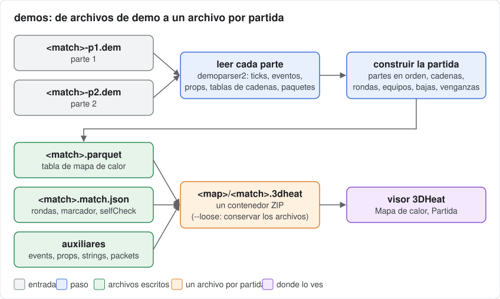

# 3DHeat CS2 {#dheat-cs2}

**¿Qué es?** Counter-Strike 2 puede guardar una grabación de una partida, llamada *demo*. Esta
herramienta convierte una demo en archivos que el visor 3DHeat puede mostrar en 3D: dónde estaba cada
uno, quién murió, lanzó y plantó, ronda a ronda. También puede convertir un mapa de CS2 en un modelo 3D
sobre el que mostrarlo.

**¿Para qué lo usaría?** Para revisar tus propias partidas, para superponer muchas partidas de un mismo
mapa como un único mapa de calor, y para estadísticas de partida como el ADR (daño medio por ronda) y el
KAST (la proporción de rondas en las que un jugador mató, asistió, sobrevivió o fue vengado).

**Ejemplo:** `alpha-vs-bravo-m1.dem` entra, `out/de_x/alpha-vs-bravo-m1.3dheat` sale (`de_x` es un
nombre de mapa inventado).



Con más detalle: 3DHeat CS2 convierte **demos de Counter-Strike 2** en una tabla de mapa de calor y un
documento de la partida por cada partida, y un **mapa de CS2** en geometría de nivel. Las salidas están
hechas para el visor de telemetría [3DHeat](https://holdi601.github.io/3DHeat/)
([código](https://github.com/Holdi601/3DHeat)), pero son archivos corrientes - Parquet, JSON y glTF binario -
que cualquier otra herramienta puede leer.

Es un pequeño paquete de Python, `heat3d_cs2`, que se ejecuta desde la línea de comandos. Lee las demos
del disco (no descarga ninguna) con [demoparser2](https://github.com/LaihoE/demoparser), y exporta los
mapas del juego instalado con la versión de línea de comandos de Source2Viewer
([ValveResourceFormat](https://github.com/ValveResourceFormat/ValveResourceFormat)).

## Inicio rápido {#quick-start}

¿Nuevo en la línea de comandos? Lee primero [Antes de empezar](before-you-start.md).

```bash
pip install -r requirements.txt
python -m heat3d_cs2 demos <demo files or folders> -o out   # cada partida que contengan
python -m heat3d_cs2 map <map> -o out/<map>/<map>.glb       # el mapa del juego instalado
python -m heat3d_cs2 scoreboard out/<map>/<match>.3dheat    # el marcador de una partida, en texto
```

Deberías ver `1 match(es), 1 at a time ...` y luego una línea por partida
(ver [Comandos](commands.md#what-is-printed)).

`demos` escribe, por cada partida, un archivo en una carpeta con el nombre del mapa:
`out/<map>/<match>.3dheat`, un [contenedor `.3dheat`](output-container.md) - el formato de un archivo por
partida del visor ([especificación](https://holdi601.github.io/3DHeat/container.html)). Contiene estos
miembros; `--loose` los escribe como archivos separados:

| Miembro | Qué contiene | Se carga en la pestaña del visor |
|---|---|---|
| `<match>.parquet` (función `table`) | cada jugador vivo ocho veces por segundo con su estado (salud, dinero, destello, mirilla, zona, inventario, ...), y cada evento donde ocurrió (baja, muerte, daño, disparo, lanzamiento, detonaciones de granadas, cegado, plantado, desactivado, explosión, y un fin de ronda por jugador con lo que la ronda le pagó), una fila cada uno | pestaña Mapa de calor |
| `<match>.match.json` (función `match`, el documento de la partida) | equipos, marcador, cada ronda (ganador, cómo, economía, plantado, bajas en orden, remontadas, supervivientes) y la línea del marcador de cada jugador | pestaña Partida |
| `<match>.events/props/strings/packets.parquet` | todo lo demás que contiene la demo, completo (auxiliares) | se guarda para tener todo |

`map` escribe `<map>.glb`: la malla de colisión del mapa - suelos, muros, cajas, sin decoración -
dividida en terreno y estructura, en el mismo marco y las mismas unidades que las tablas, así que
queda exactamente bajo el mapa de calor (panel Fondo / nivel).

## Mapa de esta documentación {#map-of-this-documentation}

| Página | Qué cubre |
|---|---|
| [Antes de empezar](before-you-start.md) | Python, una terminal, marcadores, cómo se ven el éxito y los errores habituales |
| [Instalación](installing.md) | Python, los paquetes, la CLI de Source2Viewer, dónde debe estar CS2 |
| [Comandos](commands.md) | `demos`, `map`, `scoreboard`: cada opción, lo que se imprime, códigos de salida |
| [Leer una demo](reading-demos.md) | qué se lee de un archivo de demo: ticks muestreados, propiedades de jugador, reglas de partida, eventos |
| [Construir una partida](building-matches.md) | partes y cadenas, el reloj de partida, rondas, equipos y lados, filas, bajas, remontadas, aperturas, daño, destellos, economía |
| [Estadísticas](statistics.md) | el marcador: K/D/A, ADR, KAST, HS%, aperturas, remontadas, multibajas, remontadas en solitario, utilidad, destellos |
| [La tabla del mapa de calor](output-table.md) | el archivo Parquet: cada columna, su tipo, qué eventos la llenan, las pistas del pie `heat3d`, los ejes |
| [El documento de la partida](output-match-json.md) | el documento `.match.json`, campo por campo |
| [Un archivo por partida](output-container.md) | el contenedor `.3dheat` que escribe `demos` por defecto, `--loose` |
| [Exportación de mapas](map-export.md) | cómo se exporta la malla de colisión de un mapa, el marco, nombres de nodos, unidades |
| [Uso con 3DHeat](using-with-3dheat.md) | cargar tablas, documentos de partida y mapas en las pestañas Mapa de calor y Partida del visor |
| [Límites](limits.md) | lo que se asume, lo que no se gestiona, lo que no está verificado |
| [Actualizaciones](updates.md) | la comprobación de versión al arrancar y `python -m heat3d_update` |
| [Desarrollo](development.md) | estructura del código, pruebas, la demo sintética de prueba |
| [Referencia de comandos](../cli-reference.md) | el `--help` de cada comando, generado desde el código |
| [Mantenimiento](maintaining.md) | la lista de comprobación de cada versión de estas páginas |

## Contra qué se comprueba {#what-it-is-checked-against}

Las demos del mundo real no son un archivo limpio por partida. El convertidor maneja una partida repartida
en varios archivos en cualquier orden, un servidor reiniciado a mitad de partida, dos partidas distintas
guardadas con el mismo nombre, rondas restauradas desde una copia de seguridad, una grabación que empieza
tarde o acaba pronto, pausas y entrenadores en el bando de un equipo - ver
[Construir una partida](building-matches.md). Comprobado sobre una gran colección de demos de torneos: en
cada partida el marcador sigue a los ganadores de las rondas, las bajas de cada bando son las muertes del
otro, y cada ronda empieza con cinco contra cinco.

## Con qué demos usarla {#what-to-point-it-at}

Las demos de tus propias partidas, demos que descargaste a mano de un sitio de torneos, o demos de una API
a la que tengas acceso. Una demo es una grabación cuyo contenido pertenece a su editor y a los
organizadores: usa lo que salga para tu propio análisis, y no redistribuyas demos ni datos derivados de
ellas. Los sitios que ofrecen demos suelen prohibir en sus condiciones la descarga automatizada, por lo
que la herramienta lee las demos del disco y no descarga ninguna.

## Parte de 3DHeat {#part-of-3dheat}

3DHeat CS2 es una de las herramientas gratuitas que rodean al visor 3DHeat, cada una con su propio
repositorio, sus versiones y su licencia:

| Herramienta | Qué hace | Documentación |
|---|---|---|
| [3DHeat](https://github.com/Holdi601/3DHeat) | el visor: mapas de calor, análisis de carreras y revisión de partidas en 3D | [sitio](https://holdi601.github.io/3DHeat/) |
| [GameFiles](https://github.com/Holdi601/3DHeat-GameFiles) | circuitos y niveles a partir de los archivos que traen los juegos, como modelos 3D | [sitio](https://holdi601.github.io/3DHeat-GameFiles/) |
| [GameCapture](https://github.com/Holdi601/3DHeat-GameCapture) | telemetría de vueltas de juegos de carreras; niveles reconstruidos a partir de vídeo de juego | [sitio](https://holdi601.github.io/3DHeat-GameCapture/) |
| [Unreal Exporter](https://github.com/Holdi601/3DHeat-UnrealExporter) | un plugin del editor de Unreal que exporta un nivel como un modelo 3D | [sitio](https://holdi601.github.io/3DHeat-UnrealExporter/) |
| [CS2](https://github.com/Holdi601/3DHeat-CS2) | demos de Counter-Strike 2 en tablas y documentos de partida; mapas en modelos 3D | [sitio](https://holdi601.github.io/3DHeat-CS2/) |
| [Watcher](https://github.com/Holdi601/3DHeat-Watcher) | registra lo que publican los juegos sobre tu juego, en segundo plano | [sitio](https://holdi601.github.io/3DHeat-Watcher/) |
| [Ext-WarThunder](https://github.com/Holdi601/3DHeat-Ext-WarThunder) | repeticiones de War Thunder en tablas y documentos de partida | [sitio](https://holdi601.github.io/3DHeat-Ext-WarThunder/) |
| [Ext-WoT](https://github.com/Holdi601/3DHeat-Ext-WoT) | repeticiones de World of Tanks en tablas y documentos de partida | [sitio](https://holdi601.github.io/3DHeat-Ext-WoT/) |
| [Ext-WoWs](https://github.com/Holdi601/3DHeat-Ext-WoWs) | repeticiones de World of Warships en tablas y documentos de partida | [sitio](https://holdi601.github.io/3DHeat-Ext-WoWs/) |
| [Ext-Squad](https://github.com/Holdi601/3DHeat-Ext-Squad) | demos de servidores de Squad en tablas y documentos de partida | [sitio](https://holdi601.github.io/3DHeat-Ext-Squad/) |
| [Ext-DCS](https://github.com/Holdi601/3DHeat-Ext-DCS) | mapas de DCS World en modelos 3D | [sitio](https://holdi601.github.io/3DHeat-Ext-DCS/) |
| [Ext-IL2](https://github.com/Holdi601/3DHeat-Ext-IL2) | mapas de IL-2 Sturmovik en modelos 3D | [sitio](https://holdi601.github.io/3DHeat-Ext-IL2/) |

## Licencia {#licence}

MIT - ver [`LICENSE`](https://github.com/Holdi601/3DHeat-CS2/blob/main/LICENSE),
y [`LICENSES.md`](https://github.com/Holdi601/3DHeat-CS2/blob/main/LICENSES.md)
para los paquetes de terceros y lo que exigen los juegos que lee.
