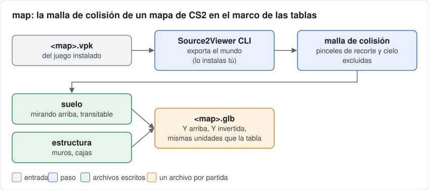

# Exportar el mapa (`map`) {#map-export-map}

`python -m heat3d_cs2 map <map> -o <file.glb>` escribe un mapa de CS2 como geometría de nivel: la
**malla de colisión** del mundo, en el sistema y las unidades en que se dibujan las
[tablas del mapa de calor](output-table.md). Código:
[`heat3d_cs2/mapexport.py`](https://github.com/Holdi601/3DHeat-CS2/blob/main/heat3d_cs2/mapexport.py),
[`heat3d_cs2/glb.py`](https://github.com/Holdi601/3DHeat-CS2/blob/main/heat3d_cs2/glb.py).
Opciones y mensajes: [Comandos](commands.md#map---a-maps-geometry-as-glb).



## Por qué la malla de colisión {#why-the-collision-mesh}

La malla de colisión es donde los jugadores se paran y se esconden - suelos, paredes, escaleras, cajas -
sin la decoración: sin props que solo parecen algo, sin texturas, con muchos menos triángulos que las
mallas de render. Eso es lo que necesita un mapa de calor debajo: algo contra lo que leer las posiciones,
no una representación del mapa.

## Cómo se obtiene {#how-it-is-obtained}

1. **Encontrar el mapa.** Una ruta que termina en `.vpk` y existe se usa tal como se da. Si no, se busca
   `<nombre>.vpk` en `<carpeta de CS2>\game\csgo\maps\`, donde la carpeta de CS2 es `--game`, o
   `steamapps\common\Counter-Strike Global Offensive` en cada biblioteca de Steam encontrada (ver
   [Instalación](installing.md#where-cs2-is-looked-for)).
2. **Encontrar la CLI de Source2Viewer**: `--source2viewer`, luego `HEAT3D_SOURCE2VIEWER`, luego
   `Source2Viewer-CLI` / `Source2Viewer-CLI.exe` en `PATH`.
3. **Exportar la física del mundo.** Source2Viewer se ejecuta así:

   ```text
   Source2Viewer-CLI -i <map>.vpk -d -f maps/<map>/world_physics.vmdl_c --gltf_export_format glb -o <temporary folder>
   ```

   Decodifica la física compilada de Source 2 desde el propio archivo del mapa y escribe el modelo (vacío:
   el mundo no tiene malla de render propia) y su física junto a él. El `.glb` más grande que escribe es
   la física. Si Source2Viewer falla o no escribe ningún `.glb`, el comando se detiene y muestra los
   últimos 800 caracteres de su salida y de sus errores.
4. **Leerlo.** Se recorre cada nodo de la escena con su transformación (matriz, o traslación-rotación-
   escala), y se toma cada primitiva de triángulos, con o sin búfer de índices, en posiciones de mundo.
5. **Dejar fuera lo que no es pared ni suelo.** Se descarta cada nodo cuyo nombre contiene `clip` -clips
   de jugador, clips de NPC, clips de granada: las paredes invisibles que detienen a jugadores y
   granadas- o `sky`, sin distinguir mayúsculas.
6. **Nombrar la superficie.** Los grupos de física se nombran por su superficie; el nombre en minúsculas,
   sin el prefijo `physics`, `physics_group` o `physics_passbullets` (y el guion bajo que sigue), es la
   superficie: `physics_group_concrete` es `concrete`, `physics_passbullets_chainlink` es `chainlink`, y un
   `physics_group` a secas es `world`. Se conservan las superficies que dejan pasar las balas.
7. **De vuelta al sistema del juego.** Source2Viewer escribe glTF en metros con Y hacia arriba: la (Y, Z,
   X) del juego multiplicada por 0,0254. Eso se deshace: cada punto pasa a ser la (X, Y, Z) del juego, en
   pulgadas.
8. **Separar suelo de estructura**, triángulo a triángulo: una cara cuya normal apunta hacia arriba al
   menos 0,7 (su componente Z, normalizada) - pendientes de hasta unos 45 grados, aproximadamente lo más
   empinado que camina un jugador de CS2 - es **suelo**; todo lo demás, paredes y techos incluidos, es
   **estructura**.
9. **Al sistema del visor.** Cada punto se escribe como (X, Z, -Y): Y hacia arriba, con la Y del juego
   negada; el sistema en el que el visor dibuja las tablas cuando sigue sus pistas `heat3d`. Es una
   rotación, no un espejo.
10. **Escribir el `.glb`.** Si no queda nada (solo clips), el comando se detiene con un error. Si no, imprime
    el archivo, el mapa, el número de triángulos, cuántos son de suelo y el número de partes.

Aquí no se lee nada más que el `.vpk` propio del mapa, y nada de Source2Viewer se incluye ni se copia.

## El archivo {#the-file}

Un binario glTF 2.0 (`.glb`), un solo búfer, escrito por `heat3d_cs2` (el `asset.generator`):

| Aspecto | Qué |
|---|---|
| Nodos | uno por parte, todos en la raíz, sin transformaciones, cada uno con su propia malla del mismo nombre |
| Nombres de nodo | `ground:<surface>` o `structure:<surface>` (`ground:concrete`, `structure:metal`, `structure:world`), ordenados por nombre |
| Primitivas | una por malla, triángulos, `POSITION` (float32, con mín/máx) y `NORMAL` (float32), índices `uint32` |
| Sombreado | plano: un vértice por esquina de triángulo, cada uno con la normal de su triángulo |
| Materiales, texturas, UV, colores | ninguno |
| Unidades | unidades del juego (**pulgadas**), no metros - a diferencia de lo que supone glTF |
| Sistema | (X, Z, -Y) del juego: la Y de glTF es la altura del juego, la Z de glTF es la -Y del juego |

El prefijo `ground:` / `structure:` es la convención de todos los exportadores de nivel de 3DHeat: el
visor toma una parte con ese nombre al pie de la letra en lugar de adivinar por la geometría, así que
los suelos reciben el sombreado de suelo y las paredes el dibujo de estructura, sin ningún paso de
clasificación.

Como las unidades son pulgadas, otro visor de glTF muestra el mapa unas 39 veces más grande (lo lee como
metros); si importa, escala por 0,0254 allí. En 3DHeat queda exactamente debajo de la tabla, que está en
las mismas unidades con escala 1.

## La comprobación de que el sistema es correcto {#the-check-that-the-frame-is-right}

La prueba `test_players_stand_on_the_exported_floor` (solo se ejecuta cuando se dan una demo y Source2Viewer,
ver [Desarrollo](development.md#tests)) exporta el mapa en el que se jugó una demo, toma 300 muestras de
posición aleatorias de la partida y, para cada una, busca hacia abajo el triángulo de suelo más alto a no
más de 4 unidades por encima de los pies del jugador. Exige que al menos el 98 % de las muestras encuentren
suelo, y que la altura media por encima de él sea menor de 5 unidades. Un mapa reflejado falla: en un mapa
reflejado por el eje equivocado, una gran parte de los jugadores está sobre el vacío. El README informa de
las cifras de esta comprobación sobre los mapas del grupo competitivo actual.

## Lo que no hace {#what-it-does-not-do}

- Ni geometría de render, ni texturas, ni decoración - ver el *porqué* de arriba.
- Solo se exporta lo que está en el modelo `world_physics` del mapa. No se ha comprobado si las partes
  móviles (puertas) o los objetos rompibles están en él.
- Sin simplificación: el visor de 3DHeat simplifica al importar con su ajuste **Objetivo de simplificación**.
- Los mapas que no están en el juego instalado (mapas de taller en otra parte del disco) funcionan cuando
  su `.vpk` se pasa como ruta y contiene `maps/<nombre>/world_physics.vmdl_c`; no verificado.
