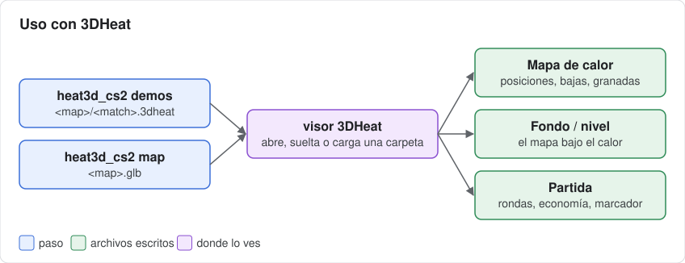

# Uso con 3DHeat {#using-it-with-3dheat}

Las salidas van a estos sitios del [visor de 3DHeat](https://holdi601.github.io/3DHeat):

| Archivo | Dónde | Qué da |
|---|---|---|
| `<partida>.3dheat` (el predeterminado) | pestaña **Mapa de calor**, panel **Origen**, o pestaña **Partida** | la tabla y el documento de la partida juntos, un archivo por partida ([contenedor](https://holdi601.github.io/3DHeat/container.html)) |
| `<partida>.parquet` | pestaña **Mapa de calor**, panel **Origen** | posiciones y eventos como mapa de calor, repetición en caja, rutas |
| `<partida>.match.json` | pestaña **Partida**, **Cargar archivos de partida…** | el marcador, las rondas, el feed de eliminaciones, estadísticas entre partidas, enlaces al mapa de calor |
| `<mapa>.glb` | panel **Fondo / nivel**, **Modelo 3D…** | el mapa bajo el mapa de calor |

La propia documentación del visor describe cada pestaña por completo: sus páginas de
[Análisis de partida](https://holdi601.github.io/3DHeat/match-analysis.html),
[Cargar archivos](https://holdi601.github.io/3DHeat/loading-files.html),
[Asignación de columnas](https://holdi601.github.io/3DHeat/column-mapping.html) y
[Repetición en caja](https://holdi601.github.io/3DHeat/box-replay.html). Esta página es la parte de CS2.



El visor: [github.com/Holdi601/3DHeat](https://github.com/Holdi601/3DHeat),
documentación [holdi601.github.io/3DHeat](https://holdi601.github.io/3DHeat/).

## Una sesión típica {#a-typical-session}

```bash
python -m heat3d_cs2 demos D:\Demos\event -o out
python -m heat3d_cs2 map <map> -o out/<map>/<map>.glb
```

1. **Mapa de calor -> Origen:** elige la carpeta `out/<mapa>` (o arrástrala).
   Cada `.parquet` de ella se convierte en un conjunto de datos; los archivos `.json` y `.glb` de la misma
   carpeta se omiten como "no es un archivo CSV/Parquet". Cárgala.
2. **Fondo / nivel -> Modelo 3D…:** elige `out/<mapa>/<mapa>.glb`.
   **Guardar en la biblioteca** lo guarda en el navegador para la próxima vez.
3. **Pestaña Partida -> Cargar archivos de partida…:** elige los archivos `.match.json` de la misma carpeta
   (varios a la vez), o suéltalos en la vista mientras la pestaña Partida está abierta.

Carga solo las tablas de un mapa a la vez: las coordenadas de mapas distintos se solapan, y un mapa de calor
de dos mapas a la vez no significa nada. La carpeta por mapa está para eso.

## La tabla se abre sin configurar nada {#the-table-opens-with-nothing-to-set}

El visor lee la entrada `heat3d` del pie del primer archivo seleccionado
([La tabla del mapa de calor](output-table.md#the-heat3d-footer-hints)) y la aplica sobre sus propias
suposiciones:

| Ajuste del visor | Valor |
|---|---|
| Posición | `x`, `y`, `z` |
| Eje vertical en el origen | Z es hacia arriba |
| Invertir Y | activado - para que el mapa esté del lado correcto, no reflejado |
| Escala de unidades | 1 - distancias en unidades del juego (etiquetadas "m"; 1 unidad = 1 pulgada) |
| Tiempo | `time`, en segundos |
| Persona | `player` |
| Grupo | `side` (T / CT) |
| Sesión | `roundId` - cada ronda es una sesión, `<partida> #NN` |
| Dirección de la mirada | vector, `dirX` / `dirY` / `dirZ` |
| Columnas de filtro | `event`, `match`, `round`, `roundTime`, `phase`, `weapon`, `place`, `won`, `buy`, `opening`, `team` |
| Tamaño de entidad | 32 - la repetición en caja dibuja a un jugador de 32 unidades de ancho, con un rayo de mirada de 4 x 32 |

Cada valor indicado sigue apareciendo en la asignación de columnas y puede cambiarse. Las demás columnas
(`headshot`, `traded`, `other`, `steamid`, `health`, `money`, `damage`, `duration`, ...) se pueden añadir a
mano allí como filtros.

Deja la escala de unidades en 1 cuando se carga un mapa: el `.glb` está en las mismas unidades del juego, y
el nivel no se reescala junto con la tabla.

### Filtros útiles {#useful-filters}

- `event` = `position` para ver dónde estaban los jugadores; `kill` / `death` para ver dónde se ganaron y
  perdieron los duelos; `smoke`, `flash`, `molotov`, `he` para ver dónde aterrizó la utilidad; `throw` para
  ver desde dónde se lanzó; `plant` para los puntos de colocación.
- `side` (el grupo) = `T` o `CT`, `phase` = `live` para dejar fuera la fase posterior, `buy` = `eco` / `force` /
  `full` para las rondas de una misma economía, `won` = 1 para las rondas que ganó el bando de la fila.
- `opening` = 1 con `kill` y `death` para los duelos de apertura.
- `roundTime` como rango para un momento de la ronda: los primeros 20 segundos, el posterior a la colocación.

## La pestaña Partida {#the-match-tab}

La pestaña Partida acepta un archivo JSON cuyo `format` es `heat3d-cs2-match` y que tiene las listas `rounds`,
`players` y `teams` ([El documento de la partida](output-match-json.md)). Muestra el marcador y las mitades,
una franja de rondas coloreadas por el bando ganador con una marca de cómo terminó cada una, la economía de
cada ronda, la colocación, el feed de eliminaciones, los clutches y los supervivientes, el marcador, y las
estadísticas de todas las partidas cargadas.

Sus enlaces **Mostrar en el mapa de calor** no cargan nada: solo ponen filtros sobre la tabla ya cargada en la
pestaña Mapa de calor - `match`, `round` (y la sesión de la ronda `<partida> #NN`), `event`, el jugador, el
bando. Eso funciona porque el documento de la partida y la tabla llevan los mismos nombres de partida, números
de ronda, nombres de jugador y bandos. **Repetir ronda** cambia el mapa de calor a repetición en caja y
reproduce la sesión de la ronda desde su inicio.

Así que carga las dos cosas: las tablas de un mapa en la pestaña Mapa de calor, y sus documentos de partida en
la pestaña Partida. Un documento de partida sin su tabla sigue mostrando el marcador y las rondas, y los
enlaces indican que no hay datos del mapa de calor cargados.

## Sin 3DHeat {#without-3dheat}

- La tabla es Parquet corriente: pandas, Polars, DuckDB, Spark, `arrow` de R la leen todas; la entrada `heat3d`
  se ignora, y las columnas de texto se leen como cadenas o categóricas.
- El documento de la partida es JSON corriente.
- El mapa es un binario glTF válido, en pulgadas y no en metros: escala por 0,0254 para las herramientas que
  suponen metros. Su sistema es el propio de glTF (Y hacia arriba), así que para superponer la tabla en otro
  sitio dibuja la (x, y, z) de cada fila como (x, z, -y), como hace 3DHeat.
