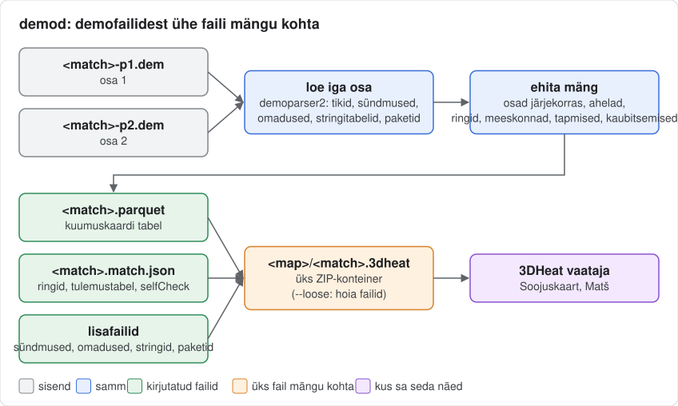

# 3DHeat CS2 {#dheat-cs2}

**Mis see on?** Counter-Strike 2 suudab salvestada mängu salvestise, mida nimetatakse
*demoks*. See tööriist muudab demo failideks, mida 3DHeat vaataja saab 3D-na näidata:
kus kõik seisid, surid, viskasid ja paigaldasid, ringi kaupa. See võib ka muuta CS2 kaardi
3D-mudeliks, millel neid näidata.

**Miks ma seda kasutaksin?** Oma mängude ülevaatamiseks, mitme sama kaardi mängu ühte kuumuskaarti
üksteise peale laotamiseks ja mängustatistikaks, nagu ADR (keskmine kahju ringi kohta) ja KAST
(ringide osakaal, mille mängija tappis, abistas, ellu jäi või kaubitseti).

**Näide:** `alpha-vs-bravo-m1.dem` sisse, `out/de_x/alpha-vs-bravo-m1.3dheat` välja
(`de_x` on väljamõeldud kaardinimi).



Üksikasjalikumalt: 3DHeat CS2 muudab **Counter-Strike 2 demod** kuumuskaardi tabeliks ja mängu
dokumendiks mängu kohta ning **CS2 kaardi** tasemegeomeetriaks. Väljundid on tehtud
[3DHeat](https://holdi601.github.io/3DHeat/) telemeetria vaatajale
([lähtekood](https://github.com/Holdi601/3DHeat)), kuid need on tavalised failid —
Parquet, JSON ja glTF binaarne — mida saab lugeda ka mistahes muu programm.

See on väike Pythoni pakett `heat3d_cs2`, mida käivitatakse käsurealt. See loeb demosid kettalt
(ta ei laadi neid alla) paketi [demoparser2](https://github.com/LaihoE/demoparser) abil ja ekspordib
kaardid paigaldatud mängust Source2Vieweri käsurearakenduse abil
([ValveResourceFormat](https://github.com/ValveResourceFormat/ValveResourceFormat)).

## Kiire algus {#quick-start}

Pole sul käsurealt kogemust? Loe enne [Enne alustamist](before-you-start.md).

```bash
pip install -r requirements.txt
python -m heat3d_cs2 demos <demo files or folders> -o out   # kõik mängud nende seas
python -m heat3d_cs2 map <map> -o out/<map>/<map>.glb       # kaart paigaldatud mängust
python -m heat3d_cs2 scoreboard out/<map>/<match>.3dheat    # mängu tulemustabel tekstina
```

Peaksid nägema `1 match(es), 1 at a time ...` ja seejärel ühe rea mängu kohta
(vt [Käsud](../commands.md#what-is-printed)).

`demos` kirjutab mängu kohta ühe faili kausta, mis on nime järgi kaardi kaust:
`out/<map>/<match>.3dheat`, [`.3dheat` konteiner](../output-container.md) — vaataja üks-fail-mängu
vorming ([spetsifikatsioon](https://holdi601.github.io/3DHeat/container.html)).
See sisaldab neid liikmeid; `--loose` kirjutab need hoopis eraldi failidena:

| Liige | Mis see sisaldab | Laetakse vaataja |
|---|---|---|
| `<match>.parquet` (roll `table`) | iga elus mängija kaheksa korda sekundis koos oma olekuga (tervis, raha, pimestamine, sihik, tsoon, varustus, ...) ning iga sündmus, kus see juhtus (tapmine, surm, haavamine, lask, viskamine, granaadi plahvatused, pimestamine, paigaldamine, desarmeerimine, plahvatus ja ringi lõpp mängija kohta koos sellega, mida ring talle maksis), üks rida iga kohta | Soojuskaardi vahelehel |
| `<match>.match.json` (roll `match`, mängu dokument) | meeskonnad, tulemus, iga ring (võitja, kuidas, majandus, paigaldus, tapmised järjekorras, klutšid, ellujäänud) ja iga mängija tulemustabeli rida | Matši vahelehel |
| `<match>.events/props/strings/packets.parquet` | kõik muu, mida demo sisaldab, tervena (lisafailid) | säilitatakse täielikkuse jaoks |

`map` kirjutab `<map>.glb`: kaardi kokkupõrkevõrgu — põrandad, seinad, kastid, ilma kaunistusteta —
jaotatuna maapinnaks ja struktuuriks, samas raamistikus ja ühikutes nagu tabelid, nii et see asub täpselt
kuumuskaardi all (Taseme paneel).

## Selle dokumentatsiooni kaart {#map-of-this-documentation}

| Leht | Mida see käsitleb |
|---|---|
| [Enne alustamist](before-you-start.md) | Python, terminal, kohatäited, mis on edu ja levinud vead |
| [Paigaldamine](../installing.md) | Python, paketid, Source2Vieweri CLI, kus CS2 peab olema |
| [Käsud](../commands.md) | `demos`, `map`, `scoreboard`: iga valik, mis prinditakse, väljumiskoodid |
| [Demo lugemine](../reading-demos.md) | mida demofailist loetakse: valitud tikid, mängija omadused, mängureeglid, sündmused |
| [Mängu ehitamine](../building-matches.md) | osad ja ahelad, mängu kell, ringid, meeskonnad ja pooled, read, tapmised, kaubitsemised, avamised, kahju, pimestamised, majandus |
| [Statistika](../statistics.md) | tulemustabel: K/D/A, ADR, KAST, HS%, avamised, kaubitsemised, mitmiktapmised, klutšid, abivahendid, pimestamised |
| [Kuumuskaardi tabel](../output-table.md) | Parquet-fail: iga veerg, selle tüüp, milliseid sündmusi see täidab, `heat3d` jaluse vihjed, teljed |
| [Mängu dokument](../output-match-json.md) | `.match.json` dokument väli-väljalt |
| [Üks fail mängu kohta](../output-container.md) | `.3dheat` konteiner, mille `demos` vaikimisi kirjutab, `--loose` |
| [Kaardi eksport](../map-export.md) | kuidas kaardi kokkupõrkevõrk eksporditakse, raamistik, sõlmede nimed, ühikud |
| [Kasutamine 3DHeatiga](../using-with-3dheat.md) | tabelite, mängu dokumentide ja kaartide laadimine vaataja Soojuskaardi ja Matši vahelehtedele |
| [Piirangud](../limits.md) | mida eeldatakse, mida ei käsitleta, mida ei ole kontrollitud |
| [Uuendused](../updates.md) | väljalaske kontroll käivitamisel ja `python -m heat3d_update` |
| [Arendus](../development.md) | koodi paigutus, testid, sünteetilise demo kinnitus |
| [Käsu viide](../cli-reference.md) | iga käsu `--help`, koodist genereeritud |
| [Nende dokumentide hooldamine](../maintaining.md) | väljalaske kontrollnimekiri nende lehtede jaoks |

## Mida see on kontrollitud {#what-it-is-checked-against}

Demod väljaspool ei ole üks puhas fail mängu kohta. Teisendaja käsitleb mängu, mis on jaotatud mitme
faili vahel suvalises järjekorras, serverit, mis taaskäivitati mängu keskel, kahte erinevat mängu, mis on
salvestatud ühe nime alla, ringe, mis taastati varukoopiast, salvestust, mis algab hilja või lõpeb
varakult, pause ja treenereid meeskonna poolel — vt [Mängu ehitamine](../building-matches.md).
Kontrollitud suure hulga turniirdemode kollektsiooni peal: igas mängus järgib tulemus ringide võitjaid,
iga poole tapmised on teise poole surmad ja iga ring algab viie vastu viie.

## Mille kallal seda kasutada {#what-to-point-it-at}

Oma mängude demod, turniirisaidilt käsitsi alla laaditud demod või API demod, millele sul on juurdepääs.
Demo on salvestus, mille sisu kuulub selle avaldajale ja korraldajatele: kasuta väljundit oma
analüüsiks ja ära jaga demosid ega nendest tuletatud andmeid edasi. Saidid, mis pakuvad demosid, keelavad
sageli automatiseeritud allalaadimise oma tingimustes, mistõttu tööriist loeb demosid kettalt ega laadi
ühtegi alla.

## Osa 3DHeatist {#part-of-3dheat}

3DHeat CS2 on üks tasuta tööriistadest vaataja 3DHeat ümber, igaühel oma hoidla, väljalasked ja litsents:

| Tööriist | Mida see teeb | Dokumentatsioon |
|---|---|---|
| [3DHeat](https://github.com/Holdi601/3DHeat) | vaataja: kuumuskaardid, võistlusanalüüs ja mängu ülevaade 3D-s | [sait](https://holdi601.github.io/3DHeat/) |
| [GameFiles](https://github.com/Holdi601/3DHeat-GameFiles) | rajad ja tasemed mängude failidest, 3D-mudelitena | [sait](https://holdi601.github.io/3DHeat-GameFiles/) |
| [GameCapture](https://github.com/Holdi601/3DHeat-GameCapture) | ringi telemeetria võidusõidumängudest; tasemed taastatud mänguvideost | [sait](https://holdi601.github.io/3DHeat-GameCapture/) |
| [Unreal Exporter](https://github.com/Holdi601/3DHeat-UnrealExporter) | Unreal Editori plugin, mis salvestab taseme ühe 3D-mudelina | [sait](https://holdi601.github.io/3DHeat-UnrealExporter/) |
| [CS2](https://github.com/Holdi601/3DHeat-CS2) | Counter-Strike 2 demod tabeliteks ja mängu dokumentideks; kaardid 3D-mudeliteks | [sait](https://holdi601.github.io/3DHeat-CS2/) |
| [Watcher](https://github.com/Holdi601/3DHeat-Watcher) | salvestab sinu mängu taustal sellest, mida mängud avaldavad | [sait](https://holdi601.github.io/3DHeat-Watcher/) |
| [Ext-WarThunder](https://github.com/Holdi601/3DHeat-Ext-WarThunder) | War Thunderi replayd tabeliteks ja mängu dokumentideks | [sait](https://holdi601.github.io/3DHeat-Ext-WarThunder/) |
| [Ext-WoT](https://github.com/Holdi601/3DHeat-Ext-WoT) | World of Tanksi replayd tabeliteks ja mängu dokumentideks | [sait](https://holdi601.github.io/3DHeat-Ext-WoT/) |
| [Ext-WoWs](https://github.com/Holdi601/3DHeat-Ext-WoWs) | World of Warshipsi replayd tabeliteks ja mängu dokumentideks | [sait](https://holdi601.github.io/3DHeat-Ext-WoWs/) |
| [Ext-Squad](https://github.com/Holdi601/3DHeat-Ext-Squad) | Squadi serverdemod tabeliteks ja mängu dokumentideks | [sait](https://holdi601.github.io/3DHeat-Ext-Squad/) |
| [Ext-DCS](https://github.com/Holdi601/3DHeat-Ext-DCS) | DCS Worldi kaardid 3D-mudeliteks | [sait](https://holdi601.github.io/3DHeat-Ext-DCS/) |
| [Ext-IL2](https://github.com/Holdi601/3DHeat-Ext-IL2) | IL-2 Sturmovigi kaardid 3D-mudeliteks | [sait](https://holdi601.github.io/3DHeat-Ext-IL2/) |

## Litsents {#licence}

MIT — vaata [`LICENSE`](https://github.com/Holdi601/3DHeat-CS2/blob/main/LICENSE),
ja [`LICENSES.md`](https://github.com/Holdi601/3DHeat-CS2/blob/main/LICENSES.md)
kolmanda osapoole pakettide ja selle kohta, mida loetavad mängud nõuavad.
