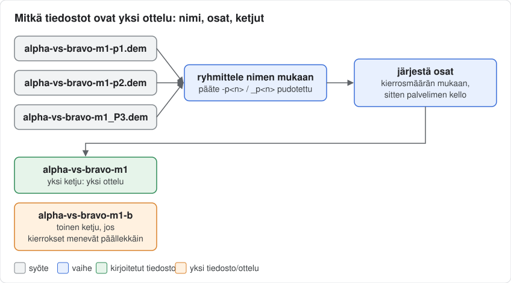

# Ottelun rakentaminen {#building-a-match}

Miten ottelu rakennetaan sen demo-osista: mitkä tiedostot kuuluvat yhteen, yksi
kello niiden kaikkien yllä, erät ja se, miten kukin voitettiin, joukkueet ja
niiden puolet sekä jokainen lämpökarttataulukon rivi tappoineen, tradeineen,
avauksineen, vahinkoineen, välähdyksineen ja taloudeneen. Koodi:
[`heat3d_cs2/match.py`](https://github.com/Holdi601/3DHeat-CS2/blob/main/heat3d_cs2/match.py).
Siitä lasketty tulostaulu on sivulla [Tilastot](statistics.md).

## Yleiskatsaus {#overview}

1. Jokainen ottelun nimen tiedosto luetaan ([Demon lukeminen](reading-demos.md)).
2. Kunkin tiedoston kaksoiset pelaajarivit (palautetut erät) ratkaistaan.
3. Tiedostot lajitellaan **ketjuiksi** - otteluiksi - ja kukin ketju asetetaan
   järjestykseen.
4. Jokainen osa sijoitetaan **ottelun kelloon**.
5. **Erät** löydetään kustakin osasta; myöhemmän osan kuvaus erästä korvaa
   aiemman.
6. **Pelaajat** ja **joukkueet** nimetään, ja kunkin erän puolet ja tulos
   annetaan joukkueen nimen mukaan. Kun puolet tiedetään, puoliajan pituus,
   pistoolierät ja kummankin puolen **osto** seuraavat.
7. **Rivit** rakennetaan: sijainnit, laukaukset, heitot, räjähdykset,
   pommin asetukset, purkamiset, tappo, kuolemat, osumat, sokaisut,
   räjähdykset.
8. Jokainen rivi saa leimaksi eränsä, vaiheensa, erän ajan, sen, voittiko sen
   puoli, ja puolensa oston; rivit, jotka eivät kuulu mihinkään erään, jätetään
   pois.

## Palautetut erät: yksi rivi pelaajaa kohden tikkiä kohti {#restored-rounds-one-row-per-player-per-tick}

Kun erä palautetaan varmuuskopiosta yhden tiedoston sisällä, demo sisältää
pelaajien vanhat ruumiit uusien rinnalla joitakin sekunteja: kaksi riviä yhdelle
pelaajalle samalla tikillä, toinen siitä, mihin mitätöity erä heidät jätti, ja
toinen palautetun erän synnyinpaikassa. Jokaiselle tällaiselle pelaajalle
kaksoistikkejä käydään läpi **taaksepäin** alkaen ensimmäisestä yksinäisestä
rivistä niiden jälkeen: jokaisella tikillä säilytetään ehdokas, joka on lähinnä
seuraavaa sijaintia, ja siitä tulee edellisen tikin vertailukohta. Jos yksinäistä
riviä ei ole niiden jälkeen, säilytetään viimeinen ehdokas. Siis kukin pelaaja
säilyttää rivin, joka johtaa siihen, minne hän menee seuraavaksi.

## Tiedoston elävä osa {#the-live-part-of-a-file}

Tiedoston **elävä alku** on sen viimeisen `round_announce_match_start`-tapahtuman
tikki, tai tikki 0, jos sitä ei ole (jaetun ottelun myöhempi osa ei yleensä
sisällä sitä). Kaikki elävän alun ennen oleva jätetään pois, samoin kaikki, jolla
on lippu `is_warmup_period`. Veitsierä tai uudelleenkäynnistys ennen ilmoitusta
jätetään siis pois; veitsierää, jota **ei** seuraa ottelun alun ilmoitus, ei
tunnisteta sellaiseksi (katso [Rajoitukset](limits.md)).

Tiedoston **erät** ovat `round_freeze_end`-tapahtumat elävästä alusta eteenpäin,
warmupin ulkopuolella, tunnistettuina niiden `total_rounds_played`-arvon mukaan
(pelin 0-pohjainen indeksi erälle, jota ollaan pelaamassa). Tiedostossa, jossa
niitä ei ole, ei ole eriä, eikä se kuulu mihinkään otteluun.

## Kello {#the-clock}

Ajat ovat sekunteina. Tiedoston sisällä aika lasketaan **tikeissä**: palvelimen
`game_time` ensimmäisellä näytteistetyllä tikillä, plus tikit siitä eteenpäin
jaettuna 64:llä. Palvelimen oma kello pysähtyy tauon ajaksi, vaikka tikit
jatkuvat; kellon kautta luettuna kaksi hetkeä pysäytetystä ottelusta saisivat
saman ajan.

Kullakin tiedostolla on *ensimmäinen kello* (aika sen elävällä alulla) ja
*viimeinen kello* (sen viimeisellä näytteistetyllä tikillä).

### Osat ja ketjut {#parts-and-chains}

Tiedostot, jotka on nimetty samaksi otteluksi ([Komennot](commands.md#which-files-are-one-match)),
lajitellaan ensin niiden ensimmäisen erän indeksin mukaan ja sitten ensimmäisen
kellon mukaan. Sitten kukin niistä järjestyksessä liittyy ensimmäiseen ketjuun,
jatkaakseen sitä, tai aloittaa uuden ketjun. Osa jatkaa ketjua, kun sen
ensimmäisen erän indeksi on vähintään ketjun viimeisen osan viimeisen indeksin
suuruinen, **ja** joko

- palvelimen kello jatkuu: sen ensimmäinen kello ei ole aiemmin kuin ketjun
  viimeisen kellon miinus 5 s; tai
- erälaskuri jatkuu: sen ensimmäisen erän indeksi on ketjun viimeinen indeksi tai
  sitä seuraava.

Ratkaisee laskuri, ja kello katkaisee tasapelit, koska palvelin, joka on
käynnistetty uudelleen erän palauttamiseksi, aloittaa kellonsa alusta, kun taas
kaksi eri ottelua samalla nimellä (samat joukkueet samalla kartalla kahdessa
tapahtumassa) saattavat saada päällekkäisiä erälaskureita. Ketjut järjestetään
sen mukaan, kuinka monta erää ne kattavat, eniten ensin; ensimmäinen säilyttää
ottelun nimen, muut kirjoitetaan muodossa `<nimi>-b`, `<nimi>-c` ja niin edelleen.

### Ottelun kello {#the-match-clock}

Ottelun nolla on ensimmäisen osan ensimmäinen kello: **ottelun aika 0 on
ensimmäisen tiedoston elävä alku**. Jokainen myöhempi osa sijoitetaan siihen:

- missä palvelimen kello jatkuu (sen ensimmäinen kello ei ole aiemmin kuin
  edellisen osan viimeinen kello miinus 5 s), palvelimen kelloa käytetään sellaisenaan;
- missä se on käynnistetty uudelleen, osa sijoitetaan seuraamaan **yhden
  sekunnin** päästä edellisen osan päättymisestä.

## Erät {#rounds}

Kullekin osan `round_freeze_end`-tapahtumalle (tikkijärjestyksessä) erän ikkuna
kestää siihen seuraavaan freeze endiin samassa osassa tai tiedoston loppuun asti.
Ikkunan sisällä erä **ratkeaa** ensimmäisellä näytteistetyllä tikillä, jossa pelin
tila näyttää `total_rounds_played` = erän indeksi + 1 ja `round_win_status` 1
(tasapeli), 2 (T voitti) tai 3 (CT voitti). Erä, jolla ei ole tällaista näytettä
ikkunassaan, katkesi tiedoston loppuun; sen numero menee ottelun
**keskeneräisten** listalle (ellei jokin toinen osa ole saanut erää valmiiksi).

| Erän kenttä | Lähde |
|---|---|
| `number` | indeksi + 1 (1-pohjainen, kuten peli laskee) |
| `start` | ottelun aika freeze timen päättyessä - pelaajat voivat liikkua |
| `end` | ottelun aika ensimmäisellä näytteellä, joka näyttää erän ratkenneen |
| `until` | ottelun aika seuraavalla `round_prestart`-tapahtumalla `end`in jälkeen, jos se on ikkunan sisällä; muuten ikkunan loppu tai tiedoston viimeinen tikki, kumpi tulee ensin (eikä koskaan ennen `end`iä) |
| `winner` | `T` tilalle 2, `CT` tilalle 3, tyhjä tilalle 1: tasapeli on ratkaistu, ilman voittajaa |
| `reason` | `round_win_reason` tuolla näytteellä, nimettynä alla olevasti |
| `score` | joukkueen nimi -> tähän erään päättyessä voitetut erät: kunkin puolen `team_rounds_total` ratkaisevalla näytteellä; jos demossa sitä ei ole, edellisen erän tulos plus yksi voittajalle |
| `sides` | joukkueen nimi -> `T` / `CT` tässä erässä |
| `equipment` | puoli -> sen **elossa olevien** pelaajien `current_equip_value`-arvojen summa ensimmäisellä näytteellä freeze endin hetkellä tai sen jälkeen |
| `buy` | puoli -> `pistol`, `eco`, `force` tai `full` ([Talous ja ostotyypit](#economy-and-buy-types)) |
| `plant` | ensimmäinen `bomb_planted` freeze endin jälkeen ja `end`iin asti, tai ei mitään |
| `exploded` | ottelun aika ensimmäisellä `bomb_exploded`-tapahtumalla kyseisen asetuksen jälkeen ja ennen seuraavaa freeze endiä, jos sellainen on (ei ottelun asiakirjassa; se ajoittaa `explode`-rivin) |

`reason` pelin `CSRoundEndReason`-koodista:

| Koodi | `reason` |
|---|---|
| 1 | `bomb` (kohde räjäytettiin) |
| 7 | `defuse` |
| 8, 9 | `elimination` (CT:t voittivat / T:t voittivat eliminoimalla) |
| 10 | `draw` |
| 12 | `time` (kohde pelastettiin) |
| 17, 18 | `surrender` |
| muu | `other` |

Kun useampi osa sisältää saman erän (indeksin perusteella), pidetään myöhemmän
osan versio. Erät luetellaan sitten indeksin mukaan. Ottelu, jonka ensimmäinen
erä ei ole erä 1, kirjaa puuttuvat numerot (`missing` ottelun asiakirjassa);
komentorivi kertoo *tallennettu erästä N alkaen*.

### Pommin asetus {#the-plant}

| Kenttä | Lähde |
|---|---|
| `site` | `A` tai `B`: pommialue, jolla asettaja peli sanoo seisoneen (`which_bomb_zone`, 1 A, 2 B); ilman sitä asettajan paikan nimi (`BombsiteA`, `BombsiteB`); ilman sitäkään kirjain, jonka saman tiedoston toinen asetus samalla alueella antoi (tapahtuman `site` on alueen entiteettinumero). Tyhjä, kun mikään ei kerro - ei koskaan numero. |
| `time` | sekuntia **erän sisällä** (freeze endistä lähtien), kuten tappo |
| `player`, `steamid` | asettaja |
| `x`, `y`, `z` | asettajan sijainti, pelin yksiköissä: missä pommi on |
| `place` | asettajan paikan nimi asetuksen hetkellä |

### Vaiheet {#the-phases}

Aika `start`ista `end`iin on erän **elävä** vaihe; `end`istä `until`iin sen
**jälkeinen** vaihe, jossa voittajat metsästävät ja häviäjät säästävät. Rivi
kuuluu siihen erään, jonka `[start, until)` sisältää sen ajan, ja on `after`, kun
sen aika on myöhempi kuin `end`. Freeze time on erien välissä eikä kuulu
kumpaankaan.

## Pelaajat ja joukkueet {#players-and-teams}

**Pelaaja** on jokainen, joka oli elossa ainakin kerran puolella (joukkue 2 tai
3), freeze timen ja warmupin ulkopuolella, elävän alun jälkeen. Valmentaja tai
kommentaattori joukkueen puolella ei ole koskaan elossa eikä ole pelaaja. Kukin
pelaaja tunnistetaan Steam-ID:llään; nimi on viimeksi nähty.

Pelaajan **joukkue** on klaanin nimi, jonka peli antoi hänen puolelleen
(`team_clan_name`), se jonka useimmin nähtiin - demo tyhjentää sen aivan lopussa.
Ottelu, joka pelattiin ilman klaanin nimiä, nimeää joukkueet puolen mukaan, jolta
ne aloittivat: `Started T` ja `Started CT`.

Kunkin erän **puolet** tulevat siitä, kuka oli millä puolella freeze endin ja
erän päättymisen välillä: kullekin puolelle annetaan joukkueen nimi, jonka useimmat
sen pelaajat kantavat. Ottelun `teams`-lista on ilmestymisjärjestyksessä, erä
erältä, T-puoli ennen CT-puolta; yleensä joukkue, joka aloitti T:nä, on ensin.

## Rivit {#the-rows}

Jokainen sijaintinäyte ja jokainen tapahtuma tulee yhdeksi riviksi
[lämpökarttataulukkoon](output-table.md). Pelaajat ovat puolella vain, kun heidän
`team_num` on 2 tai 3.

### Sijainnit {#positions}

Elossa olevien pelaajien näytteistä puolella, freeze timen ja warmupin
ulkopuolella, elävän alun jälkeen: sijainti, katsesuunta, terveys, panssari,
raha, varustearvo, kädessä oleva ase, paikka.

Katsesuunta on yksikkövektori pelin koordinaatistossa:
`(cos pitch * cos yaw, cos pitch * sin yaw, -sin pitch)` - pelin pitch on
positiivinen alaspäin katsottaessa, joten alaspäin katsominen antaa negatiivisen Z:n.

Kädessä oleva ase on `active_weapon_name` niin kuin peli sen nimeää, paitsi että
nimi, joka sisältää `Knife`, `Bayonet`, `Karambit` tai `Daggers`, muuttuu
muotoon `Knife`.

### Laukaukset ja heitot {#shots-and-throws}

`weapon_fire`-tapahtumasta, ampujan sijainnista. Veitset (`knife`, `bayonet` aseen
tunnisteessa) ja C4 jätetään pois. Kranaatit (`smokegrenade`, `flashbang`,
`hegrenade`, `molotov`, `incgrenade`, `decoy`) ovat **heitto**-rivejä, kaikki muu
**laukaus**-rivejä. Ase nimetään niin kuin peli sen näyttää (alla).

### Kranaattien räjähdykset {#grenade-detonations}

| Tapahtuma | Rivi | `weapon` |
|---|---|---|
| `smokegrenade_detonate` | `smoke` | Smoke Grenade |
| `flashbang_detonate` | `flash` | Flashbang |
| `hegrenade_detonate` | `he` | High Explosive Grenade |
| `inferno_startburn` (molotov ja incendiary) | `molotov` | Molotov |
| `decoy_detonate` | `decoy` | Decoy Grenade |

Sijainti on **missä kranaatti räjähti** (tapahtuman `x`, `y`, `z`); pelaaja ja puoli
ovat heittäjän. Demo ei nimeä paikkaa kranaatille, vain pelaajille, joten `place`
jää tyhjäksi: rivi ei väitä paikkaa, jossa se ei ollut. Heittäjän paikka sillä
hetkellä säilytetään nimellä `throwerPlace`.

### Pommin asetukset ja purkamiset {#plants-and-defuses}

`plant`- ja `defuse`-rivit pelaajan sijainnissa, aseena `C4 Explosive`. Asetettu
pommi, joka räjähti, saa **explode**-rivin: asetuksen sijainnissa, ajassa
`bomb_exploded`, asettaja pelaajana (Steam-ID:llään), puoli `T`, erän T-joukkue
joukkueena ja asetuksen paikka. Siihen kuuluu myös pommi, joka räjähtää sen
jälkeen, kun T:t ovat jo voittaneet eliminoimalla. Jos demossa ei ole
`bomb_exploded`-tapahtumaa, pommin voittama erä (`reason` = `bomb`), jossa on
asetus, saa rivin erän `end`issä.

### Tappot ja kuolemat {#kills-and-deaths}

Jokainen `player_death` erässä antaa yhden **tappotietueen** (ottelun `kills`-taulukko):

| Kenttä | Mikä |
|---|---|
| attacker, victim, assister | nimet, Steam-ID:t, puolet; tappaja on tyhjä maailman takia (putoamisvahinko, pommi) |
| `weapon` | tapahtuman ase nimettynä niin kuin peli sen näyttää |
| `headshot` | tapahtuman lippu |
| `wallbang` | `penetrated` > 0 |
| `throughSmoke` | `thrusmoke` |
| `flashAssist` | `assistedflash` |
| `noscope`, `attackerBlind` | tapahtuman liput (`noscope`, `attackerblind`); `kill`- ja `death`-rivien sarakkeita sekä ottelun asiakirjan kills-kohdassa |
| `suicide` | tappaja ja uhri ovat sama pelaaja: esimerkiksi oma kranaatti |
| `teamkill` | tappaja ja uhri samalla puolella, tappajan kanssa, eikä itsemurha |
| `opening` | erän ensimmäinen vihollisen tappo (alla) |
| `traded`, `trade` | alla |
| sijainnit | tappajan ja uhrin sijainti ja paikka |

Jokaisesta tietueesta taulukko saa **death**-rivin uhrin sijainnissa (jokainen
kuolema, myös maailman, joukkuetappojen ja itsemurhien) ja - vihollisen tappamille
(tappaja on olemassa, ei joukkuetappo, ei itsemurha) - **kill**-rivin tappajan
sijainnissa.

**Avaus.** Erän ensimmäinen vihollisen tappo elävänä aikana on sen avausduelli.
Joukkuetappo, itsemurha tai kuolema maailmalle ennen sitä ohitetaan, joten avaus
on yhä erän ensimmäinen duelli; erä, jossa ei ole vihollisen tappoa elävänä
aikana, ei saa avausta.

**Traded** ja **trade**. Vihollisen tappama kuolema on **traded**, kun sen tappaja
tapetaan uhrin puolen jonkun toimesta **5 sekunnin** sisällä sen jälkeen (yli 0 ja
enintään 5 s myöhemmin, samassa erässä); ensimmäinen tällainen tappo on
**trade**-tappo. Taulukossa `kill`-rivin `traded`-sarake on 1 trade-tapossa; `death`-rivin
on 1 kuolemalle, joka kostettiin. Jälkeisen vaiheen tapot lasketaan mukaan.

### Vahinko {#damage}

`player_hurt`-tapahtumasta, vain **vihollisten** välillä (molemmat puolella, eri
puolilla). Vahinko on terveyttä, joka oikeasti **menetettiin**: kullekin uhrille
kussakin erässä terveys alkaa 100:sta; kukin osuma lasketaan `min(dmg_health,
terveys ennen)`, ja tapahtuman `health` (mitä jäi) on seuraavan osuman "ennen".
137 vahingon päälaukaus 40 terveydellä olevaan pelaajaan lasketaan 40:ksi, kuten
pelin tulostaulu laskee sen. Osumat kohteista `hegrenade`, `inferno`, `molotov` ja
`incgrenade` ovat **apuvahinkoa** (utility). Jokainen osuma on **hurt**-rivi uhrin
sijainnissa, tekijä merkittynä `other`. Joukkuetoverien vahinko ja itsevahinko eivät
ole taulukossa eikä tilastoissa.

### Sokaisut {#flashes}

`player_blind`-tapahtumasta, vain **vihollisten** (ei joukkuetovereiden, eikä
valmentajan tai kommentaattorin, joka katsoo): yksi **blind**-rivi jokaiselle
sokaistulle pelaajalle, sokaistun pelaajan sijainnissa, välähdyttäjä merkittynä
`other`, sokaisuaika sekunteina kenttänä `duration`. Jokainen kesto säilytetään;
tilastoihin lasketaan vain vähintään yhden sekunnin sokaisut.

## Aseiden nimet {#weapon-names}

Tapahtuman aseen tunniste (`ak47`, `weapon_ak47`, `knife_karambit`) näytetään
niin kuin peli sen nimeää pelaajien omassa `active_weapon_name`-kentässä, joten
tappoaseen ja kädessä olevan aseen nimi ovat samat: `ak47` -> `AK-47`, `m4a1` ->
`M4A4`, `m4a1_silencer` -> `M4A1-S`, `hkp2000` -> `P2000`, `taser` -> `Zeus x27`,
`inferno` ja `molotov` -> `Molotov`, `incgrenade` -> `Incendiary Grenade`,
`c4` ja `planted_c4` -> `C4 Explosive`, `world` -> `World`, ja niin edelleen jokaiselle
aseelle ja kranaatille (`WEAPONS`-taulukko tiedostossa `match.py`). Kaikki, jonka
tunnisteessa on `knife` tai `bayonet`, on `Knife`. Tunniste, jota taulukossa ei ole,
säilytetään sellaisenaan.

## Talous ja ostotyypit {#economy-and-buy-types}

Freeze timen lopussa kunkin puolen varustearvo lasketaan yhteen sen elossa olevilta
pelaajilta ensimmäisellä näytteellä siitä eteenpäin ja jaetaan pelaajien määrällä:

| Erä | Keskimääräinen varustus pelaajaa kohden | `buy` |
|---|---|---|
| pistooli-erä (kunkin säännöllisen puoliajan ensimmäinen) | mikä tahansa | `pistol` |
| muu | alle 1 500 $ | `eco` |
| muu | 1 500 $ - alle 4 000 $ | `force` |
| muu | 4 000 $ tai enemmän | `full` |

Pistooli-erät seuraavat puoliaikaa, jolla ottelu pelattiin, eivät kiinteää
formaattia. Puoliaika päättyy, kun puolet vaihtuvat ensimmäisen kerran kahden
peräkkäisen, molemmat säännöllisen pelin erän välillä: sen pituus (`halfLength`
ottelun asiakirjassa) on vaihtoa edeltävä erä - 12 24 erän formaatissa, 15 30 erän
formaatissa. Erä 1 ja puoliajan jälkeinen erä ovat pistooli-eriä. Erä on
jatkoaika, kun pelin jatkoajan laskuri (`m_nOvertimePlaying`) on yli 0 sen freeze
endissä; demoissa, joissa tällaista laskuria ei ole, jokainen erä kahden puoliajan
jälkeen on sellainen. Jatkoajan puoliajat alkavat palvelimen asettamalla rahalla
eikä niissä ole pistooli-erää, vaikka puolet vaihtuvat niissäkin. Nauhoitus, joka ei
koskaan näytä puoliajan vaihtoa - se alkaa sen jälkeen tai päättyy ennen sitä -
jättää puoliajan tuntemattomaksi, ja vain erä 1 on pistooli-erä.

## Leimaus ja järjestys {#labelling-and-order}

Lopuksi jokainen rivi saa:

- `match` - ottelun nimi; `map` - demon otsikon kartta;
- `round` ja `roundId` (`<match> #NN`, kaksi numeroa);
- `phase` - `live` tai `after`;
- `roundTime` - sekunteja siitä, kun erän freeze time päättyi;
- `won` - 1, jos rivin puoli voitti erän, 0 jos ei, tyhjä riville, jolla ei ole puolta;
- `buy` - rivin puolen osto siinä erässä;
- `team` - rivin pelaajan joukkue Steam-ID:n mukaan.

Rivit, joiden aika ei kuulu mihinkään erään - ennen ensimmäisen erän freeze endiä,
freeze timen aikana, viimeisen erän jälkeen - jätetään pois. Rivit järjestetään
ajan mukaan ja saman ajan sisällä tapahtuman nimen mukaan.
