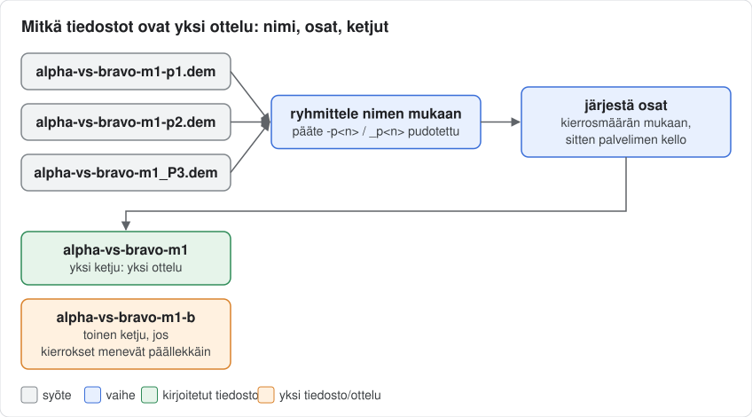

# Komennot {#commands}

Uusi komentorivin kanssa? Lue ensin [Ennen kuin aloitat](before-you-start.md).
Kirjoita nämä terminaaliin, joka on avattu kansioon, jonne purit tai kloonasit
ohjelman; `<...>` ovat paikanpitäjiä, ja polku, jossa on välilyöntejä, laitetaan
lainausmerkkien sisään.

```text
python -m heat3d_cs2 demos <demo files or folders> -o <folder> [--every 8] [--jobs N] [--map TEXT] [--force] [--no-bulk] [--loose]
python -m heat3d_cs2 map <map name | path to its .vpk> -o <file.glb> [--game FOLDER] [--source2viewer EXE]
python -m heat3d_cs2 scoreboard <match.3dheat | match.json>
```

`python -m heat3d_cs2 --help` ja `python -m heat3d_cs2 <verb> --help` listaavat
samat valinnat; [Komentoviite](../cli-reference.md) näyttää ne kaikki. Jokainen
käynnistys ajaa ensin julkaisutarkistuksen, joka on kuvattu sivulla
[Päivitykset](updates.md) (pois päältä `HEAT3D_NO_UPDATE=1`:llä).

Koodi: [`heat3d_cs2/cli.py`](https://github.com/Holdi601/3DHeat-CS2/blob/main/heat3d_cs2/cli.py).

## `demos` - demot taulukoiksi ja ottelun asiakirjoiksi {#demos---demos-into-tables-and-match-documents}

```powershell
python -m heat3d_cs2 demos D:\Demos\event -o out
python -m heat3d_cs2 demos alpha-vs-bravo-m1-p1.dem alpha-vs-bravo-m1-p2.dem -o out
python -m heat3d_cs2 demos D:\Demos -o out --map final --jobs 4
```

| Argumentti | Oletus | Tekee |
|---|---|---|
| `paths` (yksi tai useampi) | - | demotiedostot ja kansiot. Tiedosto otetaan, kun sen pääte on `.dem` (mikä tahansa kirjainkoko). Kansiosta etsitään **rekursiivisesti** tiedostot, jotka päättyvät `.dem`:iin, mikä tahansa kirjainkoko, lajiteltuina. Pakatuja demoja (`.dem.zst`, `.dem.bz2`, arkistot) ei lueta: pura ne ensin. |
| `-o`, `--out` | pakollinen | kansio, johon kirjoitetaan; luodaan tarvittaessa |
| `--every N` | `8` | näytteistä jokaisen pelaajan joka *N*:s tikki. CS2-demot kulkevat 64 tikkiä sekunnissa, joten 8 on kahdeksan näytettä sekunnissa, 4 on kuusitoista, 64 on yksi. Tapahtumat luetaan aina niiden omalla tikillä, *N*:stä riippumatta. |
| `--jobs N` | `0` = puolet prosessorin ytimistä | kuinka monta ottelua muunnetaan yhtä aikaa, kukin omassa prosessissaan. Ei koskaan alle 1, ei koskaan enempää kuin muunnettavia otteluita on. |
| `--map TEXT` | - | vain ottelut, joiden **nimi** sisältää *TEXT*-tekstin, kirjainkoolla välittämättä (`--map final`). Suodatus tehdään tiedostonimen perusteella, ei sen kartan perusteella, jonka demo osoittautuu sisältävän. |
| `--force` | pois | muunna jo kirjoitetut ottelut uudelleen, korvaten ne |
| `--loose` | pois | pidä kukin ottelu erillisinä tiedostoina - taulukko, `.match.json` ja sivutiedostot - sen sijaan, että ne pakataan yhteen `.3dheat`-säiliöön. Katso [Yksi tiedosto per ottelu](output-container.md). |
| `--container` | päällä | pakkaa kukin ottelu yhdeksi `.3dheat`-tiedostoksi; oletus, joten tämä on olemassa vain selkeyden vuoksi |
| `--no-bulk` | pois | jättää entiteettivirran, pelaajien komennot ja animaatiovirran pois paketti-sivutiedostosta - yli puolet demon koosta, vaikka pakattuna. Ottelun asiakirjan itsetarkistus laskee ne silloin `lost`-kohtaan nimen mukaan. |


### Mitkä tiedostot ovat yksi ottelu {#which-files-are-one-match}



Ottelun nimi on demotiedoston nimi ilman päätettä ja ilman osan tunnistetta:
`-p<numeroita>` tai `_p<numeroita>` lopussa, kirjainkoolla välittämättä. Joten
`alpha-vs-bravo-m1-p1.dem`, `alpha-vs-bravo-m1-p2.dem` ja
`alpha-vs-bravo-m1_P3.dem` ovat saman ottelun osia, `alpha-vs-bravo-m1`.
Tiedostot ryhmitellään pelkän nimen perusteella - kaksi samannimistä tiedostoa eri
kansioissa ryhmitellään myös yhteen.

Tunniste ei kerro järjestyksestä: `-p2` voi olla aiempi puoliaika. Osat
järjestetään niiden sisältämien erien määrän ja sitten palvelimen kellon mukaan, ja
ryhmä, joka osoittautuu kahdeksi eri ottelusi (esimerkiksi samat joukkueet samalla
kartalla kahdessa tapahtumassa), jaetaan **ketjuiksi**: eniten eriä sisältävä ketju
kirjoitetaan nimen itsensä alle, seuraava nimellä `<nimi>-b`, sitten `<nimi>-c`, ja
niin edelleen. Tiedosto, jossa ei ole yhtään erää (pelkkä warmup, tauko), ei kuulu
mihinkään ketjuun. Miten ketjut löydetään, on kuvattu sivulla
[Ottelun rakentaminen](building-matches.md#osat-ja-ketjut).

### Mitä kirjoitetaan {#what-is-written}

Kullekin ottelulle kansioon, joka on nimetty demon otsikon kartan mukaan
(`unknown`, jos otsikossa ei ole nimeä), yksi `.3dheat`-tiedosto:

```text
out/
  de_x/
    alpha-vs-bravo-m1.3dheat
    alpha-vs-bravo-m2.3dheat
  de_y/
    ...
```

Testien synteettisessä kahden erän demossa:


Valinnalla `--loose` kukin ottelu on taulukko, sen ottelun asiakirja ja neljä
sivutiedostoa vierekkäin ([Yksi tiedosto per ottelu](output-container.md)):


Lämpökartta koskee yhtä karttaa, joten yhden kansion lataaminen katselimeen on
yhden kartan otteluiden lataamista. Katso [Lämpökarttataulukko](output-table.md) ja
[Ottelun asiakirja](output-match-json.md).

### Mitä ohitetaan {#what-is-skipped}

Ennen kuin mitään luetaan, listataan jokainen `*.3dheat` kaikkialta `--out`-kansiosta
(säiliö kirjoitetaan kokonaan tai ei lainkaan), ja jokainen `*.parquet`, jonka vieressä
on sen ottelun asiakirja (`<nimi>.match.json`). Ottelu, jonka nimi on yhtä kuin jokin
näistä tiedostonimistä (ilman päätettä), ohitetaan, ellei `--force` ole annettu.
Taulukko ilman ottelun asiakirjaa - ajo, joka pysähtyi kahden kirjoituksen välissä -
ei ole laskettu, joten se ottelu muunnetaan uudelleen. Tarkistus tehdään vain nimen
perusteella: ottelu, joka muunnettiin eri karttakansioon tai eri `--every`-arvolla,
lasketaan yhä tehdyksi. Kun mitään ei ole jäljellä:

```text
nothing to do: no demos found, or every match already written (--force redoes them)
```

### Mitä tulostetaan {#what-is-printed}

Ensin työn määrä, sitten yksi rivi kullekin ottelulle, kun se valmistuu (valmistumisjärjestyksessä,
ei tiedostojen järjestyksessä):

```text
3 match(es), 3 at a time
alpha-vs-bravo-m1: de_x, 21 rounds (Alpha 13 Bravo 8), 412,377 rows, lost 0
alpha-vs-bravo-m2: de_y, 30 rounds (Bravo 16 Alpha 14), 598,104 rows, 1 incomplete round(s) left out, lost 0
alpha-vs-bravo-m3: de_y, 18 rounds (Alpha 13 Bravo 5), 330,981 rows, recorded from round 3, lost 1,204,331 (svc_PacketEntities, svc_UserCmds, DEM_AnimationData)
```

(Luvut ovat havainnollistavia.) Tulos on viimeisen erän tulos, joukkue kerrallaan
siinä järjestyksessä, jossa ottelun asiakirja luettelee ne. *incomplete round(s) left
out* laskee erät, jotka demo katkaisi ennen kuin ne ratkesivat; *recorded from round N*
kertoo, että nauhoitus alkaa myöhään; *lost* on ottelun asiakirjan itsetarkistus - kuinka
monta demon kohtaa meni hukkaan, ja minkälaisia (`--no-bulk` tekee bulkista hukkaan
menevää). Ottelu, joka ei tuota mitään, kertoo syyn:

```text
alpha-vs-bravo-m4: no round in 1 file(s) - nothing written
alpha-vs-bravo-m4-b: no complete round in 1 file(s) - nothing written
```

Yhden ottelun virhe ei pysäytä muita; se tulostetaan muodossa
`<nimi>: failed - <error>`.

### Poistumiskoodi {#exit-code}

`0`, kun jokainen ottelu muunnettiin (tai ei ollut mitään tehtävää), `1`, kun vähintään
yksi epäonnistui.

### Kuinka kauan kestää {#how-long-it-takes}

Jokainen ottelu luetaan ja rakennetaan työprosessissa. Kansio, jossa on muutama sata
demoa, vie minuutteja oletusarvoisella `--jobs`-asetuksella. Muisti per työ kasvaa
ottelun pituuden ja pienemmän `--every`-arvon mukana: jokainen työprosessi pitää
muistissaan jokaisen näytteistetyn pelaajarivin omasta ottelustaan (suunnilleen kymmenen
pelaajaa kertaa 64 / *N* riviä nauhoitussekunnissa) ennen kirjoittamista.

Sivutiedostot vievät enemmän aikaa kuin taulukko: jokainen parserin lukema ominaisuus
luetaan jokaisella tikillä, ikkuna tikkejä kerrallaan (noin kaksi minuuttia
40 minuutin demolle, enintään noin 3 GB muistia per työ), ja sen jälkeen demo käydään
vielä kerran läpi kehyksien ja viestien vuoksi.

## `map` - kartan geometria `.glb`-tiedostona {#map---a-maps-geometry-as-glb}


```powershell
python -m heat3d_cs2 map <map> -o out/<map>/<map>.glb
python -m heat3d_cs2 map <map> -o <map>.glb --game "D:\Games\Steam\steamapps\common\Counter-Strike Global Offensive"
python -m heat3d_cs2 map "D:\maps\<map>.vpk" -o <map>.glb --source2viewer C:\Tools\Source2Viewer-CLI.exe
```

| Argumentti | Oletus | Tekee |
|---|---|---|
| `name` | - | kartan nimi (kuten `de_x`), tai polku sen `.vpk`-tiedostoon. Polku, joka päättyy `.vpk`:hon ja on olemassa, käytetään sellaisenaan; muu haetaan tiedostonimellä asennetusta pelistä. |
| `-o`, `--out` | pakollinen | kirjoitettava `.glb`; sen kansio luodaan tarvittaessa |
| `--game FOLDER` | Steamin kirjastot | CS2:n asennuskansio (se, jossa on `game\csgo`), kun Steam ei tiedä sitä. `--game`:n kanssa haetaan vain tästä kansiosta. |
| `--source2viewer EXE` | `HEAT3D_SOURCE2VIEWER`, sitten `PATH` | Source2Viewerin komentorivisuoritettava tiedosto |

Onnistuneesta ajosta tulostetaan:

```text
out/de_x/de_x.glb: de_x, 412,880 triangles (151,204 ground) in 14 parts
```

(luvut havainnollistavia). Kun `.glb` kirjoitetaan kartan taulukoiden viereen
(`out/<map>/<map>.glb`), kartan data ja geometria ovat samassa kansiossa. Miten
vienti toimii: [Kartan vienti](map-export.md).

Virheet, jokainen tulostettuna muodossa `error: ...` ja poistumiskoodilla `2`:

| Viesti | Tarkoittaa |
|---|---|
| `no de_x.vpk found in an installed CS2 - pass --game <CS2 folder> or the .vpk path` | karttaa ei ole millään löydetyssä Steam-kirjastossa, tai nimi on väärin |
| `Source2Viewer-CLI not found: ...` | mikään kolmesta, `--source2viewer`, `HEAT3D_SOURCE2VIEWER` tai `PATH`, ei antanut olemassa olevaa tiedostoa |
| `Source2Viewer did not export de_x's collision mesh:` ja sen perässä lopun sen tulosteesta | se epäonnistui, tai se ei kirjoittanut `.glb`-tiedostoa |
| `de_x's collision mesh has nothing but clip brushes` | leikkeitä ja taivasta pois jätettyään ei jäänyt mitään |

## `scoreboard` - ottelu tekstinä {#scoreboard---a-match-as-text}

```bash
python -m heat3d_cs2 scoreboard out/de_x/alpha-vs-bravo-m1.3dheat
python -m heat3d_cs2 scoreboard out/de_x/alpha-vs-bravo-m1.match.json   # after demos --loose
```

Tulostaa ottelun tulostaulun sen [ottelun asiakirjasta](output-match-json.md),
avaamatta katselinta. Se lukee asiakirjan [`.3dheat`](output-container.md)-säiliön
sisältä tai erillisestä `<match>.match.json`-tiedostosta.
Testien synteettisessä kahden erän demossa:


```text
alpha-vs-bravo-m1 - de_test  Alpha 2  Bravo 0

Alpha
player                 K   D   A  +/-    ADR   KAST   HS%  OK-OD  clutch
ash                    1   0   0   +1   50.0 100.0%    0%   0-0     1/1
ace                    1   1   0   +0   50.0 100.0%  100%   1-0     0/0

Bravo
player                 K   D   A  +/-    ADR   KAST   HS%  OK-OD  clutch
ben                    1   1   0   +0   50.0 100.0%    0%   0-0     0/1
bob                    0   1   0   -1    0.0 100.0%    0%   0-1     0/0

rounds  1:TK 2:TB
```

- Ensimmäinen rivi: ottelun nimi, kartta ja kunkin joukkueen lopputulos.
- Taulukko kullekin joukkueelle ottelun asiakirjan `teams`-järjestyksessä; pelaajat
  ottelun asiakirjan järjestyksessä (tappojen miinus kuolemat, sitten tapot, parhain
  ensin). Nimet katkaistaan 19 merkkiin.
- Sarakkeet: **K** tapot, **D** kuolemat, **A** avustukset *mukaan lukien* välähdysavustukset,
  **+/-** tappoja miinus kuolemia, **ADR**, **KAST** (%), **HS%** (pyöristetty kokonaiseen
  prosenttiin), **OK-OD** avaustapot - avauskuolemat, **clutch** voitetut clutchit / pelatut
  clutchit. Määritelmät: [Tilastot](statistics.md).
- Erärivi: `<erä><voittava puoli><miten>`, jossa **B** pommi räjähti, **D** purettiin,
  **K** eliminointi, **T** aika loppui, ja **?** kaikelle muulle (tasapeli, antautuminen,
  muu). Tasapelissä ei ole voittavaa puolta: `<erä>:?`.

Tiedosto, joka ei ole kelvollista JSONia tai jota ei löydy, pysähtyy virheeseen; JSON-asiakirja,
josta puuttuvat ottelun asiakirjan kentät, aiheuttaa Python-virheen (sitä ei tarkisteta
pidemmälle).
