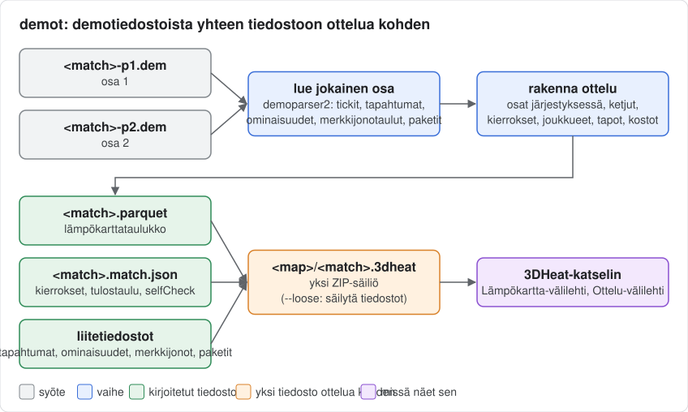

# 3DHeat CS2 {#dheat-cs2}

**Mitä se on?** Counter-Strike 2 voi tallentaa ottelusta tallenteen, nimeltään
*demo*. Tämä työkalu muuttaa demon tiedostoiksi, jotka 3DHeat-katselin näyttää 3D:nä:
missä kaikki seisoivat, kuolivat, heittivät ja asettivat pommin, kierros kerrallaan. Se voi myös
muuttaa CS2-kartan 3D-malliksi, jolle nämä näytetään.

**Miksi käyttäisin sitä?** Oman otteluiden tarkasteluun, useiden saman kartan otteluiden
asettamiseen toistensa päälle yhdeksi lämpökartaksi, sekä ottelutilastoihin, kuten ADR (keskimääräinen
vahinko kierrosta kohden) ja KAST (kierrosten osuus, joissa pelaaja tappoi, avusti, selvisi tai
kostettiin).

**Esimerkki:** `alpha-vs-bravo-m1.dem` sisään, `out/de_x/alpha-vs-bravo-m1.3dheat` ulos
(`de_x` on keksitty kartan nimi).



Tarkemmin: 3DHeat CS2 muuttaa **Counter-Strike 2 -demot** lämpökarttataulukoksi ja ottelutiedostoksi
jokaista ottelua kohden, ja **CS2-kartan** kentän geometriaksi. Tulokset on tehty
[3DHeat](https://holdi601.github.io/3DHeat/)-telemetriakatselimelle
([lähdekoodi](https://github.com/Holdi601/3DHeat)), mutta ne ovat tavallisia tiedostoja –
Parquet, JSON ja binäärinen glTF – joita mikä tahansa muu ohjelma voi lukea.

Se on pieni Python-paketti, `heat3d_cs2`, joka ajetaan komentoriviltä. Se lukee demot levyltä
(ei lataa mitään) [demoparser2](https://github.com/LaihoE/demoparser)-kirjastolla, ja vie kartat
asennetusta pelistä Source2Viewerin komentorivijulkaisulla
([ValveResourceFormat](https://github.com/ValveResourceFormat/ValveResourceFormat)).

## Pikaohje {#quick-start}

Uusi komentorivin kanssa? Lue ensin [Ennen aloittamista](before-you-start.md).

```bash
pip install -r requirements.txt
python -m heat3d_cs2 demos <demo files or folders> -o out   # jokainen niiden ottelu
python -m heat3d_cs2 map <map> -o out/<map>/<map>.glb       # kartta asennetusta pelistä
python -m heat3d_cs2 scoreboard out/<map>/<match>.3dheat    # ottelun tulostaulu tekstinä
```

Pitäisi näkyä `1 match(es), 1 at a time ...` ja sitten yksi rivi ottelua kohden
(katso [Komennot](commands.md#what-is-printed)).

`demos` kirjoittaa kutakin ottelua kohden yhden tiedoston kansioon, joka on nimetty kartan mukaan:
`out/<map>/<match>.3dheat`, [`.3dheat`-säiliö](output-container.md) – katselimen yhden ottelun
yhden tiedoston muoto ([määritys](https://holdi601.github.io/3DHeat/container.html)).
Se sisältää nämä osat; `--loose` kirjoittaa ne erillisinä tiedostoina:

| Osa | Mitä se kantaa | Ladataan katselimen |
|---|---|---|
| `<match>.parquet` (rooli `table`) | jokainen elävä pelaaja kahdeksan kertaa sekunnissa tilansa kanssa (terveys, raha, välähdys, tähtäys, vyöhyke, varusteet ...), ja jokainen tapahtuma siinä, missä se tapahtui (tappo, kuolema, vahinko, laukaus, heitto, kranaatin räjähdykset, sokaisu, pommin asetus, purku, räjähdys ja kierroksen loppu pelaajakohtaisesti sen kanssa, mitä kierros maksoi hänelle), yksi rivi kumpikin | Lämpökartta-välilehti |
| `<match>.match.json` (rooli `match`, ottelun asiakirja) | joukkueet, tulos, jokainen kierros (voittaja, miten, talous, pommi, tapot järjestyksessä, clutchit, selviytyjät) ja jokaisen pelaajan tulostaulun rivi | Ottelu-välilehti |
| `<match>.events/props/strings/packets.parquet` | kaikki muu, mitä demo sisältää, kokonaisena (liitetiedostot) | säilytetään täydellisyyden vuoksi |

`map` kirjoittaa `<map>.glb`: kartan törmäysmeshin – lattiat, seinät, laatikot, ilman koristeita –
jaettuna maahan ja rakenteeseen, samassa koordinaatistossa ja yksiköissä kuin taulukot, joten se
osuu täsmälleen lämpökartan alle (Tausta / kenttä -paneeli).

## Dokumentaation kartta {#map-of-this-documentation}

| Sivu | Mitä se kattaa |
|---|---|
| [Ennen aloittamista](before-you-start.md) | Python, pääte, paikanpitäjät, miltä onnistuminen ja yleiset virheet näyttävät |
| [Asennus](installing.md) | Python, paketit, Source2Viewerin CLI, missä CS2:n on oltava |
| [Komennot](commands.md) | `demos`, `map`, `scoreboard`: jokainen asetus, mitä tulostuu, poistumiskoodit |
| [Demon lukeminen](reading-demos.md) | mitä demotiedostosta luetaan: näytteistetyt tickit, pelaajan ominaisuudet, pelisäännöt, tapahtumat |
| [Ottelun rakentaminen](building-matches.md) | osat ja ketjut, ottelukello, kierrokset, joukkueet ja puolet, rivit, tapot, kostot, avaukset, vahinko, välähdykset, talous |
| [Tilastot](statistics.md) | tulostaulu: K/D/A, ADR, KAST, HS%, avaukset, kostot, monitapot, clutchit, apuvälineet, välähdykset |
| [Lämpökarttataulukko](output-table.md) | Parquet-tiedosto: jokainen sarake, sen tyyppi, mitkä tapahtumat sen täyttävät, `heat3d`-alatunnisteen vihjeet, akselit |
| [Ottelun asiakirja](output-match-json.md) | `.match.json`-asiakirja kenttä kerrallaan |
| [Yksi tiedosto ottelua kohden](output-container.md) | `.3dheat`-säiliö, jonka `demos` kirjoittaa oletuksena, `--loose` |
| [Karttavienti](map-export.md) | miten kartan törmäysmesh viedään, kehys, solmujen nimeäminen, yksiköt |
| [Käyttö 3DHeatin kanssa](using-with-3dheat.md) | taulukoiden, ottelun asiakirjojen ja karttojen lataaminen katselimen Lämpökartta- ja Ottelu-välilehdille |
| [Rajoitukset](limits.md) | mitä oletetaan, mitä ei käsitellä, mitä ei ole tarkistettu |
| [Päivitykset](updates.md) | julkaisutarkistus käynnistyksessä ja `python -m heat3d_update` |
| [Kehitys](development.md) | koodin rakenne, testit, synteettinen demokiinnitys |
| [Komentoviite](../cli-reference.md) | jokaisen komennon `--help`, luotu koodista |
| [Ylläpito](maintaining.md) | julkaisun tarkistuslista näille sivuille |

## Mitä sitä vastaan on tarkistettu {#what-it-is-checked-against}

Demot, joita löytyy maailmalta, eivät ole yksi siisti tiedosto per ottelu. Muunnin käsittelee ottelun,
joka on jaettu tiedostoihin missä tahansa järjestyksessä, palvelimen, joka käynnistettiin uudelleen
kesken ottelun, kaksi eri ottelua samalla nimellä, kierrokset, jotka palautettiin varmuuskopiosta,
tallenteen, joka alkaa myöhään tai loppuu aikaisin, tauot ja valmentajat joukkueen puolella –
katso [Ottelun rakentaminen](building-matches.md). Suuren turnausdemokokoelman yli tarkistettuna:
jokaisessa ottelussa tulos seuraa kierrosten voittajia, kunkin puolen tapot ovat toisen puolen kuolemia,
ja jokainen kierros alkaa viidellä viitä vastaan.

## Mitä demoja tähän kannattaa antaa {#what-to-point-it-at}

Omien otteluidesi demot, demot, jotka latasit käsin turnaussivustolta, tai demot API:sta, johon sinulla
on pääsy. Demo on tallenne, jonka sisältö kuuluu sen julkaisijalle ja järjestäjille: käytä tulosta omaan
analyysiisi, äläkä jaa demoja tai niistä johdettua dataa edelleen. Työkalu lukee demot levyltä eikä
lataa yhtään, eikä mitään pelistä toimiteta sen mukana: ei pelin tiedostoja, ei pelin koodia, ei
DLL-tiedostoja.

3DHeat CS2 ei ole sidoksissa Valveen eikä Valven hyväksymä. Counter-Strike 2 sekä siihen liittyvät nimet
ja tavaramerkit kuuluvat omistajilleen. Oikeudenhaltijat: avatkaa issue osoitteessa
[github.com/Holdi601/3DHeat-CS2/issues](https://github.com/Holdi601/3DHeat-CS2/issues) - vastaamme
nopeasti ja poistamme pyynnöstä mitä tahansa.

## Osa 3DHeatia {#part-of-3dheat}

3DHeat CS2 on yksi 3DHeat-katselimen ympärillä olevista ilmaisista työkaluista. Jokaisella on oma
repositorionsa, julkaisunsa ja lisenssinsä:

| Työkalu | Mitä se tekee | Dokumentaatio |
|---|---|---|
| [3DHeat](https://github.com/Holdi601/3DHeat) | katselin: lämpökartat, kilpa-analyysi ja ottelun tarkastelu 3D:nä | [sivusto](https://holdi601.github.io/3DHeat/) |
| [GameFiles](https://github.com/Holdi601/3DHeat-GameFiles) | radat ja kentät pelien toimittamista tiedostoista 3D-malleina | [sivusto](https://holdi601.github.io/3DHeat-GameFiles/) |
| [GameCapture](https://github.com/Holdi601/3DHeat-GameCapture) | kierrosten telemetria kilpailupeleistä; kentät rakennettu pelivideosta | [sivusto](https://holdi601.github.io/3DHeat-GameCapture/) |
| [Unreal Exporter](https://github.com/Holdi601/3DHeat-UnrealExporter) | Unreal Editor -liitännäinen, joka vie kentän yhtenä 3D-mallina | [sivusto](https://holdi601.github.io/3DHeat-UnrealExporter/) |
| [CS2](https://github.com/Holdi601/3DHeat-CS2) | Counter-Strike 2 -demot taulukoiksi ja ottelutiedostoiksi; kartat 3D-malleiksi | [sivusto](https://holdi601.github.io/3DHeat-CS2/) |
| [Watcher](https://github.com/Holdi601/3DHeat-Watcher) | tallentaa pelaamisesi taustalla pelien julkaisemasta datasta | [sivusto](https://holdi601.github.io/3DHeat-Watcher/) |
| [Ext-WarThunder](https://github.com/Holdi601/3DHeat-Ext-WarThunder) | War Thunder -tallenteet taulukoiksi ja ottelutiedostoiksi | [sivusto](https://holdi601.github.io/3DHeat-Ext-WarThunder/) |
| [Ext-WoT](https://github.com/Holdi601/3DHeat-Ext-WoT) | World of Tanks -tallenteet taulukoiksi ja ottelutiedostoiksi | [sivusto](https://holdi601.github.io/3DHeat-Ext-WoT/) |
| [Ext-WoWs](https://github.com/Holdi601/3DHeat-Ext-WoWs) | World of Warships -tallenteet taulukoiksi ja ottelutiedostoiksi | [sivusto](https://holdi601.github.io/3DHeat-Ext-WoWs/) |
| [Ext-Squad](https://github.com/Holdi601/3DHeat-Ext-Squad) | Squad-palvelindemot taulukoiksi ja ottelutiedostoiksi | [sivusto](https://holdi601.github.io/3DHeat-Ext-Squad/) |
| [Ext-DCS](https://github.com/Holdi601/3DHeat-Ext-DCS) | DCS World -kartat 3D-malleiksi | [sivusto](https://holdi601.github.io/3DHeat-Ext-DCS/) |
| [Ext-IL2](https://github.com/Holdi601/3DHeat-Ext-IL2) | IL-2 Sturmovik -kartat 3D-malleiksi | [sivusto](https://holdi601.github.io/3DHeat-Ext-IL2/) |
| [Ext-Dota](https://github.com/Holdi601/3DHeat-Ext-Dota) | Dota 2 -kartta omasta asennuksestasi 3D-kenttänä | [sivusto](https://holdi601.github.io/3DHeat-Ext-Dota/) |
| [Ext-DotaReplay](https://github.com/Holdi601/3DHeat-Ext-DotaReplay) | Dota 2 -tallenteet | [sivusto](https://holdi601.github.io/3DHeat-Ext-DotaReplay/) |
| [Ext-Riot](https://github.com/Holdi601/3DHeat-Ext-Riot) | League of Legends- ja VALORANT-tallenteet (mitä ne sisältävät salaamattomana) | [sivusto](https://holdi601.github.io/3DHeat-Ext-Riot/) |
| [Ext-Forza](https://github.com/Holdi601/3DHeat-Ext-Forza) | Forza-radat, kisat ja autot omasta asennuksestasi | [sivusto](https://holdi601.github.io/3DHeat-Ext-Forza/) |
| [Ext-Battlefield](https://github.com/Holdi601/3DHeat-Ext-Battlefield) | Battlefield-kentät (Frostbite) 3D-kenttinä | [sivusto](https://holdi601.github.io/3DHeat-Ext-Battlefield/) |
| [Ext-BeamNG](https://github.com/Holdi601/3DHeat-Ext-BeamNG) | BeamNG.drive -radat | [sivusto](https://holdi601.github.io/3DHeat-Ext-BeamNG/) |
| [Ext-ACRally](https://github.com/Holdi601/3DHeat-Ext-ACRally) | Assetto Corsa Rally -osuudet radoiksi | [sivusto](https://holdi601.github.io/3DHeat-Ext-ACRally/) |
| [Ext-Reforger](https://github.com/Holdi601/3DHeat-Ext-Reforger) | Arma Reforger -maailmat (Enfusion) 3D-kenttinä | [sivusto](https://holdi601.github.io/3DHeat-Ext-Reforger/) |
| [Ext-R6](https://github.com/Holdi601/3DHeat-Ext-R6) | Rainbow Six Siege -ottelutallenteet | [sivusto](https://holdi601.github.io/3DHeat-Ext-R6/) |

## Lisenssi {#licence}

MIT - katso [`LICENSE`](https://github.com/Holdi601/3DHeat-CS2/blob/main/LICENSE)
ja [`LICENSES.md`](https://github.com/Holdi601/3DHeat-CS2/blob/main/LICENSES.md)
kolmansien osapuolten paketeista.
