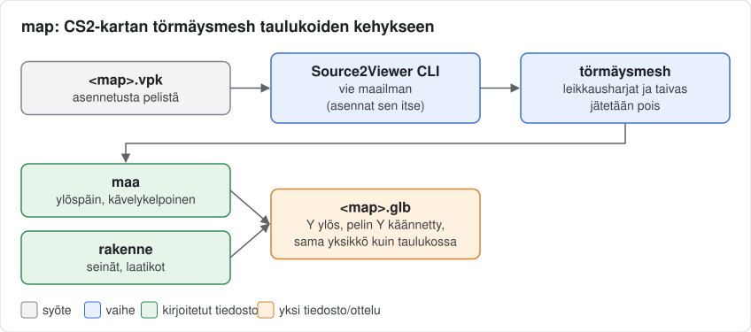

# Kartan vienti (`map`) {#map-export-map}

`python -m heat3d_cs2 map <map> -o <file.glb>` kirjoittaa CS2-kartan tasogeometriana:
maailman **törmäysverkon**, siinä kehyksessä ja yksiköissä, joissa
[lämpökarttataulukot](output-table.md) piirretään. Koodi:
[`heat3d_cs2/mapexport.py`](https://github.com/Holdi601/3DHeat-CS2/blob/main/heat3d_cs2/mapexport.py),
[`heat3d_cs2/glb.py`](https://github.com/Holdi601/3DHeat-CS2/blob/main/heat3d_cs2/glb.py).
Valinnat ja viestit: [Komennot](commands.md#map---kartan-geometria-glb-tiedostona).



## Miksi törmäysverkko {#why-the-collision-mesh}

Törmäysverkko on se, minkä päällä pelaajat seisovat ja jonka taakse he piiloutuvat -
lattiat, seinät, portaat, laatikot - ilman koristeita: ei propseja, jotka vain näyttävät
jotakin, ei tekstuureja, paljon vähemmän kolmioita kuin renderöintiverkoissa. Sitä lämpökartta
tarvitsee alleen: jotain, mihin sijainteja verrataan, ei kartan renderöintiä.

## Miten se saadaan {#how-it-is-obtained}

1. **Löydä kartta.** Polku, joka päättyy `.vpk`:hon ja on olemassa, käytetään sellaisenaan.
   Muuten etsitään `<name>.vpk` kohteesta `<CS2-kansio>\game\csgo\maps\`, missä CS2-kansio
   on `--game`, tai `steamapps\common\Counter-Strike Global Offensive` jokaisesta löydetystä
   Steam-kirjastosta (katso [Asennus](installing.md#mistä-cs2-etsitään)).
2. **Löydä Source2Viewerin CLI**: `--source2viewer`, sitten `HEAT3D_SOURCE2VIEWER`, sitten
   `Source2Viewer-CLI` / `Source2Viewer-CLI.exe` polulla `PATH`.
3. **Vie maailman fysiikka.** Source2Vieweria ajetaan näin:

   ```text
   Source2Viewer-CLI -i <map>.vpk -d -f maps/<map>/world_physics.vmdl_c --gltf_export_format glb -o <temporary folder>
   ```

   Se purkaa Source 2:n käännetyn fysiikan kartan omasta arkistosta ja kirjoittaa mallin
   (tyhjä: maailmalla ei ole omaa renderöintiverkkoa) ja sen fysiikan sen viereen. Suurin
   kirjoitettu `.glb` on fysiikka. Jos Source2Viewer epäonnistuu tai ei kirjoita `.glb`-tiedostoa,
   komento pysähtyy ja näyttää viimeiset 800 merkkiä sen tulosteesta ja virheistä.
4. **Lue se.** Jokainen kohtaus solmu luetaan muunnoksineen (matriisi tai käännös-kierto-skaala),
   ja jokainen kolmioprimitiivi otetaan, indeksipuskurilla tai ilman, maailmakoordinaatteina.
5. **Jätä pois kaikki, mikä ei ole seinä eikä lattia.** Solmu, jonka nimessä on `clip` -
   pelaajaleikkeet, NPC-leikkeet, kranaattileikkeet: näkymättömät seinät, jotka pysäyttävät
   pelaajat ja kranaatit - tai `sky`, kirjainkoosta riippumatta, pudotetaan.
6. **Nimeä pinta.** Fysiikkaryhmät nimetään pinnan mukaan; nimi pienillä kirjaimilla, ilman
   alkuun lisättyä `physics`, `physics_group` tai `physics_passbullets` (ja sen jälkeistä
   alaviivaa), on pinta: `physics_group_concrete` on `concrete`, `physics_passbullets_chainlink`
   on `chainlink`, pelkkä `physics_group` on `world`. Pinnat, joiden läpi luodit menevät,
   säilytetään.
7. **Takaisin pelin kehykseen.** Source2Viewer kirjoittaa glTF:n metreissä, Y ylöspäin: pelin
   (Y, Z, X) kerrottuna 0,0254:llä. Se perutaan - jokainen piste muuttuu pelin (X, Y, Z)
   -koordinaateiksi tuumissa.
8. **Erota maa rakenteesta** kolmio kerrallaan: pinta, jonka normaali osoittaa ylös vähintään
   0,7 (sen Z-komponentti normalisoituna) - rinteet jopa noin 45 asteeseen asti, suunnilleen
   jyrkimmän, jota CS2-pelaaja kävelee - on **maata**; kaikki muu, seinät ja katot mukaan lukien,
   on **rakennetta**.
9. **Katselimen kehykseen.** Jokainen piste kirjoitetaan muodossa (X, Z, -Y): Y ylös, pelin Y
   negatiivisena - kehys, jossa katselin piirtää taulukot, kun se seuraa niiden `heat3d`-vihjeitä.
   Kierto, ei peilaus.
10. **Kirjoita `.glb`.** Jos mitään ei jää (vain leikkeet), komento pysähtyy virheeseen.
    Muuten se tulostaa tiedoston, kartan, kolmioiden määrän, kuinka monta on maata, ja osien määrän.

Mitään tästä ei lue muu kuin kartan oma `.vpk`, eikä Source2Viewerin mitään ole mukana tai kopioitu.

## Tiedosto {#the-file}

glTF 2.0 -binääri (`.glb`), yksi puskuri, kirjoittanut `heat3d_cs2` (`asset.generator`):

| Näkökohta | Mitä |
|---|---|
| Solmut | yksi per osa, kaikki juuressa, ei muunnoksia, kullakin oma verkko samannimisenä |
| Solmujen nimet | `ground:<surface>` tai `structure:<surface>` (`ground:concrete`, `structure:metal`, `structure:world`), nimen mukaan lajiteltuina |
| Primitiivit | yksi per verkko, kolmiot, `POSITION` (float32, min/max) ja `NORMAL` (float32), `uint32`-indeksit |
| Varjostus | tasainen: yksi piste kolmion kulmaa kohden, kullakin kolmion normaali |
| Materiaalit, tekstuurit, UV:t, värit | ei mitään |
| Yksiköt | pelin yksiköt (**tuumat**), ei metrit - toisin kuin glTF olettaa |
| Kehys | pelin (X, Z, -Y): glTF:n Y on pelin korkeus, glTF:n Z on pelin -Y |

Etuliite `ground:` / `structure:` on kaikkien 3DHeat-tason vientien yleissopimus: katselin
ottaa sellaisella nimellä merkityn osan sanasta sanaan sen sijaan, että arvaisi geometriasta,
joten lattiat saavat maavarjostuksen ja seinät rakennepiirroksen ilman mitään luokitusvaihetta.

Koska yksiköt ovat tuumia, toinen glTF-katselin näyttää kartan noin 39 kertaa liian suurena
(se lukee ne metreinä); kerro 0,0254:llä, jos sillä on väliä. 3DHeatissa se on täsmälleen
taulukon alla, koska taulukko on samoissa yksiköissä skaalalla 1.

## Tarkistus, että kehys on oikein {#the-check-that-the-frame-is-right}

Testi `test_players_stand_on_the_exported_floor` (ajetaan vain, kun demo ja Source2Viewer
annetaan, katso [Kehitys](development.md#testit)) vie kartan, jolla demo pelattiin, ottaa
ottelusta 300 satunnaista sijaintinäytettä, ja jokaiselle katsoo suoraan alas korkeimman
maakolmion kohdalta, joka on enintään 4 yksikköä pelaajan jalkojen yläpuolella. Vaaditaan,
että vähintään 98 % näytteistä löytää maan, ja että keskimääräinen korkeus maan yläpuolella
on alle 5 yksikköä. Peilattu kartta epäonnistuu siinä: väärällä akselilla peilatulla kartalla
suuri osa pelaajista seisoo tyhjän päällä. README raportoi tämän tarkistuksen luvut nykyisen
kilpailullisen kartta-allaskiskon kartoista.

## Mitä se ei tee {#what-it-does-not-do}

- Ei renderöintigeometriaa, tekstuureja eikä koristeita - katso ylhäältä *miksi*.
- Viedään vain se, mikä on kartan `world_physics`-mallissa. Liikkuvia osia (ovet) tai
  rikottavia esineitä siinä on, ei ole tarkistettu.
- Ei yksinkertaistamista: 3DHeat-katselin yksinkertaistaa tuontia **Yksinkertaistustavoite**-asetuksellaan.
- Kartat, joita ei ole asennetussa pelissä (työpajakartat muualla levyllä), toimivat, kun niiden
  `.vpk` annetaan polkuna ja se sisältää `maps/<name>/world_physics.vmdl_c`; ei todennettu.
