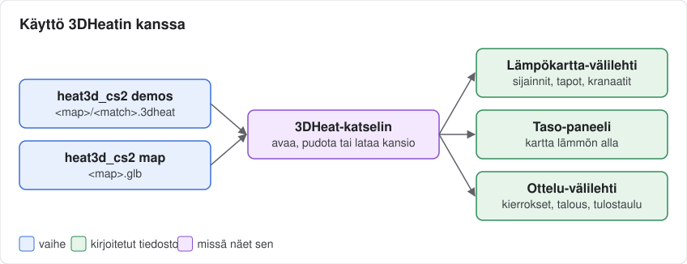

# Käyttö 3DHeatin kanssa {#using-it-with-3dheat}

Tulosteet menevät näihin paikkoihin [3DHeat-katselimessa](https://holdi601.github.io/3DHeat):

| Tiedosto | Missä | Mitä se antaa |
|---|---|---|
| `<match>.3dheat` (oletus) | **Lämpökartta**-välilehti, **Lähde**-paneeli, tai **Ottelu**-välilehti | taulukko ja ottelun asiakirja yhdessä, yksi tiedosto per ottelu ([säilö](https://holdi601.github.io/3DHeat/container.html)) |
| `<match>.parquet` | **Lämpökartta**-välilehti, **Lähde**-paneeli | sijainnit ja tapahtumat lämpökarttana, laatikkotoistona, reitteinä |
| `<match>.match.json` | **Ottelu**-välilehti, **Lataa ottelutiedostot…** | tulostaulu, erät, tappolista, tilastot ottelujen yli, linkit lämpökarttaan |
| `<map>.glb` | **Tausta / kenttä** -paneeli, **3D-malli…** | kartta lämpökartan alla |

Katselimen oma dokumentaatio kuvaa jokaisen välilehden kokonaan: sen
[Ottelu-analyysi](https://holdi601.github.io/3DHeat/match-analysis.html),
[Tiedostojen lataaminen](https://holdi601.github.io/3DHeat/loading-files.html),
[Sarakemääritys](https://holdi601.github.io/3DHeat/column-mapping.html)
ja [Laatikkotoisto](https://holdi601.github.io/3DHeat/box-replay.html) -sivut. Tämä sivu on
sen CS2-puoli.



Katselin: [github.com/Holdi601/3DHeat](https://github.com/Holdi601/3DHeat),
dokumentaatio [holdi601.github.io/3DHeat](https://holdi601.github.io/3DHeat/).

## Tyypillinen käyttökerta {#a-typical-session}

```bash
python -m heat3d_cs2 demos D:\Demos\event -o out
python -m heat3d_cs2 map <map> -o out/<map>/<map>.glb
```

1. **Lämpökartta-välilehti -> Lähde:** valitse kansio `out/<map>` (tai pudota se).
   Jokainen `.parquet` siinä tulee yhdeksi aineistoksi; saman kansion `.json`- ja `.glb`-tiedostot
   ohitetaan "ei csv/parquet-tiedosto" -ilmoituksella. Lataa se.
2. **Tausta / kenttä -> 3D-malli…:** valitse `out/<map>/<map>.glb`.
   **Tallenna kirjastoon** säilyttää sen selaimessa seuraavaa kertaa varten.
3. **Ottelu-välilehti -> Lataa ottelutiedostot…:** valitse saman kansion `.match.json`-tiedostot
   (useita kerralla), tai pudota ne näkymään, kun Ottelu-välilehti on auki.

Lataa kerralla vain yhden kartan taulukot: eri karttojen koordinaatit menevät päällekkäin, ja kahden
kartan lämpökartta yhtä aikaa ei tarkoita mitään. Kansio per kartta on siksi olemassa.

## Taulukko avautuu ilman mitään asetettavaa {#the-table-opens-with-nothing-to-set}

Katselin lukee ensimmäisen valitun tiedoston `heat3d`-alaviitemerkinnän
([Lämpökarttataulukko](output-table.md#heat3d-alaviitevihjeet)) ja asettaa sen omien arvausten
päälle:

| Katselimen asetus | Aseta arvoon |
|---|---|
| Sijainti | `x`, `y`, `z` |
| Ylöspäin osoittava akseli lähteessä | Z on ylhäällä |
| Käännä Y | päällä - jotta kartta on oikein päin, ei peilattuna |
| Yksikön mittakaava | 1 - etäisyydet pelin yksiköissä (merkitty "m", 1 yksikkö = 1 tuuma) |
| Aika | `time`, sekuntia |
| Henkilö | `player` |
| Ryhmä | `side` (T / CT) |
| Istunto | `roundId` - jokainen erä on istunto, `<match> #NN` |
| Katsesuunta | vektori, `dirX` / `dirY` / `dirZ` |
| Suodatinsarakkeet | `event`, `match`, `round`, `roundTime`, `phase`, `weapon`, `place`, `won`, `buy`, `opening`, `team` |
| Olion koko | 32 - laatikkotoisto piirtää pelaajan 32 yksikköä leveänä, katsosäteen ollessa 4 x 32 |

Jokainen vihjattu arvo näkyy yhä sarakemäärityksessä ja sen voi muuttaa. Muut sarakkeet
(`headshot`, `traded`, `other`, `steamid`, `health`, `money`, `damage`, `duration`, ...) voi lisätä
suodattimiksi sinne käsin.

Pidä yksikön mittakaava 1, kun kartta on ladattu: `.glb` on samoissa pelin yksiköissä, eikä kenttää
skaalata taulukon mukana.

### Hyödyllisiä suodattimia {#useful-filters}

- `event` = `position` kertoo, missä pelaajat olivat; `kill` / `death` kertovat, missä duellit
  voitettiin ja hävittiin; `smoke`, `flash`, `molotov`, `he` kertovat, minne apuvälineet osuivat;
  `throw` kertoo, mistä ne heitettiin; `plant` kertoo pommin asetuspaikat.
- `side` (ryhmä) = `T` tai `CT`, `phase` = `live` jättää jälkeisen vaiheen pois, `buy` =
  `eco` / `force` / `full` erille yhdestä taloudesta, `won` = 1 erille, jotka rivin puoli voitti.
- `opening` = 1 yhdessä `kill`- ja `death`-rivien kanssa avausduelleille.
- `roundTime` välinä erän hetkelle: ensimmäiset 20 sekuntia, asetuksen jälkeinen aika.

## Ottelu-välilehti {#the-match-tab}

Ottelu-välilehti hyväksyy JSON-tiedoston, jonka `format` on `heat3d-cs2-match` ja jossa on
taulukot `rounds`, `players` ja `teams` ([Ottelun asiakirja](output-match-json.md)). Se näyttää
tuloksen ja puoliajat, erien nauhan, joka on väritetty voittavan puolen mukaan ja jossa on merkki
siitä, miten kukin päättyi, kunkin erän talouden, asetuksen, tappolistan, clutchit ja selviytyjät,
tulostaulun sekä tilastot kaikista ladatuista otteluista.

Sen **Näytä lämpökartalla** -linkit eivät lataa mitään. Ne asettavat suodattimia jo ladatulle
taulukolle Lämpökartta-välilehdessä - `match`, `round` (ja erän istunto `<match> #NN`), `event`,
pelaaja, puoli. Tämä toimii, koska ottelun asiakirjalla ja taulukolla on samat ottelujen nimet,
erien numerot, pelaajien nimet ja puolet. **Toista erä** vaihtaa lämpökartan laatikkotoistoon ja
toistaa erän istunnon alusta.

Lataa siis molemmat: kartan taulukot Lämpökartta-välilehteen ja niiden ottelun asiakirjat Ottelu-välilehteen.
Ottelun asiakirja ilman taulukkoa näyttää yhä tulostaulun ja erät, ja linkit kertovat, ettei
lämpökarttadataa ole ladattu.

## Ilman 3DHeatia {#without-3dheat}

- Taulukko on tavallista Parquetia: pandas, Polars, DuckDB, Spark ja R:n `arrow` lukevat sen,
  `heat3d`-merkintä jätetään huomiotta, ja tekstisarakkeet lukeutuvat merkkijonoina tai
  kategorioina.
- Ottelun asiakirja on tavallista JSONia.
- Kartta on kelvollinen glTF-binääri, tuumissa eikä metreissä: kerro 0,0254:llä työkaluille, jotka
  olettavat metrit. Sen kehys on glTF:n oma (Y ylös), joten taulukon piirtämiseksi muualla piirrä
  jokainen rivi (x, y, z) muodossa (x, z, -y), kuten 3DHeat tekee.
