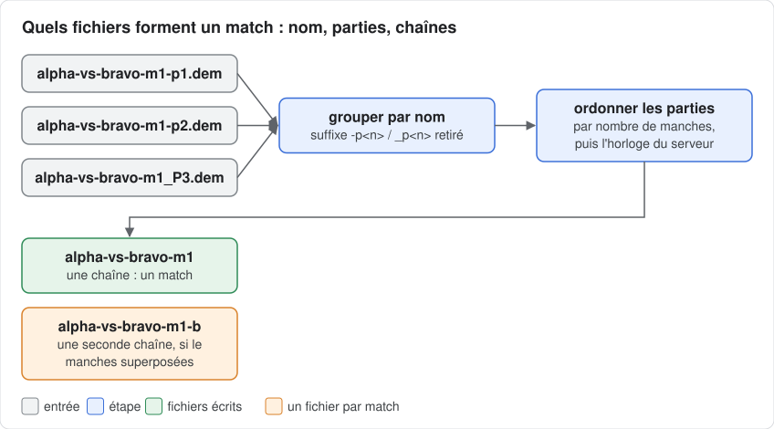

# Construire un match {#building-a-match}

Comment un match est construit à partir de ses parties de démo : quels fichiers vont ensemble, une seule horloge pour tous, les rounds et comment chacun a été gagné, les équipes et leurs camps, et chaque ligne de la table de carte de chaleur avec les kills, trades, ouvertures, dégâts, flashs et économie. Code :
[`heat3d_cs2/match.py`](https://github.com/Holdi601/3DHeat-CS2/blob/main/heat3d_cs2/match.py).
Le tableau des scores calculé à partir de là est sur [Statistiques](statistics.md).

## Vue d'ensemble {#overview}

1. Chaque fichier du nom d'un match est lu ([Lire une démo](reading-demos.md)).
2. Les lignes de joueurs en double de chaque fichier (rounds restaurés) sont résolues.
3. Les fichiers sont triés en **chaînes** - des matchs - et chaque chaîne est mise en ordre.
4. Chaque partie est placée sur l'**horloge du match**.
5. Les **rounds** sont trouvés dans chaque partie ; le récit d'un round donné par une partie plus tardive remplace celui d'une partie antérieure.
6. Les **joueurs** et les **équipes** sont nommés, et les camps et le score de chaque round sont donnés par nom d'équipe. Une fois les camps connus, on en déduit la durée de la mi-temps, les rounds pistolet et l'**achat** de chaque camp.
7. Les **lignes** sont construites : positions, tirs, lancers, détonations, poses, désamorçages, kills, morts, blessures, aveuglements, explosions.
8. Chaque ligne est étiquetée avec son round, sa phase, le temps du round, si son camp a gagné et l'achat de son camp ; les lignes hors de tout round sont supprimées.

## Rounds restaurés : une ligne par joueur et par tick {#restored-rounds-one-row-per-player-per-tick}

Quand un round est restauré depuis une sauvegarde à l'intérieur d'un même fichier, la démo garde pendant quelques secondes les anciens corps des joueurs à côté des nouveaux : deux lignes pour un même joueur au même tick, l'une là où le round annulé les avait laissés, l'autre au point d'apparition du round restauré. Pour chacun de ces joueurs, les ticks dupliqués sont parcourus **à reculons** à partir de la première ligne unique qui suit : à chaque tick, le candidat le plus proche de la position suivante est gardé, et il sert de référence pour le tick précédent. Sans ligne unique après eux, le dernier candidat est gardé. Ainsi chaque joueur garde la ligne qui mène là où il va ensuite.

## La partie en direct d'un fichier {#the-live-part-of-a-file}

Le **début en direct** d'un fichier est le tick de son dernier événement `round_announce_match_start`, ou le tick 0 s'il n'en a pas (une partie tardive d'un match coupé en plusieurs fichiers n'en a en général pas). Tout ce qui précède le début en direct est laissé de côté, de même que tout ce qui porte `is_warmup_period`. Un round de couteau ou un redémarrage avant l'annonce est donc laissé de côté ; un round de couteau *non* suivi d'une annonce de début de match n'est pas reconnu comme tel (voir [Limites](limits.md)).

Les **rounds** d'un fichier sont les événements `round_freeze_end` à partir du début en direct, hors échauffement, identifiés par leur `total_rounds_played` (l'index à partir de 0 du round qui va être joué). Un fichier sans aucun n'a pas de round et n'appartient à aucun match.

## L'horloge {#the-clock}

Les temps sont en secondes. À l'intérieur d'un fichier, le temps se compte en **ticks** : le `game_time` du serveur au premier tick échantillonné, plus les ticks écoulés depuis, divisés par 64. L'horloge propre du serveur s'arrête pendant une pause alors que les ticks continuent ; lue par cette horloge, deux instants d'un match en pause auraient le même temps.

Chaque fichier a une *première horloge* (le temps à son début en direct) et une *dernière horloge* (à son dernier tick échantillonné).

### Parties et chaînes {#parts-and-chains}

Les fichiers nommés comme un même match ([Commandes](commands.md#which-files-are-one-match)) sont d'abord triés par l'index de leur premier round, puis par leur première horloge. Chacun, dans cet ordre, rejoint la première chaîne qu'il prolonge, ou en démarre une nouvelle. Une partie prolonge une chaîne quand son index de premier round est au moins égal à l'index du dernier round de la dernière partie de la chaîne, **et** que l'une de ces deux conditions est vraie :

- l'horloge du serveur continue : sa première horloge n'est pas antérieure à la dernière horloge de la chaîne moins 5 s ; ou
- le compte des rounds continue : son index de premier round est celui qui termine la chaîne ou le suivant.

Le compte des rounds décide, et l'horloge départage : un serveur redémarré pour restaurer un round relance son horloge, alors que deux matchs différents sous un même nom (les mêmes équipes sur la même carte lors de deux événements) ont des comptes de rounds qui se chevauchent. Les chaînes sont classées par nombre de rounds couverts, le plus grand d'abord ; la première garde le nom du match, les autres s'écrivent `<nom>-b`, `<nom>-c`, ...

### L'horloge du match {#the-match-clock}

Le zéro du match est la première horloge de la première partie : **le temps 0 du match est le début en direct du premier fichier**. Chaque partie suivante y est placée :

- là où l'horloge du serveur continue (sa première horloge n'est pas antérieure à la dernière horloge de la partie précédente moins 5 s), l'horloge du serveur est utilisée telle quelle ;
- là où elle a été relancée, la partie est placée pour suivre **une seconde** après la fin de la partie précédente.

## Rounds {#rounds}

Pour chaque `round_freeze_end` d'une partie (dans l'ordre des ticks), la fenêtre du round va jusqu'au freeze end suivant de cette partie, ou jusqu'à la fin du fichier. Dans cette fenêtre, le round est **décidé** au premier tick échantillonné où l'état du jeu montre `total_rounds_played` = l'index du round + 1 et `round_win_status` 1 (égalité), 2 (les T gagnent) ou 3 (les CT gagnent). Un round sans un tel échantillon dans sa fenêtre a été coupé par la fin du fichier ; son numéro va dans la liste **incomplete** du match (sauf si une autre partie a le round complet).

| Champ du round | D'où il vient |
|---|---|
| `number` | l'index + 1 (à partir de 1, comme compte le jeu) |
| `start` | temps du match à la fin du temps de gel - les joueurs peuvent bouger |
| `end` | temps du match du premier échantillon qui montre le round décidé |
| `until` | temps du match du prochain `round_prestart` après `end`, s'il est dans la fenêtre ; sinon la fin de la fenêtre ou le dernier tick du fichier, selon ce qui vient en premier (et jamais avant `end`) |
| `winner` | `T` pour le statut 2, `CT` pour 3, vide pour 1 : une égalité est décidée, sans gagnant |
| `reason` | `round_win_reason` à cet échantillon, nommé comme ci-dessous |
| `score` | nom d'équipe -> rounds gagnés après celui-ci : le `team_rounds_total` de chaque camp à l'échantillon de décision ; quand la démo n'en a pas, le score du round précédent plus un pour le gagnant |
| `sides` | nom d'équipe -> `T` / `CT` pour ce round |
| `equipment` | camp -> la somme des `current_equip_value` des joueurs **vivants** de ce camp au premier échantillon à partir du freeze end |
| `buy` | camp -> `pistol`, `eco`, `force` ou `full` ([Économie](#economy-and-buy-types)) |
| `plant` | le premier `bomb_planted` après le freeze end et jusqu'à `end`, ou aucun |
| `exploded` | temps du match du premier `bomb_exploded` après cette pose et avant le prochain freeze end, s'il existe (pas dans le document du match ; il date la ligne `explode`) |

`reason`, d'après le `CSRoundEndReason` du jeu :

| Code | `reason` |
|---|---|
| 1 | `bomb` (cible explosée) |
| 7 | `defuse` |
| 8, 9 | `elimination` (les CT gagnent / les T gagnent par élimination) |
| 10 | `draw` |
| 12 | `time` (cible sauvée) |
| 17, 18 | `surrender` |
| tout autre | `other` |

Quand plusieurs parties contiennent le même round (même index), la version de la partie la plus tardive est gardée. Les rounds sont ensuite listés par index. Un match dont le premier round n'est pas le round 1 note les numéros manquants (`missing` dans le document du match) ; la ligne de commande affiche *recorded from round N* (enregistré à partir du round N).

### La pose {#the-plant}

| Champ | D'où il vient |
|---|---|
| `site` | `A` ou `B` : la zone de bombe où le jeu dit que le poseur se tenait (`which_bomb_zone`, 1 A, 2 B) ; sans lui, le nom de lieu du poseur (`BombsiteA`, `BombsiteB`) ; sans cela, la lettre qu'une autre pose du même fichier dans la même zone a donnée (le numéro d'entité de la zone est dans l'événement `site`). Vide quand rien ne le dit - jamais le numéro. |
| `time` | secondes **dans le round** (depuis son freeze end), comme le temps d'un kill |
| `player`, `steamid` | le poseur |
| `x`, `y`, `z` | la position du poseur, en unités du jeu : là où la bombe repose |
| `place` | le nom de lieu du poseur au moment de la pose |

### Les phases {#the-phases}

Le temps de `start` à `end` est la phase **en direct** du round ; de `end` à `until`, sa phase **après**, où les gagnants chassent et les perdants économisent. Une ligne appartient au round dont l'intervalle `[start, until)` contient son temps, et est `after` quand son temps est postérieur à `end`. Le temps de gel se situe entre les rounds et n'appartient à aucun.

## Joueurs et équipes {#players-and-teams}

Un **joueur** est toute personne qui a été vivante au moins une fois dans un camp (équipe 2 ou 3), hors temps de gel et échauffement, après le début en direct. Un coach ou un caster du côté d'une équipe n'est jamais vivant et n'est pas un joueur. Chaque joueur est identifié par son Steam ID ; le nom est le dernier vu.

L'**équipe** d'un joueur est le nom de clan que le jeu donne à son camp (`team_clan_name`), celui vu le plus souvent pour lui - la démo efface ce champ à sa toute fin. Un match joué sans noms de clan nomme ses équipes d'après le camp de départ : `Started T` et `Started CT`.

Les **camps** de chaque round viennent de qui était dans quel camp entre le freeze end et la fin du round : chaque camp reçoit le nom d'équipe que la plupart de ses joueurs portent. La liste `teams` du match est dans l'ordre d'apparition, round après round, côté T avant côté CT ; en général, l'équipe qui a commencé côté T est en premier.

## Les lignes {#the-rows}

Chaque échantillon de position et chaque événement devient une ligne de la [table de carte de chaleur](output-table.md). Les joueurs ne sont dans un camp que si leur `team_num` vaut 2 ou 3.

### Positions {#positions}

À partir des lignes échantillonnées des joueurs vivants d'un camp, hors temps de gel et échauffement, après le début en direct : position, direction du regard, vie, armure, argent, valeur de l'équipement, arme tenue, lieu.

La direction du regard est un vecteur unitaire dans le repère du jeu :
`(cos pitch * cos yaw, cos pitch * sin yaw, -sin pitch)` - le pitch du jeu est positif quand on regarde vers le bas, donc regarder vers le bas donne un Z négatif.

L'arme tenue est le `active_weapon_name` tel que le jeu le nomme, sauf que tout nom contenant `Knife`, `Bayonet`, `Karambit` ou `Daggers` devient `Knife`.

### Tirs et lancers {#shots-and-throws}

À partir de `weapon_fire`, à la position du tireur. Les couteaux (`knife`, `bayonet` dans l'identifiant d'arme) et le C4 sont laissés de côté. Les grenades (`smokegrenade`, `flashbang`, `hegrenade`, `molotov`, `incgrenade`, `decoy`) sont des lignes **throw** (lancer), tout le reste des lignes **shot** (tir). L'arme est nommée comme le jeu l'affiche (ci-dessous).

### Détonations de grenades {#grenade-detonations}

| Événement | Ligne | `weapon` |
|---|---|---|
| `smokegrenade_detonate` | `smoke` | Smoke Grenade |
| `flashbang_detonate` | `flash` | Flashbang |
| `hegrenade_detonate` | `he` | High Explosive Grenade |
| `inferno_startburn` (molotov et incendiaire) | `molotov` | Molotov |
| `decoy_detonate` | `decoy` | Decoy Grenade |

La position est **l'endroit où la grenade a explosé** (les `x`, `y`, `z` de l'événement) ; le joueur et le camp sont ceux du lanceur. La démo ne nomme aucun lieu pour une grenade, seulement pour les joueurs : `place` reste donc vide, une ligne ne revendique pas un lieu où elle n'était pas. Le lieu du lanceur à cet instant est gardé comme `throwerPlace`.

### Poses et désamorçages {#plants-and-defuses}

Lignes `plant` et `defuse` à la position du joueur, arme `C4 Explosive`. Une bombe posée qui a explosé reçoit une ligne **explode** : à la position de la pose, au temps de `bomb_exploded`, avec le poseur comme joueur (et son Steam ID), le camp `T`, l'équipe T du round comme `team`, et le lieu de la pose. Cela couvre aussi une bombe qui explose après que les T ont déjà gagné par élimination. Quand la démo n'a pas de `bomb_exploded`, un round gagné par la bombe (`reason` = `bomb`) avec une pose reçoit la ligne à `end` du round.

### Kills et morts {#kills-and-deaths}

Chaque `player_death` d'un round donne un **enregistrement de kill** (la table `kills` du match) avec :

| Champ | Contenu |
|---|---|
| attacker, victim, assister | noms, Steam IDs, camps ; l'attaquant est vide pour le monde (dégâts de chute, la bombe) |
| `weapon` | l'arme de l'événement, nommée comme le jeu l'affiche |
| `headshot` | le drapeau de l'événement |
| `wallbang` | `penetrated` > 0 |
| `throughSmoke` | `thrusmoke` |
| `flashAssist` | `assistedflash` |
| `noscope`, `attackerBlind` | les drapeaux de l'événement (`noscope`, `attackerblind`) ; colonnes des lignes `kill` et `death`, et dans les kills du document du match |
| `suicide` | attaquant et victime sont le même joueur : une grenade à soi, par exemple |
| `teamkill` | attaquant et victime du même camp, avec un attaquant, et pas un suicide |
| `opening` | le premier kill d'un ennemi du round (ci-dessous) |
| `traded`, `trade` | ci-dessous |
| positions | la position et le lieu de l'attaquant et de la victime |

À partir de chaque enregistrement, la table reçoit une ligne **death** à la position de la victime (chaque mort, celles du monde, des teamkills et des suicides comprises) et - pour les kills par un ennemi (un attaquant, pas de teamkill, pas de suicide) - une ligne **kill** à la position du tueur.

**Ouverture.** Le premier kill d'un ennemi dans chaque round, tant que celui-ci est en direct, est son duel d'ouverture. Un teamkill, un suicide ou une mort due au monde avant lui est ignoré, si bien que l'ouverture reste le premier duel du round ; un round sans kill d'ennemi pendant qu'il est en direct n'en a pas.

**Traded** et **trade.** Une mort par un ennemi est **traded** (échangée) quand son tueur est tué par un membre du camp de la victime dans les **5 secondes** qui suivent (plus de 0 et au plus 5 s plus tard, dans le même round) ; le premier kill de ce type est un **trade kill**. Dans la table, la colonne `traded` d'une ligne `kill` vaut 1 pour un trade kill ; celle d'une ligne `death` vaut 1 pour une mort vengée. Les kills de la phase après comptent aussi.

### Dégâts {#damage}

À partir de `player_hurt`, entre **ennemis** seulement (tous deux dans un camp, camps différents). Les dégâts sont la vie réellement **perdue** : pour chaque victime dans chaque round, la vie part de 100 ; chaque coup compte `min(dmg_health, vie avant)`, et la `health` de l'événement (ce qui reste) devient la valeur « avant » du coup suivant. Un headshot de 137 dégâts sur un joueur à 40 points de vie compte 40, comme le compte le tableau des scores du jeu. Les coups de `hegrenade`, `inferno`, `molotov` et `incgrenade` sont des dégâts **d'utilitaire**. Chaque coup est une ligne **hurt** à la position de la victime, l'attaquant en `other`. Les dégâts entre coéquipiers et les dégâts sur soi ne sont ni dans la table ni dans les statistiques.

### Flashs {#flashes}

À partir de `player_blind`, **ennemis** seulement (pas les coéquipiers, ni un coach ou un caster qui regarde) : une ligne **blind** par joueur aveuglé, à la position du joueur flashé, le flasheur en `other`, la durée d'aveuglement en secondes comme `duration`. Chaque durée est gardée ; les statistiques ne comptent que les aveuglements d'au moins une seconde.

## Noms des armes {#weapon-names}

Un identifiant d'arme venant d'un événement (`ak47`, `weapon_ak47`, `knife_karambit`) est affiché comme le jeu le nomme dans le `active_weapon_name` des joueurs, pour que l'arme d'un kill et une arme tenue se lisent de la même façon : `ak47` -> `AK-47`, `m4a1` -> `M4A4`, `m4a1_silencer` -> `M4A1-S`, `hkp2000` -> `P2000`, `taser` -> `Zeus x27`, `inferno` et `molotov` -> `Molotov`, `incgrenade` -> `Incendiary Grenade`, `c4` et `planted_c4` -> `C4 Explosive`, `world` -> `World`, et ainsi de suite pour chaque arme et grenade (la table `WEAPONS` dans `match.py`). Tout identifiant contenant `knife` ou `bayonet` est `Knife`. Un identifiant absent de la table est gardé tel quel.

## Économie et types d'achat {#economy-and-buy-types}

À la fin du temps de gel, la valeur d'équipement de chaque camp est additionnée sur ses joueurs vivants au premier échantillon à partir de là, puis divisée par leur nombre :

| Round | Équipement moyen par joueur | `buy` |
|---|---|---|
| un round pistolet (le premier de chaque mi-temps réglementaire) | peu importe | `pistol` |
| autre | moins de 1 500 $ | `eco` |
| autre | de 1 500 $ à moins de 4 000 $ | `force` |
| autre | 4 000 $ ou plus | `full` |

Les rounds pistolet suivent la mi-temps telle que le match a été joué, et non un format fixe. La mi-temps se termine là où les camps changent de côté pour la première fois entre deux rounds qui se suivent, tous deux en temps réglementaire : sa durée (`halfLength` dans le document du match) est le round qui précède le changement - 12 dans le format à 24 rounds, 15 dans celui à 30. Le round 1 et le round qui suit la mi-temps sont les rounds pistolet. Un round est en prolongation quand le compteur de prolongation du jeu (`m_nOvertimePlaying`) est supérieur à 0 à son freeze end ; là où une démo n'a pas ce compteur, chaque round après deux mi-temps l'est. Les mi-temps de prolongation démarrent avec l'argent que fixe le serveur et n'ont pas de round pistolet, bien que les camps y changent aussi de côté. Un enregistrement qui ne montre jamais le changement de mi-temps - il commence après, ou finit avant - laisse la mi-temps inconnue, et seul le round 1 est un round pistolet.

## Étiquetage et ordre {#labelling-and-order}

Enfin, chaque ligne reçoit :

- `match` - le nom du match ; `map` - la carte de l'en-tête de la démo ;
- `round` et `roundId` (`<match> #NN`, deux chiffres) ;
- `phase` - `live` ou `after` ;
- `roundTime` - secondes depuis la fin du temps de gel du round ;
- `won` - 1 si le camp de la ligne a gagné le round, 0 sinon, vide pour une ligne sans camp ;
- `buy` - l'achat du camp de la ligne pour ce round ;
- `team` - l'équipe du joueur de la ligne, par Steam ID.

Les lignes dont le temps n'appartient à aucun round - avant le freeze end du premier round, pendant le temps de gel, après le dernier round - sont supprimées. Les lignes sont triées par temps, puis par nom d'événement à temps égal.
