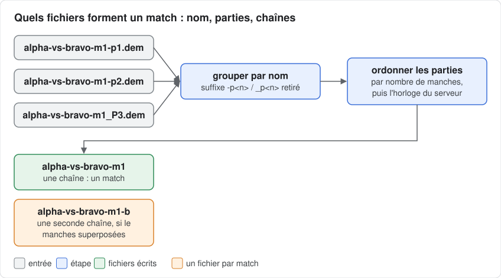

# Commandes {#commands}

Vous débutez avec la ligne de commande ? Lisez d'abord [Avant de commencer](before-you-start.md). Tapez ces commandes dans un terminal ouvert dans le dossier que vous avez décompressé ou cloné ; `<...>` sont des espaces réservés, et un chemin contenant des espaces se met entre guillemets.

```text
python -m heat3d_cs2 demos <fichiers ou dossiers de démo> -o <dossier> [--every 8] [--jobs N] [--map TEXTE] [--force] [--no-bulk] [--loose]
python -m heat3d_cs2 map <nom de la carte ou chemin de son .vpk> -o <fichier.glb> [--game DOSSIER] [--source2viewer EXE]
python -m heat3d_cs2 scoreboard <match.3dheat | match.json>
```

`python -m heat3d_cs2 --help` et `python -m heat3d_cs2 <verbe> --help` listent les mêmes options ; la [Référence des commandes](../cli-reference.md) les montre toutes. Chaque lancement exécute d'abord la vérification de version décrite dans [Mises à jour](updates.md) (désactivable avec `HEAT3D_NO_UPDATE=1`).

Code : [`heat3d_cs2/cli.py`](https://github.com/Holdi601/3DHeat-CS2/blob/main/heat3d_cs2/cli.py).

## `demos` - des démos en tables et documents de match {#demos---demos-into-tables-and-match-documents}

```powershell
python -m heat3d_cs2 demos D:\Demos\event -o out
python -m heat3d_cs2 demos alpha-vs-bravo-m1-p1.dem alpha-vs-bravo-m1-p2.dem -o out
python -m heat3d_cs2 demos D:\Demos -o out --map final --jobs 4
```

| Argument | Défaut | Rôle |
|---|---|---|
| `paths` (un ou plusieurs) | - | fichiers de démo et dossiers. Un fichier est pris quand son extension est `.dem` (quelle que soit la casse). Un dossier est parcouru **récursivement** à la recherche des fichiers se terminant par `.dem`, quelle que soit la casse, dans l'ordre alphabétique. Les démos compressées (`.dem.zst`, `.dem.bz2`, archives) ne sont pas lues : décompressez-les d'abord. |
| `-o`, `--out` | obligatoire | le dossier dans lequel écrire ; créé si besoin |
| `--every N` | `8` | échantillonne chaque joueur tous les *N* ticks. Les démos CS2 tournent à 64 ticks par seconde : 8 donne huit échantillons par seconde, 4 en donne seize, 64 n'en donne qu'un. Les événements sont toujours lus à leur propre tick, quelle que soit la valeur de *N*. |
| `--jobs N` | `0` = la moitié des cœurs du processeur | nombre de matchs convertis en même temps, chacun dans son propre processus. Jamais moins de 1, jamais plus qu'il n'y a de matchs à faire. |
| `--map TEXTE` | - | seulement les matchs dont le **nom** contient *TEXTE*, sans tenir compte de la casse (`--map final`). Le filtre porte sur le nom du fichier, pas sur la carte que la démo contient réellement. |
| `--force` | désactivé | convertit même les matchs déjà écrits, en les remplaçant |
| `--loose` | désactivé | garde chaque match sous forme de fichiers séparés - table, `.match.json`, fichiers annexes - au lieu de les regrouper dans un seul fichier `.3dheat`. Voir [Un fichier par match](output-container.md). |
| `--container` | activé | regroupe chaque match dans un seul fichier `.3dheat` ; c'est la valeur par défaut, l'option n'existe que pour être explicite |
| `--no-bulk` | désactivé | laisse de côté le flux des entités, les commandes des joueurs et le flux d'animation des fichiers annexes de paquets - plus de la moitié de la taille d'une démo, même compressée. L'auto-contrôle du document du match les compte alors comme `lost`, par nom. |


### Quels fichiers forment un même match {#which-files-are-one-match}



Le nom du match est le nom du fichier de démo sans son extension ni son suffixe de partie : `-p<chiffres>` ou `_p<chiffres>` à la fin, quelle que soit la casse. Ainsi `alpha-vs-bravo-m1-p1.dem`, `alpha-vs-bravo-m1-p2.dem` et `alpha-vs-bravo-m1_P3.dem` sont les parties d'un même match, `alpha-vs-bravo-m1`. Les fichiers sont regroupés par ce nom seul : deux fichiers de même nom dans des dossiers différents sont regroupés aussi.

Le suffixe ne dit rien de l'ordre : un `-p2` peut être la première moitié. Les parties sont mises en ordre d'après le nombre de rounds qu'elles contiennent, puis d'après l'horloge du serveur ; un groupe qui s'avère contenir deux matchs différents (les mêmes équipes sur la même carte lors de deux événements, par exemple) est découpé en **chaînes** : la chaîne qui a le plus de rounds est écrite sous le nom lui-même, la suivante sous `<nom>-b`, puis `<nom>-c`, et ainsi de suite. Un fichier sans aucun round (échauffement seul, une pause) n'appartient à aucune chaîne. La manière dont les chaînes sont trouvées est décrite dans [Construire un match](building-matches.md#parts-and-chains).

### Ce qui est écrit {#what-is-written}

Pour chaque match, dans un dossier nommé d'après la carte que l'en-tête de la démo indique (`unknown` quand elle n'en indique aucune), un fichier `.3dheat` :

```text
out/
  de_x/
    alpha-vs-bravo-m1.3dheat
    alpha-vs-bravo-m2.3dheat
  de_y/
    ...
```

Sur la démo synthétique de deux rounds des tests :


Avec `--loose`, chaque match est la table, son document de match et quatre fichiers annexes côte à côte ([Un fichier par match](output-container.md)) :


Une carte de chaleur porte sur une seule carte : charger un dossier dans la visionneuse revient à charger les matchs d'une seule carte. Voir [La table de carte de chaleur](output-table.md) et [Le document du match](output-match-json.md).

### Ce qui est ignoré {#what-is-skipped}

Avant toute lecture, chaque `*.3dheat` présent quelque part sous `--out` (un conteneur est écrit en entier ou pas du tout), ainsi que chaque `*.parquet` accompagné de son document de match (`<nom>.match.json`), sont listés, et un match dont le nom est égal au nom de l'un de ces fichiers (sans extension) est ignoré, sauf avec `--force`. Une table sans son document de match - une exécution arrêtée entre l'écriture des deux - ne compte pas : ce match est donc reconverti. La vérification se fait uniquement par nom : un match converti dans un dossier de carte différent, ou avec un autre `--every`, compte toujours comme fait. S'il n'y a plus rien à faire :

```text
nothing to do: no demos found, or every match already written (--force redoes them)
```

### Ce qui est affiché {#what-is-printed}

D'abord la quantité de travail, puis une ligne par match à mesure qu'il se termine (dans l'ordre où ils se terminent, et non dans l'ordre des fichiers) :

```text
3 match(es), 3 at a time
alpha-vs-bravo-m1: de_x, 21 rounds (Alpha 13 Bravo 8), 412,377 rows, lost 0
alpha-vs-bravo-m2: de_y, 30 rounds (Bravo 16 Alpha 14), 598,104 rows, 1 incomplete round(s) left out, lost 0
alpha-vs-bravo-m3: de_y, 18 rounds (Alpha 13 Bravo 5), 330,981 rows, recorded from round 3, lost 1,204,331 (svc_PacketEntities, svc_UserCmds, DEM_AnimationData)
```

(Les chiffres sont illustratifs.) Le score est celui du dernier round, équipe par équipe dans l'ordre où le document du match les liste. *incomplete round(s) left out* compte les rounds qu'une démo a coupés avant qu'ils ne soient décidés ; *recorded from round N* indique que l'enregistrement commence tard ; *lost* est l'auto-contrôle du document du match - combien d'éléments de la démo n'ont mené nulle part, et de quels types (`--no-bulk` rend le bulk perdu). Un match qui ne donne rien l'explique :

```text
alpha-vs-bravo-m4: no round in 1 file(s) - nothing written
alpha-vs-bravo-m4-b: no complete round in 1 file(s) - nothing written
```

Une erreur dans un match n'arrête pas les autres ; elle est affichée sous la forme `<nom>: failed - <erreur>`.

### Code de sortie {#exit-code}

`0` quand tous les matchs ont été convertis (ou quand il n'y avait rien à faire), `1` quand au moins un a échoué.

### Durée {#how-long-it-takes}

Chaque match est lu et construit dans un processus de travail. Un dossier de quelques centaines de démos prend quelques minutes avec `--jobs` par défaut. La mémoire par tâche croît avec la durée du match et avec un `--every` plus petit : chaque travailleur garde chaque ligne de joueur échantillonnée de son match (environ dix joueurs fois 64 / *N* lignes par seconde d'enregistrement) avant d'écrire.

Les fichiers annexes prennent plus de temps que la table : chaque propriété lue par l'analyseur est lue à chaque tick, par fenêtre de ticks (environ deux minutes pour une démo de 40 minutes, près de 3 Go de mémoire au maximum par tâche), puis la démo est parcourue encore une fois pour ses images et ses messages.

## `map` - la géométrie d'une carte en `.glb` {#map---a-maps-geometry-as-glb}


```powershell
python -m heat3d_cs2 map <carte> -o out/<carte>/<carte>.glb
python -m heat3d_cs2 map <carte> -o <carte>.glb --game "D:\Games\Steam\steamapps\common\Counter-Strike Global Offensive"
python -m heat3d_cs2 map "D:\maps\<carte>.vpk" -o <carte>.glb --source2viewer C:\Tools\Source2Viewer-CLI.exe
```

| Argument | Défaut | Rôle |
|---|---|---|
| `name` | - | le nom de la carte (comme `de_x`), ou le chemin de son `.vpk`. Un chemin finissant par `.vpk` qui existe est utilisé tel quel ; tout le reste est cherché par son nom de base dans le jeu installé. |
| `-o`, `--out` | obligatoire | le `.glb` à écrire ; son dossier est créé si besoin |
| `--game DOSSIER` | les bibliothèques Steam | le dossier d'installation de CS2 (celui qui contient `game\csgo`), quand Steam ne le connaît pas. Avec `--game`, seul ce dossier est cherché. |
| `--source2viewer EXE` | `HEAT3D_SOURCE2VIEWER`, puis `PATH` | l'exécutable de l'interface en ligne de commande de Source2Viewer |

Affiché en cas de succès :

```text
out/de_x/de_x.glb: de_x, 412,880 triangles (151,204 ground) in 14 parts
```

(chiffres illustratifs). Écrire le `.glb` à côté des tables de la carte (`out/<carte>/<carte>.glb`) garde les données et la géométrie d'une carte dans un même dossier. Fonctionnement de l'export : [Export de la carte](map-export.md).

Erreurs, chacune affichée sous la forme `error: ...` avec le code de sortie `2` :

| Message | Signification |
|---|---|
| `no de_x.vpk found in an installed CS2 - pass --game <CS2 folder> or the .vpk path` | la carte ne se trouve dans aucune bibliothèque Steam trouvée, ou le nom est faux |
| `Source2Viewer-CLI not found: ...` | ni `--source2viewer`, ni `HEAT3D_SOURCE2VIEWER`, ni `PATH` ne donne un fichier existant |
| `Source2Viewer did not export de_x's collision mesh:` suivi de la fin de sa sortie | il a échoué, ou n'a écrit aucun `.glb` |
| `de_x's collision mesh has nothing but clip brushes` | une fois les clips et le ciel retirés, il ne reste rien |

## `scoreboard` - un match en texte {#scoreboard---a-match-as-text}

```bash
python -m heat3d_cs2 scoreboard out/de_x/alpha-vs-bravo-m1.3dheat
python -m heat3d_cs2 scoreboard out/de_x/alpha-vs-bravo-m1.match.json   # après demos --loose
```

Affiche le tableau des scores du match à partir de son [document de match](output-match-json.md), sans ouvrir la visionneuse. Il lit le document à l'intérieur d'un conteneur `.3dheat`, ou un `<match>.match.json` séparé.
Sur la démo synthétique de deux rounds des tests :


```text
alpha-vs-bravo-m1 - de_test  Alpha 2  Bravo 0

Alpha
player                 K   D   A  +/-    ADR   KAST   HS%  OK-OD  clutch
ash                    1   0   0   +1   50.0 100.0%    0%   0-0     1/1
ace                    1   1   0   +0   50.0 100.0%  100%   1-0     0/0

Bravo
player                 K   D   A  +/-    ADR   KAST   HS%  OK-OD  clutch
ben                    1   1   0   +0   50.0 100.0%    0%   0-0     0/1
bob                    0   1   0   -1    0.0 100.0%    0%   0-1     0/0

rounds  1:TK 2:TB
```

- La première ligne : nom du match, carte, et score final par équipe.
- Un tableau par équipe, dans l'ordre des `teams` du document de match ; les joueurs dans l'ordre du document (par kills moins morts, puis kills, du meilleur au moins bon). Les noms sont coupés à 19 caractères.
- Colonnes : **K** kills, **D** morts, **A** assistances *y compris* les assistances au flash, **+/-** kills moins morts, **ADR**, **KAST** (%), **HS%** (arrondi au pour-cent), **OK-OD** ouvertures gagnées - ouvertures perdues, **clutch** clutchs gagnés / clutchs joués. Définitions : [Statistiques](statistics.md).
- La bande des rounds : `<round>:<camp gagnant><comment>`, avec **B** bombe explosée, **D** désamorcée, **K** élimination, **T** temps écoulé, et **?** pour tout le reste (égalité, reddition, autre). Une égalité n'a pas de camp gagnant : `<round>:?`.

Un fichier qui n'est pas du JSON valide, ou introuvable, arrête la commande avec une erreur ; un document JSON sans les champs du document de match échoue avec une erreur Python (il n'est pas validé davantage).
