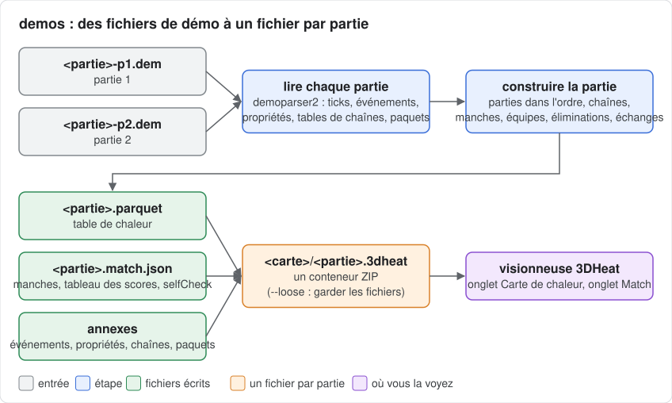

# 3DHeat CS2 {#dheat-cs2}

**Qu'est-ce que c'est ?** Counter-Strike 2 peut enregistrer une partie, appelée une
*démo*. Cet outil transforme une démo en fichiers que la visionneuse 3DHeat peut afficher en 3D :
où chacun se tenait, est mort, a lancé et posé, manche par manche. Il peut aussi
transformer une carte de CS2 en modèle 3D pour les y montrer.

**À quoi ça sert ?** À revoir vos propres parties, à superposer plusieurs parties d'une même carte
en une seule carte de chaleur, et pour les statistiques de match comme l'ADR (dégâts moyens par manche)
et le KAST (la part des manches où un joueur a tué, aidé, survécu ou été échangé).

**Exemple :** `alpha-vs-bravo-m1.dem` en entrée, `out/de_x/alpha-vs-bravo-m1.3dheat`
en sortie (`de_x` est un nom de carte inventé).



En détail : 3DHeat CS2 transforme les **démos de Counter-Strike 2** en une table de carte de chaleur et un
document de partie par match, et une **carte CS2** en géométrie de niveau. Les sorties sont conçues
pour la visionneuse de télémétrie [3DHeat](https://holdi601.github.io/3DHeat/)
([source](https://github.com/Holdi601/3DHeat)), mais ce sont des fichiers ordinaires - Parquet,
JSON et glTF binaire - que n'importe quel autre outil peut lire.

C'est un petit paquet Python, `heat3d_cs2`, lancé depuis la ligne de commande. Il lit les démos
depuis le disque (il n'en télécharge aucune) avec
[demoparser2](https://github.com/LaihoE/demoparser), et exporte les cartes depuis le jeu installé avec
la version en ligne de commande de Source2Viewer
([ValveResourceFormat](https://github.com/ValveResourceFormat/ValveResourceFormat)).

## Démarrage rapide {#quick-start}

Vous débutez avec la ligne de commande ? Lisez d'abord [Avant de commencer](before-you-start.md).

```bash
pip install -r requirements.txt
python -m heat3d_cs2 demos <fichiers ou dossiers de démo> -o out   # chaque partie qu'ils contiennent
python -m heat3d_cs2 map <carte> -o out/<carte>/<carte>.glb         # la carte du jeu installé
python -m heat3d_cs2 scoreboard out/<carte>/<partie>.3dheat         # le tableau des scores d'une partie, en texte
```

Vous devez voir `1 match(es), 1 at a time ...` puis une ligne par partie
(voir [Commandes](../commands.md#ce-qui-est-affiche)).

`demos` écrit, pour chaque partie, un fichier dans un dossier portant le nom de la carte :
`out/<carte>/<partie>.3dheat`, un [conteneur `.3dheat`](../output-container.md) - le format
d'un fichier par partie de la visionneuse ([spécification](https://holdi601.github.io/3DHeat/container.html)).
Il contient ces éléments ; `--loose` les écrit à la place sous forme de fichiers séparés :

| Élément | Ce qu'il contient | Chargé dans |
|---|---|---|
| `<partie>.parquet` (rôle `table`) | chaque joueur vivant huit fois par seconde avec son état (santé, argent, flash, visée, zone, inventaire...), et chaque événement là où il s'est produit (élimination, mort, blessure, tir, lancer, explosions de grenades, aveuglement, pose et désamorçage de bombe, explosion, et une fin de manche par joueur avec ce que la manche lui a rapporté), une ligne chacun | onglet Carte de chaleur |
| `<partie>.match.json` (rôle `match`, le document de partie) | équipes, score, chaque manche (vainqueur, mode, économie, pose, éliminations dans l'ordre, clutches, survivants) et la ligne du tableau des scores de chaque joueur | onglet Match |
| `<partie>.events/props/strings/packets.parquet` | tout le reste de la démo, en entier (fichiers annexes) | conservé pour l'exhaustivité |

`map` écrit `<carte>.glb` : le maillage de collision de la carte - sols, murs, caisses,
sans décoration - séparé en sol et structure, dans le même repère et les mêmes unités que les tables, pour se
poser exactement sous la carte de chaleur (panneau Arrière-plan / niveau).

## Carte de la documentation {#map-of-this-documentation}

| Page | Ce qu'elle couvre |
|---|---|
| [Avant de commencer](before-you-start.md) | Python, un terminal, les espaces réservés, à quoi ressemblent la réussite et les erreurs courantes |
| [Installation](../installing.md) | Python, les paquets, l'interface en ligne de commande de Source2Viewer, l'emplacement de CS2 |
| [Commandes](../commands.md) | `demos`, `map`, `scoreboard` : chaque option, ce qui est affiché, codes de sortie |
| [Lire une démo](../reading-demos.md) | ce qui est lu dans un fichier de démo : ticks échantillonnés, propriétés des joueurs, règles du jeu, événements |
| [Construire une partie](../building-matches.md) | parties et chaînes, l'horloge du match, les manches, les équipes et les camps, les lignes, éliminations, échanges, ouvertures, dégâts, flashs, économie |
| [Statistiques](../statistics.md) | le tableau des scores : K/D/A, ADR, KAST, HS%, ouvertures, échanges, multi-éliminations, clutches, utilitaires, flashs |
| [La table de carte de chaleur](../output-table.md) | le fichier Parquet : chaque colonne, son type, les événements qui la remplissent, les indices du pied `heat3d`, les axes |
| [Le document de partie](../output-match-json.md) | le document `.match.json`, champ par champ |
| [Un fichier par partie](../output-container.md) | le conteneur `.3dheat` que `demos` écrit par défaut, `--loose` |
| [Export de carte](../map-export.md) | comment le maillage de collision d'une carte est exporté, le repère, le nommage des nœuds, les unités |
| [Utilisation avec 3DHeat](../using-with-3dheat.md) | charger les tables, les documents de partie et les cartes dans les onglets Carte de chaleur et Match de la visionneuse |
| [Limites](../limits.md) | ce qui est supposé, ce qui n'est pas géré, ce qui n'est pas vérifié |
| [Mises à jour](../updates.md) | la vérification de version au démarrage et `python -m heat3d_update` |
| [Développement](../development.md) | organisation du code, tests, la démo synthétique de test |
| [Référence des commandes](../cli-reference.md) | le `--help` de chaque commande, généré depuis le code |
| [Maintenir ces documents](../maintaining.md) | la liste de contrôle des versions pour ces pages |

## Ce à quoi il est confronté {#what-it-is-checked-against}

Les démos rencontrées dans la nature ne sont pas un fichier propre par partie. Le convertisseur gère une
partie répartie sur plusieurs fichiers dans n'importe quel ordre, un serveur redémarré en cours de partie, deux
parties différentes enregistrées sous un même nom, des manches restaurées depuis une sauvegarde, un enregistrement qui
commence tard ou se termine tôt, les pauses, et les coachs du côté d'une équipe -
voir [Construire une partie](../building-matches.md). Vérifié sur une grande collection
de démos de tournoi : dans chaque partie, le score suit les vainqueurs des manches, les éliminations
de chaque camp sont les morts de l'autre, et chaque manche commence à cinq contre cinq.

## À quoi le diriger {#what-to-point-it-at}

Les démos de vos propres parties, les démos que vous avez téléchargées à la main depuis un site de tournoi,
ou les démos d'une API à laquelle vous avez accès. Une démo est un enregistrement dont le contenu
appartient à son éditeur et à ses organisateurs : utilisez ce qui en sort pour votre propre
analyse, et ne redistribuez ni les démos ni les données qui en sont tirées. Les sites qui
proposent des démos interdisent souvent, dans leurs conditions, le téléchargement automatisé ; c'est pourquoi
l'outil lit les démos depuis le disque et n'en télécharge aucune.

## Partie de 3DHeat {#part-of-3dheat}

3DHeat CS2 est l'un des outils gratuits qui entourent la visionneuse 3DHeat, chacun avec son propre
dépôt, ses versions et sa licence :

| Outil | Ce qu'il fait | Documentation |
|---|---|---|
| [3DHeat](https://github.com/Holdi601/3DHeat) | la visionneuse : cartes de chaleur, analyse de course et revue de partie en 3D | [site](https://holdi601.github.io/3DHeat/) |
| [GameFiles](https://github.com/Holdi601/3DHeat-GameFiles) | circuits et niveaux tirés des fichiers livrés par les jeux, en modèles 3D | [site](https://holdi601.github.io/3DHeat-GameFiles/) |
| [GameCapture](https://github.com/Holdi601/3DHeat-GameCapture) | télémétrie de tour des jeux de course ; niveaux reconstruits à partir de vidéos de jeu | [site](https://holdi601.github.io/3DHeat-GameCapture/) |
| [Unreal Exporter](https://github.com/Holdi601/3DHeat-UnrealExporter) | un plugin de l'éditeur Unreal qui exporte un niveau en un modèle 3D | [site](https://holdi601.github.io/3DHeat-UnrealExporter/) |
| [CS2](https://github.com/Holdi601/3DHeat-CS2) | démos de Counter-Strike 2 en tables et documents de partie ; cartes en modèles 3D | [site](https://holdi601.github.io/3DHeat-CS2/) |
| [Watcher](https://github.com/Holdi601/3DHeat-Watcher) | enregistre en arrière-plan ce que les jeux publient sur votre jeu | [site](https://holdi601.github.io/3DHeat-Watcher/) |
| [Ext-WarThunder](https://github.com/Holdi601/3DHeat-Ext-WarThunder) | replays de War Thunder en tables et documents de partie | [site](https://holdi601.github.io/3DHeat-Ext-WarThunder/) |
| [Ext-WoT](https://github.com/Holdi601/3DHeat-Ext-WoT) | replays de World of Tanks en tables et documents de partie | [site](https://holdi601.github.io/3DHeat-Ext-WoT/) |
| [Ext-WoWs](https://github.com/Holdi601/3DHeat-Ext-WoWs) | replays de World of Warships en tables et documents de partie | [site](https://holdi601.github.io/3DHeat-Ext-WoWs/) |
| [Ext-Squad](https://github.com/Holdi601/3DHeat-Ext-Squad) | démos de serveurs Squad en tables et documents de partie | [site](https://holdi601.github.io/3DHeat-Ext-Squad/) |
| [Ext-DCS](https://github.com/Holdi601/3DHeat-Ext-DCS) | cartes de DCS World en modèles 3D | [site](https://holdi601.github.io/3DHeat-Ext-DCS/) |
| [Ext-IL2](https://github.com/Holdi601/3DHeat-Ext-IL2) | cartes d'IL-2 Sturmovik en modèles 3D | [site](https://holdi601.github.io/3DHeat-Ext-IL2/) |

## Licence {#licence}

MIT - voir [`LICENSE`](https://github.com/Holdi601/3DHeat-CS2/blob/main/LICENSE),
et [`LICENSES.md`](https://github.com/Holdi601/3DHeat-CS2/blob/main/LICENSES.md)
pour les paquets tiers et ce qu'imposent les jeux qu'il lit.
