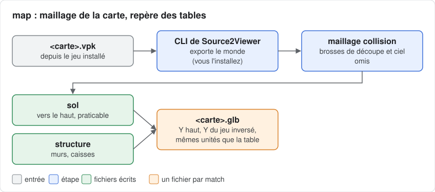

# Export de la carte (`map`) {#map-export-map}

`python -m heat3d_cs2 map <carte> -o <fichier.glb>` écrit une carte CS2 sous forme de géométrie de niveau : le **maillage de collision** du monde, dans le repère et les unités dans lesquels les [tables de carte de chaleur](output-table.md) sont dessinées. Code :
[`heat3d_cs2/mapexport.py`](https://github.com/Holdi601/3DHeat-CS2/blob/main/heat3d_cs2/mapexport.py),
[`heat3d_cs2/glb.py`](https://github.com/Holdi601/3DHeat-CS2/blob/main/heat3d_cs2/glb.py).
Options et messages : [Commandes](commands.md#map---a-maps-geometry-as-glb).



## Pourquoi le maillage de collision {#why-the-collision-mesh}

Le maillage de collision est ce sur quoi les joueurs marchent et derrière quoi ils se cachent - sols, murs, escaliers, caisses - sans la décoration : pas de props qui ne font que ressembler à quelque chose, pas de textures, bien moins de triangles que les maillages de rendu. C'est ce qu'il faut à une carte de chaleur : quelque chose sur quoi lire les positions, et non un rendu de la carte.

## Comment il est obtenu {#how-it-is-obtained}

1. **Trouver la carte.** Un chemin finissant par `.vpk` qui existe est utilisé tel quel. Sinon, `<nom>.vpk` est cherché dans `<dossier CS2>\game\csgo\maps\`, où le dossier CS2 est `--game`, ou `steamapps\common\Counter-Strike Global Offensive` dans chaque bibliothèque Steam trouvée (voir [Installation](installing.md#where-cs2-is-looked-for)).
2. **Trouver l'interface en ligne de commande de Source2Viewer** : `--source2viewer`, puis `HEAT3D_SOURCE2VIEWER`, puis `Source2Viewer-CLI` / `Source2Viewer-CLI.exe` dans `PATH`.
3. **Exporter la physique du monde.** Source2Viewer est lancé ainsi :

   ```text
   Source2Viewer-CLI -i <map>.vpk -d -f maps/<map>/world_physics.vmdl_c --gltf_export_format glb -o <temporary folder>
   ```

   Il décode la physique compilée de Source 2 depuis l'archive propre à la carte et écrit le modèle (vide : le monde n'a pas de maillage de rendu propre) ainsi que sa physique à côté. Le plus grand `.glb` écrit est la physique. Si Source2Viewer échoue ou n'écrit aucun `.glb`, la commande s'arrête et affiche les 800 derniers caractères de sa sortie et de ses erreurs.
4. **Le lire.** Chaque nœud de la scène est parcouru avec sa transformation (matrice, ou translation-rotation-échelle), et chaque primitive de triangles est prise, avec ou sans tampon d'index, en positions du monde.
5. **Retirer ce qui n'est ni un mur ni un sol.** Un nœud dont le nom contient `clip` - clips de joueurs, clips de PNJ, clips de grenades : les murs invisibles qui arrêtent joueurs et grenades - ou `sky`, quelle que soit la casse, est supprimé.
6. **Nommer la surface.** Les groupes de physique sont nommés d'après leur surface ; le nom en minuscules, sans le préfixe `physics`, `physics_group` ou `physics_passbullets` (et le tiret bas qui suit), est la surface : `physics_group_concrete` donne `concrete`, `physics_passbullets_chainlink` donne `chainlink`, et un `physics_group` seul donne `world`. Les surfaces que les balles traversent sont gardées.
7. **Revenir au repère du jeu.** Source2Viewer écrit du glTF en mètres avec Y vers le haut : le (Y, Z, X) du jeu multiplié par 0,0254. On l'annule - chaque point devient le (X, Y, Z) du jeu, en pouces.
8. **Séparer le sol de la structure**, triangle par triangle : une face dont la normale pointe vers le haut d'au moins 0,7 (sa composante Z, normalisée) - pentes jusqu'à environ 45 degrés, à peu près la pente la plus raide qu'un joueur de CS2 puisse marcher - est du **sol** ; tout le reste, murs et plafonds compris, est de la **structure**.
9. **Dans le repère du visualiseur.** Chaque point est écrit sous la forme (X, Z, -Y) : Y vers le haut, Y du jeu inversé - le repère dans lequel le visualiseur dessine les tables, quand il suit leurs indications `heat3d`. C'est une rotation, pas un miroir.
10. **Écrire le `.glb`.** Si rien ne reste (seulement des clips), la commande s'arrête avec une erreur. Sinon elle affiche le fichier, la carte, le nombre de triangles, combien sont du sol, et le nombre de parties.

Rien ici ne lit autre chose que le `.vpk` propre à la carte, et rien de Source2Viewer n'est fourni ni copié.

## Le fichier {#the-file}

Un binaire glTF 2.0 (`.glb`), un seul tampon, écrit par `heat3d_cs2` (le `asset.generator`) :

| Aspect | Contenu |
|---|---|
| Nœuds | un par partie, tous à la racine, sans transformation, chacun avec son propre maillage du même nom |
| Noms des nœuds | `ground:<surface>` ou `structure:<surface>` (`ground:concrete`, `structure:metal`, `structure:world`), triés par nom |
| Primitives | une par maillage, triangles, `POSITION` (float32, avec min/max) et `NORMAL` (float32), indices `uint32` |
| Ombrage | plat : un sommet par coin de triangle, portant chacun la normale de son triangle |
| Matériaux, textures, UV, couleurs | aucun |
| Unités | unités du jeu (**pouces**), pas des mètres - contrairement à ce que suppose glTF |
| Repère | (X, Z, -Y) du jeu : le Y de glTF est la hauteur du jeu, le Z de glTF est le -Y du jeu |

Le préfixe `ground:` / `structure:` est la convention de tous les exporteurs de niveaux 3DHeat : le visualiseur prend au mot une partie nommée ainsi au lieu de deviner depuis la géométrie, donc les sols reçoivent l'ombrage de sol et les murs le dessin de structure, sans étape de classement.

Comme les unités sont des pouces, un autre visualiseur glTF affiche la carte environ 39 fois trop grande (il lit les unités comme des mètres) ; multipliez par 0,0254 là si c'est important. Dans 3DHeat, elle se place exactement sous la table, qui est dans les mêmes unités avec une échelle de 1.

## La vérification que le repère est juste {#the-check-that-the-frame-is-right}

Le test `test_players_stand_on_the_exported_floor` (lancé seulement quand une démo et Source2Viewer sont fournis, voir [Développement](development.md#tests)) exporte la carte sur laquelle une démo a été jouée, prend 300 échantillons de position aléatoires du match, et pour chacun regarde droit vers le bas le triangle de sol le plus haut, à 4 unités au plus au-dessus des pieds du joueur. Il exige qu'au moins 98 % des échantillons trouvent du sol, et que la hauteur médiane au-dessus de celui-ci soit inférieure à 5 unités. Une carte en miroir échoue : sur une carte mise en miroir par le mauvais axe, une grande part des joueurs se tiennent au-dessus de rien. Le README donne les chiffres de cette vérification sur les cartes du pool compétitif actuel.

## Ce qu'il ne fait pas {#what-it-does-not-do}

- Pas de géométrie de rendu, ni de textures ou de décoration - voir *pourquoi* plus haut.
- Seul ce qui se trouve dans le modèle `world_physics` de la carte est exporté. La présence des parties mobiles (portes) ou des éléments destructibles dans ce modèle n'a pas été vérifiée.
- Pas de simplification : le visualiseur 3DHeat simplifie à l'import avec son réglage **Cible de simplification**.
- Les cartes absentes du jeu installé (cartes d'atelier ailleurs sur le disque) fonctionnent quand leur `.vpk` est passé comme chemin et contient `maps/<nom>/world_physics.vmdl_c` ; non vérifié.
